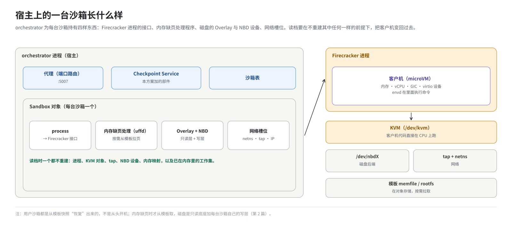
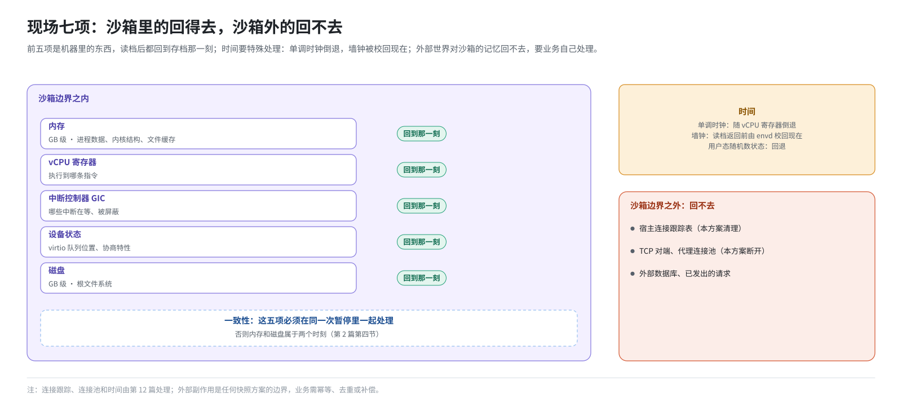
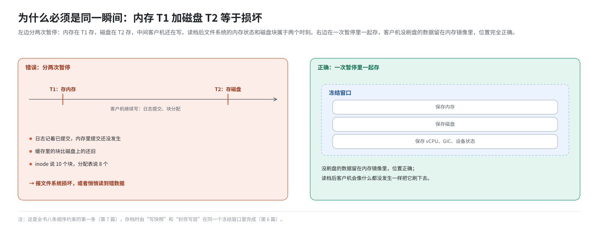

# 第 2 篇｜基础一：一台沙箱的“现场”由什么组成

> **本篇目标**：要给一台机器存档，先得知道“存”的是什么。本篇从“沙箱为什么是一台虚拟机”讲起，认识 KVM、Firecracker 和 E2B 的沙箱长什么样；然后把一台沙箱的“现场”拆成七项，说清楚哪些回得去、哪些回不去；最后讲两件贯穿全书的事：为什么这七项必须在**同一瞬间**存下来，以及“重建”和“原地”两种恢复方式的区别。

---

## 一、从进程到虚拟机

### 1. 为什么沙箱是一台虚拟机

AI Agent 生成的代码，平台事先无法审查，只能当作“不可信的任意代码”。要在一台服务器上同时跑很多份这样的代码，彼此不能互相干扰，更不能影响宿主机。常见的隔离方式有三种：

| | 容器 | 传统虚拟机 | microVM（轻量虚拟机） |
|---|---|---|---|
| 隔离边界 | 和宿主**共用一个内核**，靠内核的命名空间、资源限制隔开 | 自己的内核，硬件虚拟化隔开 | 自己的内核，硬件虚拟化隔开 |
| 内核有漏洞时 | 可能逃逸到宿主 | 被硬件边界挡住 | 被硬件边界挡住 |
| 启动 | 最快 | 慢，要走固件、枚举一堆设备 | 快，几乎只剩加载内核 |
| 设备 | 用宿主的 | 完整模拟：BIOS、PCI、显卡、USB…… | 只有几个最简单的虚拟设备 |

容器共用内核，风险太大；传统虚拟机太重。microVM 就是为这个空隙设计的：保留硬件隔离，把设备砍到最少。E2B 的每一台沙箱就是一台 microVM。

### 2. KVM：让 CPU 直接跑客户机

虚拟机里的程序不是被“模拟”着一条条解释执行的，而是**直接在真实的 CPU 上跑**。做到这一点靠的是 CPU 的硬件虚拟化能力，以及 Linux 内核里的 **KVM** 模块。

可以这样理解：KVM 让一个普通的宿主进程能对 CPU 说“现在切换到客户机模式，从这个地址开始执行”。客户机里的程序全速运行，直到碰到一些必须由宿主处理的事情（比如访问一个虚拟设备），CPU 才“退出”回宿主，宿主处理完再切回去。这种退出叫 **VM-Exit**，或者叫“陷出”。它有代价，退出越频繁，客户机越慢。第 8 篇讲脏页跟踪时会反复用到这个概念。

客户机的内存，在宿主看来就是这个宿主进程地址空间里的一大段普通内存。客户机以为自己拥有从 0 开始的一整块物理内存，这个地址叫**客户机物理地址**（GPA）；它实际落在宿主进程的某一段虚拟地址上。客户机写内存，就是直接写宿主进程的这段内存，**不经过任何宿主代码**。记住这一点：宿主上的程序“看不见”客户机在写什么，所以“哪些页被写过”必须靠硬件或内核帮忙记录。

### 3. Firecracker：一个极简的虚拟机外壳

KVM 只管 CPU 和内存，虚拟机还需要一个用户态程序来创建它、给它模拟设备、管理它的生命周期。这个程序叫 **VMM**（虚拟机监控器）。E2B 用的 VMM 是 **Firecracker**，一个用 Rust 写的开源项目。每台沙箱对应宿主上一个 Firecracker 进程。

Firecracker 砍掉的东西比保留的多：没有 BIOS，直接加载 Linux 内核；没有 PCI 总线，只用最简单的 virtio-mmio；设备只有网卡（virtio-net）、磁盘（virtio-block）、随机数（virtio-rng）和串口；启动时设备就固定了，不支持热插拔。

这对快照是好消息。设备越少，“一台虚拟机的状态”就越简单。除了内存，其他所有状态加起来通常只有几十 KB。**内存是绝对的大头**，一台 2 GiB 的沙箱就有 2 GiB 内存。所以后面几乎所有的优化，都是在优化“内存怎么存、怎么读回来”。

Firecracker 通过一个本地的 unix socket 提供 HTTP 接口，宿主上的程序向它发请求：暂停、恢复、打快照……本方案在这套接口上加了三处扩展，第 11 篇细讲。

## 二、E2B 的沙箱长什么样

只讲本书用得到的几点。

**模板与沙箱。** 用户先定义一个模板（类似 Dockerfile），E2B 把它构建出来，产物是三份文件：内存镜像 `memfile`、根文件系统镜像 `rootfs`、记录 CPU 和设备状态的 `snapfile`。这三份东西本身就是一个快照。用户每次开沙箱，E2B 都是从这个快照**恢复**出一台新机器，而不是从头开机。这是 E2B 开沙箱能在一秒内完成的原因。

**内存按需拉取。** 模板的内存镜像可能有几个 GB，通常不在本地。E2B 不会先把它整个下载下来，而是借助 Linux 的 **userfaultfd**（简称 uffd）机制：客户机第一次访问某一页时会发生“缺页”，内核把这件事交给 orchestrator 里的一个处理程序，由它去取这一页的内容填进去。用到哪页取哪页。这个机制对本方案有两处影响：模板内存镜像在本地不一定有，读档不能依赖它（第 9 篇“全量根”）；原生快照用 uffd 判断脏页，在 ARM 上出了问题（第 4、15 篇）。

**磁盘分层。** 模板的 rootfs 是只读的底座，每台沙箱在上面盖一层自己的**写层**。客户机的所有写都落进写层，读的时候先查写层，没有再查底座。同一个模板可以被很多沙箱共享，每台沙箱只占自己写过的那部分。这些层由 orchestrator 里的一个 Overlay 对象管理，再通过 **NBD**（网络块设备，这里用在本机）变成一块块设备交给 Firecracker，客户机看到的就是一块普通磁盘。

**orchestrator。** 宿主上的管理进程，管这台机器上所有沙箱。对每台沙箱它都持有：Firecracker 进程的接口、内存缺页处理程序、磁盘的 Overlay 和 NBD 设备、一个网络槽位（独立的网络命名空间、tap 网卡和 IP）。



**请求怎么进沙箱。** 用户调 `sandbox.commands.run("ls")`，请求发到沙箱的公开地址，地址里带着沙箱 ID 和端口；orchestrator 的代理解出这两样，把请求转发进对应沙箱的对应端口，由客户机里的守护进程 **envd** 执行命令。第 5 篇会看到，存档请求也走这条路，只是在最后一跳之前被截下来了。

现在“沙箱不能中断”这句话具体了：一次中断意味着上面这些全部要重建：新的 Firecracker 进程、新的 KVM 对象、新的 tap、新的 NBD 设备，还要把客户机用到的内存一页页重新拉回来。

## 三、“现场”有七项

把一台运行中的沙箱在某一刻的全部状态列出来，一共七项：

| # | 部分 | 大小 | 里面是什么 | 回滚后 |
|---|---|---|---|---|
| 1 | **内存** | GB 级 | 所有进程的数据、内核的数据结构、文件缓存 | 回到那一刻 |
| 2 | **vCPU 寄存器** | 每个 vCPU 几 KB | CPU 正执行到哪条指令、各寄存器的值 | 回到那一刻 |
| 3 | **中断控制器** | 几 KB | ARM 上叫 GIC，记着哪些中断在等待、哪些被屏蔽 | 回到那一刻 |
| 4 | **设备状态** | 几 KB | 每个 virtio 设备的队列走到哪了、协商过哪些特性 | 回到那一刻 |
| 5 | **磁盘** | GB 级 | 根文件系统上的所有文件 | 回到那一刻 |
| 6 | **时间** | —— | 客户机里的两种时钟 | 单调时钟倒退，墙钟被校回现在 |
| 7 | **外部世界对它的记忆** | —— | 连接状态、对端、外部数据库 | **回不去** |

前五项是“机器里的东西”，直觉上都想得到。第 4 项最容易漏掉：virtio 设备在客户机和宿主之间维护着几个环形队列，记录“哪些请求发出了、哪些处理完了”，这些位置信息也必须和内存一起回去，否则两边对不上。

后两项才是真正的坑。

**时间。** 客户机里有两种钟。**单调时钟**只往前走，用来量“过了多久”；**墙钟**是年月日时分秒。单调时钟来自 vCPU 的计时器寄存器，寄存器被恢复成那一刻的值，单调时钟就倒退了。这在快照语义下是唯一自洽的做法：客户机认为自己就处在那一刻，它的所有状态都和那一刻一致。墙钟则不能留在过去，否则所有时间戳都错了，需要外部把它校回来。第 12 篇细讲。

**外部世界的记忆。** 客户机被退回到十分钟前，外部世界没有退：

| 外部记忆 | 退回后会怎样 |
|---|---|
| 宿主内核的连接跟踪表 | 客户机发出的 TCP 包序号“倒退”了，被宿主当作非法包丢掉，连接**挂死而不是报错** |
| TCP 连接的对端 | 对端记得的序号和客户机现在用的对不上 |
| 代理的连接池 | 池子里的连接对应的客户机侧状态已经不存在了 |
| 已发出的 API 调用、已写入的外部数据库 | 无法撤销 |

前三项本方案会处理（第 12 篇），最后一项是任何快照方案都管不到的边界，要由业务自己做幂等或补偿。



## 四、一致性：为什么必须是同一瞬间

假设内存在 T1 时刻保存，磁盘在 T2 时刻保存，中间客户机还在跑。读档后客户机看到的是：**内存是 T1 的，磁盘是 T2 的**。

会出什么事？客户机的文件系统在内存里维护着一堆状态：文件缓存（page cache）里有还没写到磁盘的数据，文件系统日志里有写了一半的事务，内存里的 inode 记着一个文件占了哪些块。这些在 T1 被存下来，而磁盘上的块已经走到了 T2。于是可能出现：

- 日志里记着一笔已经提交的事务，而内存里那个提交操作还没发生；
- 缓存里的一个块比磁盘上的还**旧**，正常情况下只可能更新；
- 一个文件的 inode 说它有 10 个块，磁盘上的分配表说只有 8 个。

客户机内核可能在恢复后直接报文件系统损坏，也可能不报，只是**悄悄读到错的数据**。



唯一正确的做法是**在一次暂停内把所有东西处理完**：

```
暂停虚机
  ├── 保存内存
  ├── 保存磁盘
  └── 保存 vCPU、中断控制器、设备状态
恢复虚机
```

这样所有部分都是同一瞬间的。客户机还没刷盘的数据留在内存里，位置完全正确；读档之后，它会像什么都没发生一样，把这些数据接着刷下去。

暂停的这段时间叫**冻结窗口**。它是快照**唯一对业务可见的代价**：业务感受到的是“卡了几十毫秒”。所以全书在性能上反复区分两个数：“整个调用花了多久”和“虚机被冻住了多久”。冻结窗口里做的事越少越好，凡是能挪到窗口外做的，都应该挪出去。这是第 6、7 篇的一条主线。

## 五、恢复的两种形态：重建与原地

存下来之后，怎么恢复？有两种根本不同的方式。**这是全书最重要的分野。**

**重建：新起一个进程去加载快照。**

```
新起 Firecracker 进程 → 创建 KVM 虚拟机 → 创建 vCPU、中断控制器、设备
→ 建网卡、挂磁盘、挂内存 → 加载 CPU 和设备状态 → 开始运行
→ 客户机一边跑，一边通过缺页把用到的内存一页页拉回来
```

上游 Firecracker 的快照加载、E2B 原生的 resume 都是这样。成本是“建一台虚拟机的固定开销 + 把工作集重新拉回内存”，后者和虚机大小成正比，和“回退了多少”毫无关系。

**原地：往活着的进程里写回。**

```
暂停虚机 → 把变了的那些页写回活着的内存 → 把 CPU 和设备状态写回已有的对象 → 恢复运行
```

一个宿主资源都不重建：进程、KVM 对象、中断控制器、设备、网卡、内存映射，以及**已经在内存里的整个工作集**，全部原样保留。成本是“变了多少写多少”。

| | 重建 | 原地 |
|---|---|---|
| 成本和什么成正比 | 虚机大小 | 回退了多少 |
| 进程 | 新的 | 同一个 |
| 网络、磁盘设备 | 全部重建 | 保留 |
| 恢复后 | 一段时间内持续缺页，慢慢变快 | 立刻满速 |
| 进程已经死了，还能恢复吗 | 能 | 不能 |
| 能换一台机器恢复吗 | 能 | 不能 |
| 实现难度 | 低：从零构造，对象天然自洽 | 高：要让已有对象重新自洽 |

最后三行是代价。原地方式换来的速度，付出的是**适用范围**和**实现难度**。适用范围的问题，第 14 篇讲；实现难度的问题，第 11、12 篇讲，难在那些“从活对象里推导出来、又没进快照”的状态，比如网卡里缓存的描述符、宿主的连接跟踪表。

**本方案选的是原地。** 第二部分的大半篇幅，都是在讲这个选择带来的后果。

## 六、怎么判断“回对了”

怎么证明读档回来的确实是那一刻？光比较文件内容不够。一个很强的判据是：**杀掉一个进程，然后读档，看它能不能复活。**

```
① 在客户机里起一个后台进程，记下它的 PID 和启动时刻
② 存档
③ kill -9 这个进程
④ 读档回 ②
⑤ 检查：进程回来了吗？PID 一样吗？启动时刻一样吗？
```

三个都对上，说明回来的是**完整的内存现场**：进程表、页表、文件描述符、内核里这个进程的全部结构。没有任何“反操作”能让一个被 `kill -9` 的进程带着原来的 PID 回来。

再加一条：读档之后，沙箱还要**能继续干活**。命令能跑、文件能读写、能起新进程、后台进程接着往下跑。数据对了但沙箱动不了，也不算成功。第 19 篇会看到，正确性测试就是围绕这两条设计的。

---

## 本篇小结

| 概念 | 一句话解释 |
|---|---|
| microVM | 保留硬件隔离、设备砍到最少的轻量虚拟机，E2B 每台沙箱就是一台 |
| KVM | 内核模块，让客户机代码直接在真实 CPU 上跑；需要宿主处理时才陷出 |
| Firecracker | 每台沙箱一个的极简虚拟机进程，提供 HTTP 接口 |
| 客户机物理地址（GPA） | 客户机眼里的内存地址，实际是宿主进程里的一段内存；客户机写它不经过宿主代码 |
| 沙箱模型 | 从模板快照恢复；内存缺页时按需拉；磁盘是只读底座加写层，经 NBD 交给客户机 |
| 现场七项 | 内存、vCPU、中断控制器、设备、磁盘、时间、外部世界；前五项回得去，时间要特殊处理，外部世界回不去 |
| 一致性 | 内存和磁盘必须是同一瞬间，所以要在一次暂停里一起处理 |
| 冻结窗口 | 虚机被暂停的那段时间，唯一对业务可见的代价 |
| 重建 vs 原地 | 重建成本看虚机大小，原地成本看回退多少；本方案选原地 |

**下一篇预告**：[《基础二：页、脏页、稀疏文件与位图》](03-pages-bitmaps-sparse-files.md)。“只为改动付费”要靠几样基础工具：内存怎么按页管理，怎么用一个比特记一页脏不脏，怎么让一个文件“看起来有 2 GiB、实际只占 40 MiB”，以及为什么 ext4 不支持 reflink 这件事决定了整套设计。
