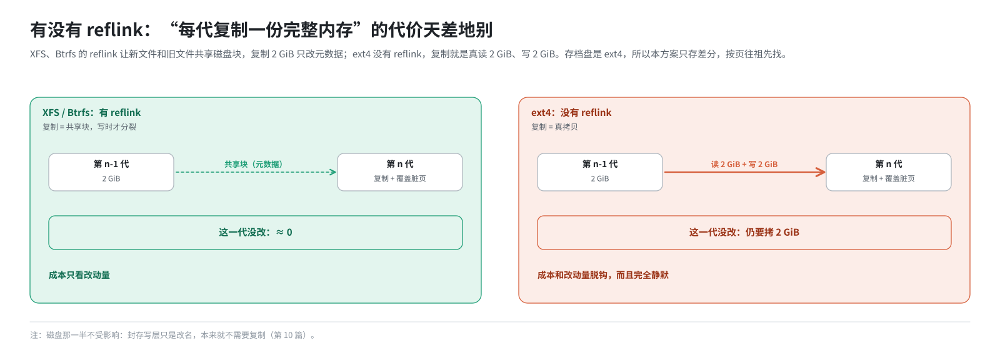

# 第 3 篇｜基础二：页、脏页、稀疏文件与位图

> **本篇目标**：“只为改动付费”是这套设计的核心目标。要做到它，得先有几样基础工具：内存按页管理，用一个比特记一页有没有被写过，用稀疏文件让一个“看起来 2 GiB”的文件只占实际写过的那点空间，用分层让磁盘的改动单独落在一处。本篇把这几样东西讲透，并解释为什么“ext4 不支持 reflink”这一个事实，决定了后面整个内存方案的形状。

---

## 一、页：内存的最小管理单位

操作系统不会一个字节一个字节地管理内存，而是把内存切成固定大小的块，叫**页**。本书涉及的环境里，一页是 **4 KiB**（4096 字节）。

一台 2 GiB 内存的沙箱，内存一共有：

```
2 GiB ÷ 4 KiB = 2 × 1024 × 1024 × 1024 ÷ 4096 = 524288 页
```

客户机物理地址（GPA）和页号的关系很简单：页号 = 地址 ÷ 4096。地址 0～4095 是第 0 页，4096～8191 是第 1 页，以此类推。本书后面说“第 42 页”，就是指地址从 42 × 4096 开始的那 4 KiB。

为什么以页为单位？因为硬件就是按页来管理权限和映射的。CPU 的页表里，每一页有自己的一组标志：能不能读、能不能写、能不能执行。“这一页被写过没有”也是按页记的。一页里改了 1 个字节，和改了 4096 个字节，在“脏不脏”这件事上没有区别，都是这一整页脏了。

这里顺带说明一个单位：本书里的 MiB、GiB 是按 1024 进位的。1 MiB = 1024 × 1024 字节，1 GiB = 1024 MiB。

## 二、脏页：被写过的页

**脏页**就是“自某个时刻以来被写过的页”。“脏”只是一个约定俗成的叫法，意思是“和那个时刻相比，内容可能变了”。

为什么只想存脏页？因为大多数时候，两次存档之间客户机只改了一小部分内存。一台 2 GiB 的沙箱，Agent 跑一条命令、改几个文件，可能只碰了几十 MB。如果每次都把 2 GiB 全部写一遍，99% 的工作是在重复写没变的内容。

只存脏页的前提，是**准确知道哪些页被写过**。上一篇说过，客户机写内存不经过宿主的任何代码，宿主上的程序看不见。所以必须借助硬件或内核。最直观的办法是：

> 把所有页设成只读。客户机第一次写某一页时，CPU 发现“这一页不让写”，就会停下来通知宿主内核。内核在本子上记一笔“第 N 页脏了”，再把这一页改回可写，让客户机继续。之后再写这一页就不会被打断了，因为已经记过了。

这就是“写保护”的思路。它的代价是每一页的第一次写都要打断客户机一次。还有更好的办法：让 CPU 硬件自己记，不打断客户机。这些细节留到第 8 篇。

这里先记住一个关键点：脏页记录必须**宁多勿少**。多记一页，最多是多存、多写回一页，慢一点而已；少记一页，读档时这一页就不会被写回，客户机内存里就混进了一页“来自另一个时刻”的数据，而且没有任何报错。所以脏页跟踪的准确性**既是性能问题，也是正确性问题**。

## 三、位图：一个比特记一页

怎么记“哪些页脏了”？最省空间的办法是**位图**：每一页对应一个比特，1 表示脏，0 表示干净。

2 GiB 内存 524288 页，位图就是 524288 个比特：

```
524288 比特 ÷ 8 = 65536 字节 = 64 KiB
```

64 KiB 的位图就能描述 2 GiB 内存的脏页情况，是内存大小的 1/32768。程序处理位图时，通常一次处理 64 个比特（一个 64 位整数，叫一个“字”），524288 比特就是 8192 个字。

位图有两个特别好用的操作：

- **求并集**：两张位图按字做“或”运算，就得到“在任意一张里脏过的页”。8192 次“或”运算，对现代 CPU 来说是微秒级的事。后面读档时要把好几代的位图合在一起，用的就是这个。
- **跳过全 0**：一个字等于 0，说明这 64 页都是干净的，直接跳过。脏页少的时候，绝大多数字都是 0，扫描非常快。

这两个性质带来一个重要结论，第 7 篇会正式用到：读档过程中，和“虚机有多大”相关的工作只有扫描位图，而扫描位图的代价极小。2 GiB 是 8192 个字，16 GiB 也只是 65536 个字。所以一台 2 GiB 和一台 16 GiB 的沙箱，回退同样多的页，花的时间几乎一样。

## 四、稀疏文件：看起来很大，实际很小

只存脏页，存到哪里？一个自然的想法是：把每个脏页写到文件里**和它在内存里相同的位置**。第 3 页写在文件偏移 3 × 4096 处，第 17 页写在 17 × 4096 处，中间的干净页不写。

这样得到的文件，逻辑上和整份内存一样长，读文件的偏移 = 内存地址，非常直观。但中间那些没写过的区间怎么办，不会白白占掉磁盘吗？

不会。现代文件系统（ext4、XFS 等）支持**稀疏文件**：文件里从来没写过的区间，文件系统不给它分配真实的磁盘块，读的时候直接返回 0。这些区间叫“空洞”。

```
文件逻辑大小：2 GiB（等于客户机内存）
实际占磁盘  ：约等于脏页总量

偏移 →
┌──────┬─────────────┬──────┬──────┬─────────────┬──────┐
│ 第3页 │    空洞      │第17页│第18页│    空洞      │第99页│
└──────┴─────────────┴──────┴──────┴─────────────┴──────┘
```

所以“文件逻辑上是完整的内存”和“物理上只占改动量”两件事同时成立。

稀疏文件有几个相关的知识点，后面会用到：

- **逻辑大小和实际占用不是一回事。** `ls -l` 看到的是逻辑大小，2 GiB；`du` 看到的是实际占用，可能只有 40 MiB。实际占用来自文件的 `st_blocks` 字段，第 17 篇读“产物有多大”时用的就是它。
- **可以快速找出哪里有数据。** Linux 提供 `SEEK_DATA` / `SEEK_HOLE`，能让程序跳过空洞，只遍历真正写过的区间。
- **读空洞得到 0，这一点要小心。** 如果程序想读某一页的内容，结果那一页其实不在这个文件里（是空洞），读到的是全 0，而不是报错。第 9 篇会看到，这正是为什么每个差分文件旁边必须放一张位图：只看文件本身，分不清“这一页的内容就是全 0”还是“这一页根本没存在这里”。


## 五、写时复制与分层：磁盘的改动单独放一层

内存讲完了，再看磁盘。上一篇提过，E2B 的磁盘是“只读底座 + 写层”。这种做法叫**写时复制**（Copy-on-Write，COW）加**分层**：

- **写**：客户机写磁盘上的某个块，这个块被写到最上面的写层里，底座不动；
- **读**：客户机读某个块，先看写层里有没有，有就用写层的；没有就往下一层找，一直找到底座。


写层本身也是一个稀疏文件，和磁盘一样大，只有写过的块才占空间。

分层对快照特别友好。客户机自上次存档以来对磁盘的所有改动，**正好全在写层里**。要存档，只需要把这一层“封起来”变成只读，再给客户机换一个新的空写层就行了。封起来的这一层就是这一代的磁盘改动，不用逐块对比，也不用复制。

读档时也一样：要回到某个存档，只要把那时候的层组合重新摆好，再给一个新的空写层。层叠得越多，读一个块可能要往下找好几层，这会带来“层太多怎么办”的问题，第 10 篇讲怎么解决。

## 六、reflink：一个决定了整体设计的文件系统特性

最后讲一个看起来很小、影响却很大的东西。

有些文件系统（XFS、Btrfs）支持 **reflink**：复制一个文件时，并不真的复制数据，而是让新文件和旧文件**共享同一批磁盘块**。之后谁改了哪一块，那一块才真正分裂成两份。复制一个 2 GiB 的文件，只要改一下元数据，瞬间完成，几乎不占额外空间。

**ext4 不支持 reflink。** 在 ext4 上复制一个 2 GiB 的文件，就是老老实实读 2 GiB、写 2 GiB。

这为什么重要？设想内存快照的一种最简单的存法，叫“每代自足”：

```
第 n 代存档 = 复制一份第 n-1 代的完整内存镜像 + 把这一代的脏页覆盖上去
```

每一代都是一份完整的内存镜像，读档时直接用，不用往前找，逻辑非常简单。

- 在 **XFS** 上，“复制一份”是 reflink，瞬间完成，然后只写脏页。成本只跟改动量有关。
- 在 **ext4** 上，“复制一份”就是真的拷贝 2 GiB。**即使这一代什么都没改，也要付一次 2 GiB 的拷贝**。而且结果照样是对的，不报任何错，只是慢。这种“功能正常、悄悄变慢”的退化最难发现。



本方案的运行环境，存放快照的磁盘是 **ext4**。设计时不能假设使用者愿意、也不能假设他们能够把产物盘换成 XFS。一个要求“请把磁盘格式化成带 reflink 的 XFS”的方案，在条件不满足时会静默退化成每次全量拷贝。

所以整条数据路径**不能依赖 reflink**。内存只能用另一种存法：

```
第 n 代存档 = 只存这一代的脏页（稀疏文件）+ 一张位图
要读某一页在第 n 代时的内容 → 沿着第 n 代、第 n-1 代……往前找，找到最近一个存过它的那一代
```

这就是第 9 篇“内存差分树”的由来。它多了“往前找”的逻辑，换来的是不依赖任何文件系统特性，成本永远只和改动量挂钩。

磁盘那一半没有这个问题：封存写层只是改个名字，本来就不需要复制，在 ext4 上一样快。

---

## 本篇小结

| 概念 | 一句话解释 |
|---|---|
| 页 | 内存的管理单位，4 KiB；2 GiB 内存是 524288 页 |
| 脏页 | 自某个时刻以来被写过的页；记录必须宁多勿少，少记一页就会回错 |
| 写保护 | 把页设成只读，第一次写时被抓到并记一笔 |
| 位图 | 一页一个比特；2 GiB 内存的位图只有 64 KiB，求并集和扫描都极快 |
| 稀疏文件 | 逻辑大小等于整份内存，只有写过的地方占磁盘；读空洞得到 0 |
| 写时复制与分层 | 写只落最上层，读从上往下找；存档时封存写层即可 |
| reflink | 复制文件时共享磁盘块；ext4 不支持，所以内存不能“每代复制一份”，只能“只存差分、往前找” |

**下一篇预告**：[《为什么不直接用原生快照：目标、原则与取舍》](04-why-not-native.md)。E2B 本来就有 pause / resume，为什么不直接用它、也不在它上面改？三条理由，五条硬约束，四条设计原则，以及三条被否决的路线。
