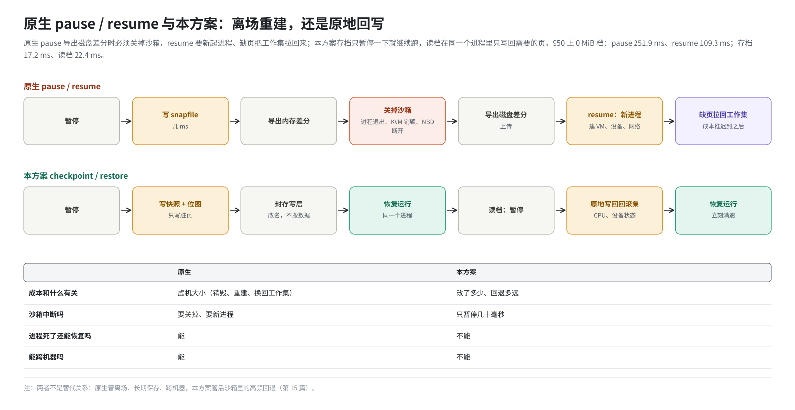
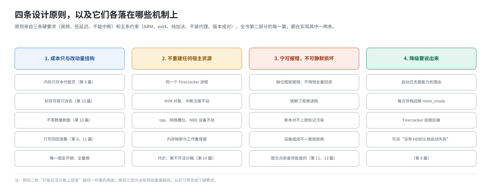
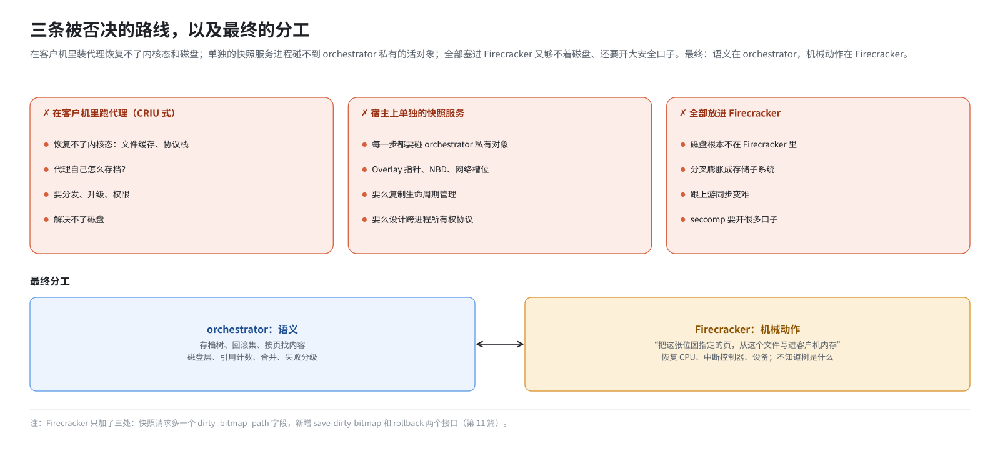

# 第 4 篇｜为什么不直接用原生快照：目标、原则与取舍

> **本篇目标**：E2B 本来就有一套快照：pause / resume。最自然的想法是直接用它，或者在它上面改。本篇先看原生快照的骨架，再讲三条理由说明它不适合“高频小回退”；然后列出设计时不可商量的硬约束、由此推出的四条设计原则、明确不做的事，以及三条考虑过又被否决的路线。读完这一篇，你会知道这套方案的“性格”是怎么定下来的。

---

## 一、原生快照怎么做

E2B 原生的快照接口是 `Pause`：

```
停掉健康检查
→ 暂停虚机
→ 让 Firecracker 写出 snapfile（CPU、中断控制器、设备状态，几十 KB）
→ 问内存后端“哪些页算脏”，把这些页从 Firecracker 进程里拷出来，写成内存差分
→ 导出磁盘写层的差分 ← 这一步会关掉沙箱
→ 上传，写元数据
```

注意：暂停之后一直**没有恢复运行**。原生 pause 的语义就是“沙箱到此为止，离场”。

恢复用的是 `ResumeSandbox`：新起一个 Firecracker 进程，建 KVM 虚拟机、vCPU、中断控制器、设备、tap、NBD、缺页处理程序，加载 snapfile，然后让客户机跑起来，边跑边通过缺页把内存一页页拉回来。这就是上一篇讲的“重建”形态。

E2B 还有一个叫 `Checkpoint` 的原生接口（注意和本书的 checkpoint 不是一回事）：打快照、停掉沙箱，再从新快照立刻拉起一台。对外沙箱 ID 不变，但底下已经换了一个全新的 Firecracker 进程。

## 二、三条理由：原生不适合高频小回退

### 理由一：会中断沙箱

导出磁盘差分时，必须先把写层从 Overlay 上摘下来、停掉沙箱、等 NBD 设备释放，写层文件才能安全地导出。这不是实现上的偷懒，而是代码结构决定的：导出磁盘差分的函数 `ExportDiff`，它的参数之一就是“关掉沙箱”的回调。理由很直接：

- 写层被摘下之后，客户机之后的写就没有去处了；
- 遍历写层导出数据时，不能有人同时在写，否则导出的是“一半新一半旧”的镜像；
- NBD 设备释放之后，写层文件才能关闭。

恢复也要新起进程。这和第 1 篇的硬要求“沙箱不能中断”直接冲突。

### 理由二：成本模型不对

原生方案的主要代价来自**销毁和重建虚机**，改动量只决定它上面的那一点增量。鲲鹏 950 上的实测：

| 改动量 | pause 中位数 | resume 中位数 |
|---|---|---|
| 0 MiB（什么都没改） | 251.9 ms | 109.3 ms |
| 256 MiB | 429.9 ms | 120.7 ms |

即使什么都没改，pause 也要 250 ms 左右。在另一台机器上对一次 pause 做了时间拆分：真正保存内存状态的只有前 10 ms 左右，其余 200 多毫秒都花在让 Firecracker 进程退出、销毁 KVM 虚拟机、断开 NBD 设备、导出磁盘差分上。

resume 也差不多是固定的 110 ms，看起来不慢，但成本只是被推迟了：resume 返回时内存还没拉回来，之后客户机第一次读那些页时还要再付。950 上实测，恢复后第一次读一份 192 MiB 的内存数据，比快照前慢了约 112 ms。

高频回退的特点是“每次改得少”。改得少的时候，原生方案**一点都省不下来**。对比一下，本方案在 0 MiB 档的存档 / 读档中位数是 17.2 ms / 22.4 ms。

### 理由三：ARM 上的增量判据已经退化

原生 pause 用 uffd 判断哪些页是脏页。在上游 x86 上，uffd 有“写保护”功能，能区分“这一页是被读进来的”还是“被写过的”，增量是准确的。移植到 ARM 时，这条写保护路径被注释掉了，判据退化成“**凡是被拉进内存过的页，都算脏**”。

再叠加原生每次都新起进程、工作集要重新缺页拉回来，结果就是：即使两次 pause 之间什么都没做，导出的“增量”也约等于整个常驻工作集。实测出现过“改了 12 MiB，导出 148 MiB”的情况。

需要说清楚：这是 ARM 适配带来的退化，不是 E2B 设计的问题。这一条后来在原生路径上也被修好了（第 15 篇）。但修好之后，前两条理由依然成立，它们来自“沙箱离场”这个语义本身，和判据准不准无关。第三条的意义在于：本方案的脏页判据不能从原生借，必须自己另外取。



## 三、硬约束

下面这些是设计时不可商量的条件：

| # | 约束 | 后果 |
|---|---|---|
| 1 | **ARM 服务器**（鲲鹏 920B、950） | x86 上的方案不能照搬；ARM 适配版已有的问题要一起面对 |
| 2 | **存快照的磁盘是 ext4** | 整条数据路径不能依赖 reflink（第 3 篇） |
| 3 | **不改变原生路径的行为** | 两条路径并存，本方案是纯加法：新路径、新接口、新字段 |
| 4 | **沙箱内不装任何代理程序** | 所有动作在宿主侧完成 |
| 5 | **orchestrator 和 Firecracker 版本必须成对** | 两边配错了就用不了，要能被明确检查出来 |

约束 2 的影响最深远。第 3 篇讲过，它直接否掉了“每代复制一份完整内存”这个更简单的设计，是内存差分树存在的全部原因。

## 四、四条设计原则

从三条硬要求和五条约束，推出四条原则。全书各篇都在实现它们。

### 原则一：成本只与改动量挂钩

任何与“虚机有多大”成正比的固定开销都要消掉：

| 哪里 | 怎么做 | 哪一篇 |
|---|---|---|
| 内存存档 | 每代只存本代脏页，不复制上一代 | 第 9 篇 |
| 磁盘存档 | 封存写层就是改名，零数据搬运 | 第 10 篇 |
| 封存后的落盘 | 不等数据真正刷到磁盘 | 第 10 篇 |
| 读档 | 只写回需要变的页，不重建内存镜像 | 第 9、11 篇 |

唯一保留的固定开销是**每台沙箱的第一次存档**：存一份完整内存作为树根。理由在第 9 篇。

### 原则二：不重建任何宿主资源

进程、KVM 对象、中断注册、tap 网卡、网络槽位、NBD 设备、内存映射，一个都不重建。

这既是“快”的全部来源，也是“离不开活沙箱”的全部原因。同一件事的两面。

### 原则三：宁可报错，不可静默损坏

这套系统操作的是**一台正在运行的虚拟机的内存**。一次错误的读档不会让虚机崩溃，它只会让某几页内存的内容属于另一个时刻，然后虚机继续跑，可能很久以后才以莫名其妙的方式暴露出来。所以：

| 情况 | 怎么处理 |
|---|---|
| 需要的位图文件缺了 | 报错，不悄悄改成“全量回滚” |
| 存档链断了 | 拒绝读档，直到下一次全量存档 |
| 账本和磁盘层对不上 | 标记“账本已污染”，拒绝存档 |
| 设备拓扑不一致 | 拒绝，不勉强写 |

第 13 篇专门讲这一条。

### 原则四：能力随硬件自动降级，但要说出来

有硬件脏页跟踪就用硬件，没有就退回软件写保护，再不行就每次全量。**功能永远正确，只是代价不同**。但降级不能悄悄发生：启动时在日志里报告用的是哪种、为什么；每次存档都回报这次是全量还是增量。第 8 篇细讲。



## 五、明确不做什么

**划界本身是设计的一部分。** 下面这些明确不做，交给原生快照：

| 不做 | 为什么 |
|---|---|
| 宿主崩溃后恢复 | 账本只在 orchestrator 进程内存里，进程没了就没了 |
| 跨机器迁移 | 存档是“相对模板的增量”，路径也绑在本机 |
| 长期保存 | 存档随沙箱一起被回收 |
| 沙箱进程已经死了之后恢复 | 只有原地回滚一条路，它要求虚机活着 |
| 跨沙箱共享存档 | 存档 ID 只在所属沙箱的生命周期里有意义 |

划出去换来的，不只是少写点代码，而是**一整类问题根本不存在**：

| 不做什么 | 所以不用处理 |
|---|---|
| 存档不跨重启存活 | 陈旧数据回收、和已消失沙箱的对账、文件格式升级迁移 |
| 不跨机器 | 上传下载、跨机器一致性、跨机器引用计数 |
| 只在活沙箱上工作 | 离线状态的加载、校验、修复 |

代价同样真实：存档带不走，把目录拷走也恢复不了；orchestrator 重启、宿主重启，存档全部失效。这些不是缺陷，而是这笔交易的另一半。

## 六、三条被否决的路线

### 路线一：在客户机里跑一个代理程序

在沙箱里装一个守护进程，用类似 CRIU 的工具把进程树存下来。否决理由：

- 它恢复不了**内核态**。客户机内核的文件缓存、网络协议栈状态、文件系统日志都不在进程树里；
- 它自己也是一个进程，“代理怎么把自己存下来”没有干净的答案；
- 它要分发、要升级、要权限，还会出现在用户的进程列表里；
- 最关键的：它**解决不了磁盘**。进程回去了，文件系统还停在未来。

虚机级快照没有这些问题：客户机的一切都在内存镜像和磁盘里，包括它自己都不知道的部分。

### 路线二：宿主上单独跑一个快照服务进程

和 orchestrator 通过进程间通信协作。否决理由：存档的每一步都要碰 orchestrator 私有的“活对象”：Overlay 的指针、NBD 设备、网络槽位、沙箱表。把它们暴露给另一个进程，要么复制一套生命周期管理，要么设计一套跨进程的所有权协议，都比“在同一个进程里加一个模块”贵得多。

代价是存档逻辑和 orchestrator 同生共死。这也是“orchestrator 重启后存档全部失效”的来源之一。

### 路线三：全部放进 Firecracker

让 Firecracker 自己管存档树、自己写文件。否决理由：

- 磁盘那一半根本不在 Firecracker 里，Overlay、NBD、层文件都是 orchestrator 的东西；
- 对 Firecracker 的改动会从“一个字段加两个接口”膨胀成一整个存储子系统，以后跟上游同步会很难；
- Firecracker 进程是一道安全边界，它被系统调用白名单（seccomp）限制得很严，往里加文件系统操作要开很多口子。

最终的分工是：**语义在 orchestrator，机械动作在 Firecracker**。Firecracker 只做“把这张位图指定的页、从这个文件写进客户机内存”这类无状态的动作，它不知道“树”是什么。



## 七、一句话的交易

把上面所有内容压成一句话：

> **用“绑定沙箱生命周期”换掉存档的自足性和账本的持久化，换来零拷贝封存、原地回滚，以及只随回退跨度增长的成本曲线。**

两条路径并存，各管各的：原生快照管迁移、长期保存、崩溃恢复；本方案管高频快速回退。两者怎么配合，第 15 篇讲。

---

## 本篇小结

| 概念 | 一句话解释 |
|---|---|
| 原生 pause / resume | 停下、存盘、离场；恢复时新起进程重建 |
| 理由一 | 原生会中断沙箱，导出磁盘差分要先关掉沙箱 |
| 理由二 | 原生成本看虚机大小：改 0 MiB 也要约 250 ms 的 pause |
| 理由三 | ARM 上原生的脏页判据退化成“拉进过内存就算脏”，本方案必须另取判据 |
| 硬约束 | ARM、ext4、纯加法、不装代理、版本成对 |
| 四条原则 | 成本只看改动量；不重建宿主资源；宁可报错不可静默损坏；降级要说出来 |
| 不做的事 | 崩溃恢复、迁移、长期保存、进程死后恢复、跨沙箱共享 |
| 最终分工 | 语义在 orchestrator，机械动作在 Firecracker |

**下一篇预告**：[《总体架构：请求发往沙箱，却由宿主应答》](05-architecture.md)。存档要先暂停虚机，可沙箱里的程序暂停不了自己。本方案怎么让 `sandbox.checkpoint.create()` 看起来是发给沙箱的，实际上由宿主应答？orchestrator 里分了哪几块，Firecracker 加了哪三处，存档文件放在哪里。
