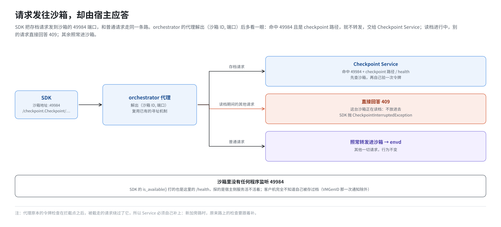
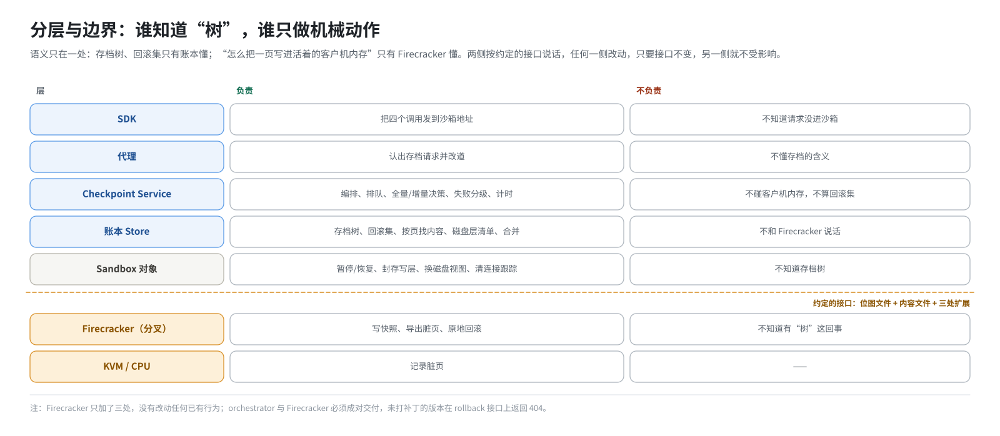
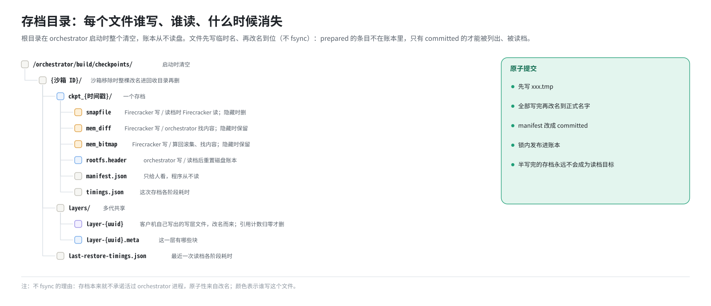

# 第 5 篇｜总体架构：请求发往沙箱，却由宿主应答

> **本篇目标**：从组件边界开始看清整套方案。存档的第一步是暂停虚机，而沙箱里的程序暂停不了自己，所以执行者必须在宿主上；可对用户来说，`sandbox.checkpoint.create()` 最好和 `sandbox.commands.run()` 一样，是沙箱对象上的一个方法。本篇讲这两件事怎么同时成立，然后认识 orchestrator 里的几个部件、Firecracker 加的三处扩展，以及存档文件在磁盘上的样子。

---

## 一、难题：谁来暂停虚机

打快照要先暂停虚机，让它在冻结窗口里不再产生新状态。**沙箱里的程序做不到这件事**，它就跑在要被暂停的那台机器上。所以存档的执行者必须在宿主侧，也就是 orchestrator。

但从使用者的角度，最自然的 API 是沙箱对象上的方法，走和其他操作同一个地址、同一套鉴权。用户不应该为了存档另外去找一个宿主的地址。

两件事要同时成立。本方案的做法是：**请求照常发往沙箱，在进沙箱之前被截下来。**

## 二、拦截：49984 端口

第 2 篇讲过普通请求的路径：SDK 把请求发到沙箱的公开地址，地址里带着沙箱 ID 和端口；orchestrator 的代理解出这两样，把请求转发进沙箱，由 envd 应答。

存档请求走的是同一条路，只是 SDK 把它发往沙箱的 **49984 端口**。orchestrator 的代理在转发之前多看一眼：

```
解出 (沙箱 ID, 端口)
├── 端口是 49984，路径是 /health 或以 /checkpoint.Checkpoint/ 开头
│     → 不转发，交给 Checkpoint Service 处理
├── 这台沙箱正在读档
│     → 不放进去，直接回答“沙箱刚被回滚，请重试”
└── 其他请求
      → 照常转发进沙箱
```

沙箱里其实**没有任何程序监听 49984**。连 SDK 用来探测“存档功能可不可用”的 `/health`，也是由宿主应答的，它探的是宿主侧服务活不活着。

拦截是**加法**：只多了一个判断，命中才改道，其他请求的行为完全不变。地址解析也复用了已有的机制，没有引入新的地址空间。所以 SDK 几乎不需要特殊处理，照常拼一个沙箱内端口的 URL 就行。

第二个分支处理“读档期间到达的其他请求”。那时客户机已经暂停、连接状态正要回到过去，把请求放进去，它只会挂到读档结束再失败，不如立刻告诉调用方重试。第 12 篇细讲。



## 三、为什么要再检查一次身份

代理本来会检查请求带的访问令牌（`e2b-traffic-access-token`），确认调用者有权访问这台沙箱。但这个检查发生在**拦截点之后**，被截走的存档请求绕过了它。

所以 Checkpoint Service 收到请求后，先确认沙箱存在，再自己做一遍同样的令牌检查。

这不是重复劳动。把安全检查放在一条会被绕过的路径上，是一类经典的漏洞来源。新加一条旁路时，要问自己一句：原来路上的检查，我这条旁路还有没有？没有就补上。

## 四、换来了什么：沙箱里什么都不用装

这样做的结果是，客户机**完全不知道自己被存过档**，除了读档时的一次通知（VMGenID，第 12 篇）。对比第 4 篇否决的“在沙箱里装代理”：不用分发、不用升级、不用权限，也没有“代理自己怎么被存档”的问题。

对外的接口一共四个远程调用，加一个 `/health`：

| 调用 | 作用 | 主要返回 |
|---|---|---|
| `CreateCheckpoint` | 存档 | `checkpoint_id`、`mem_mode` |
| `RestoreCheckpoint` | 读档 | 成功与否 |
| `ListCheckpoints` | 列出存档 | 每个存档的 ID、名字、创建时间、全量还是增量（不含父子关系） |
| `DeleteCheckpoint` | 删除存档 | 成功与否 |

协议是 Connect（一种跑在 HTTP 上的 RPC 协议），用 JSON 编码。

`mem_mode` 这个返回字段值得单独说一句。它告诉调用方这次存档是 `full`（全量）还是 `incremental`（增量）。它存在的唯一理由，是**让“悄悄退化成全量”变得看得见**。除了每台沙箱的第一次存档，如果出现 `full`，说明这台宿主没在跟踪脏页。功能照常，只是每次都多拷一整份内存。没有这个字段，这种退化只会表现为“好像有点慢”，混在平均延迟里，很久都没人发现。这是原则四的第一处落地。

## 五、orchestrator 里的部件

把整套方案按层摆开：

| 层 | 负责 | **不**负责 |
|---|---|---|
| SDK | 把四个调用发到沙箱地址 | 不知道请求其实没进沙箱 |
| 代理 | 认出存档请求并改道 | 不理解存档的含义 |
| Checkpoint Service | 编排、排队、决定全量还是增量、失败分级、计时 | 不碰客户机内存，不算回滚集 |
| 账本 | 存档树、回滚集、按页找内容、磁盘层清单、合并 | 不和 Firecracker 说话 |
| Sandbox 对象 | 暂停 / 恢复、封存写层、切换磁盘视图、清连接跟踪表 | 不知道存档树 |
| Firecracker | 写快照、导出脏页位图、原地回滚 | 不知道有“树”这回事 |
| KVM / CPU | 记录脏页 | —— |



这个分层有一条纪律：**语义只在一处**。“什么是一棵树、回滚集怎么算”只有账本知道；Firecracker 收到的是一张位图和一个文件，它不需要知道它们是怎么来的。反过来，“怎么把一页写进活着的客户机内存”只有 Firecracker 知道，orchestrator 不去碰它的地址空间。这样任何一侧改动，只要双方约定的接口不变，另一侧就不受影响。

下面分别看三个主要部件。

### 1. Checkpoint Service：编排者

Service 自己几乎不记任何状态，它做的是把一次请求按顺序编排起来：

- 鉴权，把四个调用分发到各自的处理逻辑；
- **按沙箱排队**：一个操作从头到尾都持有这台沙箱的操作锁，同一台沙箱的存档、读档、删除串行执行；
- 决定这次存档是全量还是增量（第 6 篇）；
- 出错时分清“沙箱还能用”“沙箱坏了”“链断了”（第 13 篇）；
- 记录每一步花了多少时间，把 `mem_mode` 回给调用方；
- 跟随沙箱的生命周期：沙箱被删除时，清掉它的全部存档；同一个沙箱 ID 换了一代进程时，丢掉上一代的全部存档（第 14 篇）。

还有一个容易忽略的细节。HTTP 请求有自己的生命周期：客户端断开或超时了，服务端的请求上下文就会被取消。但存档和读档一旦开始，就**不能跟着请求一起被取消**，因为那时虚机可能正处于暂停状态。一个所有人都以为在运行、实际上停着的沙箱，比一次失败的存档糟糕得多。所以操作一开始，就和请求的生命周期脱钩了。

### 2. 账本（Store）：所有语义的所在地

账本是 orchestrator 内存里的几张表：

| 表 | 内容 |
|---|---|
| 存档表 | 每台沙箱有哪些存档，每个存档的信息 |
| 当前基准 | 每台沙箱现在“从哪个存档继续往下走”，以及“链断了没有” |
| 磁盘账本 | 每台沙箱当前的磁盘由哪些层组成，每一块来自哪一层 |
| 层引用计数 | 每个磁盘层被多少地方引用，归零就可以删 |
| 子节点计数 | 每个存档有几个孩子，用来快速判断能不能删 |
| 字节与个数计数 | 用于配额检查 |
| 代际 | 每个沙箱 ID 当前对应的是哪一代进程 |
| 操作锁 | 每台沙箱一把，可以设置等待上限 |

**这些表只在进程内存里。** orchestrator 启动时，会把存档目录整个清空再重建，从不读盘恢复。磁盘上的 `manifest.json` 只是为了出问题时方便人去看，程序自己从来不读。

为什么不把账本存盘、重启后读回来？因为 orchestrator 重启时，它上面的所有沙箱本来就没了，而存档要恢复到的，正是那台活着的沙箱。为一个已经不存在的目标保存账本，没有意义。第 14 篇会用一个思想实验把这件事讲透。

### 3. Sandbox 对象：活资源的持有者

Service 通过沙箱表拿到 Sandbox 对象，再通过它碰到三样东西：

| 通过 | 做什么 |
|---|---|
| Firecracker 进程接口 | 暂停 / 恢复虚机，调用三处扩展 |
| 磁盘提供者（Overlay + NBD） | 封存写层，切换磁盘视图 |
| 网络槽位 | 清连接跟踪表 |

E2B 支持多种磁盘提供方式，只有“NBD + Overlay”这一种能封存换层。如果拿到的是别的方式，就明确报错“这种磁盘不能封存写层”，而不是走一条半对的路。这是原则三的又一处体现。

## 六、Firecracker 只改了三处

Firecracker 那一侧是一个分叉版本，功能上是上游的超集，只加了三处：

| 扩展 | 形式 | 作用 |
|---|---|---|
| `dirty_bitmap_path` | 已有“打快照”接口的一个新的可选字段 | 写快照的同时，把这一代的脏页位图写到指定文件 |
| `PUT /snapshot/save-dirty-bitmap` | 新接口 | 虚机暂停时，导出“自上次清零以来”的脏页位图 |
| `PUT /snapshot/rollback` | 新接口 | 原地回滚：把指定的页写回内存，恢复 CPU、中断控制器和设备状态 |

外加硬件脏页跟踪（HDBSS）的启用与上报，以及回滚需要的几条系统调用白名单。主体代码集中在 Firecracker 源码的一个新文件 `src/vmm/src/rollback.rs` 里（第 11 篇、附录 A）。

**已有的行为基本没动。** 一个不用这三处的调用者，只会碰到两处和上游不同的地方，而且都是有意的：

- 暂停时，vCPU 停下之前先把 KVM 里挂着的半步设备访问收尾（第 11 篇阶段 5），快照里的 vCPU 状态因此是自洽的；
- 带内存文件的“打快照”请求不再 fsync（第 11 篇扩展一）。E2B 原生 pause 不带内存文件，仍和上游一样落盘。

这种克制是有意的。改得越少，以后跟上游同步越容易；出了问题，也越容易判断是不是自己引入的。

**版本必须成对。** 如果 orchestrator 碰上一个没打补丁的 Firecracker，`/snapshot/rollback` 是一个它不认识的路径，会返回 400 `Invalid request method and/or path`（中间若有代理，也可能是 404）。orchestrator 把这两种都翻译成一句明确的话：“这个 firecracker 不支持原地回滚”，而不是一个含糊的 HTTP 错误。

## 七、存档文件放在哪

存档存在宿主本地磁盘上，默认根目录是 `/orchestrator/build/checkpoints/`。结构是：

```
/orchestrator/build/checkpoints/          ← orchestrator 启动时清空
└── <沙箱 ID>/
    ├── ckpt_<时间戳>/                     ← 一个存档
    │   ├── manifest.json                 ← 存档记录（给人看的）
    │   ├── snapfile                      ← CPU、中断控制器、设备状态
    │   ├── mem_diff                      ← 这一代的内存差分（稀疏文件）
    │   ├── mem_bitmap                    ← 这一代的脏页位图
    │   ├── rootfs.header                 ← 这个存档时刻的磁盘由哪些层组成
    │   └── timings.json                  ← 这次存档每一步花了多久
    ├── layers/
    │   ├── layer-<uuid>                  ← 封存的磁盘层
    │   └── layer-<uuid>.meta             ← 这一层存了哪些块
    └── last-restore-timings.json         ← 最近一次读档每一步花了多久
```



每个文件谁写、谁读：

| 文件 | 谁写 | 谁读 |
|---|---|---|
| `snapfile` | Firecracker | Firecracker（读档时） |
| `mem_diff` | Firecracker | orchestrator（读档时找内容） |
| `mem_bitmap` | Firecracker | orchestrator（算回滚集、找内容） |
| `rootfs.header` | orchestrator | orchestrator（读档后重置磁盘账本） |
| `layer-<uuid>` | **客户机自己**（经 NBD 写进去的写层，改名而来） | 运行中的沙箱、读档时重新打开 |
| `layer-<uuid>.meta` | orchestrator | orchestrator |

`layer-<uuid>` 那一行最能体现这套设计的特点：**它就是客户机自己写出来的那个写层文件**。没有人把数据从一处搬到另一处，只是给文件改了个名字、换了个身份。第 10 篇细讲。

### 原子提交：半写完的存档永远不会被读到

存档文件先写成临时名字（`xxx.tmp`），全部写完后再改名成正式名字。改名在文件系统里是原子操作：要么改了，要么没改，不会改一半。

账本里每个存档有两个状态：

- `prepared`：目录建好了，文件正在写。这时在列表里看不见，也不能作为读档目标；
- `committed`：文件都已就位，可见、可读档。

所以**半写完的存档永远不可能成为读档目标**。这是一条硬性的规则，第 13 篇的不变量清单里会再看到它。

注意，这里刻意**不调用 fsync**（把数据强制刷到磁盘）。原子性靠的是改名，而存档本来就不承诺能活过 orchestrator 进程的重启。既然重启后存档反正失效，就没必要为“断电后数据还在”付出等待刷盘的代价。

---

## 本篇小结

| 概念 | 一句话解释 |
|---|---|
| 49984 拦截 | 存档请求发往沙箱的 49984 端口，代理在转发前截下，交给宿主处理 |
| 再次鉴权 | 被截走的请求绕过了代理的令牌检查，Service 自己补上 |
| 四个调用 | Create / Restore / List / Delete，加一个 `/health` |
| `mem_mode` | 回报这次是全量还是增量，让静默退化看得见 |
| 语义只在一处 | 树和回滚集只有账本懂；写内存只有 Firecracker 懂 |
| 账本 | orchestrator 内存里的几张表，启动时清空，从不读盘 |
| Firecracker 三处扩展 | 写快照顺带写位图、导出脏页位图、原地回滚 |
| 原子提交 | 先写临时文件再改名；`prepared` 不可见，`committed` 才可见；不 fsync |

**下一篇预告**：[《一次存档，逐步走：checkpoint》](06-checkpoint-step-by-step.md)。从请求进入 Service 开始，经过排队、决定全量还是增量、冻结窗口里的五步，到提交进账本。以及为什么“写快照”这一步成功之后，后面的失败就不再能“删掉了事”。
