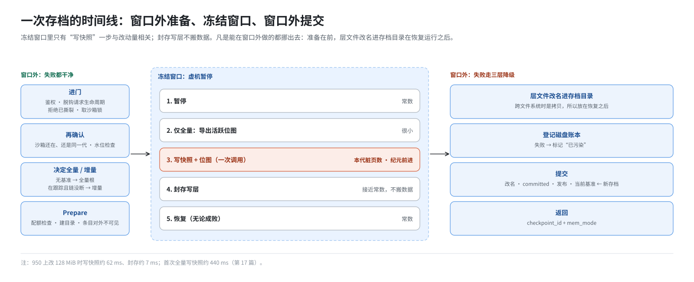
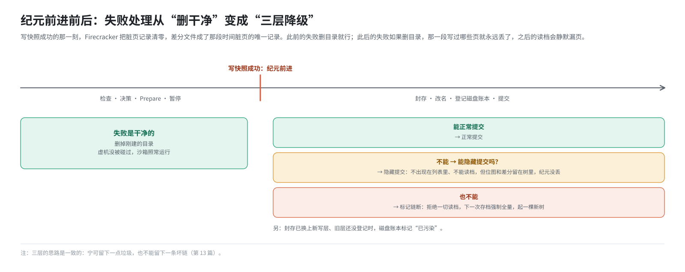

# 第 6 篇｜一次存档，逐步走：checkpoint

> **本篇目标**：跟着一次 `sandbox.checkpoint.create()`，从请求进入 Checkpoint Service 开始，一步一步走到它返回。整个过程分成三段：冻结窗口之前的准备、冻结窗口里的五步、冻结窗口之后的提交。重点看两件事：冻结窗口里每一步的代价和什么成正比；以及为什么“写快照”这一步一旦成功，后面的失败就不能再“删掉了事”。

---

## 一、全貌

先看整体：



| 段 | 做什么 | 虚机在跑吗 |
|---|---|---|
| 准备（窗口外） | 鉴权、排队、各种检查、决定全量还是增量、建目录 | 在跑 |
| 冻结窗口 | 暂停、写快照、封存写层、恢复 | **停着** |
| 提交（窗口外） | 挪层文件、记磁盘账本、改名、发布进账本 | 在跑 |

原则很简单：**凡是能在窗口外做的，都不放进窗口里。**

## 二、准备：窗口外

### 1. 进门

| # | 步骤 | 为什么 |
|---|---|---|
| 1 | 代理认出 49984 端口的存档请求，交给 Service | 第 5 篇 |
| 2 | 找沙箱，找不到回 404 | |
| 3 | 检查访问令牌 | 拦截点绕过了代理的检查，自己补上 |
| 4 | 把操作和请求的生命周期脱钩 | 客户端放弃了，虚机也不能停在暂停状态 |
| 5 | 如果这一代沙箱已经“撕裂”，拒绝 | 撕裂的沙箱状态不可信，第 13 篇 |
| 6 | 取这台沙箱的操作锁；排队太久就回“忙” | 同一台沙箱的操作必须一个一个来 |
| 7 | 拿到锁后再确认一次：沙箱还在吗？还是同一代吗？ | 排队的时候，沙箱可能被删了，也可能已经换了一代进程 |
| 8 | 检查存档磁盘的剩余空间，低于水位线就拒绝 | 在锁里做，两个并发的存档不会看到同一份剩余空间 |

第 7 步是一个常见的并发陷阱：**检查和使用之间隔了一段时间**。进门时沙箱还在，排了几秒队之后它可能已经没了。所以拿到锁之后必须重新确认。

### 2. 决定全量还是增量

账本里记着这台沙箱的“当前基准”，也就是“现在从哪个存档继续往下走”，以及“链断了没有”。根据这两样和两个开关，用三个条件决定这次怎么存：

```
本次是新树根 = 当前没有基准  并且  “全量根”开关打开（默认打开）
本次存增量   = 脏页跟踪开着  并且  链没断  并且  不是新树根
```

所以：

- 一台沙箱的**第一次**存档：没有基准，是全量，成为一棵树的根；
- 之后的存档：有基准、在跟踪脏页、链没断，就是增量，父亲是当前基准；
- 宿主没开脏页跟踪：每次都是全量；
- 链断了（第 13 篇讲什么时候会断）：下一次存档是全量，起一棵新树。

为什么第一次默认存全量，而不是相对模板存增量？因为模板的内存镜像不一定在本地（第 2 篇的按需拉取）。树根存一份完整内存，之后读档时就永远不用跨网络去找模板。这是全方案唯一保留的固定开销，第 9 篇细讲。

### 3. 准备条目

在账本锁里检查三件事：

- 这一代沙箱有没有资格存档；
- 可见存档的**个数**有没有到上限；
- 全部存档占的**字节数**有没有到上限。

超了就回 429，什么都还没做。两种上限默认都是关的，第 14 篇讲怎么用。

检查通过后，在锁外建目录 `ckpt_<时间戳>/`，写一份状态为 `prepared` 的 manifest。此时这个存档**还不在账本里**，列表里看不见，也不能作为读档目标。

最后准备好封存磁盘层需要的东西：层目录、模板的磁盘描述（第一次封存时用来初始化磁盘账本）、新层的文件名。

**这一段的失败都是干净的**：删掉刚建的目录就行，虚机根本没被碰过。

## 三、冻结窗口：五步

### 第 1 步：暂停虚机

让 Firecracker 暂停所有 vCPU。从这一刻起，客户机不再产生新的状态，内存、CPU、设备、磁盘都定格在同一瞬间。

暂停之后立刻登记一件事：**无论后面发生什么，最后一定要恢复虚机。** 快照失败了要恢复，封存失败了要恢复，调用方已经放弃了也要恢复。而且恢复这个动作本身也不受任何取消的影响。

### 第 2 步（仅全量）：先导出一份活跃位图

只有全量存档才做这一步。它服务于一个后面才会讲到的需求：“开机以来写过哪些页”这个累积集合，用于存档之后再做原生 pause（第 15 篇）。增量存档写出的位图本身就带着这个信息，所以不用单独导出；全量存档写出的位图是“全 1”，不带信息，所以要在写快照之前先导出一份。

代价是导出一张位图，内存大小的 1/32768，很小。

### 第 3 步：写快照

一次调用让 Firecracker 写出三样东西：

| 文件 | 内容 |
|---|---|
| `snapfile` | vCPU、中断控制器、设备状态 |
| `mem_diff` | 内存：增量时只写本代脏页（稀疏文件），全量时写整份 |
| `mem_bitmap` | 这一代的脏页位图；全量时是全 1 |

这就是第 5 篇说的第一处扩展 `dirty_bitmap_path`：位图和差分在**同一次调用里**落地，保证它们描述的是同一件事，也省掉一次来回。

写完之后，Firecracker 会把脏页记录**清零**，开始记下一段。这个细节极其重要，下面第五节专门讲。

这一步是冻结窗口里**唯一**与改动量相关的步骤：增量时与本代脏页数成正比，全量时与整个内存成正比。

### 第 4 步：封存写层

磁盘这一半：

```
刷屏障：把客户机已经发出、还缓存在宿主上的写全部推进写层
→ 新建一个空的写层
→ 把旧写层追加到只读层栈上，成为一个只读层
→ 把 Overlay 的“当前写层”指针换成新的空层
```

旧写层从此不再被写，它就是这一代的磁盘改动。没有复制任何一个块，只是换了指针，再把旧层写过哪些块登记进索引。所以这一步**不搬数据**，代价接近常数；随写入量略有增长的，只是刷屏障要推下去的写和登记的块数。第 10 篇细讲。

### 第 5 步：恢复虚机

前面登记的“一定要恢复”在这里执行。冻结窗口到此结束。

### 内存和磁盘必须在同一个窗口里

第 3、4 步在同一次暂停里完成，这不只是“省一次暂停”。第 2 篇讲过，内存和磁盘必须是同一瞬间的两半：客户机还没刷盘的数据（文件缓存里的脏数据、写了一半的文件系统日志）留在内存镜像里，位置完全正确；读档时两者一起回到那一刻，客户机看到的世界是自洽的。分成两次暂停，中间客户机继续运行，就会出现“内存是 T1、磁盘是 T2”。

这是全书**八条顺序约束**里的第一条。第 7 篇末尾会把八条汇总起来。

## 四、提交：窗口外

### 1. 层文件挪进存档目录

写层文件原本放在沙箱的缓存目录里，封存后要挪进存档的 `layers/` 目录。如果两个目录在同一个文件系统上，这只是一次改名；如果不在，就是一次真正的拷贝，耗时和写层大小成正比。

所以这一步**刻意放在恢复虚机之后**。实现上，“挪层文件”和“恢复虚机”是按特定顺序登记的两个收尾动作，保证恢复先执行、挪文件后执行。这样即使需要拷贝，冻结窗口也不会因此变长，不会随“上次存档以来客户机写了多少”而增长。

### 2. 记磁盘账本

把新封存的层登记进磁盘账本：

- 在账本锁里，把新层合进“每一块来自哪一层”的总映射；
- 在锁外，写这一层的说明文件 `.meta`（这一层存了哪些块），以及这个存档的 `rootfs.header`（这个时刻的磁盘由哪些层组成）。

如果锁外的写失败了，会把磁盘账本标记为“已污染”，此后拒绝新的存档，直到下一次读档把账本重置为止（第 13 篇）。

### 3. 提交

```
临时文件改名成正式名字（不 fsync）
→ manifest 改成 committed
→ 在账本锁里发布：
     存档进入存档表
     父亲的子节点数 +1
     新层的引用数 +1
     字节数累加
     当前基准 ← 这个新存档
```

发布是一个常数时间的操作。最后写这次的 `timings.json`，把 `{checkpointId, memMode}` 返回给调用方。

注意最后一行：**当前基准变成了新存档**。下一次存档的父亲就是它。

## 五、写快照成功之后，失败不再干净

回到第 3 步那个细节：写完快照，Firecracker 会把脏页记录清零。

这意味着，从这一刻起，那一段时间里“哪些页被写过”的**唯一记录**就是刚写出的 `mem_bitmap` 和 `mem_diff`。Firecracker 那里已经没有了。我们把这件事叫做“**纪元前进了**”：两次清零之间的那段时间是一个纪元，清零就是跨入下一个纪元。

那么，如果第 4 步封存失败了，或者提交时某个文件改名失败了，能不能像准备阶段那样，把目录删掉、当作什么都没发生？

**不能。** 删掉目录，就丢掉了那个纪元的脏页记录。下一次存档时，Firecracker 只会报告“清零之后”写过的页，清零之前那一段写过的页就永远丢了。之后以这个基准做的任何读档，都会漏掉这些页。漏掉的页不会报错，只会让客户机内存里悄悄混进错误的内容。

所以写快照之后的失败，走的是一条**三层降级**的路：

```
能正常提交吗？
├── 能 → 正常提交
└── 不能 → 能以“隐藏存档”的身份提交吗？
          ├── 能 → 隐藏提交：不出现在列表里，不能被读档，但它的位图和差分保留在树里，纪元没丢
          └── 不能 → 标记“链已断”：此后拒绝一切读档，直到下一次全量存档起一棵新树
```

另外，如果封存已经把新写层换上去了，但旧层还没登记进账本，还要额外把磁盘账本标记为“已污染”，因为实际在用的层和账本记的已经对不上了。



这三层的思路是一致的：**宁可留下一点垃圾，也不能留下一条坏链。** 隐藏存档会占一点空间，但能保证读档的正确性；实在保不住，就明确地拒绝读档，而不是让它悄悄回错。这正是原则三“宁可报错，不可静默损坏”。第 13 篇会把所有失败情况放在一起讲。

## 六、代价小结

冻结窗口里每一步的代价：

| 步骤 | 代价 |
|---|---|
| 暂停 / 恢复 | 常数 |
| 导出活跃位图（仅全量） | 内存的 1/32768，很小 |
| 写快照 | **本代脏页数**；全量时是整份内存 |
| 封存写层 | 接近常数：刷屏障 + 换指针 + 登记块，不搬数据 |

只有写快照与改动量相关，这就是“成本只与改动量挂钩”在存档这一侧的具体样子。950 上的实测，改 128 MiB 时写快照约 62 ms、封存约 7 ms；改 512 MiB 时写快照约 210 ms、封存约 22 ms。封存也略有增长，来自刷屏障要推下去的写和要登记的块变多了，但远小于写快照的增长。

---

## 本篇小结

| 概念 | 一句话解释 |
|---|---|
| 三段 | 准备（窗口外）、冻结窗口、提交（窗口外） |
| 拿锁后再确认 | 排队期间沙箱可能被删或换代 |
| 全量还是增量 | 没有基准且开了全量根 → 全量；在跟踪、链没断 → 增量 |
| `prepared` | 准备好的条目不在账本里，失败了删掉就行 |
| 冻结窗口五步 | 暂停 →（全量才有）导出位图 → 写快照 → 封存写层 → 恢复 |
| 恢复一定执行 | 无论成败、无论调用方是否放弃 |
| 层文件窗口外挪 | 跨文件系统时是拷贝，放在恢复之后，不拉长冻结窗口 |
| 纪元前进 | 写快照后 Firecracker 清零，差分成了那段脏页的唯一记录 |
| 三层降级 | 正常提交 → 隐藏提交 → 标记链断；宁可留垃圾，不留坏链 |

**下一篇预告**：[《一次读档，逐步走：restore》](07-restore-step-by-step.md)。读档比存档复杂：要先装好目标磁盘、在冻结窗口里算出要写回哪些页并准备好内容、交给 Firecracker 写回、切换磁盘、清理网络连接，最后在账本里把“当前基准”指向目标。以及为什么要先更新账本、再等客户机应答。
