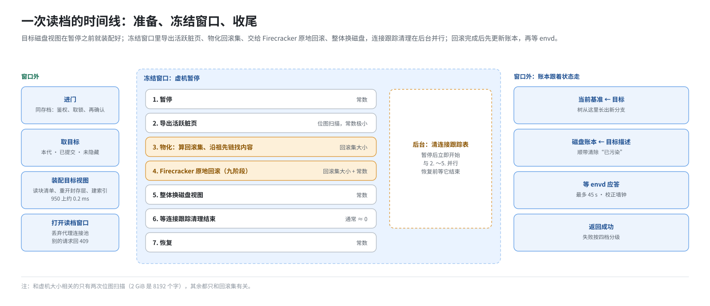

# 第 7 篇｜一次读档，逐步走：restore

> **本篇目标**：跟着一次 `sandbox.checkpoint.restore(id)` 走一遍。读档比存档复杂：要先在窗口外装好目标磁盘；在冻结窗口里导出脏页位图、算出要写回哪些页并准备好内容、交给 Firecracker 写回、整体换上目标磁盘、等网络清理结束；最后在账本里把“当前基准”指向目标，再等客户机应答。本篇还会讲清三个“钟”的区别，并把散落在第 6、7 篇的八条顺序约束汇总成一张表。

---

## 一、全貌



| 段 | 做什么 | 虚机在跑吗 |
|---|---|---|
| 准备（窗口外） | 鉴权、排队、取目标、装配目标磁盘视图、空间检查、打开“读档窗口” | 在跑 |
| 冻结窗口 | 暂停、导出脏页图、物化回滚集、Firecracker 原地回滚、换磁盘、等网络清理、恢复 | **停着** |
| 收尾（窗口外） | 更新账本、等客户机里的 envd 应答 | 在跑 |

## 二、准备：窗口外

前面几步和存档一样：拦截、鉴权、和请求生命周期脱钩、拒绝已撕裂的沙箱、取操作锁、拿锁后再确认沙箱还在且还是同一代。接下来：

**取目标存档。** 只认这台沙箱当前这一代的、已提交的、没被隐藏的存档。半写完的、隐藏的、上一代的都不行，找不到就回 404。

**读目标的磁盘描述。** 读出目标存档时刻的磁盘由哪些层组成，再读每一层的 `.meta`，得到“每个层文件持有哪些块”的清单。如果这个存档没有可用的磁盘描述，说明链断了，回 412 `chain_broken`。

**空间检查。** 后面要把回滚集的内容写成临时文件，最多可能有一整份内存那么大。在暂停之前就检查剩余空间，好过写到一半磁盘满了。

**装配目标磁盘视图。** 以模板 rootfs 为底，把目标时刻的那些封存层一层层重新打开，建好“每一块该从哪一层读”的索引。

这一步为什么能放在窗口外？因为它读的全是**不可变**的东西：已封存的层文件和它们的说明文件，封存之后就再也不会变。而同一台沙箱的操作已经被操作锁串行化了，没人能在背后再封一层。所以“现在装配”和“暂停后再装配”结果完全一样。这一步失败也很干净，虚机根本没被碰过。950 上它大约只要 0.2 ms。

**打开“读档窗口”。** 从这时起，发往这台沙箱的其他请求会被代理直接拒绝，告诉调用方“沙箱正在回滚，请重试”。同时丢弃代理到这台沙箱的连接池，原因见第 12 篇。

## 三、冻结窗口

### 第 1 步：暂停，并在后台开始清连接跟踪表

暂停虚机。紧接着在后台启动一件事：清理宿主和沙箱网络命名空间里属于这台沙箱的连接跟踪表项（conntrack）。它和后面几步并行，第 6 步再等它结束。为什么要清、为什么能并行，第 12 篇讲。

### 第 2 步：导出活跃脏页图

调用第二处扩展 `save-dirty-bitmap`，让 Firecracker 导出“自上次清零以来写过的页”。这批页叫**活跃脏页**：当前基准之后客户机写过、还没有被任何存档记录下来的页。

为什么一定要它？设想客户机在上次存档之后，把第 42 页从 X 改成了 Y，还没存新档。第 42 页不在任何一个存档的位图里，因为它属于还没结束的那个纪元。如果读档时不把活跃脏页算进去，第 42 页就不会被写回，读档后它仍然是 Y，客户机内存里混进了一页“来自被丢弃的时间线”的数据。

### 第 3 步：物化回滚集

这一步在 orchestrator 里完成，分两小步：

1. **算回滚集**：哪些页需要写回。规则是把“当前基准到目标”沿途经过的每一代存档的位图求并集，再并上第 2 步的活跃脏页。为什么这样就够、为什么必须这样，是第 9 篇的主题；
2. **找内容**：对回滚集里的每一页，找出它在目标时刻的内容在哪个存档的差分文件里，读出来。

结果写成两个文件交给 Firecracker：

| 文件 | 内容 |
|---|---|
| `revert_bitmap` | 回滚集的位图：要写回哪些页 |
| `revert_mem` | 一个稀疏文件，这些页在目标时刻的内容，写在各自的偏移上 |

账本的全局锁只在算“沿途经过哪些存档”时短暂持有一下，读位图、读差分、写文件都在锁外，不影响别的沙箱。

还有一个细节：第 2 步导出的活跃脏页，以及 Firecracker 马上要写回的这批页，都会被并入第 6 篇提到的“开机以来写过的页”集合。Firecracker 写回内存走的是它自己的映射，KVM 不会把这些写记成脏页，不收进来，这批页就会从所有后续记录里消失。

### 第 4 步：Firecracker 原地回滚

调用第三处扩展 `PUT /snapshot/rollback`，把两个文件和目标的 `snapfile` 交给 Firecracker。Firecracker 在**同一个进程**里依次做九件事：校验、等在途 I/O、再取一次活跃脏页并核对覆盖、写回内存、恢复 vCPU、恢复中断控制器、恢复设备状态、通知客户机“你被回滚了”、清零脏页记录。第 11 篇逐个讲。

### 第 5 步：换磁盘视图

把准备阶段装好的目标视图整体换上，同时给一个新的空写层。客户机的磁盘挂载不动，NBD 设备也不动，只是 Overlay 底下的指针换了。代价是常数。第 10 篇细讲。

### 第 6 步：等连接跟踪清理结束

等第 1 步在后台启动的清理完成。通常它早就做完了，这里的等待接近于零。

### 第 7 步：恢复虚机

冻结窗口结束。

## 四、两条顺序约束

### 暂停之后，才导出、才物化

第 1 步必须在第 2、3 步之前。虚机暂停后，活跃脏页**不再增长**，所以第 2 步导出的就是最终集合，第 3 步准备的内容一定覆盖 Firecracker 要写回的全部页。

如果在暂停之前导出，导出之后到暂停之间客户机又写了几页，会怎样？Firecracker 自己在第 4 步还会再取一次活跃脏页，它会把这几页也算进要写回的集合；可是第 3 步准备的内容文件里没有这几页，那里是空洞，读出来是 0。Firecracker 有一道“覆盖校验”专门检查这种情况，在动手写之前就拒绝这次回滚。

这道校验是保险，**顺序本身才是正确性的来源**。

### 清连接跟踪表，在恢复之前完成

表项必须在流量放回来之前清完，否则残留的表项会让跨越回滚的连接挂死。它只要求“虚机已经停了”，不要求“回滚已经完成”，所以可以从第 1 步就开始并行做，第 6 步只是等它。如果中途失败、要原样恢复虚机，同样先等清理完成再恢复。

## 五、收尾：账本跟着状态走

冻结窗口之后：

1. **当前基准 ← 目标**。下一次存档的父亲是目标存档，树从这里长出一个新分支。比目标更新的存档都还在，以后还可以读档回去；
2. **磁盘账本 ← 目标的磁盘描述**。给新视图里的层加引用，把旧状态的引用还掉。如果之前账本被标记为“已污染”，这里顺带清除；
3. **等客户机里的 envd 应答**，最多等 45 秒。客户机醒来时墙钟还停在存档时刻，envd 的初始化流程会把它校回现在；
4. 写 `last-restore-timings.json`，返回成功。

**为什么第 1、2 步在等 envd 之前？** 因为 Firecracker 的回滚一旦完成，虚机和磁盘就已经回到了目标时刻，这是既成事实，和这次调用最后成不成功无关。假如因为 envd 没应答就不更新账本，账本里的基准还停在“读档之前”的那个存档上，而虚机早已离开了那里。下一次存档会以错误的父亲来算差分，结果是一个静默的错误，没有任何报错。

一句话：**账本跟着状态走，不跟着 RPC 走。**

还有一个配对关系要注意：账本把基准指向目标，Firecracker 在回滚的最后一步把脏页记录清零。两者都做，下一个存档的位图才恰好覆盖“从目标时刻到下一次存档”这一段。少做一边，位图覆盖的区间就错位了。

## 六、冻结窗口里到底有什么

| 步骤 | 代价 |
|---|---|
| 暂停 / 恢复 | 常数 |
| 导出活跃脏页图 | 扫描位图，与内存大小成正比，但常数极小 |
| 物化 | **回滚集大小**的读和写 |
| Firecracker 回滚 | **回滚集大小**的写回 + 常数的 CPU 与设备状态恢复 |
| 换磁盘视图 | 常数（视图已在窗口外装好） |
| 等连接跟踪清理 | 通常接近零 |

和“虚机有多大”相关的只有两次位图扫描：orchestrator 导出一次，Firecracker 自己展开一次。第 3 篇算过，2 GiB 内存的位图是 8192 个字，扫一遍是微秒级的事。其余都只和回滚集有关。

所以一台 2 GiB 的沙箱和一台 16 GiB 的沙箱，回退同样多的页，冻结窗口几乎一样长。这就是“成本只随回退跨度增长”在读档这一侧的具体样子。

## 七、三个钟

全书反复提到三种时间，它们回答三个不同的问题：

```
├──────────────── 客户端墙钟 ────────────────┤   调用方等了多久（含网络往返、排队）
       ├────── 冻结窗口 ──────┤                  业务停了多久
   │暂停│导出│物化│回滚│换盘│恢复│                停的这段时间花在哪
```


| 钟 | 回答 | 谁记 |
|---|---|---|
| 客户端墙钟 | 调用方等了多久 | SDK 一侧计时 |
| 冻结窗口 | 业务停了多久 | orchestrator 记 `frozen` |
| 分阶段计时 | 停的时间花在哪 | orchestrator 记 `pause`、`materialize`、`reset_view`……，Firecracker 自报 `fc_memory`、`fc_vcpus`…… |

客户端墙钟最大，冻结窗口在它里面，分阶段计时又在冻结窗口里面。排查问题时，先看哪个钟异常，就知道往哪一层找：墙钟慢而冻结窗口正常，问题在网络或排队；冻结窗口慢，再看是哪一段。第 16 篇讲测性能时会用到。

## 八、八条顺序约束

第 6、7 篇里提到的顺序要求，加上 Firecracker 内部的三条，一共八条：

| # | 约束 | 违反了会怎样 |
|---|---|---|
| 1 | 存档时内存与磁盘在**同一个**暂停窗口里 | 客户机看到内存和磁盘属于不同时刻，可能报文件系统损坏 |
| 2 | 读档时**暂停之后**才导出脏页图、才物化 | 内容文件漏页；靠 Firecracker 的覆盖校验拦下 |
| 3 | 清连接跟踪表在**恢复之前**完成 | 跨越回滚的连接挂死 |
| 4 | 账本基准与 Firecracker 脏页记录**同时**重置 | 下一代位图覆盖的区间错位，回滚集漏页 |
| 5 | 回滚完成后**先更新账本、再等 envd** | 账本停在虚机已经离开的状态，下次存档差分算错父亲 |
| 6 | Firecracker 里**先写内存、再恢复设备** | 网卡按内存里的队列重建缓存时，读到的是被丢弃那条时间线的队列，恢复后收包卡死 |
| 7 | Firecracker 里**VMGenID 在内存之后**写 | 通知被写回的旧内存覆盖掉 |
| 8 | 设备队列所在的页在**清零之后**重新标脏 | 下一代位图漏掉这些页 |


这八条里，被违反后**能立刻报错的只有第 2 条**，靠 Firecracker 的覆盖校验兜底。第 1 条可能以客户机报文件系统错误的形式露头。其余全都是静默的：连接挂死没有错误信息；漏页、算错父亲、客户机不知道时间被回拨，都要等到某个程序读到错误的内容时才会显形，那时已经很难追查了。

这就是为什么第 13 篇要把不变量单独列成清单，第 19 篇的测试要专门设计去抓这类问题。

---

## 本篇小结

| 概念 | 一句话解释 |
|---|---|
| 窗口外装配视图 | 读的都是不可变的封存层，同沙箱又已串行，挪出窗口不影响正确性 |
| 读档窗口 | 期间别的请求被直接拒绝，连接池被丢弃 |
| 活跃脏页 | 当前基准之后写过、还没被存下来的页，必须算进回滚集 |
| 物化 | 算出回滚集，找到每页的目标内容，写成 `revert_bitmap` + `revert_mem` |
| 原地回滚 | Firecracker 在同一个进程里写回内存、恢复 CPU 和设备状态 |
| 账本跟着状态走 | 回滚完成就先更新基准和磁盘账本，再等 envd |
| 冻结窗口代价 | 除两次极便宜的位图扫描外，只和回滚集大小有关 |
| 三个钟 | 客户端墙钟 ⊃ 冻结窗口 ⊃ 分阶段计时 |
| 八条顺序约束 | 只有一条违反后能立刻报错，其余都是静默的 |

**下一篇预告**：[《怎么知道哪一页被写过：脏页跟踪与 HDBSS》](08-dirty-tracking.md)。前两篇反复用到“脏页位图”，它到底是怎么来的？软件写保护、userfaultfd 和硬件 HDBSS 三种办法各有什么代价；为什么“读一次就清零”这个特性正是纪元的来源；以及为什么“读也算脏”会让增量彻底失效。
