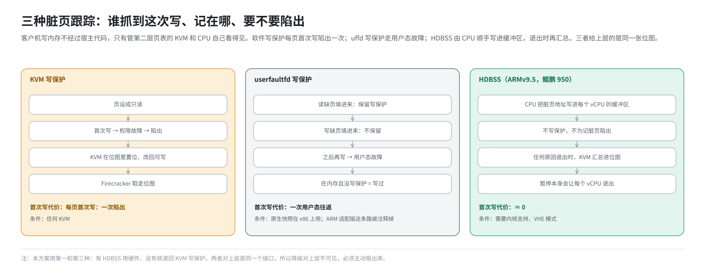
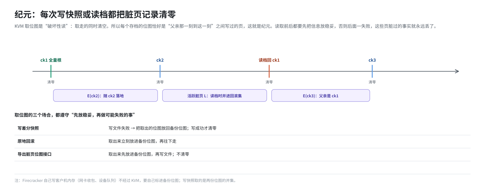
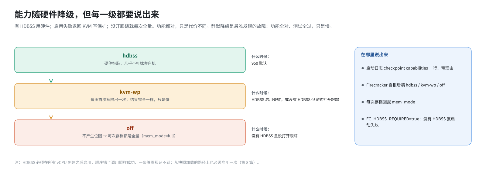

# 第 8 篇｜怎么知道哪一页被写过：脏页跟踪与 HDBSS

> **本篇目标**：前两篇反复用到“脏页位图”，本篇讲它从哪来。宿主看不见客户机写内存，只能靠内核或硬件帮忙记。本篇讲三种记法：软件写保护、userfaultfd 写保护、硬件 HDBSS，以及它们各自的代价；讲清 KVM 脏页日志“读一次就清零”的特性怎么产生了“纪元”；讲 HDBSS 是怎么启用的、哪一步错了会悄无声息地失效；最后讲“读也算脏”这个判据问题，以及为什么本方案不受它影响。

---

## 一、脏页跟踪：既关乎快，也关乎对

第 3 篇说过，脏页记录必须宁多勿少。再强调一次两个方向的后果：

| 记错的方向 | 后果 |
|---|---|
| 多记了（没写过的页也记成脏） | 存档多存几页，读档多写回几页，**只是慢** |
| 少记了（写过的页没记上） | 读档时这一页不会被写回，客户机内存里混进一页别的时刻的数据，**静默出错** |

所以脏页跟踪的精度，既是性能问题，也是正确性问题。

## 二、两层地址翻译

在虚拟化下，客户机访问内存要经过两层翻译：

```
客户机程序用的虚拟地址
   │  第一层：客户机内核自己管的页表
   ▼
客户机物理地址（GPA）
   │  第二层：宿主 KVM 管的页表（ARM 上叫 Stage-2）
   ▼
宿主真实的物理地址
```

我们要跟踪的是中间那一层：**哪些客户机物理页被写过**。客户机写内存时，第一层是它自己的事；第二层由 KVM 管，所以 KVM 和 CPU 能“看见”客户机对哪个物理页做了什么。三种跟踪办法都建立在第二层上。

## 三、三种记法

### 1. KVM 写保护

最经典的办法，也是 KVM 的标准能力：

1. Firecracker 告诉 KVM：“这块内存请记录脏页”；
2. KVM 把第二层页表里所有页设成**只读**；
3. 客户机第一次写某页 → CPU 发现没有写权限 → **陷出**到宿主内核 → KVM 在脏页位图里把这一页置 1，把它改回可写，再让客户机继续；
4. Firecracker 需要时，向 KVM 取走这张位图。

代价很清楚：**每个干净页的第一次写，付一次陷出。** 之后这一页一直可写，不再有开销，直到下次取位图时重新设成只读。

对一个要做存档的沙箱，这个代价通常划算。对一个**从不存档**的沙箱，这是白付的。

### 2. userfaultfd 写保护

E2B 原生快照在 x86 上用的办法。客户机内存由 uffd 托管，缺页时由 orchestrator 填页。填页的时候可以选择“保留写保护”：

- 因为**读**而填的页 → 填好后仍是写保护的；
- 因为**写**而填的页 → 填好后可写。

之后如果客户机去写一个“因读而填”的页，会再触发一次写保护故障，处理程序把保护去掉。于是每一页“有没有写保护”就成了一个准确的信号：在内存里、又没有写保护的页，就是被写过的页。

### 3. HDBSS：硬件来记

**HDBSS** 是 ARM 架构 v9.5 新增的硬件能力，鲲鹏 950 实现了它。它的思路是：既然 CPU 本来就在做第二层翻译，那就让 CPU 在翻译时顺手记一笔。

```
客户机写某个物理页
  → CPU 直接把这一页的地址写进这个 vCPU 专属的一块缓冲区   ← 硬件完成，不陷出
  → 之后 vCPU 因为任何原因退出到宿主时
  → KVM 把缓冲区里的记录汇总进标准的脏页位图
  → Firecracker 照常取位图
```

关键在于：**没有写保护，就没有为记脏页而发生的陷出。** CPU 顺手记，内核定期汇总。

有人会问：如果客户机在纯计算、一直不退出，缓冲区里的记录岂不是迟迟进不了位图？不会。存档和读档之前都要先暂停虚机，暂停本身就会让每个 vCPU 退出，所以“暂停之后取位图”的那一刻，记录都已经汇总好了。

HDBSS 不是一套快照系统，它只回答“哪些页被写过”。它最终喂给上层的，和软件写保护是**同一张位图**、同一个读取接口。这一点既是好事也是坏事：上层代码不用为两种方式分叉；但如果 HDBSS 没开成、退回了软件写保护，**上层完全察觉不到**，只是变慢了。所以第五节要专门处理“怎么把它说出来”。

### 三者对比

| | 判据来自 | 每页首次写的代价 | 精确吗 | 用的条件 |
|---|---|---|---|---|
| KVM 写保护 | 第二层页表的权限故障 | 一次陷出 | 精确，只有写才触发 | 任何 KVM |
| uffd 写保护 | 页的写保护标志 | 一次用户态故障往返 | 精确 | 内存由 uffd 托管，且写保护路径可用 |
| **HDBSS** | CPU 写缓冲区，退出时汇总 | **几乎为零** | 精确 | ARMv9.5 + 内核支持 |



本方案用的是第一和第三种：有 HDBSS 用 HDBSS，没有就退回 KVM 写保护。后面说“KVM 脏页日志”时，两者都包括。

## 四、“读一次就清零”与纪元

KVM 的取位图接口有一个特点：**取走的同时清空**。这是标准设计，否则调用方没法区分“上次取了之后新脏的”和“历史上脏过的”。

这个特点在本方案里有两层意义。

**第一层：它产生了“纪元”。** 每次写快照成功、每次读档完成，Firecracker 都会把脏页记录清零。两次清零之间的那段时间就是一个**纪元**。随某个存档一起落地的位图，恰好就是“这个存档的父亲那一刻”到“这个存档这一刻”之间写过的页。第 9 篇整个差分树的正确性，就建立在这条性质上。



**第二层：每次读都是一次不可撤销的信息转移。** 读完之后如果后面的步骤失败了，“这些页脏过”的信息就永远消失了。所以凡是取位图的地方，都遵守同一个模式：**先把易失的信息放到不会丢的地方，再做可能失败的事。**

| 场合 | 做法 |
|---|---|
| 写差分快照 | 写文件失败时，把取出来的位图放回 Firecracker 自己的备份位图；写成功才清零 |
| 原地回滚 | 取出来立刻放进备份位图，再往下走 |
| 导出脏页位图接口 | 取出来先放进备份位图，再写文件 |

第 6 篇讲的“写快照之后失败不再干净”，根源也在这里。

### 两份位图

Firecracker 里其实有两份脏页记录：一份在内核（KVM 的），一份在 Firecracker 进程自己手里（备份位图）。写快照时取的是两者的**并集**。

备份位图不只是备份。**Firecracker 自己写客户机内存时**，比如网卡往客户机的接收缓冲区放一个网络包、往设备队列里放一个“处理完了”的记录，这些写不经过第二层页表的权限检查，KVM 根本不知道。如果只取 KVM 的位图，这类页就会漏掉。所以 Firecracker 自己写的页，要自己在备份位图里标上。第 7 篇八条顺序约束里的第 8 条“设备队列页要重新标脏”，就是这个问题。

## 五、HDBSS 怎么启用

### 1. 先分清两层开关

脏页这件事分两层，HDBSS 只是第二层。混淆这两层是部署时最常见的配置错误：

| 层 | 管什么 | 谁决定 | 关掉 / 失败时 |
|---|---|---|---|
| 第一层 | **要不要记脏页** | orchestrator，在虚机启动时告诉 Firecracker | 不产生位图 → 每次都存全量 → `mem_mode=full`。**不报错，测试照样过，测的却不是增量** |
| 第二层 | **用什么方式记** | Firecracker 自己探测 | 退回软件写保护 → 结果完全一样，只是每页首次写多一次陷出。**只有延迟看得出来** |

### 2. 两侧各做一件事

**orchestrator** 启动时，向内核问一句“支持 HDBSS 吗”。这只是查询，不建虚拟机、不启用任何东西。据此决定这台机器上的虚机**默认**要不要记脏页：

| 硬件 | 记脏页的代价 | 默认 |
|---|---|---|
| 有 HDBSS | 几乎为零 | 开 |
| 没有 HDBSS | 每页首次写一次陷出，对从不存档的沙箱是白付 | 关 |

一台 950 上，沙箱开箱就能做增量存档；一台没有 HDBSS 的机器上，不存档的沙箱不用为别人的功能买单。在没有 HDBSS 的机器上要做增量，显式打开 `FC_TRACK_DIRTY_PAGES=true` 即可，退回软件写保护，仍是增量。

这个决定是整个 orchestrator 一个值，不是每台沙箱一个。做成“按沙箱决定”需要在创建沙箱时就知道它会不会存档，而现在的接口里没有这个信息。这是第 20 篇列出的一个后续方向。

**Firecracker** 在创建虚拟机时真正启用：先尝试打开 HDBSS，成功就用它；失败了，如果配置要求“必须用 HDBSS”就直接启动失败，否则退回软件写保护。

这段决策在 Firecracker 源码 `src/vmm/src/vstate/vm.rs` 的 `setup_dirty_tracking` 里（节选，注释已译成中文）：

```rust
pub fn setup_dirty_tracking(&mut self) -> Result<(), VmError> {
    // 第一层：orchestrator 有没有要求记脏页？内存注册时带了脏页位图才算要求了。
    let armed = self.guest_memory().iter().any(|region| region.bitmap().is_some());
    if !armed {
        self.common.dirty_tracking = DirtyTrackingBackend::Off;
        return Ok(());
    }

    // 第二层：用什么方式记。（aarch64）
    let order = std::env::var("FC_HDBSS_ORDER")          // 缓冲区大小，默认 1
        .ok().and_then(|v| v.parse::<u64>().ok()).unwrap_or(1);
    let required = std::env::var("FC_HDBSS_REQUIRED")    // "true" 或 "1" 表示必须用 HDBSS
        .map(|v| v == "true" || v == "1").unwrap_or(false);

    match self.enable_hdbss(order) {
        Ok(()) => self.common.dirty_tracking = DirtyTrackingBackend::Hdbss,
        Err(err) if required => return Err(VmError::HdbssRequired(err)), // 宁可启动失败
        Err(err) => {
            info!("HDBSS unavailable, falling back to KVM write-protect dirty tracking: ...");
            self.common.dirty_tracking = DirtyTrackingBackend::KvmWriteProtect;
        }
    }
    Ok(())
}
```

“打开 HDBSS”本身只是对虚拟机发一次 `KVM_ENABLE_CAP`（`src/vmm/src/arch/aarch64/vm.rs` 的 `enable_hdbss`）。这个能力是 openEuler 内核加的，Firecracker 用的 kvm-bindings 里还没有它的定义，所以在代码里就地写死：能力号 `KVM_CAP_ARM_HW_DIRTY_STATE_TRACK = 502`，参数 `args[0]` 就是上面的缓冲区大小 `order`。

### 3. 六个前提，最危险的是顺序

HDBSS 要开成功，需要：内核编译了它、CPU 实现了它、KVM 运行在特定模式（VHE）、内存注册时要求记录脏页、没有同时使用另一种叫 dirty ring 的机制，以及最后一条：

> **启用 HDBSS 的调用，必须在所有 vCPU 创建之后。**

原因是内核只为“调用那一刻已经存在的 vCPU”分配缓冲区。顺序错了，**调用照样返回成功**，只是没有任何 vCPU 拿到缓冲区，一条脏页都记不到。

```
✗ 创建虚拟机 → 启用 HDBSS → 创建 vCPU
✓ 创建虚拟机 → 创建所有 vCPU → 注册内存 → 启用 HDBSS → 启动 vCPU
```

现在的代码靠“调用写在正确的位置”来保证顺序，并没有断言守着。具体位置在 `src/vmm/src/builder.rs`：两条建虚拟机的路径都先调 `create_vmm_and_vcpus`（里面创建全部 vCPU），再 `register_memory_regions`，紧接着 `setup_dirty_tracking`，最后才启动 vCPU。以后有人挪动这一行，就是一个静默的破坏。第 20 篇把它列为一个待补的验证缺口。

还有一点：HDBSS 不会随快照继承，从快照恢复会创建新的虚拟机和新的 vCPU。而 E2B 的用户沙箱全都是从模板快照恢复出来的。所以“从快照加载”这条路径上也必须启用一次。只管冷启动，等于完全没开。上面说的两条路径，就是冷启动的 `build_microvm_for_boot` 和加载快照的 `build_microvm_from_snapshot`，`setup_dirty_tracking` 在两边各调一次。

### 4. 缓冲区大小

每个 vCPU 一块缓冲区，大小由环境变量 `FC_HDBSS_ORDER` 配，单位是“2 的几次方个页”，默认 1，即两页、8 KiB，和内核的默认值一致。一条记录 8 字节，8 KiB 大约 1000 条，能覆盖约 4 MiB 的脏页。写得很密集时缓冲区会满，触发额外的处理，可能吃掉一部分收益。调大缓冲区可以缓解，但每个 vCPU 都要分配一块**物理连续**的内存，在长期运行、内存碎片化的宿主上并不免费。

950 上只实测了默认大小。不同大小之间谁更好，还没有数据。

### 5. 把能力说出来

因为降级是静默的，必须主动报告“这台机器实际在用哪种方式”：

- **orchestrator** 启动日志里打一行 `checkpoint capabilities`，写明是否记脏页，以及**理由**：检测到硬件能力、被环境变量强制开 / 关，或者没检测到；
- **Firecracker** 在实例信息（`GET /`）里多了一个字段 `dirty_tracking`，报告实际用的后端：`hdbss`、`kvm-wp` 或 `off`；启动日志里也有一行 `HDBSS enabled (buffer order 1)` 或 `HDBSS unavailable, falling back to KVM write-protect dirty tracking`；
- **每次存档**回报 `mem_mode`：除了每台沙箱的第一次，出现 `full` 就说明没在跟踪；
- 生产部署可以设 `FC_HDBSS_REQUIRED=true`：**宁可启动失败，也不要悄悄走软件路径**。



这就是原则四“能力随硬件自动降级，但要说出来”的完整落地。静默降级是这套系统里**最难发现的故障**：功能全对、测试全过，只是慢，而且慢多少取决于负载，不容易触发告警。

## 六、“读也算脏”

最后讲一个判据问题，它是理解本方案价值的前提。

| | 怎么判断脏页 | 结果 |
|---|---|---|
| E2B 原生，x86 | uffd 写保护：读进来的页保留写保护，写过才去掉 | 精确 |
| E2B 原生，ARM 适配版 | 写保护那段代码在 ARM 上走不通，被注释掉了 | **读也算脏**：凡是被拉进内存过的页都算脏 |
| 本方案 | 不走 uffd，直接取 KVM / HDBSS 的脏页日志 | 精确 |

ARM 适配版里，填页时“保留写保护”的那几行被注释掉了，于是每次填页都会清掉写保护，不管是因为读还是写。判据“在内存里且没有写保护”就塌缩成了“在内存里”。

这条判据由 Firecracker 的 `GET /memory/dirty` 接口执行。它是 E2B 自己的 Firecracker 分支就有的，不是本方案加的。代码在 `src/vmm/src/lib.rs` 的 `get_dirty_memory` 和 `src/vmm/src/utils/pagemap.rs`：先用 `mincore` 找出驻留在内存里的页，再逐页读 `/proc/self/pagemap` 的那一项：

```rust
// src/vmm/src/utils/pagemap.rs（节选）
pub fn is_write_protected(&self) -> bool { (self.raw & (1u64 << 57)) != 0 } // 第 57 位：uffd 写保护
pub fn is_present(&self) -> bool         { (self.raw & (1u64 << 63)) != 0 } // 第 63 位：在内存里

// is_page_dirty：在内存里，且没有写保护，就算脏
Ok(entry.is_present() && !entry.is_write_protected())
```

在 ARM 适配版里没有任何一页带写保护，第二个条件永远成立，于是只剩“在内存里”。

再叠加原生快照每次都新起进程：新进程内存是空的，客户机一跑起来就要把用到的页重新拉进来，**拉进来就被判脏**。结果是，即使两次原生快照之间什么都没做，导出的增量也约等于整个常驻工作集。

本方案根本不走这条判据。它取的是第二层页表上真正“被写过”的记录，读一页不会让它变脏。这条路径也不要求内存由 uffd 托管。

要说明的是：这是**修复 ARM 适配带来的退化**，不是“超越了 x86 原生”。x86 上原生的增量本来就是精确的。原生路径上的这个问题，后来也单独修好了，第 15 篇讲。

## 七、什么时候不该开

| 场景 | 建议 |
|---|---|
| 从不存档，宿主没有 HDBSS | 关（默认） |
| 写得很密集，又很少存档 | 关，这种负载下增量本来就省不下什么 |
| 要做回滚的生产部署 | 开，并设 `FC_HDBSS_REQUIRED=true` |

软件写保护的代价可以这样估：一个存档周期里被写过的页有 D 页，额外开销约是 D 次陷出。D 小的时候开销小、差分也小，划算；D 接近整个工作集时，付了大量陷出，差分也接近全量，不划算。

---

## 本篇小结

| 概念 | 一句话解释 |
|---|---|
| 精度的意义 | 多记只是慢，少记会静默回错 |
| KVM 写保护 | 页设只读，首次写陷出记一笔；每页首次写一次陷出 |
| HDBSS | ARMv9.5 硬件能力，CPU 顺手记进缓冲区，退出时汇总；几乎不打扰客户机 |
| 同一张位图 | HDBSS 和软件写保护给上层的是同一个接口，降级对上层不可见 |
| 读一次就清零 | 产生了纪元；也意味着每次读都要先把信息放稳妥再往下走 |
| 两份位图 | Firecracker 自己写客户机内存，KVM 不知道，要自己标 |
| 两层开关 | 要不要记（关了每次全量）、用什么记（退回软件只是慢） |
| 启用顺序 | HDBSS 必须在所有 vCPU 创建后启用，错了不报错、一条都记不到 |
| 说出来 | 启动日志、Firecracker 自报后端、每次 `mem_mode`、`FC_HDBSS_REQUIRED` |
| 读也算脏 | ARM 适配版原生快照的判据退化；本方案取 KVM 日志，不受影响 |

**下一篇预告**：[《内存差分树：只存改过的页，还能回到任意一代》](09-memory-diff-tree.md)。有了每一代的位图和差分文件，怎么组织它们，才能回到任意一个存档？为什么是树不是链？读档时要写回哪些页，为什么“沿途位图求并、再并上活跃脏页”就一定够？每一页的目标内容去哪里找？
