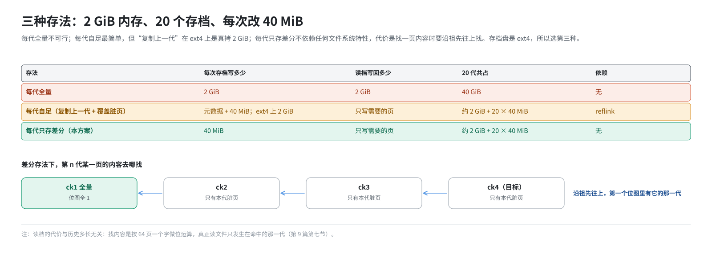
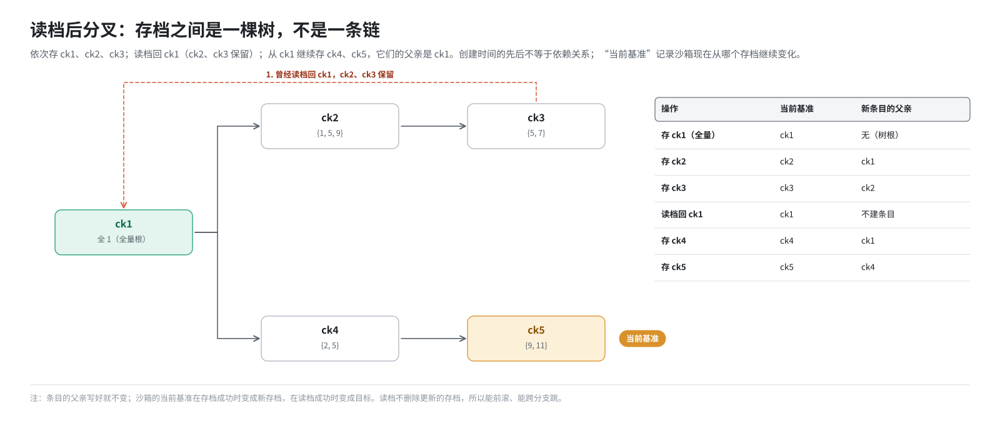
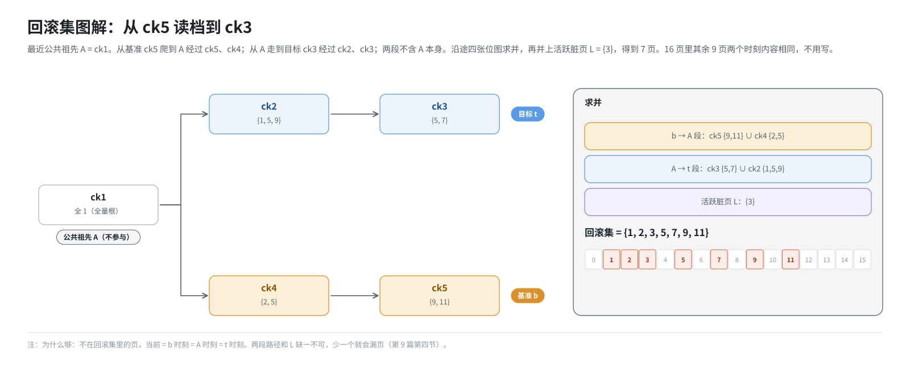
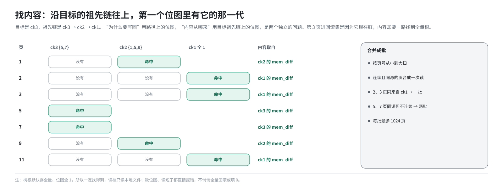

# 第 9 篇｜内存差分树：只存改过的页，还能回到任意一代

> **本篇目标**：每次存档只存这一代的脏页，那么要回到任意一个存档，怎么知道该写回哪些页、每一页的内容去哪里找？本篇是全书的核心。先说清三种存法和为什么选“差分”；再讲存档之间为什么是树而不是链；然后用一个 16 页的小例子，把“回滚集”算一遍、证一遍；最后讲每一页的内容怎么沿祖先链找到，以及为什么读档的代价不会随历史变长而变大。

---

## 一、问题：怎么存 n 代内存

一台 2 GiB 内存的沙箱，存了 20 个档，每两次之间改动 40 MiB 左右。要能回到其中任意一个。三种存法：

| 存法 | 每次存档写多少 | 读档写回多少 | 20 代共占多少 | 依赖 |
|---|---|---|---|---|
| 每代全量 | 2 GiB | 2 GiB | 40 GiB | 无 |
| 每代自足（复制上一代 + 覆盖脏页） | 只写元数据 + 40 MiB，**前提是有 reflink** | 只写需要的页 | 约 2 GiB + 20 × 40 MiB | reflink |
| 每代只存差分 | 40 MiB | 只写需要的页 | 约 2 GiB + 20 × 40 MiB | 无 |



第一种显然不行。第二、三种在有 reflink 的文件系统上几乎一样好，第二种还更简单：每一代都是一份完整内存，读档直接用。

但第 3 篇讲过，存档盘是 ext4，**没有 reflink**，第二种的“复制上一代”会退化成每次真拷 2 GiB。所以只能选第三种：**每代只存差分，要找某一页的内容时，按页往祖先找。**

## 二、一代存档里有什么

第 6 篇讲过，写快照时 Firecracker 一次写出三样东西。和内存有关的是两样：

- **`mem_diff`**：稀疏文件，每个脏页写在它自己的偏移上，干净页的位置是空洞；
- **`mem_bitmap`**：这一代的脏页位图。

为什么差分文件旁边一定要放一张位图？第 3 篇说过：读稀疏文件的空洞得到 0。只看差分文件，分不清“这一页的内容就是全 0”和“这一页根本没存在这一代里”。位图就是这个文件的“目录”，告诉你哪些页在这里。

全量存档也写位图，内容是全 1：每一页都在这里。

### 核心性质

第 8 篇讲过，写快照成功、读档完成时，Firecracker 都会把脏页记录清零。所以随存档 x 一起落地的位图，记作 `E(x)`，恰好是：

> **`E(x)` = 从 x 的父亲那一刻，到 x 这一刻之间，客户机写过的页。**

这条性质是后面所有推导的地基。它由两边共同维持：

- Firecracker：写快照和读档都清零；
- 账本：新存档的父亲，取的是当时的“当前基准”。

**改动任何一边，都必须重新检查这条性质。** 第 7 篇八条顺序约束里的第 4 条，说的就是这件事。

## 三、树，而不是链

每个存档在账本里有一条记录，叫**条目**。条目记着自己的 ID、父亲的 ID（树根的父亲为空）、状态、全量还是增量、各个文件的路径。

连续存三次：

| 存档 | 父亲 | 内存里存的是 |
|---|---|---|
| ck1 | 无 | 全量，作为树根 |
| ck2 | ck1 | ck1 到 ck2 之间写过的页 |
| ck3 | ck2 | ck2 到 ck3 之间写过的页 |

现在读档回 ck1。**读档不删除 ck2、ck3**，它们以后还能读回去。沙箱从 ck1 的状态继续跑，改了一些页，存 ck4。ck4 的差分是相对 ck1 算的，所以 ck4 的父亲是 ck1，不是 ck3。再存 ck5，父亲是 ck4：

```
ck1 ── ck2 ── ck3
  └── ck4 ── ck5
```

所以：**创建时间的先后，不等于依赖关系。** ck4 比 ck3 晚，但它不是从 ck3 继续的。保留旧存档、又允许从读档目标继续存，就必须用树来记录。

这里有两份不同的记录，要分清：

- **条目的父亲**：这个存档的差分是相对谁算的。写好就不变；
- **沙箱的当前基准**：沙箱现在从哪个存档继续变化，也就是下一次存档的父亲。存档成功时变成新存档，读档成功时变成目标。



有了树，就能做三件事：读档回 ck1 之后，再“前滚”回 ck3；从 ck5 直接跨分支跳到 ck3；删掉中间的存档而不破坏它的后代（第五节）。

## 四、回滚集：要写回哪些页

### 1. 问题

客户机现在的内存 = **当前基准 b 那一刻的内容** + **b 之后写过的页**（活跃脏页，记作 L）。

要把它变成**目标 t 那一刻的内容**，最少要写回哪些页？

写回全部内存当然对，但那就回到了“成本和虚机大小挂钩”。我们要一个**尽量小、但保证够用**的集合。

### 2. 答案

找到 b 和 t 在树上的**最近公共祖先** A：从 b 往上爬、从 t 往上爬，第一次相遇的那个存档。然后：

```
回滚集 = （从 b 爬到 A 沿途各代的位图） ∪ （从 t 爬到 A 沿途各代的位图） ∪ L
```

两段路径都**不含 A 本身**。用白话说：从基准爬到公共祖先、再从公共祖先走到目标，把沿途每一代的位图求并集，再并上活跃脏页。

### 3. 为什么这就够了

要证明的是：**不在回滚集里的页，当前内容就已经等于目标时刻的内容**，不用写。拿任意一页 p，假设它不在回滚集里：

1. p 不在 L 里 → 自 b 以来没被写过 → **当前内容 = b 时刻的内容**；
2. p 不在 b 到 A 沿途任何一代的位图里 → 从 A 到 b 的每个纪元都没写过它 → **b 时刻的内容 = A 时刻的内容**；
3. 同理，p 不在 t 到 A 沿途任何一代的位图里 → **t 时刻的内容 = A 时刻的内容**。

串起来：当前 = b = A = t。证毕。

第 2、3 步用的正是上一节的核心性质：每一代的位图恰好覆盖“父亲到自己”那一段。位图漏记一页，第 2 或第 3 步就不成立，读档就会漏一页。这就是为什么第 8 篇说，脏页跟踪的精度是正确性问题。

### 4. 三个部分缺一不可

**少了目标那一段。** 假设 ck2 写过第 1 页，当前基准在另一条分支上，从没碰过第 1 页。那么第 1 页的当前内容等于公共祖先 ck1 时的内容，却不等于目标 ck2 时的内容。如果不把目标那一段的位图算进来，第 1 页就不会被写回，读档后它停在 ck1 时的旧值。

**少了活跃脏页。** 第 7 篇的第 42 页例子：上次存档后客户机把它从 X 改成 Y，还没存新档。它不在任何一代的位图里。不并上 L，读档后它仍是 Y，内存里混进了一页来自被丢弃的那条时间线的数据。

### 5. 够用，但不一定最小

回滚集里可能有一些页，两边都改过、但恰好改成了同一个值，它们其实不用写回。要找出最小集合，得逐页比较内容，代价远大于收益。所以这里求的是“保证够用”的集合。

## 五、一个完整的例子

沿用上面那棵树。为了好算，假设客户机只有 16 页，各代的位图是：

| 存档 | 父亲 | 位图 |
|---|---|---|
| ck1 | 无 | 全 1（全量根） |
| ck2 | ck1 | {1, 5, 9} |
| ck3 | ck2 | {5, 7} |
| ck4 | ck1 | {2, 5} |
| ck5 | ck4 | {9, 11} |

当前基准是 ck5，活跃脏页 L = {3}，目标是 ck3。

**第一步，找路径。** 目标往上的链是 ck3 → ck2 → ck1。从 ck5 往上爬：ck5 → ck4 → ck1，ck1 在目标链上，所以公共祖先 A = ck1。两段路径是 {ck5, ck4} 和 {ck3, ck2}。**ck1 本身不在路径里**，它全 1 的位图不会被用到。

**第二步，求并集。**

```
回滚集 = {9,11} ∪ {2,5} ∪ {5,7} ∪ {1,5,9} ∪ {3}
       = {1, 2, 3, 5, 7, 9, 11}
```

16 页里只有 7 页要写回。第 4、6、8 页等，也许在更早的历史里被写过，但分叉之后两边都没动，两个时刻的内容一样，不用写。



**第三步，找每一页的内容。** 下一节讲规则，先看结果：

| 页 | 在 ck3 里？ | 在 ck2 里？ | ck1（全 1） | 内容取自 |
|---|---|---|---|---|
| 1 | 否 | 是 | | ck2 的差分 |
| 2 | 否 | 否 | 是 | ck1 的差分 |
| 3 | 否 | 否 | 是 | ck1 的差分 |
| 5 | 是 | | | ck3 的差分 |
| 7 | 是 | | | ck3 的差分 |
| 9 | 否 | 是 | | ck2 的差分 |
| 11 | 否 | 否 | 是 | ck1 的差分 |

第 3 页值得注意。它进回滚集，是因为它**现在**是脏的（在 L 里）；可它在 ck3 时刻的内容，要一路找到树根 ck1 才找得到。

**“为什么要写回”和“内容从哪来”是两个独立的问题**，用的是两组不同的位图：前者用路径上的位图，后者用目标往上那条链上的位图。

**第四步，合并成批。** 按页号从小到大扫，把“连续且来自同一个文件”的页合成一次读：第 2、3 页连续且都来自 ck1，合成一批；第 5、7 页虽然同源，但中间隔着不需要写回的第 6 页，所以是两批。合批能大大减少读文件的次数。

## 六、找内容：沿着目标的祖先链往上找

规则只有一句：

> **对回滚集里的每一页，从目标开始沿祖先链往上，找第一个位图里有这一页的存档，从它的差分文件里读出来。**

为什么一定找得到？因为树根默认是**全量**的，它的位图全 1，每一页都在。往上找最多找到树根就停。



### 为什么树根默认存全量

也可以让树根相对“模板内存”存差分，省掉第一次的全量。但第 2 篇讲过，模板内存镜像**不在本地**，是按需从对象存储拉的。如果树根是差分，找内容时就可能找过树根、落到模板上，一次本该几十毫秒的本地读档，可能变成一次跨网络的读取，而且是在虚机暂停期间。

所以默认让树根存全量，整棵树自给自足，读档只读本地文件。代价只落在每台沙箱的**第一次存档**：要写整份内存，950 上 2 GiB 约 0.5 秒。这就是第 4 篇说的“唯一保留的固定开销”。它有开关：沙箱很多、每台只存两三次、磁盘紧张、对象存储又在同机房时，可以考虑关掉。

### 宁可报错，不可将就

找内容的过程中有两处“不将就”：

- **缺位图就报错。** 路径上或目标链上任何一代读不出合法的位图，直接拒绝这次读档，沙箱保持原样。不悄悄改成“把整份内存都回滚”，因为读不出位图说明账本和文件已经对不上了，这时“全量回滚”也未必对。
- **读短了就报错。** 按构造，差分文件在它位图声明的页上一定有数据。如果读的时候文件提前结束了，说明文件和自己的位图矛盾。直接拒绝这次读档，而不是把没读到的部分填 0 继续。填 0 意味着悄悄往客户机内存里写一页零，客户机醒来后在别的地方莫名其妙地出错。

这两处失败都发生在虚机内存被改动之前，沙箱照常可用。

### 和 Firecracker 的约定

找到的内容被写成 `revert_mem`（稀疏文件，每页写在自己的偏移上），回滚集写成 `revert_bitmap`，交给 Firecracker。

这里有一条双方必须遵守的约定：Firecracker 回滚时，会把**它自己手里的**活跃脏页也并进要写回的集合。所以 Firecracker 实际写回的页 ⊇ orchestrator 给的位图。如果某一页 Firecracker 要写、而 orchestrator 没准备内容，它就会读到空洞里的 0。

回滚集的定义里已经并上了 L，而 L 正是 Firecracker 自己会并进来的那个集合，两边相等，约定成立。**这就是 `save-dirty-bitmap` 这个接口存在的原因**：orchestrator 必须**事先**知道 Firecracker 会写哪些页，才能把它们的内容准备好。Firecracker 那边还有一道覆盖校验兜底，第 7 篇讲过。

## 七、代价：为什么读档不随历史变长而变慢

| 操作 | 代价 | 和什么无关 |
|---|---|---|
| 增量存档 | 本代脏页数 | 虚机大小、历史长度、文件系统 |
| 全量根 | 整份内存 | 每台沙箱只发生一次 |
| 算回滚集 | 路径上几张位图的按字求并，全在内存里 | —— |
| 找内容 | 按字做位运算 + 每批一次读文件 | 历史有多长 |
| 写回 | 回滚集大小 | 虚机大小、历史长度 |
| 占磁盘 | 各代脏页之和 + 一份全量 | —— |

直觉上，“沿祖先链逐页找”最可能被长长的历史拖慢。实际上不会：

- 找内容是**按字**进行的。回滚集通常只占内存的百分之几，绝大多数 64 位字都是 0，一次比较就跳过；非零的字，和链上各代的位图做“与”运算，所有页都找到来源就离开；
- 真正读文件只发生在**命中的那一代**，按批进行，读多少只取决于回滚集，和链有多深无关；
- 存档时不复制任何东西，也和链深无关。

所以**读档成本与历史长短无关**，不需要定期把历史“压平”。这是差分树相对“链式增量快照”的结构性优势：链式快照恢复时要把整条链重放一遍，差分树是**按页寻址**，不是**按代重放**。

还有一点值得注意：读档的代价取决于回滚集，而回滚集取决于“当前偏离目标有多远”，不取决于“目标存档本身多大”。即使目标存档很小，只要当前状态已经离它很远（比如之后又跑了很多东西），读档也要写回很多页。

## 八、删除：被依赖的存档不能直接删

ck2 有个孩子 ck3。ck3 的很多页要从 ck2 的差分里找内容。如果直接删掉 ck2 的文件，ck3 就变成一个看起来正常、读档时却会读到错误内容的存档。所以删除必须看依赖：

| 情况 | 处理 |
|---|---|
| 有孩子，或者它是当前基准 | **隐藏**：从列表里消失，不能再作为读档目标；删掉只有读档才用的 snapfile 和磁盘描述；**保留内存差分和位图**，后代还要靠它们 |
| 没有孩子，也不是基准 | **真正删除**，然后看它的父亲是不是“隐藏、没孩子了、也不是基准”，是就一并删掉，一直往上 |

隐藏的存档仍然完整地参与回滚集计算和内容查找。它在树里，只是不在接口里。第 6 篇讲的“隐藏提交”也是这种状态。

### 合并：让“只留最近 N 个”收敛

只靠隐藏和级联删除，有一种最常见的用法会出问题：**每次存一个新的，删掉最旧的，只留最近 N 个。** 每次删的那个最旧的存档，总是下一个存档的父亲，有孩子，只能隐藏，永远删不掉。隐藏的存档越积越多，磁盘跟着涨。

解决办法是**合并**：如果一个隐藏存档 H 只有一个孩子 C，就把 H 并进 C，让 C 直接接到 H 的父亲上，H 离开树。

- C 的位图变成 H 和 C 位图的并集；
- 内容以 C 为准，C 没有、H 有的页，从 H 补过来；
- 数据往少的一边拷，尽量少搬。

可以证明，**合并不会改变任何一次读档的结果**：读档时算出的回滚集逐位相同，每一页找到的内容逐字节相同。直觉上，合并就是把树上 H–C 这条边“收缩”成一个点，任何一条经过 H 的路径一定也经过 C，所以把它们当成一个点看，结果不变。这个结论有专门的随机测试守着：开、关合并两套账本跑同一串随机操作，每一步对每个存档比较读档要写的内容，必须完全一致。

合并之后可以算出一个上界：**可见存档有 V 个时，树里最多 2V + 1 个条目。**“只留最近 N 个”的用法，占用的空间因此会收敛。第 14 篇从使用者的角度再讲一次。

合并在删除的末尾同步进行，没有后台任务，每次最多合并几个。这让删除操作变慢了一些，是一个已知的待改进点，第 20 篇讲。

---

## 本篇小结

| 概念 | 一句话解释 |
|---|---|
| 差分存法 | ext4 没有 reflink，只能每代只存脏页，按页往祖先找内容 |
| 位图侧车 | 差分文件的“目录”，区分“内容是 0”和“不在这里” |
| 核心性质 | 存档 x 的位图恰好是“父亲到 x”之间写过的页 |
| 树 | 读档不删更新的存档，从目标继续存就会分叉；时间先后不等于依赖 |
| 当前基准 | 沙箱从哪个存档继续变化，下次存档的父亲 |
| 回滚集 | 基准到公共祖先、公共祖先到目标沿途位图求并，再并上活跃脏页 |
| 找内容 | 沿目标的祖先链往上，第一个含这一页的存档 |
| 全量根 | 树根存全量，读档不跨网络；唯一的固定开销 |
| 不将就 | 缺位图、读短了都报错，不悄悄全量回滚或填 0 |
| 成本 | 读档只和回滚集有关，与虚机大小、历史长度无关 |
| 隐藏与合并 | 被依赖的存档只隐藏；隐藏且单孩子的并进孩子，条目数 ≤ 2V + 1 |

**下一篇预告**：[《磁盘分层：封存只改个名字》](10-disk-layering.md)。内存讲完了，磁盘那一半怎么做到“存档不搬数据、读档不复制回来”？写层怎么被封存，目标磁盘怎么被装配和换上，层多了怎么回收、怎么合并。
