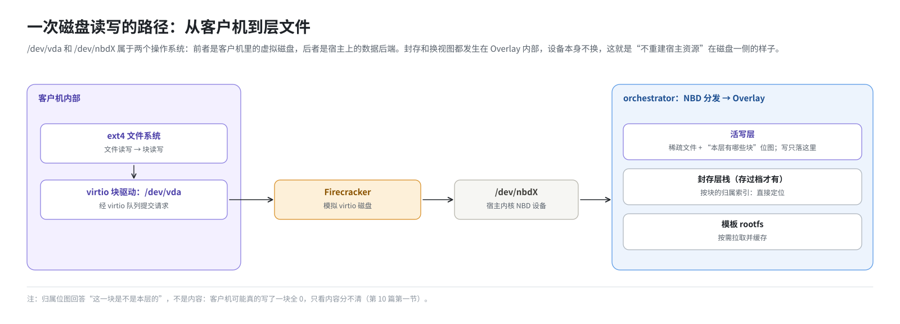
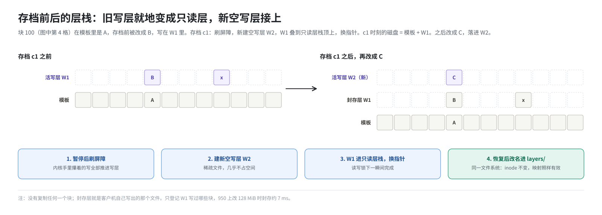
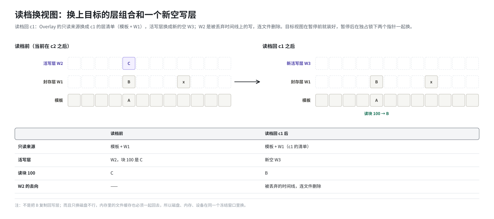
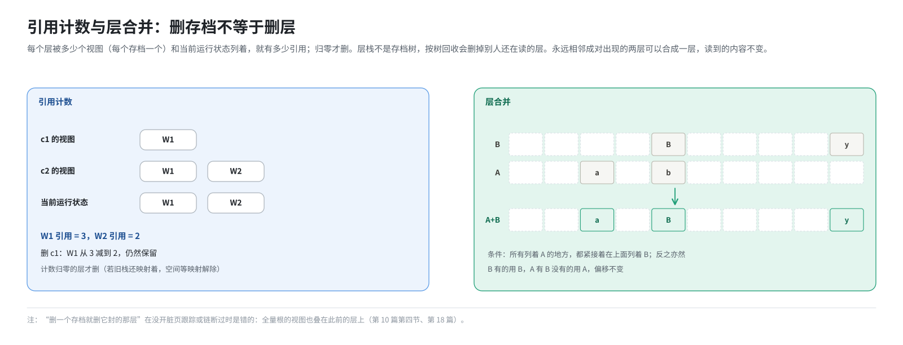

# 第 10 篇｜磁盘分层：封存只改个名字

> **本篇目标**：内存那一半讲完了，本篇讲磁盘。磁盘做到“只为改动付费”的方式和内存很不一样：存档时把写层原地“封存”起来，一个字节都不搬；读档时不把旧数据复制回来，而是换上目标时刻的层组合。本篇先看一次读写请求怎么走到写层，然后讲存档时怎么封存、读档时怎么换视图、删存档时怎么判断哪些层还有用、层多了怎么合并，最后讲账本怎么记录这一切。

---

## 一、运行中的沙箱：读写落在哪

### 1. 一次读写请求的路径

```
客户机里
  文件系统（ext4）把文件读写变成磁盘块读写
  virtio 块设备驱动，设备名 /dev/vda
        │ 通过 virtio 队列提交请求
──────────────────────────────────────────
宿主上  ▼
  Firecracker：模拟 virtio 磁盘，对后端设备读写
        ▼
  /dev/nbdX：宿主内核里的 NBD 块设备
        ▼
  orchestrator 里的 NBD 请求分发器
        ▼
  Overlay：写落最上层，读从上往下找
    ├── 活写层：一个稀疏文件 + 一张“本层有哪些块”的位图
    └── 只读来源：封存层（存过档才有）+ 模板 rootfs
```



要注意 `/dev/vda` 和 `/dev/nbdX` 属于两个不同的操作系统。前者是客户机内核给虚拟磁盘起的名字，后者是宿主上的一块设备，作为这块虚拟磁盘的数据后端。客户机看不到 `/dev/nbdX`。

Firecracker 负责“这是一块磁盘”的设备行为，orchestrator 通过 NBD 提供磁盘的数据。后面讲的封存和换视图，都发生在 Overlay **内部**，不需要更换 `/dev/vda` 或 `/dev/nbdX`。这就是“不重建任何宿主资源”在磁盘这一侧的样子。

### 2. 活写层：和磁盘一样大，却几乎不占空间

活写层创建时，逻辑大小设成和磁盘一样大，但它是稀疏文件，只有写过的块才占空间。刚起来的沙箱，写层物理上接近 0。

orchestrator 把写层文件映射（mmap）进自己的地址空间来读写。这里的“映射”只是程序访问文件的一种方式，数据由宿主的页缓存管理，并不是把整块磁盘复制进内存。

### 3. “这一块是我的吗”

每个写层旁边有一张位图，按块号记录“本层有没有保存这个块”。为什么需要它？还是第 3 篇那个问题：稀疏文件的空洞读出来是 0，而客户机也可能真的往一块里写了全 0。只看内容分不清“这块是本层写的全 0”还是“本层没有这块，应该往下找”。位图回答的是**归属**，不是内容。

## 二、存档：封存旧写层，接替新写层

### 1. 封存前后发生了什么

设磁盘块 100 在模板里是 A，客户机把它改成了 B，写在活写层 W1 里：

| 时刻 | 活写层 | 封存层 | 客户机读块 100 |
|---|---|---|---|
| 存档 c1 之前 | W1，块 100 是 B | 无 | 从 W1 读到 B |
| 存档 c1 之后 | 新建的空 W2 | W1，块 100 仍是 B | W2 没有，往下从 W1 读到 B |
| 之后改成 C | W2，块 100 是 C | W1，块 100 仍是 B | 从 W2 读到 C |

**封存**就是：不再把新的写送进旧写层，保留它已有的内容，让它成为一个只读层。c1 时刻的完整磁盘由“模板 + W1”共同提供。W1 本身不是一份完整磁盘，只是 c1 之前的改动。

再存 c2，W2 也被封存，c2 时刻的磁盘就是“模板 + W1 + W2”，同一个块以较新的层为准。



### 2. 冻结窗口里做的三件事

```
① 刷屏障：把内核手里缓存着、还没交给 orchestrator 的写，全部推进写层
② 建一个新的空写层：一个稀疏文件，几乎不占空间
③ 旧写层追加到只读层栈的最上面，Overlay 的“当前写层”指针换成新的
```

**为什么必须先暂停，再刷屏障？** 刷屏障保证的是：内核已经接受的写，都到了写层里。它不保证客户机不再产生新的写。暂停管的是“客户机还要写的”，刷屏障管的是“内核手里还攥着的”，两者缺一不可。

**为什么换指针对正在进行的读写是安全的？** Overlay 有一把读写锁，普通读写持共享锁，换层时持独占锁。NBD 分发器手里拿着的始终是同一个 Overlay 对象，换的是它内部的指针，所以对分发器来说，换层是一瞬间完成的。

旧写层没有被丢掉，它成了层栈的最上一层。运行中的沙箱照样能读到自己封存前写的每一个块，只是现在是从“只读来源”读到的。

### 3. 封存之后：只改个名字

封存出的层文件原本在沙箱的缓存目录里。冻结窗口结束、虚机恢复运行之后，再把它挪进存档目录的 `layers/` 下。

两个目录在同一个文件系统上时，这只是一次**改名**。文件的 inode（文件系统里文件的身份）不变，所以 orchestrator 对它的那个映射继续有效，映射认的是 inode，不是路径。

这就是本篇标题的意思：**存档存下来的磁盘层，就是客户机自己写出来的那个写层文件**，没有人把数据从一处搬到另一处，只是给它换了个名字、换了个身份。

如果两个目录不在同一个文件系统上，改名会失败，退而做一次保留空洞的拷贝。结果照样正确，只是代价变成了一次拷贝。这也是为什么第 6 篇说要把它放到虚机恢复之后做：不让冻结窗口随写入量变长。默认配置下两个目录在同一个文件系统上，不会走到这条路。

### 4. 不等数据刷到磁盘

封存时**不额外等待**层文件的数据真正写回物理磁盘。层文件通过映射访问，同一个文件的映射和读取都经过宿主的页缓存，不需要先写到物理磁盘再读回来。源码里记录过，额外等待大约每 MB 脏数据 0.5 ms，省下来的就是这部分。

这不代表“什么同步都没有”：封存前仍有刷屏障。也不代表存档能扛住宿主崩溃：账本只在 orchestrator 进程内存里，本来就不承诺跨重启。第 14 篇细讲这个边界。

还要说清楚：封存不是严格的“零成本”。要把旧层写过的块登记进索引（下面第六节），这和写过的块数有关；第一次封存还要为整块磁盘建索引。但比起复制数据，这些都很小。950 上改 128 MiB 时，封存约 7 ms。

## 三、读档：换上目标视图，再给一个新写层

### 1. 不是把旧数据复制回来

读档前：模板块 100 是 A，W1 是 B，当前写层 W2 是 C。读档回 c1 之后：

| | 读档前 | 读档回 c1 后 |
|---|---|---|
| 只读来源 | 模板 + W1 | 模板 + W1 |
| 活写层 | W2，块 100 是 C | 新的空 W3 |
| 读块 100 | C | B |
| 新的写落在 | W2 | W3 |

读档改变的是 Overlay **用哪些层**，而不是把 B 逐块复制回写层。W2 是被丢弃的那条时间线上的写，直接扔掉。

本书把“模板 + 按顺序排好的封存层，共同提供某一时刻的完整磁盘”叫做一个**磁盘视图**。读档就是换视图。



### 2. 暂停前装好，暂停后换上

第 7 篇讲过，目标视图在**暂停之前**就装配好了：读出目标存档的层清单，把这些层文件一层层重新打开，根据每层的块清单恢复“这一层有哪些块”，建好读取索引。这时旧的 Overlay 照常服务，还没切换。

暂停之后只做：刷屏障、建一个新的空写层，然后在独占锁下把 Overlay 的“只读来源”和“活写层”两个指针一起换掉。被丢弃那条时间线的写层，连文件一起删掉；旧的层栈只解除映射，层文件留给存档目录管理。

### 3. 只换磁盘不行

客户机的内存里可能缓存着读档前的文件内容和文件系统状态。只换磁盘，不换内存，就是第 2 篇的那个一致性反例。所以完整的读档必须在同一个冻结窗口里协调磁盘、内存和设备状态。

## 四、删除存档：先看哪些层还有人要

### 1. 删记录不等于删层

W1 存着块 100，后面的 W2 只存了块 200。c2 的磁盘是“模板 + W1 + W2”。即使删掉 c1，c2 仍要从 W1 读块 100，所以 W1 不能跟着删。

### 2. 引用计数

每个层被多少地方“列着”，就有多少个引用：

- 每个存档的磁盘视图，列着它用到的层；
- 当前运行状态的磁盘账本，也列着正在用的层。

例如 c1 列着 W1，c2 列着 W1、W2，当前运行状态也列着 W1、W2，那么 W1 的引用是 3，W2 是 2。删除 c1 只把 W1 从 3 减到 2，它还活着。**计数归零**的层，才真正删掉。

为什么不能简单地“删一个存档，就删它封存的那一层”？因为**层栈不是存档树**。封存层是一路往上叠的，不看存档的父子关系。比如全量存档是树根，它的视图却叠在此前封存的每一层上。按树来回收，很容易删掉别的存档还在读的层。引用计数只看“谁还列着它”，不看树的形状，所以总是对的。



还有一个细节：计数归零后删掉的是文件路径。如果运行中的旧层栈还映射着这个文件，磁盘空间要等映射解除后才真正释放。

## 五、层合并：两层变一层

第 9 篇讲过，内存那边会把“隐藏且只有一个孩子”的存档并进孩子。磁盘这边顺带尝试把孩子封存的层 B 和紧挨在它下面的层 A **合成一层**。不合的话，内存条目收敛了，磁盘层文件还在一层层叠。

合并的规则很直观：B 有的块用 B 的，A 有 B 没有的块用 A 的，都没有的照旧往下找。因为层文件里块的位置和磁盘上的位置相同，A 的块合进来后还在**同一个偏移**上。

但不是什么时候都能合。条件是：**所有列着 A 的地方，都紧接着在 A 上面列着 B；所有列着 B 的地方，都紧接着在 B 下面列着 A**。也就是 A 和 B 永远以相邻的一对出现。只有这样，“把 A、B 换成合并层”对每一个视图读到的内容都没有影响。不满足就只合并内存，不动磁盘。

合并时数据往少的一边拷，用新名字创建合并后的文件，最后在锁里一次切换，原来的 A、B 计数归零回收。运行中的沙箱不受影响，它继续通过已有的映射读 A、B。

## 六、账本怎么记录磁盘

三种信息，存在三个地方：

| 信息 | 存在哪 | 回答什么 |
|---|---|---|
| 块的内容 | 层文件 | 这一块的字节是什么 |
| 本层有哪些块 | 内存里的位图；封存后另写一份 `.meta` 块清单 | 哪些块应该从这一层读 |
| 整块磁盘每一段从哪来 | `rootfs.header` | 每段磁盘内容对应哪个来源、文件里的哪个位置 |

**偏移相同。** 层文件就是原来的写层文件，块还在原来的位置上：磁盘偏移 409600 的块，就在层文件偏移 409600 处。所以“磁盘偏移 → 文件偏移”是恒等的，比原生导出时的紧凑格式少一步换算。代价是写了全 0 的块也实打实占一个块，不像紧凑格式那样把全零块省掉。对高频存档，这个取舍划算：省下的是每次封存一整趟数据搬运。

**块清单 `.meta`。** 每个层文件旁边一个，每块一条 8 字节的偏移。它唯一的作用是：读档重新打开这个层文件时，恢复“它有哪些块”这份知识。丢了会怎样？读档在暂停之前就要读它，读不出来就失败，沙箱照常运行在当前状态。错误会被发现，不会静默读错。

**`rootfs.header`。** 每次存档，把新层的映射合进沙箱当前的总映射：上层覆盖下层，相邻同源的区间合并，最后检查结果**没有缝隙、没有重叠、正好覆盖整块磁盘**。结果写成这个存档的 `rootfs.header`，它描述的就是这一刻的完整磁盘视图。

**读取索引。** 封存了 k 次之后，最朴素的读法是一层层往下问：“最上层有没有？没有就问下一层……”，最坏要问 k + 2 层，历史越长读越慢。实际的做法是维护一个**按块的归属索引**：每块 2 字节，记着“这一块归第几层”，读的时候直接去那一层读，**代价和层数无关**。代价是每 GiB 磁盘每个视图 512 KiB 的索引。读档装配目标视图时，按连续区间批量填这个索引，而不是一块一块地填。

## 七、账本必须跟着层栈走

磁盘账本（当前层清单、总映射）和 Overlay 实际在用的层栈，必须一一对应。

封存一旦发生，新层就已经在活的层栈里了，这是既成事实。如果之后登记账本失败了（比如映射合并的校验没通过），账本就比实际**少一层**。之后用这份账本构造的每一个视图都会少这一层，读档时静默地读到旧数据。

所以这时的处理不是“重试”，也不是“把层再拆下来”（拆一个已经接收过新写的层，只会让情况更糟），而是**把磁盘账本标记为“已污染”**，此后一切存档直接报错（`rootfs_poisoned`）。读档仍然可以：成功读档到任意一个已有的存档，会用那个存档自己的 `rootfs.header` 重建账本，污染随之清除。

> **账本跟着层栈走，不跟着请求的成败走。** 层栈已经变了，这是事实；请求失败只是调用方没拿到结果。

这和第 7 篇“账本跟着状态走”是同一个思想。

## 八、和原生 pause 的区别

| | 原生 pause 导出磁盘 | 本方案封存 |
|---|---|---|
| 数据 | 把写层逐块读出来，紧凑地写进一个导出文件 | 不复制，写层原地变成只读层 |
| 沙箱 | 必须停掉 | 暂停一下，之后继续跑 |
| Overlay | 摘下所有层后作废 | 继续用，只是多了一层 |
| 产物 | 自足的紧凑文件，可以上传、搬走 | 绑在本机的层文件，只在这台沙箱这一代里有用 |

原生导出是“沙箱生命的终点”，所以可以摘下所有层；本方案要让沙箱接着跑，所以只能原地封存。两者用途不同，不能互相替代。第 15 篇会讲，一台存过档的沙箱再做原生 pause 时，原生导出会把所有封存层和当前写层一起压平导出，和沙箱自己读到的内容一致。

---

## 本篇小结

| 概念 | 一句话解释 |
|---|---|
| 请求路径 | 客户机 → Firecracker → /dev/nbdX → orchestrator 的 Overlay → 写层 / 封存层 / 模板 |
| 归属位图 | 记“本层有没有这一块”，区分“写了全 0”和“没写过” |
| 封存 | 刷屏障、建新空写层、旧写层进只读层栈、换指针；不搬数据 |
| 只改名字 | 封存层就是客户机写出的那个文件，恢复运行后改名进存档目录 |
| 换视图 | 读档时换上目标的层组合和新空写层，不把旧数据复制回来 |
| 引用计数 | 层被多少视图和当前账本列着；归零才删，不按存档树回收 |
| 层合并 | 永远相邻成对出现的两层可以合成一层，读到的内容不变 |
| 三种记录 | 层文件存内容，`.meta` 存归属，`rootfs.header` 存整盘映射 |
| 归属索引 | 每块记着归第几层，读取代价和层数无关 |
| 账本污染 | 层栈已变而账本没跟上，就标记污染、拒绝存档，读档后恢复 |

**下一篇预告**：[《在活着的虚机里原地回滚：Firecracker 的三处扩展与九个阶段》](11-in-place-rollback.md)。orchestrator 把要写回的页和内容准备好之后，Firecracker 怎么在同一个进程里把它们写回去，再把 CPU、中断控制器、设备一一恢复？“提交点”是什么，为什么它把失败分成了截然不同的两类？
