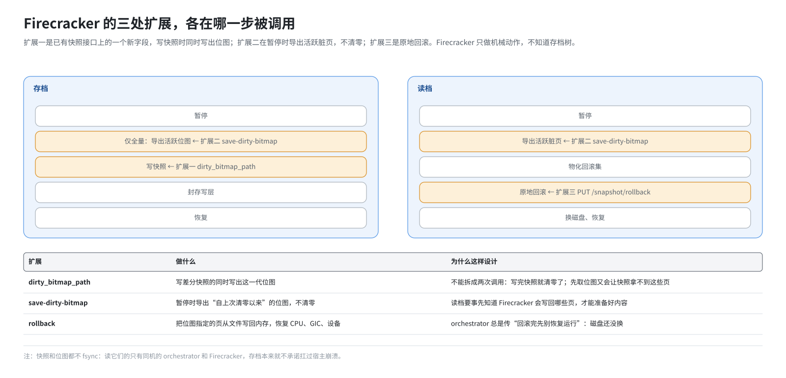

# 第 11 篇｜在活着的虚机里原地回滚：Firecracker 的三处扩展与九个阶段

> **本篇目标**：orchestrator 算好了回滚集、准备好了内容，接下来要由 Firecracker 把它们写进一台**正在运行（此刻暂停着）的**虚拟机。本篇先讲为什么 Firecracker 必须改、改了哪三处、两边约定的位图格式长什么样；然后逐个讲原地回滚的九个阶段，以及把它们分成两半的“提交点”；最后讲为什么快照和运行中虚机的设备组成必须完全一致。

> **关于本篇的源码片段**：e2b-infra 里只有编译好的 `firecracker.arm`，Firecracker 这一侧的源码没有随它发布。本篇的片段摘自编出这个二进制的 Firecracker 源码，路径以 Firecracker 源码目录为根（例如 `src/vmm/src/rollback.rs`），只给文件和函数名。片段都是节选：省略处用 `// ……` 标出，英文注释译成了中文，逻辑不改。全部改动的清单见[附录 A](A-firecracker-changes.md)。

---

## 一、为什么要改 Firecracker

上游 Firecracker 已经有快照能力：全量快照、差分快照、脏页跟踪、暂停恢复，以及“新起一个进程加载快照”。它缺三样东西：

| 缺什么 | 为什么需要 |
|---|---|
| 写差分快照时，同时交出“这次写了哪些页” | 差分树每一代都需要一张位图（第 9 篇） |
| 虚机暂停时，导出“自上次清零以来写过的页” | 读档时要把活跃脏页并进回滚集，而且要**事先**知道 |
| 往活着的进程里写回指定页、恢复 CPU 和设备 | 上游只有“新进程加载”这一条恢复路径 |

改动遵循**最小化原则**：Firecracker 只做机械动作，不知道树、不知道存档、不管文件放在哪。改得越少，跟上游同步越容易，出了问题也越容易判断是不是自己引入的。

主体集中在一个新文件 `src/vmm/src/rollback.rs`：九个阶段、设备组成校验、导出位图都在这里。其余改动分散在内存（`src/vmm/src/vstate/memory.rs`）、写快照（`src/vmm/src/vstate/vm.rs`、`src/vmm/src/persist.rs`）、vCPU 与中断控制器（`src/vmm/src/arch/aarch64/` 下）、几个设备和 HTTP 接口层。

## 二、三处扩展

### 扩展一：写快照时顺带写位图

在已有的“创建快照”接口 `PUT /snapshot/create` 上加一个可选字段 `dirty_bitmap_path`。写差分快照时，Firecracker 把“这次写进内存文件的页”写成一张位图放到这个路径。

为什么不能分两次调用，先写快照、再取位图？因为写快照的最后一步就是把脏页记录清零，等 orchestrator 再来问，已经没有了。那先取位图、再写快照呢？也不行，取位图会清零 KVM 的记录，写快照时就拿不到这些页了。**唯一正确的时机，就是在写快照的过程中**：Firecracker 决定哪些页写进文件的同时，顺手把它们记成位图。这样位图描述的恰好是“文件里实际写了的页”，一页不多、一页不少。

代码就是这样写的。`src/vmm/src/vstate/vm.rs` 的 `snapshot_memory_to_file` 里，位图是写内存那一步**顺带返回**的：

```rust
// 这次快照实际写了哪些页，按“内存文件里的页号”编号。全量快照就是每一页。
let written_bitmap = match snapshot_type {
    SnapshotType::Diff => {
        let dirty_bitmap = self.get_dirty_bitmap()?;              // 取 KVM 的脏页记录
        self.guest_memory().dump_dirty(&mut file, &dirty_bitmap)? // 写脏页，同时返回写了哪些页
    }
    SnapshotType::Full => {
        self.guest_memory().dump(&mut file)?;
        self.reset_dirty_bitmap();
        self.guest_memory().reset_dirty();
        let mut all = vec![u64::MAX; total_pages.div_ceil(64)];    // 全 1
        if total_pages % 64 != 0 {                                 // 最后一个字多出来的位清零
            // ……把最后一个字设成 (1 << (total_pages % 64)) - 1
        }
        all
    }
};
// ……写完内存文件之后，若请求带了 dirty_bitmap_path，把 written_bitmap 写成 FCDB 文件
```

`dump_dirty` 是上游已有的函数，它逐页判断“KVM 记为脏，或 Firecracker 自己记为脏”就写进文件。改动是让它在写的同时把这些页记进一张平铺的位图，写完返回。它的结尾保留了第 8 篇那条纪律：写文件失败时，把取出来的 KVM 记录放回 Firecracker 自己的备份位图；写成功才清零。

```rust
// src/vmm/src/vstate/memory.rs，dump_dirty 结尾
if write_result.is_err() {
    self.store_dirty_bitmap(dirty_bitmap, page_size);  // 失败：取出的记录放回备份位图，不丢
} else {
    self.reset_dirty();                                // 成功：清零，开始记下一段
}
```

全量快照也写位图，内容全 1。只要位图、不要内存文件是不行的：请求里有 `dirty_bitmap_path` 却没有 `mem_file_path`，`src/vmm/src/persist.rs` 直接拒绝（错误 `DirtyBitmapWithoutMemFile`），因为没有内存文件，位图就无从描述。

存档这次写出的三个文件（snapfile、内存差分、位图）都**不调用 fsync**。读它们的只有同一台宿主上的 orchestrator 和 Firecracker，走的是同一份页缓存，写完立刻可见；存档本来就不承诺扛过宿主崩溃；而在冻结窗口里调用 fsync，要等整个文件系统的日志提交，会被别的沙箱的写拖慢。Firecracker 源码的注释里记着一组实测：ext4 上 16 路并发增量存档时，快照这一段的 p50 因 fsync 从 112 ms 涨到 870 ms。第 18 篇第三节讲这一组优化。

原生 pause 也调这个接口，它的 snapfile 要上传、要长期保存，所以那条路径保留了原来的 fsync。两条路径靠什么区分？靠请求里有没有 `mem_file_path`：存档让 Firecracker 写内存文件，原生 pause 不让，它的内存由 orchestrator 自己导出（第 15 篇）。

```rust
// src/vmm/src/persist.rs
/// snapfile 是否必须在 create_snapshot 返回前落盘。
/// 带 mem_file_path 的是 checkpoint：产物只在本机页缓存里被读，不 fsync；
/// 不带的是原生 pause：snapfile 要活过这个进程，保留上游的 sync_all()。
fn snapfile_must_be_durable(params: &CreateSnapshotParams) -> bool {
    params.mem_file_path.is_none()
}
```

判断写在 Firecracker 里、不写在调用方，是为了让以后再加的第三种调用者也必须经过这条判断。

### 扩展二：`PUT /snapshot/save-dirty-bitmap`

虚机暂停时调用，请求体只有一个 `path`，把当前的活跃脏页位图写到这个文件。

它**不清零**：从 KVM 取出来的记录立刻放进 Firecracker 自己的备份位图，写文件用的是备份的副本。所以之后的快照或回滚仍然能看到完整的集合。这是第 8 篇那条纪律：取出来的脏页信息，在任何路径上都不能丢。

```rust
// src/vmm/src/rollback.rs，save_dirty_bitmap（节选）
let kvm_bitmap = vmm.vm.get_dirty_bitmap()?;                      // KVM 的读取会清零它
vmm.vm.guest_memory().store_dirty_bitmap(&kvm_bitmap, page_size); // 先并进备份位图
let words = userspace_bitmap_flat(vmm.vm.guest_memory(), page_size, total_pages);
let data = serialize_dirty_bitmap(&words, page_size, total_pages);
std::fs::write(path, data)?;
```

`userspace_bitmap_flat` 读备份位图时先复制一份再取值，不动原件。对这条只读路径，这一点是必需的。

为什么非有不可，第 9 篇讲过：Firecracker 回滚时会把自己的活跃脏页并进写回集合，orchestrator 必须事先知道这些页，才能准备好它们的内容。

### 扩展三：`PUT /snapshot/rollback`

原地回滚。请求体有四个字段：

| 字段 | 含义 |
|---|---|
| `snapshot_path` | 目标时刻的 snapfile（CPU、中断控制器、设备状态） |
| `mem_file_path` | 内容文件：回滚集里每一页在目标时刻的内容 |
| `revert_bitmap_path` | 回滚集位图（FCDB 格式），可省略 |
| `resume_vm` | 回滚完要不要立刻恢复运行 |

orchestrator 永远传 `resume_vm: false`。原因是**磁盘视图还没换**：Firecracker 回滚完时，内存已经在目标时刻，磁盘还在当前时刻，这时让客户机跑起来，它会按目标时刻的文件系统元数据去读当前时刻的磁盘块。恢复运行由 orchestrator 在换好磁盘、清完连接跟踪表之后自己做。

返回值除了写回了多少页（`restored_pages`）、多少字节（`restored_bytes`），还有两组观测数据：

- `timings_us`：每个阶段花了多少微秒，字段是 `validate`、`quiesce`、`bitmap`、`memory`、`vcpus`、`gic`、`devices`、`total`；
- `vcpu_counters`：本次调用里收尾了几次挂起的设备访问、收尾失败几次、读回核对不一致几次（阶段 5 讲）。



## 三、两边约定的位图格式

orchestrator 和 Firecracker 之间唯一的二进制格式，叫 FCDB：

| 位置 | 长度 | 内容 |
|---|---|---|
| 0 | 4 字节 | 标识 `"FCDB"` |
| 4 | 4 字节 | 版本号，当前是 1 |
| 8 | 8 字节 | 页大小 |
| 16 | 8 字节 | 页数 |
| 24 | 每 64 页 8 字节 | 位图本体，第 w 个字的第 i 位对应第 w × 64 + i 页 |

所有整数都是小端序。2 GiB 内存的位图文件长 24 + 65536 字节。


写这个格式的函数只有十来行：

```rust
// src/vmm/src/vstate/memory.rs
pub const DIRTY_BITMAP_MAGIC: &[u8; 4] = b"FCDB";
pub const DIRTY_BITMAP_VERSION: u32 = 1;

pub fn serialize_dirty_bitmap(bitmap: &[u64], page_size: usize, num_pages: usize) -> Vec<u8> {
    let mut out = Vec::with_capacity(4 + 4 + 8 + 8 + bitmap.len() * 8);
    out.extend_from_slice(DIRTY_BITMAP_MAGIC);
    out.extend_from_slice(&DIRTY_BITMAP_VERSION.to_le_bytes());
    out.extend_from_slice(&(page_size as u64).to_le_bytes());
    out.extend_from_slice(&(num_pages as u64).to_le_bytes());
    for word in bitmap {
        out.extend_from_slice(&word.to_le_bytes());
    }
    out
}
```

读的一侧 `deserialize_dirty_bitmap` 检查标识、版本号，以及文件长度是否恰好等于 24 + ⌈页数 / 64⌉ × 8，任何一项不对都报错。

几个设计上的讲究：

- **页号是“内存快照文件里的偏移 ÷ 页大小”，不是客户机物理地址。** 客户机内存可能由几段组成，中间有空隙；快照文件把这几段首尾相接地平铺。所以 orchestrator 看到的是一个平坦的、连续的页号空间，完全不需要知道客户机的内存布局。布局的知识全部留在 Firecracker 里。
- **每次读都校验几何。** 页大小和页数必须和当前虚机一致，文件长度必须恰好对得上。对不上说明这张位图属于另一台虚机或另一次运行，直接报错，不猜。
- **最后一个字里多出来的位必须是 0。** 页数通常不是 64 的倍数，最后一个字有几位不对应任何页。两边构造“全 1 位图”时都把这几位清零（上面扩展一的全量分支就是这么做的），保证两边造出来的全 1 位图是同一个，求并、比较时不会出现莫名其妙的不一致。

## 四、九个阶段与提交点

Firecracker 收到回滚请求后，在同一个进程里依次做九件事。九件事全写在 `src/vmm/src/rollback.rs` 的 `rollback_snapshot_inner` 里，每个阶段开头都有一行 `// ── Phase N ──` 注释。中间有一条线，叫**提交点**：


| # | 阶段 | 做什么 | 动客户机吗 |
|---|---|---|---|
| 1 | 校验 | 虚机是否已暂停；快照能否读；设备组成是否一致；内存文件长度、位图几何是否对得上 | 否 |
| 2 | 静默在途 I/O | 等磁盘的异步操作收尾；把网卡里缓存着的、发给旧时间线的包读出来扔掉 | 否 |
| 3 | 取活跃脏图并校验覆盖 | 从 KVM 取活跃脏页，与传入的回滚集求并；检查内容文件在每一页上都有数据 | 否 |
| | **═ 提交点 ═** | | |
| 4 | 内存 | 把回滚集里的页写回客户机内存 | **是** |
| 5 | vCPU | 收尾挂起的设备访问，复位，写回全部寄存器，读回核对 | 是 |
| 6 | 中断控制器 | 写回 GIC 状态，“使能 / 等待 / 正在处理”三类寄存器按位绝对写回 | 是 |
| 7 | 设备 | 恢复每个 virtio 设备的队列、协商过的特性、中断状态；复位串口；重建网卡缓存 | 是 |
| 8 | VMGenID | 写入一个新的代号，通知客户机“你被回滚过” | 是 |
| 9 | 重置基线 | 清零脏页记录；把设备队列所在的页重新标脏 | 只改 Firecracker 自己的记录 |

还有一步发生在九个阶段之外：orchestrator 换好磁盘后让虚机恢复运行，Firecracker 的 `resume_vm`（`src/vmm/src/lib.rs`）在放行 vCPU 之前，会先通知每个设备按当前队列重新处理一遍。上游每次恢复运行都会这样做，回滚代码的注释把它记作“第 10 步”，不另写代码。

### 提交点：把失败切成两半

- **提交点之前**失败：客户机一个字节都没动。orchestrator 恢复虚机运行，沙箱照常可用，这次读档只是失败了。
- **提交点之后**失败：客户机已经是两个时刻的混合体，一部分在目标时刻，一部分还在现在。Firecracker 把虚机标记为 `Faulted`。此后只接受查询类请求；恢复运行、暂停、打快照、再回滚、导出位图、热更新设备一律拒绝，只能销毁重建。orchestrator 把这种情况叫“撕裂”。

“哪些错误算撕裂”不靠文案，而是写死在错误类型上：

```rust
// src/vmm/src/rollback.rs
impl RollbackError {
    /// 失败是否发生在提交点之后，让客户机状态撕裂在两个时刻之间。
    pub fn faults_vm(&self) -> bool {
        match self {
            NotPaused | Faulted | SnapshotFile(_) | Validation(_) | RevertBitmap(_)
            | MemoryFile(_) | MemoryFileCoverage(_) | DirtyBitmap(_) | BitmapWrite(_) => false,
            Memory(_) | Vcpu(_) | Gic(_) | Devices(_) => true,   // 阶段 4～9 的错误
        }
    }
}
```

`Faulted` 由回滚函数自己标记（`brand_vm_on_faulting_failure`），不交给 HTTP 那一层。这样任何调用者，包括测试，拿到撕裂错误时虚机都已经是 `Faulted`，不会还自称“已暂停、可恢复”。

所以设计的原则是：**能检查的，全部在提交点之前检查完。** 设备组成、文件长度、位图几何、内容覆盖，任何一项不对都在动客户机之前拒绝。

返回给 orchestrator 的错误也按这条线分级：提交点之前失败返回 400；之后失败返回 500，并在响应里带一个明确的 `"fault": true` 字段。orchestrator **只看这个字段**来判断是不是撕裂，不去匹配错误文案。判错的代价在两个方向上都很高：把撕裂当成可恢复，是让一个半新半旧的客户机继续跑，静默损坏；把可恢复当成撕裂，是白白杀掉一台本来完好的沙箱。而 Firecracker 的错误文案随时可能被人改写，不能当成约定。

如果回滚调用**超时**没有应答，orchestrator 也按撕裂处理：它说不清 Firecracker 停在提交点的哪一边，可能已经写了一半内存。

“提交点之后失败”在正常运行中几乎碰不到，为了能在真机上测它，Firecracker 有一个测试专用的编译特性 `rollback-fault-inject`。用它编出的二进制读环境变量 `FC_ROLLBACK_FAULT_INJECT=post_commit`，在阶段 5 和阶段 6 之间注入一个与真实阶段 6 失败相同的错误。交付的二进制不带这个特性：相关代码在编译时整段去掉，连这个变量名都不包含。第 19 篇里“提交点后失败”这个用例需要这样编出的 Firecracker，所以默认跳过。

### 阶段 1：校验

先看状态：虚机必须是 `Paused`，已经 `Faulted` 的直接拒绝。然后读 snapfile、比对设备组成（第五节），再核对内存文件长度等于客户机内存大小、客户机内存是整数个页、回滚集位图的页大小和页数与本机一致。全部通过才往下走。

### 阶段 2：为什么要静默在途 I/O

如果有一个磁盘操作是在回滚**之前**发起的、在回滚**之后**完成，它的结果就会被写进新时间线。所以要先让磁盘的在途操作收尾，用的是上游写快照前就会调用的同一个函数 `prepare_save`。

网卡这边，宿主 tap 设备里可能缓存着一些还没交给客户机的包，它们是发给被丢弃的那条时间线的。把它们读出来扔掉：

```rust
// src/vmm/src/rollback.rs，quiesce_devices 的网卡分支（节选）
let fd = net.tap.as_raw_fd();          // tap 是非阻塞的
let mut buf = [0u8; 65562];
for _ in 0..4096 {                     // 最多读 4096 次
    let n = unsafe { libc::read(fd, buf.as_mut_ptr().cast(), buf.len()) };
    if n <= 0 { break; }               // 读空（EAGAIN）就停
}
```

读的次数上限是 4096 次，防止在持续灌包的环境里，这一步变成死循环把冻结窗口无限拉长。万一没读完，剩下的包客户机恢复后照常收到，TCP 协议栈会把序号对不上的包丢弃，这和真实网络上的重复包、迟到包是一回事，不影响内存的正确性。

### 阶段 3：先放稳，再校验

从 KVM 取出活跃脏页后，**第一件事是放进备份位图**，然后才求并、校验。这样即使后面校验失败、这次回滚被拒绝，“这些页脏过”的信息也不会丢。

```rust
// src/vmm/src/rollback.rs，阶段 3 与提交点
let kvm_bitmap = vmm.vm.get_dirty_bitmap()?;                      // 读取即清零
vmm.vm.guest_memory().store_dirty_bitmap(&kvm_bitmap, page_size); // 先放稳

// 回滚集 = 活跃脏页 ∪ 调用方传入的累计集合
let mut revert = userspace_bitmap_flat(vmm.vm.guest_memory(), page_size, total_pages);
if let Some(words) = &file_bitmap {
    for (dst, src) in revert.iter_mut().zip(words.iter()) {
        *dst |= *src;
    }
}

// 仍在提交点之前：内存文件在要读的偏移上没有数据，就拒绝
validate_mem_file_coverage(&mem_file, &revert, page_size, total_pages)?;

// ────────── 提交点 ──────────
// 从这里开始改写客户机内存。之后任何失败，虚机一部分在目标快照、一部分在现在：Faulted。
```

覆盖校验（`validate_mem_file_coverage`）用 `SEEK_DATA` / `SEEK_HOLE` 逐段走内容文件，看回滚集里有没有哪一页落在空洞上，有就拒绝。代价是每个空洞一对 `lseek`，而不是每页一次。它挡住的是两种错误：orchestrator 漏准备了某一页；或者递过来的文件根本不对，比如把一个差分层当成了完整视图。后一种光看长度查不出来：Firecracker 写差分文件时会把它补齐到和全量文件一样长。放过去的话，阶段 4 会从空洞读到 0 写进客户机，而且发生在提交点之后。

这个校验有两处有意的取舍：

- 文件系统不支持 `SEEK_DATA` / `SEEK_HOLE` 时（返回 `EINVAL`），校验无从进行，跳过并告警一次，不算失败；
- 一页内容恰好全是 0、文件系统又恰好把它存成空洞，会被误拒。目前准备回滚集时都是真的把页写出来，不会产生这种页；而放过空洞的代价是静默损坏，所以宁可误拒。

### 阶段 4：写回内存

按位图逐字扫描，只处理需要写回的页，把**连续的页合成一批**，一批一次 `pread` 直接读进客户机内存。回滚集通常是成片的，一个进程动过的内存往往是连续的，合批之后系统调用从“每页一次”降到“每段一次”。

```rust
// src/vmm/src/vstate/memory.rs，restore_dirty（节选）
// 按 u64 一个字一个字地走位图，全 0 的字整个跳过，只对置位的页做事：
// 代价是“每 64 页读一个字 + 每个脏页一步”，不是“客户机内存有多少页就走多少步”。
for_each_set_bit(bitmap, region_start_page, region_pages, |flat| {
    let page = flat - region_start_page;
    if batch_pages > 0 && batch_start_page + batch_pages == page {
        batch_pages += 1;                         // 和上一页连续：并进当前批
    } else {
        flush(batch_start_page, batch_pages)?;    // 不连续：上一批一次 pread 读完
        batch_start_page = page;
        batch_pages = 1;
    }
    restored_pages += 1;
    Ok(())
})?;
flush(batch_start_page, batch_pages)?;
```

`flush` 里的读是 `read_exact_at(buf, file_offset)`，`buf` 直接指向客户机内存的那一段，文件偏移和内存位置由同一个页号算出。早先的版本每批先 `seek` 再 `read`，两次系统调用；回滚集稀疏时大多数批只有一页，合成一次 `pread` 省下了一半调用。按字跳零也是后来的优化：之前是逐页判断，4 GiB 客户机要判断一百万次，不管脏页有多少。

这些写走的是 Firecracker 自己的内存映射，KVM 不会把它们记成脏页。这正是第 7 篇说 orchestrator 要把回滚集并进“开机以来写过的页”的原因。

### 阶段 5：vCPU，先收尾、再复位全写、再读回

每个 vCPU 的恢复在它**自己的线程**上执行：主线程给每个 vCPU 线程发一个“恢复状态”事件，再等它们各自回复（`src/vmm/src/lib.rs` 的 `restore_vcpu_states_in_place`）。原因是安全限制：每个线程有自己的系统调用白名单（seccomp），允许设置 vCPU 寄存器、复位 vCPU 的只有 vCPU 线程。为此 vCPU 线程的白名单里加了 `KVM_SET_ONE_REG`、`KVM_SET_MP_STATE`、`KVM_ARM_VCPU_INIT`、`KVM_ARM_VCPU_FINALIZE` 四个 ioctl。

每个 vCPU 线程上做三步，对应 `src/vmm/src/arch/aarch64/vcpu.rs` 的 `restore_state_in_place`：

```rust
pub fn restore_state_in_place(&mut self, state: &VcpuState) -> Result<(), KvmVcpuError> {
    self.complete_pending_exit("rollback"); // 1. 收尾挂起的设备访问
    self.restore_state(state)?;             // 2. 复位（KVM_ARM_VCPU_INIT），再写回全部寄存器
    self.verify_restored_core_regs(state);  // 3. 读回核心寄存器比对
    Ok(())
}
```

**第一步，把挂着的设备访问收尾。** ARM 上，客户机访问一个模拟设备时会退出到宿主，宿主处理完后，“把结果写进寄存器、指令指针前进一步”要等到**下一次进入客户机时**才真正发生。这个“挂着的半步”在 KVM 内部，不在快照里，复位也清不掉。不先收尾，恢复后第一次进入客户机时，会把旧时间线的那半步套在刚写好的新寄存器上，悄悄改掉一个寄存器、多走一条指令。实测中出过的客户机内核崩溃，现场正是这样：指令指针比快照里多走了一步，一个寄存器里放着一次设备读的返回值，客户机自己执行指令不可能走到这种组合。

收尾的办法是让 KVM 进一次 `KVM_RUN`、但不真正进入客户机：

```rust
// src/vmm/src/arch/aarch64/vcpu.rs，drain_pending_exit（节选）
let exit_reason = self.fd.get_kvm_run().exit_reason;
if !exit_needs_completion_run(exit_reason) {   // aarch64 上只有 KVM_EXIT_MMIO 需要
    return PendingExitDrain::NotNeeded;
}
self.fd.set_kvm_immediate_exit(1);   // KVM_RUN 先补完挂起的那半步，再看到 immediate_exit，
let result = self.fd.run();          // 不进入客户机就返回 -EINTR
self.fd.set_kvm_immediate_exit(0);
```

存档那一侧也做同样的收尾：vCPU 响应暂停、停下来之前先调用 `complete_pending_exit("pause")`，保证存下来的 vCPU 状态是自洽的。

**第二步，复位，再写回全部寄存器。** 复位用的是上游“新进程加载快照”时本来就走的 `restore_state`：先 `KVM_ARM_VCPU_INIT`（ARM 架构定义的复位），再逐个写寄存器。曾经有一条“只写寄存器、不复位”的路线，直觉上更快。在同一压力测试中，它的 p95 是 145.3 ms，复位路线是 48.3 ms，于是被删掉了，代码注释里记着这组数。合理的解释是：不复位，vCPU 就保留着一些快照之外的内部状态，之后要靠别的机制慢慢收敛；复位把它放回架构定义的起点，一次写满，就和快照逐项一致了。

**第三步，读回核对。** 核心寄存器写完再读回来比对。不一致只记数、告警，不让回滚失败，因为此时已经过了提交点，失败只会把一台可疑的虚机变成一台死的。收尾了几次、收尾失败几次、读回不一致几次，都计进 Firecracker 的 metrics，也随本次回滚的返回值 `vcpu_counters` 带回给 orchestrator。

### 阶段 6：中断控制器，按位绝对写回

恢复作用在**已有的**中断控制器上，不新建。这带来一个重建路线没有的问题。中断控制器里“使能 / 等待 / 正在处理”这几类状态，各由一对寄存器表示：一个“写 1 置位”（如 `GICD_ISACTIVER`），一个“写 1 清除”（如 `GICD_ICACTIVER`），写 0 的位什么也不发生。上游的恢复函数把快照值同时写进这一对：新建的控制器全是 0，这样写就等于赋值；而活着的控制器上，**快照里是 0、当前是 1 的位会原样留下**。如果某条中断的“正在处理”位残留着，这条中断以后再也不会被投递，对应的设备看起来就“卡死了”。

所以回滚走的是另一个函数 `restore_state_absolute`（`src/vmm/src/arch/aarch64/gic/gicv3/regs/mod.rs`）：先做一遍普通恢复，再把这三类寄存器**绝对**写一遍。分发器管的共享中断（SPI）和每个 vCPU 的重分发器管的私有中断（SGI/PPI）都写。

“绝对写”的办法是：往“清除”那一半写快照值取反，往“置位”那一半写快照值本身。快照里是 0 的位被清掉，是 1 的位被置上，结果和快照逐位相等：

```rust
// src/vmm/src/arch/aarch64/gic/regs.rs
// 对一个 32 位的块，给出要做的写：清除半写 !val，置位半写 val；写 0 不起作用，省掉。
pub(crate) fn absolute_w1_chunk_writes(clear_offset: u64, set_offset: u64, val: u32) -> Vec<(u64, u32)> {
    let mut writes = Vec::with_capacity(2);
    if !val != 0 { writes.push((clear_offset, !val)); }
    if val != 0  { writes.push((set_offset, val)); }
    writes
}
```

三类寄存器按“正在处理 → 等待 → 使能”的顺序写，这样一条线重新变得可投递时，它的另外两类状态已经和快照一致。这几次写是**尽力而为**：普通恢复已经成功，它们只是纠正普通恢复清不掉的位。宿主内核如果拒绝其中某一次写，只记一条调试日志，那个寄存器保持普通恢复后的样子，回滚继续。

串口那根中断线还要单独清一次（`clear_serial_gic_line`）。因为串口在阶段 7 是被**复位**的，而不是恢复：它的内部状态不在快照里。如果快照里这根线正好处于“正在处理”，就和“刚复位、以为自己从头开始的串口”矛盾，串口会卡住。920B 上见过这个现场：串口那条中断“等待”和“正在处理”同时为 1，同一台虚机的 virtio 中断都只有“使能”。有了上面的绝对写回，这根线通常已经被清掉了，单独再清一次是双保险：代价是两次 ioctl，而且绝对写回被宿主拒绝时它仍然有效。串口的中断号不写死，从设备管理器里查，因为中断号按设备注册顺序分配，取决于虚机有几个 virtio 设备。这一步同样失败只告警，不让整次回滚失败。

### 阶段 7：设备

对每个 virtio 设备（磁盘、网卡、随机数），恢复三样东西：队列的位置、协商过的特性、中断状态，直接写在已有的设备对象上（`apply_device_states`）。宿主侧的资源，包括事件通知用的 eventfd、tap、磁盘文件句柄，一律不动。

队列是按快照、对着**已经写回的内存**重建的。这就是第 7 篇第 6 条约束“先写内存，再恢复设备”的原因：网卡要读内存里的队列内容重建接收缓存，如果内存还没写回，读到的是被丢弃那条时间线的队列，恢复后收包会永久卡死。第 12 篇细讲这个问题，重建的代码在网卡的 `rollback_rx_buffers` 里。

网卡还要多做一步：如果客户机在存档之后重新协商过网卡特性，宿主 tap 设备的 offload 配置也要跟着改回去（`apply_net_tap_offload`，用 `TUNSETOFFLOAD`），否则数据包的头部格式对不上，包会静默出错。这一步在 Firecracker 的主线程上执行，主线程的白名单里原本没有这个 ioctl，所以也加上了；加之前，带网卡的虚机第一次回滚就会因为非法系统调用被杀掉。

有两样东西**有意不回滚**：网卡限速器的令牌桶，以及 Firecracker 内置元数据服务（MMDS）的网络连接。前者最多影响一个补充周期的流量额度，会自己恢复；后者回滚会让一个进行中的元数据请求超时。两者都在代码注释和日志里写明。

串口的复位也不能照搬上游的初始化函数：上游那个函数只打开“收到数据”中断，会把客户机驱动正在依赖的“发送寄存器空”中断关掉，也不清已经锁存的中断标识。回滚用的是专门的 `reset_for_rollback`（`src/vmm/src/devices/legacy/serial.rs`），三步：

1. 读一次中断标识寄存器（IIR），清掉旧时间线锁存的标识；
2. 把中断使能寄存器（IER）设成“收到数据”和“发送寄存器空”都打开；
3. 往发送寄存器写一个字节 `0`，让串口进入“发送寄存器空”状态、触发一次中断。这个字节只出现在宿主侧的控制台日志里，不进客户机。

如果客户机恰好被回滚到它自己配置串口的中途，线路控制寄存器的 DLAB 位可能还开着，这时前两个寄存器的含义变成波特率除数。所以这三步之前先关掉 DLAB，做完再恢复原值。

### 阶段 8：VMGenID

VMGenID 是一个虚拟设备，在客户机内存里放一个 128 位的代号。代号变了，客户机内核就知道“我被从快照恢复了”，会据此重新播种随机数生成器等依赖“时间只往前走”的东西。

```rust
// src/vmm/src/devices/acpi/vmgenid.rs
pub fn refresh_generation(&mut self, mem: &GuestMemoryMmap) -> Result<(), VmGenIdError> {
    let gen_id = Self::make_genid()?;                             // 新的 16 字节随机数
    mem.write_slice(&gen_id.to_le_bytes(), self.guest_address)?;  // 写进客户机内存
    self.gen_id = gen_id;
    self.notify_guest()?;                                         // 发一个 ACPI 通知
    Ok(())
}
```

写的是一个**新**代号，不是快照里那个。客户机要知道的是“你被回滚了”这件事本身。

它必须在阶段 4 之后。放在之前，新代号会被写回的旧内存覆盖掉，客户机什么都不知道。虚机没有 VMGenID 设备时，这一步跳过，日志里记一句“客户机不会收到回滚通知”。

### 阶段 9：重置基线

清零脏页记录，让下一代的差分相对“刚恢复的这个状态”来算。这和账本那边“当前基准 ← 目标”是同一件事的两半，两边都做，下一个存档的位图才恰好覆盖“从目标时刻到下一次存档”。

```rust
// src/vmm/src/rollback.rs，阶段 9
vmm.vm.guest_memory().reset_dirty();                       // 只清 Firecracker 的备份位图
vmm.mmio_device_manager.for_each_virtio_device(|_, _, _, dev| {
    let d = dev.lock().expect("Poisoned lock");
    if d.is_activated() {
        d.mark_queue_memory_dirty(vmm.vm.guest_memory())   // 设备队列所在的页重新标脏
    } else {
        Ok(())
    }
})?;
```

只清 Firecracker 的备份位图就够了，因为 KVM 那边刚在阶段 3 被取空，之后虚机一直暂停没跑过，阶段 4 的写回 KVM 也不记录。

但有一类页要重新标脏：**设备队列所在的页**。设备运行时会往队列里写东西（比如“这个请求处理完了”），这些写不经过 KVM，刚清空的位图里没有它们，下一代差分就会漏掉。所以要在清零之后把它们重新标上。

## 五、设备组成必须完全一致

原地回滚是把状态写到**已有的**对象上。对象不存在或者不一样，就没有地方可写。这是它和“重建”的根本区别：重建可以按快照造出任何设备组合，原地不行。所以阶段 1 要检查，代码在 `validate_topology`：

| 检查项 | 不一致时 |
|---|---|
| vCPU 个数 | 拒绝 |
| 内存大小 | 拒绝 |
| 快照里的每个设备，运行中的虚机里都有，类型和 ID 都对得上 | 拒绝，并指出是哪个 |
| 每个设备“是否已被客户机驱动启用”一致 | 拒绝 |
| 网卡的设备能力集（`avail_features`）一致 | 拒绝 |
| virtio 设备总数相等 | 拒绝 |
| balloon（内存气球）、vsock、vhost-user 磁盘 | **一律拒绝** |

网卡那一行要和阶段 7 区分开。`avail_features` 是设备**提供**的能力，建设备时由 tap 的能力和 Firecracker 的编译决定，虚机运行期间不变；客户机**接受**了哪些（`acked_features`）是会变的，阶段 7 会把它写回快照里的值。前者不一致，说明快照是对着另一块网卡拍的，写回的队列、接收缓存布局、offload 配置都会按错误的约定解释，所以只能拒绝。

最后一行不是“暂时不支持”的占位，而是明确的决定。balloon 的作用是把客户机内存还给宿主，它和“按页回滚内存”之间怎么交互，没有被论证过；vsock 有跨客户机和宿主的连接状态，回滚它需要一套额外的协议。与其做一个可能错的实现，不如明确拒绝。

这些检查全部在提交点之前，拒绝时虚机原样恢复运行。

## 六、版本必须成对

orchestrator 和 Firecracker 一起交付。如果 orchestrator 碰上一个没有这三处扩展的 Firecracker，回滚请求会落到一个它不认识的路径上：没改过的 Firecracker 对不认识的路径返回 400，正文是 `Invalid request method and/or path`；套接字前面如果还有别的代理，可能是 404。orchestrator 把这两种情况都翻译成一句明确的话：`this firecracker does not support in-place rollback`，而不是一个含糊的错误。

版本号证明不了配对是否正确。`firecracker --version` 报的是上游基线的版本号，部署目录名 `v1.13.1` 只是 orchestrator 查找用的键（《E2B 模板构建、沙箱启动与暂停恢复从零讲透》第 9 篇），两者都不能证明二进制里有这三处扩展。部署时要核对的是 Firecracker 进程实际运行的文件和它的 sha256。

---

## 本篇小结

| 概念 | 一句话解释 |
|---|---|
| 最小化原则 | Firecracker 只做机械动作，不知道树和存档；主体在 `rollback.rs` |
| 扩展一 | 写差分快照时，`dump_dirty` 顺带返回写了哪些页，同一次调用写出位图 |
| 扩展二 | 暂停时导出活跃脏页，先并进备份位图，不清零 |
| 扩展三 | 原地回滚；orchestrator 总是传 `resume_vm: false` |
| 不 fsync | 有 `mem_file_path` 的是存档，不 fsync；没有的是原生 pause，保留 fsync |
| FCDB | 两边唯一的二进制格式；页号是平铺后的文件偏移；几何不符就拒绝 |
| 九个阶段 | 校验、静默、取图 / 覆盖校验 ‖ 内存、vCPU、中断控制器、设备、VMGenID、重置基线 |
| 提交点 | 之前失败虚机原样可用（400）；之后失败即撕裂（500，`"fault": true`），只能重建 |
| `faults_vm` | 哪些错误算撕裂，按错误类型写死，不看文案 |
| 收尾挂起的访问 | 一次 `immediate_exit` 的 `KVM_RUN`，补完旧时间线的半步，再复位、写寄存器 |
| 绝对写回 | 清除半写反码、置位半写原值，活着的中断控制器才能逐位等于快照 |
| 设备组成一致 | 原地只能写已有对象；balloon、vsock、vhost-user 一律拒绝 |

**下一篇预告**：[《回到过去之后：网络、设备与时间》](12-network-devices-time.md)。客户机回到了过去，外面的世界还在现在。网卡缓存的描述符、宿主的连接跟踪表、代理的连接池、客户机里的时钟和随机数，各会出什么问题，怎么处理。
