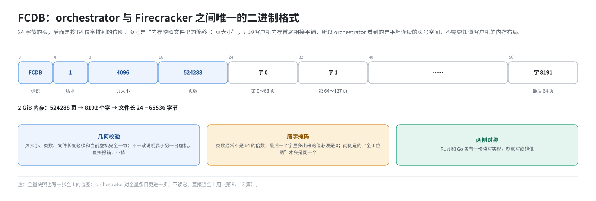
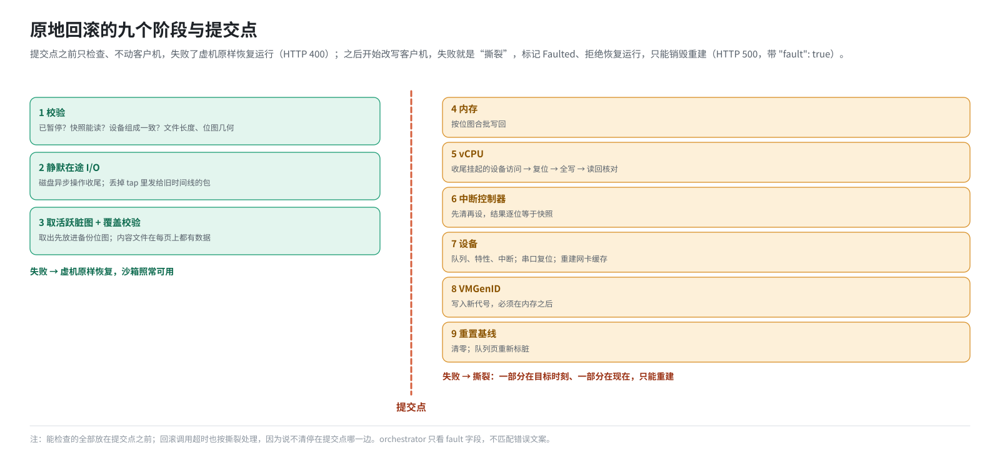

# 第 11 篇｜在活着的虚机里原地回滚：Firecracker 的三处扩展与九个阶段

> **本篇目标**：orchestrator 算好了回滚集、准备好了内容，接下来要由 Firecracker 把它们写进一台**正在运行（此刻暂停着）的**虚拟机。本篇先讲为什么 Firecracker 必须改、改了哪三处、两边约定的位图格式长什么样；然后逐个讲原地回滚的九个阶段，以及把它们分成两半的“提交点”；最后讲为什么快照和运行中虚机的设备组成必须完全一致。

---

## 一、为什么要改 Firecracker

上游 Firecracker 已经有快照能力：全量快照、差分快照、脏页跟踪、暂停恢复，以及“新起一个进程加载快照”。它缺三样东西：

| 缺什么 | 为什么需要 |
|---|---|
| 写差分快照时，同时交出“这次写了哪些页” | 差分树每一代都需要一张位图（第 9 篇） |
| 虚机暂停时，导出“自上次清零以来写过的页” | 读档时要把活跃脏页并进回滚集，而且要**事先**知道 |
| 往活着的进程里写回指定页、恢复 CPU 和设备 | 上游只有“新进程加载”这一条恢复路径 |

改动遵循**最小化原则**：Firecracker 只做机械动作，不知道树、不知道存档、不管文件放在哪。改得越少，跟上游同步越容易，出了问题也越容易判断是不是自己引入的。

## 二、三处扩展

### 扩展一：写快照时顺带写位图

在已有的“创建快照”接口上加一个可选字段 `dirty_bitmap_path`。写差分快照时，Firecracker 把“这次写进内存文件的页”写成一张位图放到这个路径。

为什么不能分两次调用，先写快照、再取位图？因为写快照的最后一步就是把脏页记录清零，等 orchestrator 再来问，已经没有了。那先取位图、再写快照呢？也不行，取位图会清零 KVM 的记录，写快照时就拿不到这些页了。**唯一正确的时机，就是在写快照的过程中**：Firecracker 决定哪些页写进文件的同时，顺手把它们记成位图。这样位图描述的恰好是“文件里实际写了的页”，一页不多、一页不少。

全量快照也写位图，内容全 1。

这两个文件都**不调用 fsync**。读它们的只有同一台宿主上的 orchestrator 和 Firecracker，走的是同一份页缓存，写完立刻可见；存档本来就不承诺扛过宿主崩溃；而在冻结窗口里调用 fsync，要等整个文件系统的日志提交，会被别的沙箱的写拖慢。原生 pause 的快照要上传、要长期保存，那条路径保留了原来的 fsync。

### 扩展二：`PUT /snapshot/save-dirty-bitmap`

虚机暂停时调用，把当前的活跃脏页位图写到指定文件。

它**不清零**：从 KVM 取出来的记录立刻放进 Firecracker 自己的备份位图，写文件用的是备份的副本。所以之后的快照或回滚仍然能看到完整的集合。这是第 8 篇那条纪律：取出来的脏页信息，在任何路径上都不能丢。

为什么非有不可，第 9 篇讲过：Firecracker 回滚时会把自己的活跃脏页并进写回集合，orchestrator 必须事先知道这些页，才能准备好它们的内容。

### 扩展三：`PUT /snapshot/rollback`

原地回滚。参数是：目标时刻的 `snapfile`（CPU、中断控制器、设备状态）、内容文件 `revert_mem`、回滚集位图 `revert_bitmap`，以及“回滚完要不要立刻恢复运行”。

orchestrator 永远传“不要恢复运行”。原因是**磁盘视图还没换**：Firecracker 回滚完时，内存已经在目标时刻，磁盘还在当前时刻，这时让客户机跑起来，它会按目标时刻的文件系统元数据去读当前时刻的磁盘块。恢复运行由 orchestrator 在换好磁盘、清完连接跟踪表之后自己做。

返回值里带着写回了多少页、多少字节，以及每个阶段花了多少微秒，后面讲观测时会用到。

## 三、两边约定的位图格式

orchestrator 和 Firecracker 之间唯一的二进制格式，叫 FCDB：

| 位置 | 长度 | 内容 |
|---|---|---|
| 0 | 4 字节 | 标识 `"FCDB"` |
| 4 | 4 字节 | 版本号，当前是 1 |
| 8 | 8 字节 | 页大小 |
| 16 | 8 字节 | 页数 |
| 24 | 每 64 页 8 字节 | 位图本体，第 w 个字的第 i 位对应第 w × 64 + i 页 |

2 GiB 内存的位图文件长 24 + 65536 字节。

几个设计上的讲究：

- **页号是“内存快照文件里的偏移 ÷ 页大小”，不是客户机物理地址。** 客户机内存可能由几段组成，中间有空隙；快照文件把这几段首尾相接地平铺。所以 orchestrator 看到的是一个平坦的、连续的页号空间，完全不需要知道客户机的内存布局。布局的知识全部留在 Firecracker 里。
- **每次读都校验几何。** 页大小和页数必须和当前虚机一致，文件长度必须恰好对得上。对不上说明这张位图属于另一台虚机或另一次运行，直接报错，不猜。
- **最后一个字里多出来的位必须是 0。** 页数通常不是 64 的倍数，最后一个字有几位不对应任何页。两边构造“全 1 位图”时都把这几位清零，保证两边造出来的全 1 位图是同一个，求并、比较时不会出现莫名其妙的不一致。

## 四、九个阶段与提交点

Firecracker 收到回滚请求后，在同一个进程里依次做九件事。中间有一条线，叫**提交点**：

| # | 阶段 | 做什么 | 动客户机吗 |
|---|---|---|---|
| 1 | 校验 | 虚机是否已暂停；快照能否读；设备组成是否一致；内存文件长度、位图几何是否对得上 | 否 |
| 2 | 静默在途 I/O | 等磁盘的异步操作收尾；把网卡里缓存着的、发给旧时间线的包读出来扔掉 | 否 |
| 3 | 取活跃脏图并校验覆盖 | 从 KVM 取活跃脏页，与传入的回滚集求并；检查内容文件在每一页上都有数据 | 否 |
| | **═ 提交点 ═** | | |
| 4 | 内存 | 把回滚集里的页写回客户机内存 | **是** |
| 5 | vCPU | 把每个 vCPU 复位，再写回全部寄存器 | 是 |
| 6 | 中断控制器 | 把 GIC 的状态写回 | 是 |
| 7 | 设备 | 恢复每个 virtio 设备的队列、协商过的特性、中断状态；复位串口；重建网卡缓存 | 是 |
| 8 | VMGenID | 写入一个新的代号，通知客户机“你被回滚过” | 是 |
| 9 | 重置脏页基线 | 清零脏页记录；把设备队列所在的页重新标脏 | 只改 Firecracker 自己的记录 |

### 提交点：把失败切成两半

- **提交点之前**失败：客户机一个字节都没动。orchestrator 恢复虚机运行，沙箱照常可用，这次读档只是失败了。
- **提交点之后**失败：客户机已经是两个时刻的混合体，一部分在目标时刻，一部分还在现在。Firecracker 把虚机标记为 `Faulted`，此后拒绝恢复运行和再打快照，只能销毁重建。orchestrator 把这种情况叫“撕裂”。

所以设计的原则是：**能检查的，全部在提交点之前检查完。** 设备组成、文件长度、位图几何、内容覆盖，任何一项不对都在动客户机之前拒绝。

返回给 orchestrator 的错误也按这条线分级：提交点之前失败返回 400；之后失败返回 500，并在响应里带一个明确的 `"fault": true` 字段。orchestrator **只看这个字段**来判断是不是撕裂，不去匹配错误文案。判错的代价在两个方向上都很高：把撕裂当成可恢复，是让一个半新半旧的客户机继续跑，静默损坏；把可恢复当成撕裂，是白白杀掉一台本来完好的沙箱。而 Firecracker 的错误文案随时可能被人改写，不能当成约定。

如果回滚调用**超时**没有应答，orchestrator 也按撕裂处理：它说不清 Firecracker 停在提交点的哪一边，可能已经写了一半内存。

### 阶段 2：为什么要静默在途 I/O

如果有一个磁盘操作是在回滚**之前**发起的、在回滚**之后**完成，它的结果就会被写进新时间线。所以要先让磁盘的在途操作收尾。

网卡这边，宿主 tap 设备里可能缓存着一些还没交给客户机的包，它们是发给被丢弃的那条时间线的。把它们读出来扔掉。读的次数设了上限，防止在持续灌包的环境里，这一步变成死循环把冻结窗口无限拉长。万一没读完，剩下的包客户机恢复后照常收到，TCP 协议栈会把序号对不上的包丢弃，这和真实网络上的重复包、迟到包是一回事，不影响内存的正确性。

### 阶段 3：先放稳，再校验

从 KVM 取出活跃脏页后，**第一件事是放进备份位图**，然后才求并、校验。这样即使后面校验失败、这次回滚被拒绝，“这些页脏过”的信息也不会丢。

覆盖校验用 `SEEK_DATA` / `SEEK_HOLE` 逐段走内容文件，看回滚集里有没有哪一页落在空洞上，有就拒绝，代价是每个空洞一次查询，而不是每页一次。它挡住的是两种错误：orchestrator 漏准备了某一页；或者递过来的文件根本不对。放过去的话，阶段 4 会从空洞读到 0 写进客户机，而且发生在提交点之后。

### 阶段 4：写回内存

按位图逐字扫描，只处理需要写回的页，把**连续的页合成一批**，一批一次读文件直接读进客户机内存。回滚集通常是成片的，一个进程动过的内存往往是连续的，合批之后系统调用从“每页一次”降到“每段一次”。

这些写走的是 Firecracker 自己的内存映射，KVM 不会把它们记成脏页。这正是第 7 篇说 orchestrator 要把回滚集并进“开机以来写过的页”的原因。

### 阶段 5：vCPU，先复位再全写

每个 vCPU 的恢复在它**自己的线程**上执行。原因是安全限制：每个线程有自己的系统调用白名单，允许设置 vCPU 寄存器的只有 vCPU 线程。

步骤是三步：

1. **先把挂着的设备访问收尾。** ARM 上，客户机访问一个模拟设备时会退出到宿主，宿主处理完后，“把结果写进寄存器、指令指针前进一步”要等到**下一次进入客户机时**才真正发生。这个“挂着的半步”在 KVM 内部，不在快照里，复位也清不掉。不先收尾，恢复后第一次进入客户机时，会把旧时间线的那半步套在刚写好的新寄存器上，悄悄改掉一个寄存器、多走一条指令。存档那一侧暂停时也做同样的收尾，保证存下来的 vCPU 状态是自洽的。
2. **复位，再写回全部寄存器。** 曾经有一条“只写寄存器、不复位”的路线，直觉上更快。实测下来，在同一压力测试中它的 p95 延迟反而是复位路线的约三倍，于是被删掉了。合理的解释是：不复位，vCPU 就保留着一些快照之外的内部状态，之后要靠别的机制慢慢收敛；复位把它放回架构定义的起点，一次写满，就和快照逐项一致了。
3. **读回核对。** 核心寄存器写完再读回来比对。不一致只记数、告警，不让回滚失败，因为此时已经过了提交点，失败只会把一台可疑的虚机变成一台死的。

### 阶段 6：中断控制器，先清再设

恢复作用在**已有的**中断控制器上，不新建。这带来一个重建路线没有的问题：中断控制器里“使能 / 等待 / 正在处理”这几类状态，是“写 1 置位”和“写 1 清除”成对的寄存器，写接口只处理值为 1 的位。新建的控制器全是 0，写快照值就等于赋值；而活着的控制器上，**快照里是 0、当前是 1 的位会原样留下**。如果某条中断的“正在处理”位残留着，这条中断以后再也不会被投递，对应的设备看起来就“卡死了”。

所以回滚时对这几对寄存器**先全部清掉，再按快照设置**，结果和快照逐位相等。

串口那根中断线还要单独清一次。因为串口在阶段 7 是被**复位**的，而不是恢复：它的内部状态不在快照里。如果快照里这根线正好处于“正在处理”，就和“刚复位、以为自己从头开始的串口”矛盾，串口会卡住。这一步失败不让整次回滚失败，只告警。

### 阶段 7：设备

对每个 virtio 设备（磁盘、网卡、随机数），恢复三样东西：队列的位置、协商过的特性、中断状态。队列是按快照、对着**已经写回的内存**重建的。这就是第 7 篇第 6 条约束“先写内存，再恢复设备”的原因：网卡要读内存里的队列内容重建接收缓存，如果内存还没写回，读到的是被丢弃那条时间线的队列，恢复后收包会永久卡死。第 12 篇细讲这个问题。

网卡还要多做一步：如果客户机在存档之后重新协商过网卡特性，宿主 tap 设备的配置也要跟着改回去，否则数据包的头部格式对不上，包会静默出错。

有两样东西**有意不回滚**：网卡限速器的令牌桶，以及 Firecracker 内置元数据服务的网络连接。前者最多影响一个补充周期的流量额度，会自己恢复；后者回滚会让一个进行中的元数据请求超时。两者都在日志里明说。

### 阶段 8：VMGenID

VMGenID 是一个虚拟设备，在客户机内存里放一个 128 位的代号。代号变了，客户机内核就知道“我被从快照恢复了”，会据此重新播种随机数生成器等依赖“时间只往前走”的东西。

写的是一个**新**代号，不是快照里那个。客户机要知道的是“你被回滚了”这件事本身。

它必须在阶段 4 之后。放在之前，新代号会被写回的旧内存覆盖掉，客户机什么都不知道。

### 阶段 9：重置基线

清零脏页记录，让下一代的差分相对“刚恢复的这个状态”来算。这和账本那边“当前基准 ← 目标”是同一件事的两半，两边都做，下一个存档的位图才恰好覆盖“从目标时刻到下一次存档”。

只清 Firecracker 的备份位图就够了，因为 KVM 那边刚在阶段 3 被取空，之后虚机一直暂停没跑过，阶段 4 的写回 KVM 也不记录。

但有一类页要重新标脏：**设备队列所在的页**。设备运行时会往队列里写东西（比如“这个请求处理完了”），这些写不经过 KVM，刚清空的位图里没有它们，下一代差分就会漏掉。所以要在清零之后把它们重新标上。

## 五、设备组成必须完全一致

原地回滚是把状态写到**已有的**对象上。对象不存在或者不一样，就没有地方可写。这是它和“重建”的根本区别：重建可以按快照造出任何设备组合，原地不行。所以阶段 1 要检查：

| 检查项 | 不一致时 |
|---|---|
| vCPU 个数 | 拒绝 |
| 内存大小 | 拒绝 |
| 快照里的每个设备，运行中的虚机里都有，类型和 ID 都对得上 | 拒绝，并指出是哪个 |
| 每个设备“是否已被客户机驱动启用”一致 | 拒绝 |
| 网卡的设备能力集一致 | 拒绝 |
| virtio 设备总数相等 | 拒绝 |
| balloon（内存气球）、vsock、vhost-user 磁盘 | **一律拒绝** |

最后一行不是“暂时不支持”的占位，而是明确的决定。balloon 的作用是把客户机内存还给宿主，它和“按页回滚内存”之间怎么交互，没有被论证过；vsock 有跨客户机和宿主的连接状态，回滚它需要一套额外的协议。与其做一个可能错的实现，不如明确拒绝。

这些检查全部在提交点之前，拒绝时虚机原样恢复运行。

## 六、版本必须成对

orchestrator 和 Firecracker 一起交付。如果 orchestrator 碰上一个没有这三处扩展的 Firecracker，回滚接口会返回 404，orchestrator 把它翻译成一句明确的话“这个 firecracker 不支持原地回滚”，而不是一个含糊的错误。部署时可以通过 Firecracker 自报的能力来确认配对是否正确。

---

## 本篇小结

| 概念 | 一句话解释 |
|---|---|
| 最小化原则 | Firecracker 只做机械动作，不知道树和存档 |
| 扩展一 | 写差分快照时在同一次调用里写出位图，时机不可替代 |
| 扩展二 | 暂停时导出活跃脏页，不清零 |
| 扩展三 | 原地回滚；orchestrator 总是要求“回滚完先别恢复运行” |
| 不 fsync | 同机同页缓存，存档本不承诺扛崩溃，fsync 只会拖慢冻结窗口 |
| FCDB | 两边唯一的二进制格式；页号是平铺后的文件偏移；几何不符就拒绝 |
| 九个阶段 | 校验、静默、取图 / 覆盖校验 ‖ 内存、vCPU、中断控制器、设备、VMGenID、重置基线 |
| 提交点 | 之前失败虚机原样可用；之后失败即撕裂，只能重建 |
| 先清再设 | 活着的中断控制器上，快照为 0、当前为 1 的位不会被普通写清掉 |
| 设备组成一致 | 原地只能写已有对象；balloon、vsock、vhost-user 一律拒绝 |

**下一篇预告**：[《回到过去之后：网络、设备与时间》](12-network-devices-time.md)。客户机回到了过去，外面的世界还在现在。网卡缓存的描述符、宿主的连接跟踪表、代理的连接池、客户机里的时钟和随机数，各会出什么问题，怎么处理。
