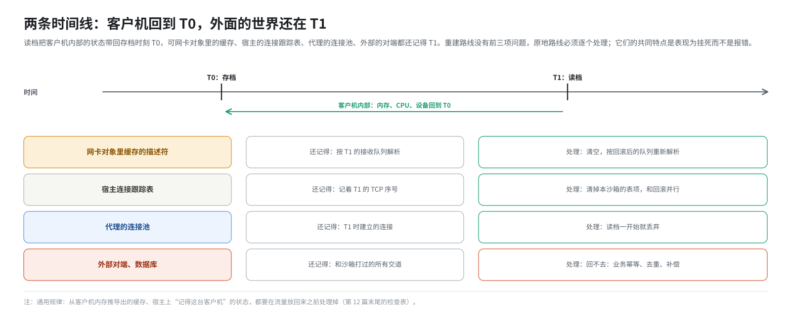
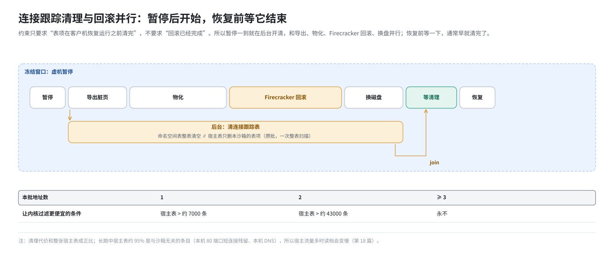
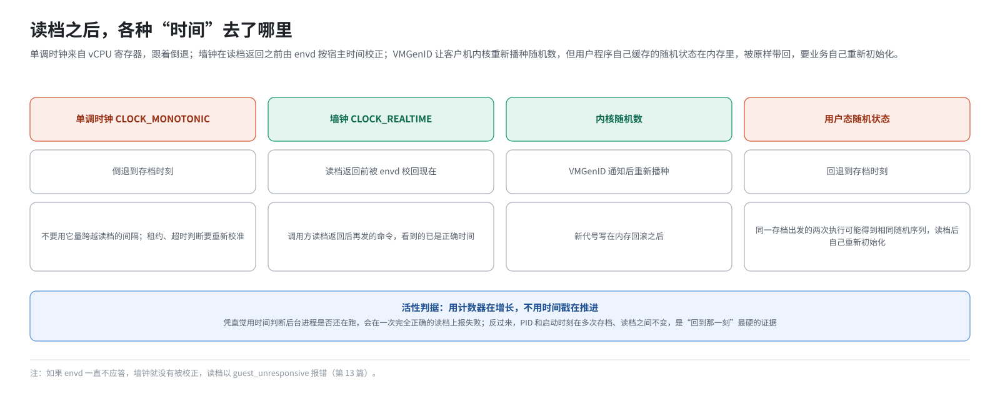

# 第 12 篇｜回到过去之后：网络、设备与时间

> **本篇目标**：“重建”路线从零构造一切，对象天然自洽；“原地”路线把旧状态写回活着的对象，就会遇到一类新问题：有些状态是从活对象里**推导**出来的，又不在快照里。客户机回到了过去，外面的世界还在现在。本篇讲这类问题的几个典型：网卡缓存的描述符、宿主的连接跟踪表、代理的连接池、VMGenID、客户机里的时钟和随机数、正在进行中的调用。最后给一张检查表，帮你在加新设备、改回滚路径时找出同类问题。

---

## 一、为什么会有这类问题

把第 2 篇的“现场七项”换个角度看。读档时，客户机内部的状态（内存、CPU、设备）回到了 T0，而下面这些还停在“现在”T1：

| 停在 T1 的东西 | 它记着什么 |
|---|---|
| Firecracker 网卡对象里的缓存 | 按 T1 时的接收队列解析好的描述符 |
| 宿主内核的连接跟踪表 | 每条连接走到了哪个 TCP 序号 |
| orchestrator 代理的连接池 | 一批开着的、对端在 T1 时建立的连接 |
| 外部的对端、数据库 | 它们和这台沙箱打过的所有交道 |



重建路线不会遇到前三项，因为新建的网卡缓存是空的、新进程没有旧连接。原地路线必须一个个处理它们。这些问题的共同特点是：**表现为挂死，而不是报错**。挂死比报错难查得多。

## 二、网卡的接收描述符缓存

### 现象

读档成功，客户机一切正常，直到需要收网络包：接收方向**永久卡死**，客户机内核日志里出现一行 `virtio_net: id N is not a head!`。不是丢包、不是慢，是彻底不动。而且不是每次读档都出现。

### 背景：virtio 队列

客户机和虚拟网卡之间靠两个环形队列交接：

1. 客户机驱动准备一批空的接收缓冲区，把它们的编号（描述符）放进“可用环”；
2. 网卡从可用环取出描述符，**解析**成可以直接写入的内存位置，缓存起来；
3. 来了一个网络包，网卡取一个缓存好的位置写进去，在“已用环”里放一条“编号 N，长度 L”；
4. 客户机驱动从已用环取出，按编号找到自己那块缓冲区。

第 2 步的缓存是性能优化，不用每来一个包就重新走一遍环。

### 根因

读档时：可用环的内容在客户机内存里，被写回了 T0；网卡的队列游标按快照重置了。但网卡对象里**缓存的那批描述符没人动**，它们还是按 T1 解析出来的。

于是第 3 步用一个在 T0 根本不存在的编号写了一条“已用”记录。客户机驱动拿着这个编号去自己的表里查，查不到，因为在 T0 它从没发出过这个编号。驱动认定队列已经损坏，拒绝继续处理，接收方向永久卡死。

只有在“读档时缓存里有已解析的描述符，且读档后很快有包到达”时才出现，所以不是每次都有。

### 修法

写回设备状态之后，清空这份缓存，把队列游标退回去，再按**已经回滚的**可用环重新解析一遍。需要的几个计数，上游快照格式里本来就有，原来是给重建路线用的。

还有一个细节：清空是“原地清”，而不是“换一个新的缓存对象”。因为新建缓存对象会用到一个系统调用，而 Firecracker 的线程在初始化之后装了系统调用白名单，这个调用不在名单上，一调用进程就会被杀掉。**运行期能做的事比初始化期少**，这是原地路线的又一个限制。凡是在回滚路径上新增系统调用，都要检查白名单。

## 三、VMGenID 的次序

第 11 篇讲过：VMGenID 的代号放在客户机内存里。如果在写回内存之前刷新代号，新代号会被写回的旧值覆盖，客户机醒来看到的是熟悉的旧代号，不知道时间被回拨了。所以它必须在内存之后。

推广成一句话：**任何通过客户机内存传递给客户机的通知，都必须写在内存回滚之后。** 目前只有 VMGenID 一个。

## 四、连接跟踪表

### 现象

读档成功，新连接能建立，但**跨越回滚的那些连接全部挂死**：不是被重置、不是超时报错，发出去的包石沉大海。

### 根因

宿主内核的连接跟踪表（conntrack）记录流经它的每条连接：两端地址和端口、TCP 序号窗口、连接处在哪个阶段。NAT 依赖它。

读档之后，客户机的内存回到了 T0，宿主内核却还记得 T1 时的序号。客户机发出的包，序号在内核看来是**倒退的**，落在窗口之外，被判为非法直接丢弃。客户机这边看到的就是“发出去了，没有回应”。

### 两张表，两种清法

| 表 | 里面有什么 | 怎么清 |
|---|---|---|
| 沙箱自己网络命名空间里的表 | **只有**这台沙箱的连接 | 整表清空 |
| 宿主的表 | 这台机器上**所有**沙箱的连接，还有宿主自己的 | **只删一端地址是这台沙箱的表项**，整表清空会打断别的沙箱 |

### 宿主表怎么删才快

宿主表可能很大，要找出属于某台沙箱的表项，得把整张表扫一遍。几点优化：

- **攒成一批，扫一次。** 内核遍历这张表的代价和返回多少条无关，都要走完全部桶，而且不能同时做两次遍历。所以多台沙箱同时读档时，各自扫只会互相排队。实际做法是：请求进一个队列，清理程序把当时所有在等的请求组成一批，扫一次表，逐个应答。扫描开始之后才到达的请求，排进下一批，因为这次扫描可能已经走过了它的表项所在的位置。
- **在线上格式里直接比对。** 扫描时直接从内核返回的原始数据里读出两端地址，和本批所有地址比对，不为无关的表项分配任何对象。删除放在扫描结束之后。
- **按代价模型选路。** 另一条路是让内核按地址过滤。但“地址在任一端”要两个过滤器，每个地址就要两次遍历。按实测常数算，本批只有 1 个地址且宿主表超过约 7000 条时，过滤更便宜；2 个地址时要超过约 43000 条；3 个及以上永远是整表扫描更便宜。

过滤路径还有一道保护：内核返回的每一条，删除前再核对一次地址。因为不认识过滤请求的老内核会把整张表都返回，不核对就删，会打断这台机器上所有沙箱的连接。

要注意，清理的代价和**整张宿主表**的大小成正比，不只是和沙箱的连接数。在一次长时间测试中，宿主表里约 95% 的表项和沙箱无关（宿主本机的 HTTP 连接残留、本机 DNS 查询）。宿主上其他流量多了，读档就会变慢。

### 时机：和回滚并行

约束只有一条：**表项必须在客户机恢复运行之前清完。** 清晚了，客户机已经在跑、已经发出了包，正在删的表项里可能就有它刚建立的新连接；而删完之前，旧表项还在丢客户机的包。

这条约束只要求“虚机已经停了”，不要求“回滚已经完成”。所以：

```
暂停虚机 ──┬── 导出脏页 → 物化 → Firecracker 回滚 → 换磁盘 ──┬── 恢复运行
           └──────────── 后台清连接跟踪表 ───────────────────┘
                                                    ↑ 恢复前等它结束
```



如果中途失败、要原样恢复虚机，同样先等清理结束再恢复。通常等到这一步时清理早已完成，等待接近于零。

清理提前开始，带来一个小副作用：从“表项被删”到“客户机恢复”之间有了一段空隙，这期间宿主侧到达的包可能重建一条表项。代码注释逐条论证过为什么可以接受：代理连接池已经提前丢弃，读档期间到达的请求被拒绝而不是转发；一条表项只由宿主侧的包决定，虚机停着还是在跑不影响它长什么样。

## 五、代理的连接池

orchestrator 的代理对每台沙箱维护一个连接池。读档之后，池里那些还开着的连接，对端（客户机里的服务）已经不记得了。

所以读档**一开始**，在暂停虚机之前，就把这台沙箱的连接池丢掉。为什么这么早？跨越回滚的连接此刻已经注定要作废：早断开，持有它们的调用方几毫秒内就能得到应答；晚断开，它们要一直挂到读档结束，最坏要等 45 秒的 envd 应答。代价是：如果读档在提交点之前失败了，这些调用方白白重连了一次。两种错里，这是便宜的那种。

## 六、正在进行中的调用

读档期间，同一台沙箱上的其他调用会怎样？

| 调用处在什么阶段 | 调用方看到 |
|---|---|
| 读档进行中才到达的请求 | 立即收到 409，SDK 抛 `CheckpointInterruptedException` |
| 读档前发出、响应头还没写出的请求（普通的一问一答基本都是这种） | 409，同上 |
| 响应头已经写出、正在流式返回数据的调用（比如带实时输出的长命令） | 只能从中间被切断，表现为传输层错误 |
| 读档**返回之后**才发出的请求 | 不受影响 |

第三类的差别不是实现上的取舍，而是 HTTP 本身的限制：状态码只能在响应头里说一次，头一旦发出，服务端就没法再把这次调用改判成 409，只剩切断连接这一种表达方式。

对调用方来说：只有“多个调用方同时操作同一台沙箱”才会遇到这些情况。收到 409 就重连重试。最稳妥的做法是在业务层让同一台沙箱的读档和其他调用互斥。

那读档返回之后立刻发命令，有没有问题？950 上做过专门测试：4 台沙箱各读档 50 次，每次读档返回后立刻发一条流式命令和一条普通命令，200 次读档、400 条命令全部成功，不需要额外等待。

## 七、时间

读档把客户机的时间拨回了存档时刻，后果不那么显然：

**单调时钟真的会倒退。** 它来自 vCPU 的计时器寄存器，而寄存器被恢复成了存档时刻的值。这违反了操作系统对“单调时钟只往前走”的承诺，但在快照语义下是唯一自洽的做法：客户机的所有状态都和那一刻一致。

**墙钟在读档返回之前被校回现在。** 读档的最后一步，orchestrator 给客户机里的 envd 发一个初始化请求，带上宿主的当前时间。envd 比较自己的墙钟，偏差超过阈值就把它设成宿主时间。这和原生 resume 走的是同一条路径。所以读档返回之后，调用方再发的命令看到的已经是正确的时间。如果 envd 一直不应答，墙钟就没有被校正，读档以“客户机失联”报错。

**用户态的随机数状态会回退。** VMGenID 让客户机**内核**重新播种随机数。但用户程序自己缓存的随机状态（比如进程里已经初始化好的伪随机数生成器）就在客户机内存里，读档把它原样带回存档时刻，没人替它重新播种。从同一个存档出发的两次“不同”执行，可能产生完全相同的随机序列。对随机性敏感的程序，应当在读档之后自己重新初始化。



对业务代码的影响：

- 不要用单调时钟测量跨越读档的时间间隔；
- 依赖“时间一直向前”的租约、缓存过期、超时判断，读档之后可能要重新校准；
- 判断“某个进程还活着”，用**计数器在增长**，不要用“时间戳在推进”。

最后一条在测试里特别重要。如果凭直觉用时间判断后台进程是否还在运行，测试会在一次完全正确的读档上报失败。反过来，时间倒退也是有用的证据：后台进程在多次存档、读档之间保持**同一个 PID 和同一个启动时刻**，证明了存档没有重启虚机，读档确实回到了那一刻。

## 八、诊断：罕见故障只有一次现场

网卡缓存和连接跟踪这两类问题的共同点是：表现为挂死，而沙箱一旦被销毁，什么都不剩。

所以回滚写回设备状态之后，Firecracker 会给每个设备记一行日志：队列在设备眼里走到了哪里、在客户机内存里又走到了哪里。两者对不上就是问题所在。一个几百次才复现一次的挂死，如果现场只有“沙箱没反应”，基本无从下手；有了这一行，至少能分清是设备没往下走，还是客户机没往下走。

## 九、检查表：还有哪些地方可能藏着同类问题

给加新设备、改回滚路径的人，逐条过一遍：

| 问 | 如果是 |
|---|---|
| 设备对象里有没有“从客户机内存推导出来的缓存”？ | 回滚后必须重建（如网卡接收缓存） |
| 有没有“上次处理到哪”的游标，又不在快照里？ | 同上 |
| 有没有通过客户机内存传给客户机的通知？ | 必须写在内存回滚之后（如 VMGenID） |
| 设备运行时会不会自己写客户机内存？ | 那些页要在清零脏页记录后重新标脏 |
| 宿主上有没有“记得这台客户机”的状态？ | 要在流量放回来之前清掉（如连接跟踪表、代理连接池） |
| 新代码有没有引入新的系统调用？ | 检查各线程的系统调用白名单 |
| 有没有在途的异步 I/O？ | 回滚前排空 |
| 有没有“内核里挂着、不在快照里”的状态？ | 暂停和回滚前都要收尾（如 ARM 上延迟完成的设备访问） |
| 往活着的对象写“写 1 才生效”的成对寄存器？ | 先清后设 |
| 设备状态和宿主侧后端有没有必须一致的配置？ | 回滚设备后按新的值重设后端（如 tap 的配置） |
| 新设备支持热插拔或动态配置吗？ | 设备组成校验要能表达，否则拒绝 |

---

## 本篇小结

| 概念 | 一句话解释 |
|---|---|
| 原地路线的新问题 | 从活对象推导出、又不在快照里的状态，回滚后和客户机对不上 |
| 网卡接收缓存 | 缓存着按 T1 解析的描述符；清空后按回滚后的队列重新解析 |
| VMGenID 次序 | 通过客户机内存传递的通知，写在内存回滚之后 |
| 连接跟踪表 | 宿主记着 T1 的序号，客户机的包被当成非法丢弃；命名空间表整清，宿主表只删本沙箱的 |
| 清表时机 | 暂停后开始，和回滚并行，恢复运行前等它结束 |
| 代理连接池 | 读档一开始就丢弃，让在途调用尽早得到应答 |
| 在途调用 | 未发响应头的回 409；已在流式返回的只能被切断 |
| 时间 | 单调时钟倒退；墙钟在返回前由 envd 校正；用户态随机状态要业务自己重置 |
| 活性判据 | 用计数器增长，不用时间戳 |

**下一篇预告**：[《宁可报错，不可静默损坏：失败分级与不变量》](13-failures-and-invariants.md)。前面各篇零散提到了很多失败处理：提交点、撕裂、隐藏提交、链断、账本污染。下一篇把它们放在一起：读档的四档失败各意味着什么，调用方该怎么做；整套系统靠哪些不变量保证“不会静默回错”。
