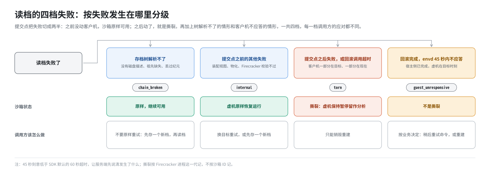
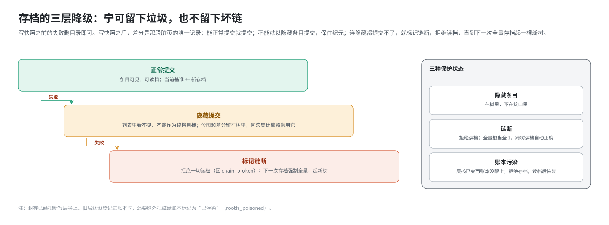
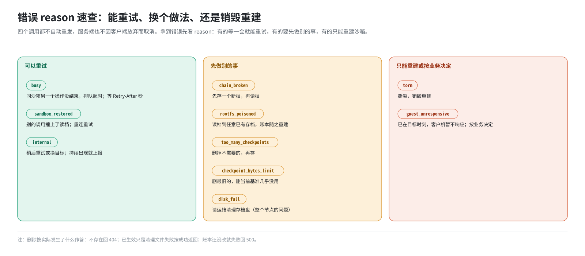

# 第 13 篇｜宁可报错，不可静默损坏：失败分级与不变量

> **本篇目标**：前面各篇零散提到了很多失败处理：提交点、撕裂、隐藏提交、链断、账本污染。本篇把它们放在一起讲。先说为什么这套系统对“静默损坏”格外警惕；然后分别看读档和存档的失败怎么分级、调用方该怎么应对；再看隐藏条目、断链、账本污染这三种“保护状态”各是什么；最后把整套系统靠的不变量列成一张清单，看看其中有多少被破坏后是静默的。

---

## 一、总纲：静默损坏比报错糟得多

这套系统操作的是**一台正在运行的虚拟机的内存**。设想一次读档写错了几页：

- 虚机不会崩溃；
- 那几页的内容属于另一个时刻，可能是某个进程的一段数据、内核的一个数据结构、文件缓存里的一块；
- 虚机继续运行，可能很久之后，某个程序读到这几页，以莫名其妙的方式失败；
- 那时已经没人能把这个失败和“几个小时前的一次读档”联系起来。

对比一下：读档报一个错，调用方知道这次没成功，可以重试、换目标，或者销毁重建。

而且，这套系统**没有兜底的重建路线**：读档只有原地这一条路，不会在失败时退回“新起一台”。这让“失败必须分级、必须说清楚”从一个好习惯变成了硬要求。所以第 4 篇的原则三写的是：**宁可报错，不可静默损坏。**

## 二、读档的四档失败

第 11 篇讲过，Firecracker 回滚中间有一条“提交点”：之前没动客户机，之后动了。以它为界，再加上前后的情况，读档的失败分成四档：

| 失败发生在哪 | 沙箱此时的状态 | 错误 `reason` | 调用方该怎么做 |
|---|---|---|---|
| 存档树解析不了这次读档：目标没有磁盘描述、祖先缺失、丢过纪元 | **原样，继续可用** | `chain_broken` | **不要原样重试**。先存一个新档（会以全量起一棵新树），之后再读档 |
| 提交点**之前**的其他失败：读块清单、装配视图、物化、Firecracker 校验不过 | 虚机原样恢复运行，错误信息会写明“沙箱仍在当前状态” | `internal` | 换目标重试，或先存一个新档 |
| 提交点**之后**失败，或回滚调用超时 | **撕裂**：一部分在目标时刻，一部分在现在 | `torn` | **只能销毁重建** |
| 回滚完成，但客户机里的 envd 45 秒内不应答 | 宿主侧已完成，虚机在目标时刻。**不是撕裂** | `guest_unresponsive` | 按业务决定：稍后再试命令，或销毁重建 |



几个细节：

**前两档的关键是把虚机恢复运行。** 失败了，先等后台的连接跟踪清理结束，再恢复虚机。如果失败了**并且**恢复也失败了，两个错误一起返回，不掩盖任何一个。

**撕裂时，虚机保持暂停。** 撕裂的虚机内存里是写了一半的回滚内容，它是事后分析的唯一材料；让它跑起来，一个半新半旧的客户机会把说不清的状态写进磁盘。同时，这一代沙箱此后的存档和读档一律被拒绝，列表和删除仍然可用。

**撕裂按“代”记，不按沙箱 ID。** 标记记在“这一个 Firecracker 进程”上。同一个沙箱 ID 如果经过原生 pause / resume 换了一个新进程，就从干净的状态重新开始。

**45 秒为什么刻意低于 SDK 的默认超时（60 秒）。** 两边超时一样长时，客户端总是先放弃，调用方看到的只是一个“超时”，不知道发生了什么。服务端先放弃，才能把“回滚已完成、只是客户机没应答”这个准确的信息报出来。

**`guest_unresponsive` 不要当成“没回滚成”。** 宿主这边的事都做完了，虚机已经在目标时刻，只是客户机里的服务暂时没响应。

## 三、存档的失败：纪元不能丢

第 6 篇讲过，写快照成功的那一刻，“纪元就前进了”：Firecracker 清零了脏页记录，差分文件成了那段时间脏页的唯一记录。所以存档的失败分成两种性质完全不同的情况：

| 失败发生在 | 处理 |
|---|---|
| 写快照之前（检查、准备） | 干净：删掉刚建的目录，虚机没被碰过 |
| 写快照之后（封存、登记、提交） | **三层降级** |

三层降级：

```
正常提交
  ↓ 失败
隐藏提交：存档不出现在列表里，不能被读档，但它的位图和差分留在树里
  ↓ 也失败
标记链断：此后拒绝一切读档，下一次存档强制全量，起一棵新树
```

另外，如果封存已经把新写层换上去了，但旧层还没登记进账本，就把磁盘账本标记为“已污染”。



## 四、三种保护状态

### 1. 隐藏条目：在树里，不在接口里

| 从哪看 | 隐藏条目 |
|---|---|
| 列表、按 ID 查询 | 看不见 |
| 能作为读档、删除的目标吗 | 不能 |
| 计入个数上限吗 | 不计（调用方看不见也删不掉） |
| 参与回滚集计算和内容查找吗 | **完全参与**，和普通条目一样 |

隐藏条目永远不会成为读档目标，所以只有读档才用得着的东西可以扔掉：snapfile、磁盘描述（连同它对磁盘层的引用）。留下的是内存差分和位图，后代要靠它们。

隐藏有两个来源：删除一个仍被依赖的存档（第 9 篇），和存档失败时抢救纪元。两者处理相同，因为要保住的是同一样东西：那一代的脏页记录。

### 2. 断链：拒绝服务就是正确答案

链断之后：

- **读档被拒绝**，因为回滚集不可能算对了：丢掉的那个纪元里写过哪些页，没人知道；
- **下一次存档强制全量**，成为一棵新树的根。

为什么新树根之后又安全了？全量存档持有每一页，到它为止的内容查找不需要更老的信息；它作为回滚路径上的一环时，位图被当作全 1，跨树读档时能把“它和启动时内存之间所有可能不同的页”都带进回滚集，包括丢失的那个纪元里写过的页。代码没有为“跨树”写专门的分支，是这条“全量根当全 1”的规则让它自动正确。

**拒绝服务在这里是正确答案。** 一次不完整的回滚会让客户机内存混进另一个时刻的页，而调用方会以为一切正常。

### 3. 账本污染：既成事实和记账失败分开处理

第 10 篇讲过：封存已经发生，新层已经在活的层栈里，这是既成事实；账本没跟上，是记账失败。不能因为记账失败就假装封存没发生，那会让之后每一个视图都少一层，读档时静默读到旧数据。

所以把磁盘账本标记为“已污染”，拒绝再存档（`rootfs_poisoned`）。读档仍然可用，因为它不依赖当前账本，用的是目标存档自己记下的磁盘描述。一次成功的读档会用目标的描述重建账本，污染随之清除。

内存那边的“隐藏提交”是同一条规则：快照已经写了，是既成事实，后面的步骤失败不能让它消失。

## 五、完整的错误表

调用方能看到的全部错误：

| `reason` | 出现在 | 沙箱状态 | 调用方该做什么 | 能自动重试吗 |
|---|---|---|---|---|
| `torn` | 读档 | 撕裂 | 销毁重建 | **不能** |
| `chain_broken` | 读档 | 照常运行 | 先存一个新档，再读档 | **不能原样重试** |
| `rootfs_poisoned` | 存档 | 照常运行，但不能存档 | 读档到任意一个已有存档，账本随之重建 | 不能原样重试 |
| `guest_unresponsive` | 读档 | 已在目标时刻 | 按业务决定 | 视情况 |
| `busy` | 都可能 | 无影响：同一沙箱上另一个操作还没结束，排队超时 | 等 `Retry-After` 秒再发 | **可以** |
| `sandbox_restored` | 同一沙箱上的**其他**调用 | 沙箱已回到存档那一刻 | 重连重试 | 可以 |
| `disk_full` | 存档、读档 | 无影响：动手前检查到存档盘空间不足 | 请运维清理存档盘 | 清理后可以 |
| `too_many_checkpoints` | 存档 | 无影响：个数到了上限 | 删掉一个不需要的，再存 | 删除后可以 |
| `checkpoint_bytes_limit` | 存档 | 无影响：占用到了字节上限 | 删**最旧**的（第 14 篇解释为什么） | 删除后可以 |
| `internal` | 都可能 | 存档失败时虚机已恢复；读档在提交点前失败时保持原状 | 稍后重试或换目标；持续出现就上报 | 可以 |



还有几条调用约定：

- **四个调用都不自动重发。** 存档和读档都会改变沙箱的状态，自动重发可能让同一个操作做两次。
- **服务端不取消。** 客户端超时放弃了，服务端仍会把操作做完（第 5 篇“和请求生命周期脱钩”）。所以客户端超时之后，沙箱的状态是“不确定”的，应该先查询再决定。
- **删除按实际发生了什么作答。** 存档不存在，回 404；删除已经生效、只是清理文件失败了，**按成功返回**，因为从调用方的角度删除已经完成，回错误只会让调用方重试后得到一个令人困惑的 404；账本还没改就失败了，回 500，什么都没删。

## 六、不变量清单

把前面各篇散落的约束收成一张表。这些是**改代码时不能破坏的**。最后一列是重点：被破坏之后，会不会立刻报错？

| # | 不变量 | 破坏后 | 静默吗 |
|---|---|---|---|
| 1 | 增量存档必须有位图 | 这个存档不可用 | 否，提交时报错 |
| 2 | 每代位图恰好覆盖“父亲到自己”之间写过的页 | 回滚集漏页 | **是** |
| 3 | 内容文件覆盖 Firecracker 实际要写回的全部页 | 从空洞读到 0 | 否，Firecracker 覆盖校验拦下 |
| 4 | 读档目标和运行中的虚机设备组成一致 | 往不存在的对象写 | 否，设备组成校验 |
| 5 | 内存和磁盘在同一个暂停窗口里 | 客户机看到两个时刻的世界 | 部分 |
| 6 | 活跃脏页在暂停之后导出 | 同第 3 条 | 否，同上兜底 |
| 7 | 没提交的存档对查询不可见 | 半写完的快照成为读档目标 | **是** |
| 8 | 纪元前进后，产物必须保留（哪怕隐藏） | 时间线出现空洞，之后读档漏页 | **是** |
| 9 | 磁盘账本和活的层栈一致，不一致就拒绝服务 | 视图少一层，读到旧数据 | **是** |
| 10 | 连接跟踪表在恢复运行之前清完 | 连接挂死 | **是**，挂死不报错 |
| 11 | VMGenID 在内存写回之后 | 客户机不知道时间被回拨 | **是** |
| 12 | 设备队列页在清零后重新标脏 | 下一代漏页，同第 2 条 | **是** |
| 13 | HDBSS 在所有 vCPU 创建之后启用 | 一条脏页都记不到，每次退化成全量 | **是**，只表现为慢 |
| 14 | 恢复虚机是无条件的 | 虚机停在暂停状态，所有人都以为它在跑 | 部分 |
| 15 | 合并前后回滚集不变 | 读档少写或多写几页 | **是** |
| 16 | 合并前后每页的内容来源不变 | 读到错误时刻的页 | **是** |
| 17 | 合并只在沙箱操作锁内做，切换前检查树没变 | 和并发读档交错 | **是** |
| 18 | 全量存档在回滚路径上恒当作全 1 | 跨树读档漏掉丢失纪元里写过的页 | **是** |
| 19 | 各种计数（子节点、层引用、字节）和账本一致 | 删早了读不到层；删晚了磁盘泄漏 | 删早了**是** |

19 条里，大多数被破坏后是**静默**的。这就是为什么代码里到处是“宁可报错”的分支，也是为什么测试不能只写几个例子了事。第 19 篇会讲，有一类测试专门为这些不变量而生：随机生成大量操作序列，每一步都拿实现和一个简单的参照模型比对，或者从磁盘上重算计数来核对。

---

## 本篇小结

| 概念 | 一句话解释 |
|---|---|
| 为什么怕静默损坏 | 写错几页不会崩溃，只会很久之后莫名出错；又没有兜底重建路线 |
| 读档四档 | 链断（原样可用）、提交点前失败（原样可用）、撕裂（只能重建）、客户机失联（已回到目标） |
| 撕裂保持暂停 | 半写的内存是唯一的分析材料，不能让它写磁盘 |
| 45 秒 | 低于 SDK 超时，让服务端先说清发生了什么 |
| 存档三层降级 | 正常提交 → 隐藏提交 → 标记链断 |
| 隐藏条目 | 在树里、不在接口里；保住纪元 |
| 断链 | 拒绝读档，下次存档起新树；全量根当全 1 让跨树读档自动正确 |
| 账本污染 | 层栈已变而账本没跟上；拒绝存档，读档后恢复 |
| 调用约定 | 不自动重发；服务端不取消；删除按实际结果作答 |
| 不变量清单 | 19 条，多数被破坏后是静默的 |

**下一篇预告**：[《并发、生命周期与空间：一个沙箱能存多少档》](14-concurrency-lifecycle-space.md)。多台沙箱同时存档、多个调用方同时操作同一台沙箱时怎么办？存档什么时候会失效，为什么把目录拷走也恢复不了？删了存档空间什么时候释放，“只留最近 N 个”为什么会收敛？
