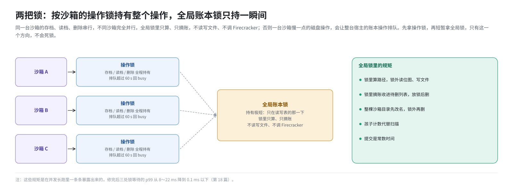
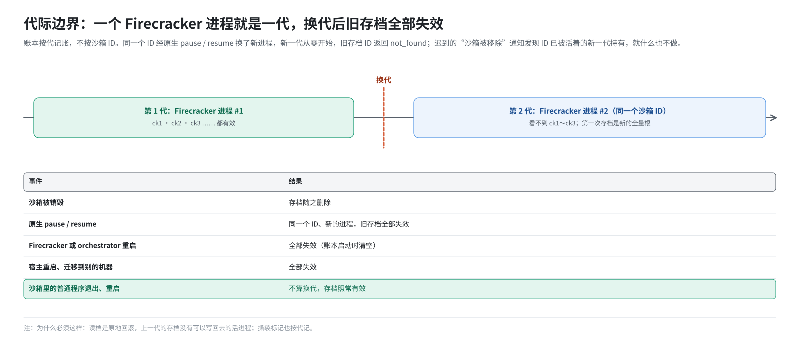
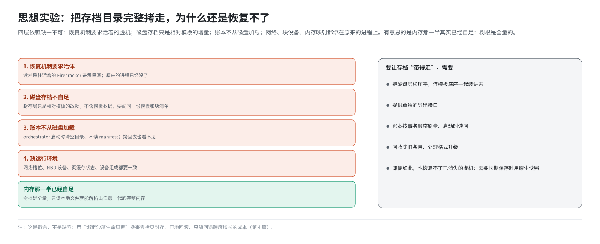
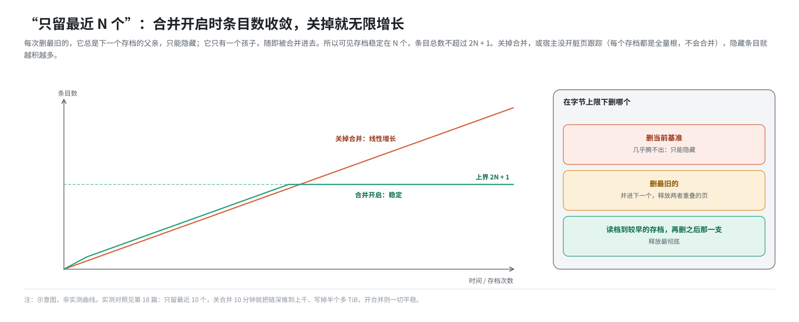

# 第 14 篇｜并发、生命周期与空间：一个沙箱能存多少档

> **本篇目标**：前面都在讲“一台沙箱、一次操作”。本篇把视野放大：一台宿主上很多沙箱同时存档读档，几个调用方同时操作同一台沙箱，怎么保证互不干扰、又不出错？一个存档能活多久，什么时候会失效，为什么把目录整个拷走也恢复不了？存档占多少磁盘，删了之后空间什么时候释放，“只留最近 N 个”的用法为什么会收敛？

---

## 一、两把锁

整套系统有两把锁，一长一短：

| 锁 | 保护什么 | 持有多久 | 规则 |
|---|---|---|---|
| **沙箱操作锁** | 一台沙箱的状态：当前基准、磁盘层栈 | **整个操作**（一次存档、读档、删除从头到尾） | 每台沙箱一把；排队有上限，超时回 `busy` |
| **账本全局锁** | 账本里那几张表 | **极短**，只在读写表的那一下 | 持有时**不做任何文件读写，不调用 Firecracker** |



### 为什么按沙箱串行

要保护的是每台沙箱自己的状态。设想一次存档已经写完快照（纪元前进了），但还没提交进账本。这时另一个存档进来，读到的是**旧**基准，两个存档会声称有同一个父亲，而它们的位图覆盖了重叠的时间段，第 9 篇的核心性质就破了。读档也一样：它最后把基准挪到目标，中间插进来的存档会挂在错误的父亲上。

所以同一台沙箱的存档、读档、删除必须**一个一个来**，而且锁要持有**整个操作**。

不同沙箱之间在账本层面没有共享状态，完全可以并行。

### 为什么全局锁里不做 I/O

全局锁保护的是整台宿主所有沙箱的账本。如果持着它去读写文件，一台沙箱慢一点的磁盘操作，就会让这台机器上**所有**沙箱的账本操作排队，包括另一台正在冻结窗口里等这把锁的沙箱。

所以几条规矩：

- **锁里只算，锁外读写。** 读档物化时，锁里只算“目标是谁、沿途经过哪些存档”，读位图、读差分、写文件全在锁外；
- **锁里摘账，锁外删文件。** 删除时，锁里只把要删的东西从表里摘下、收进一个“待删列表”，放锁之后、返回之前再删文件。整台沙箱的目录要删时，先在锁里改名成一个临时的回收目录（改名是瞬间的），放锁后再删；
- **用计数代替扫描。** “这个存档有没有孩子”不扫描全部存档，而是查一张孩子计数表，瞬间回答；
- **发布是常数时间的。** 提交时锁里只插入条目、移动基准、登记计数。

这些规矩是在多沙箱并发测试里一条条暴露、一条条修出来的，第 18 篇讲这段经历。

### 锁的顺序

先拿沙箱操作锁，再在需要时短暂拿全局锁。只有这一个方向，所以不会死锁。取沙箱操作锁时，不能持着全局锁去等，否则一个进行中的长操作会把全局锁一直占着。

### 排队为什么要有上限

持锁的一方可能卡在一个永远不返回的调用上，比如一个不再应答的 Firecracker。无限排队只会让每个等待者各占一条连接，最后得到一个莫名其妙的读超时。所以排队超过上限（默认 60 秒）就回 `busy`，告诉调用方“等一会儿再来”。

### 冻结窗口本身就是一种静默机制

磁盘那边的封存和换视图，是在 NBD 分发器“底下”换指针（第 10 篇）。为什么不担心换到一半有请求进来？因为换的时候虚机是暂停的，客户机不会发出新的读写；已经发出的，刷屏障时都处理完了。Overlay 自己的读写锁保证“换”这一下是原子的。

## 二、生命周期：存档能活多久

### 1. “一代”是什么

**一个 Firecracker 进程就是一代。** 存档只在它所属的那一代里有效。

会让沙箱换代的事：

| 事件 | 结果 |
|---|---|
| 沙箱被销毁 | 存档随之删除 |
| 原生 pause / resume | 同一个沙箱 ID，新的 Firecracker 进程，旧存档全部失效 |
| Firecracker 或 orchestrator 重启 | 全部失效 |
| 宿主重启、沙箱迁移到别的机器 | 全部失效 |

沙箱**里面**的普通程序退出、重启，不算换代。

账本按“代”记账，而不是按沙箱 ID 记账。同一个沙箱 ID 换了一代之后：新一代看不到上一代的存档，对旧存档 ID 读档得到 `not_found`；新一代从零开始，第一次存档是一棵新的全量树。

为什么必须这样？因为读档是原地回滚，要求那个活着的进程、那份活着的内存映射、那套活着的宿主资源还在。上一代的存档没有可以写回去的对象了。保留它们，只会让调用方拿到一个必定失败、或者更糟、悄悄恢复到别的进程上的 ID。



还有一个容易被忽视的并发情况：“沙箱被移除”的通知是异步到达的，可能在原生 resume 已经把新一代放回来**之后**才到。这时账本发现这个 ID 已经被当前活着的那一代持有，就什么也不做，**迟到的移除不会带走活沙箱的存档**。

### 2. 思想实验：把目录完整拷走

假设在沙箱被删除之前，把它的存档目录整个打包保存下来，以后试图恢复。会怎样？一步步看：

**第一步：orchestrator 不认识它。** orchestrator 启动时会把存档根目录整个清空再重建，账本的每张表都是空的，不扫描磁盘，不读任何 manifest。拷回去的目录根本不会被看见，下次启动还会被清掉。

**第二步：即使账本能从磁盘重建，也没有沙箱可以回滚。** 读档是往一个**活着的** Firecracker 进程里写。原来那个进程已经没了，新起一个沙箱，它是另一个进程、另一份内存映射。

**第三步：换一个新的活沙箱顶上也不行。** 磁盘那一半不自足：封存层只是“相对模板的改动”，层文件里没有模板的数据，要配合同一份模板、同一套块清单才能用。设备组成、内存布局也要完全一致。还缺运行时环境：网络槽位、NBD 设备、页缓存里的状态。

所以有四层依赖：

| 层 | 依赖 |
|---|---|
| 恢复机制 | 要求活着的虚机 |
| 磁盘存档 | 只是相对模板的增量，不自足 |
| 账本 | 不从磁盘加载 |
| 运行环境 | 网络、块设备、内存映射都绑在原来的进程上 |



有意思的是，内存那一半其实已经自足了：树根是全量的（第 9 篇），整棵内存树只读本地文件就能解析出任意一代的完整内存。缺的是磁盘、账本和运行环境。

**这是取舍，不是缺陷。** 第 4 篇说过：用“绑定沙箱生命周期”换来零拷贝封存、原地回滚、只随回退跨度增长的成本。如果要让存档“能带走”，需要把磁盘层栈压平、把模板底座也装进去、提供导出接口；要让账本跨重启，需要按事务顺序刷盘、启动时读回、回收陈旧条目、处理格式升级。这些都是第 20 篇列出的候选方向，而且即便补齐账本，也恢复不了已经消失的虚机和设备。需要长期保存时，用原生快照。

## 三、空间：存档占多少磁盘

### 1. 一台沙箱的存档占多少

记 M 为一份完整内存（约等于客户机内存大小）。

| 部分 | 大约占多少 |
|---|---|
| 树根（第一次存档） | 约 M |
| 每个增量存档 | 本代写过的内存页 + 本代写盘封成的一层 |
| 其他（磁盘层说明、header、snapfile、位图） | 2 GiB 模板在开发机上量得约 61 MiB |
| 读档时的临时文件 | 最多一份内存，读档结束就删 |

### 2. 删了，空间不一定马上回来

调用 `delete` 之后：

- 被删的存档**立即**从列表里消失，之后不能再读档到它；
- 如果它**还有后代**，或者它是**沙箱当前所处的点**（最近一次存档或最近一次读档的目标），它的数据不能删，后代还要读它。这时它只是**隐藏**，只丢掉它自己专用的一小部分文件；
- 被隐藏、又只剩**一个**孩子的存档，会在之后的 `delete` 结尾被**合并**进那个孩子（第 9 篇）；
- 没有后代、也不是当前点的，直接删除，并顺带回收因此不再被需要的隐藏祖先。

所以“删了但磁盘占用没降”，通常不是泄漏，而是那份数据还有人要读。

### 3. “只留最近 N 个”为什么会收敛

最常见的用法：每一步存一次档，超过 N 个就删最旧的。

每次被删的最旧存档，都是下一个存档的父亲，有孩子，只能隐藏。但它只有一个孩子，随即被合并进去。结果：可见的存档稳定在 N 个，隐藏的不会无限积累，一台沙箱的条目总数不超过 2N + 1（第 9 篇的上界）。



两种情况下它**不会**收敛：

- **关掉了合并**：隐藏存档越积越多，占盘和读档耗时随时间上涨。生产环境不要关；
- **宿主没开脏页跟踪**：每个存档都是全量根，没有“隐藏且只有一个孩子”的条目，合并不起作用，磁盘层也照样累积。这种节点必须靠上限兜住。

要说明的是，“条目数有上界”不等于“占盘有固定上界”。总占盘还取决于每代实际写了多少、磁盘视图覆盖了多少块。

### 4. 两种上限

运维可以给每台沙箱设两种上限，默认都不设：

| 上限 | 数什么 | 被拒绝时怎么办 |
|---|---|---|
| 个数上限 | **可见**的存档个数（隐藏的不算，调用方看不见也删不掉） | 删掉任意一个不需要的，再存 |
| 字节上限 | 这台沙箱全部存档实际占用的磁盘（包括隐藏的、共享的层） | **删哪个很重要**，见下 |

两种上限都只拦存档，**从不拦读档**。拒绝发生在写任何东西之前，沙箱照常运行，已有的存档完好。字节上限是“当前还低于上限就放行”，所以实际占用可能超出一个存档的量，它不是严格的空间预留。

### 5. 在字节上限下，删哪个才能腾出空间

| 做法 | 能腾出多少 |
|---|---|
| 删**当前基准**（最近一次存档或读档的目标） | **几乎为零**：它是沙箱正在运行的基准，只能隐藏，只释放几十 KB 的描述文件 |
| 删**最旧**的 | 它会被合并进下一个存档，释放两者**重叠**的部分：两次改的是同一批页，就能腾出一份；改的页完全不重叠，几乎腾不出 |
| 读档到一个较早的存档，再删掉它之后的那一整支 | 被删的分支没有后代、也不是当前点，直接删除，**释放最彻底** |

被拒绝时，错误信息会写明：当前占用、上限、沙箱当前所处的存档 ID（提醒你删它没用），以及这台沙箱无论怎么删都至少要占的量。

这个“至少要占的量”约是一份完整内存，因为运行期间总要保留一棵树的根。所以字节上限设得比“一份内存 + 少量开销”还小，沙箱一旦顶到上限就再也删不回来了。要在最坏情况下（每次存档都改了全部内存）还能保留一个更早的恢复点，上限应该不低于“两份内存 + 少量开销”。服务端在沙箱第一次存档时，如果发现上限过小，会在日志里告警。

### 6. 节点上的存档盘怎么估

```
存档盘 ≥ 各沙箱存档占用之和 + 水位线余量 + 沙箱自己的写层
```

水位线余量默认是“4 GiB 和两倍最大客户机内存中较大的那个”。存档盘写满影响的是**整个节点**：同一个文件系统上，每台沙箱往写层里的写都会失败。所以剩余空间低于水位线时，存档和读档都会被提前拒绝（`disk_full`）。

多租户节点的建议：

1. 两种上限都设：个数上限挡住“循环存档、从不删除”的客户端，字节上限挡住“存得少但每个很大”的情况；
2. 水位线保持默认或调大；
3. 保持合并开启；
4. 存档不会自动过期，沙箱销毁时才随之删除。长期存活的沙箱，要靠客户端自己删除或靠上限约束。

---

## 本篇小结

| 概念 | 一句话解释 |
|---|---|
| 沙箱操作锁 | 每台沙箱一把，持有整个操作，同沙箱的存档、读档、删除串行；排队超时回 `busy` |
| 账本全局锁 | 极短持有，锁里只算不读写、只摘账不删文件 |
| 一代 | 一个 Firecracker 进程；存档只在本代有效 |
| 换代 | 销毁、原生 pause / resume、重启、迁移；沙箱内程序重启不算 |
| 拷走目录 | 恢复不了：恢复要活体、磁盘不自足、账本不读盘、缺运行环境 |
| 删除不一定释放 | 被依赖的只隐藏；当前基准删了几乎不腾空间 |
| 滚动保留收敛 | 合并开启时条目 ≤ 2N + 1；关合并或不跟踪脏页时不收敛 |
| 两种上限 | 个数、字节；只拦存档不拦读档；字节上限建议 ≥ 两份内存 + 少量开销 |
| 水位线 | 存档盘写满影响整个节点，提前拒绝 |

**下一篇预告**：[《两种快照的分工：原生 pause 的精确增量与叠加使用》](15-native-snapshot-cooperation.md)。本方案和原生快照不是二选一。原生快照擅长什么，本方案擅长什么，怎么叠加使用？原生 pause 在 ARM 上“改 12 MiB 导出 148 MiB”的问题是怎么修好的？存过档的沙箱再做原生 pause，怎么保证不漏页？
