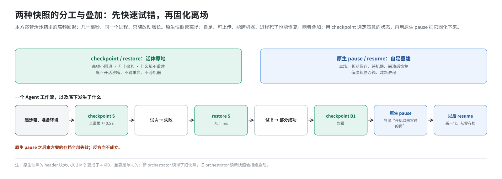
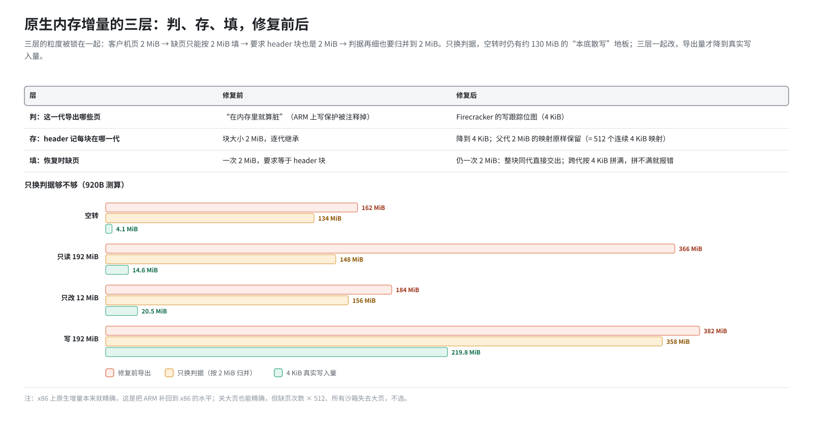
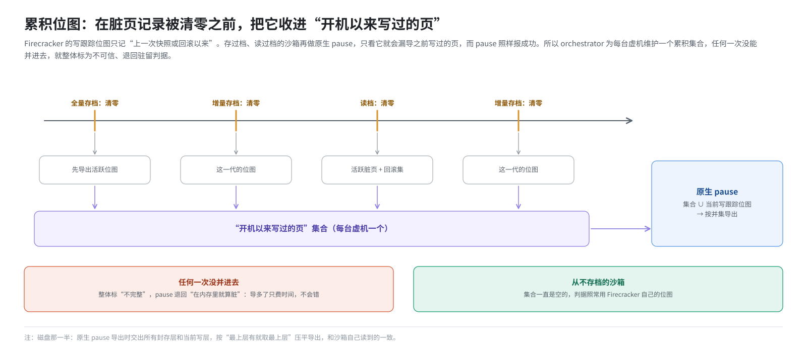
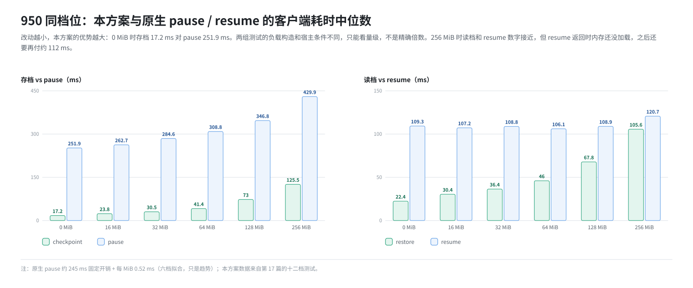

# 第 15 篇｜两种快照的分工：原生 pause 的精确增量与叠加使用

> **本篇目标**：本方案和原生快照不是二选一，而是各管一段。本篇先讲两者各解决什么问题、根本差别在哪；然后讲原生 pause 在 ARM 上“改 12 MiB 导出 148 MiB”的问题是怎么被诊断、怎么被修好的，为什么光换判据还不够；再讲一台存过档的沙箱做原生 pause 时，为什么会有漏页的风险，又是怎么用“累积位图”补上的；最后看两者的实测对比，以及怎么叠加使用。

---

## 一、两种快照各解决什么

| | 本方案：checkpoint / restore | 原生快照：pause / resume |
|---|---|---|
| 解决的问题 | **活沙箱里的高频快速回退** | **沙箱离场之后**：长期保存、跨机器、崩溃后恢复 |
| 恢复方式 | 原地：往同一个活进程里写回 | 重建：新起进程，缺页时按需加载 |
| 产物 | 绑在本机、本代进程的差分和层文件 | 自足的紧凑差分 + 映射链，可以上传、下载、搬走 |
| 成本和什么有关 | 改了多少、回退多远 | 销毁和重建虚机的固定开销，加上改动量 |
| 进程死了还能恢复吗 | 不能 | 能 |

根本差别只有一个：**活体原地，还是自足重建。** 本方案的快，全部来自“什么都不重建”；它的局限，也全部来自同一件事。原生快照的慢，来自“必须能离开这个进程、这台机器”；它能做到的事，也全部来自这一点。

所以两者互补，谁也替代不了谁：

- **本方案替代不了原生**：进程死了、要跨机器、要长期保存，本方案都做不到（第 14 篇）；
- **原生替代不了本方案**：哪怕原生的增量做到精确，“每次都要停掉沙箱、每次都要重建进程”这两项也不会消失，它们来自“离场”这个语义本身（第 4 篇）。

为什么不把两者做成一个？因为两者对产物的要求截然相反：一个要“绑死在活进程上才能快”，一个要“自足才能搬走”。硬做成一个，要么丢掉速度，要么丢掉可搬性。



## 二、原生 pause 的增量为什么不精确

第 4、8 篇提过，ARM 上原生 pause 出现过“改了 12 MiB，导出 148 MiB”。下面把它拆开。

### 1. 原生内存增量的三层

原生 pause 导出内存差分，可以分成三层：

| 层 | 做什么 | 粒度由谁决定 | 修复前 |
|---|---|---|---|
| **判** | 算出这一代哪些页要导出 | 判据返回的位图 | “在内存里且没有写保护”，ARM 上塌缩成“在内存里” |
| **存** | 把要导出的页拷进紧凑差分文件，header 记下每一块在哪一代的哪个位置 | header 的块大小，逐代继承 | 2 MiB |
| **填** | 恢复时缺页，从映射链取内容填进去 | 客户机的页大小 | 2 MiB（客户机内存用 2 MiB 大页），并且硬性要求等于 header 块大小 |

三层的粒度被一根链条锁在一起：客户机页是 2 MiB → 缺页只能按 2 MiB 填 → 填的代码要求 header 块也是 2 MiB → header 块大小逐代继承 → 判据再精细，最后也要归并到 2 MiB 块导出。



所以这里有两个问题，要分开治：**“判”决定读算不算脏；“存”和“填”决定最小能存多细。**

### 2. 判据塌缩，再叠加两个放大

“判”这一层，第 8 篇讲过：ARM 上 uffd 写保护的那几行被注释掉了，判据塌缩成“在内存里就算脏”。

单看这一点，还不至于每一代都导出几百 MiB。它和原生路径的另一个特点叠在一起：**每一代都是一个新的 Firecracker 进程**，新进程的内存一开始是空的，客户机用到的页全部要重新缺页拉进来，而拉进来就算脏。于是每一代增量的下限，约等于这一代客户机碰过的所有页，和改了多少无关。客户机读一遍 192 MiB 的文件，这 192 MiB 就进了下一次导出；客户机什么都不做，内核自己的活动也会碰到上百 MiB。

这个判据虽然浪费，但**方向是安全的**：一个写过的页，一定在内存里。所以“在内存里”是“写过”的超集，只会多导，不会少导。后面会看到，这一点让它成了所有退路的落脚点。

x86 上为什么没有这个问题？那里拉进来的是干净页，保留了写保护，不算脏。所以这个下限是 ARM 适配特有的退化，修复它是把 ARM 补回到 x86 本来就有的精确程度。

### 3. 只换判据够不够

正确的位图就在旁边：Firecracker 的写跟踪位图，也就是本方案在用的那张。最直接的修法是只把“判”换掉，“存”和“填”不动。

在另一台机器上做过测算，把 4 KiB 粒度的写跟踪位图按 2 MiB 归并（一个 2 MiB 块里只要有一个 4 KiB 页写过，整块都要导出）：

| 场景 | 修复前导出 | 只换判据（按 2 MiB 归并） | 4 KiB 真实写入量 |
|---|---|---|---|
| 空转 | 162 MiB | 134 MiB | 4.1 MiB |
| 只读 192 MiB | 366 MiB | 148 MiB | 14.6 MiB |
| 只改 12 MiB | 184 MiB | 156 MiB | 20.5 MiB |
| 写 192 MiB | 382 MiB | 358 MiB | 219.8 MiB |

看“空转”那一行：真实写入只有 4.1 MiB，归并后却是 134 MiB，放大三十多倍。因为这约 1000 个 4 KiB 页不是连成一片的，而是散在 2 GiB 内存的各处：内核的页表更新、内存分配器、定时器和调度器的记账、日志缓冲，各自落在不同的物理页上。它们落进了约 67 个不同的 2 MiB 块，每块里只有十几页真被写过，剩下四百多页是陪着导出的。

这就是**只换判据能到的地板**：只要客户机还活着，每一代就有一百多 MiB 的“本底散写”，归并到 2 MiB 之后约 130 MiB，和改动量无关。只换判据，治好了“读算脏”，但永远到不了真实写入量。“存”和“填”也必须动。

### 4. 为什么本方案天生精确，原生学不过来

本方案的差分是 Firecracker 在**进程内**按 4 KiB 写进稀疏文件的，读档时也是在**同一个进程**里直接写回，从不经过 uffd，所以既没有判据塌缩，也没有 2 MiB 的粒度锁。

原生不能照抄，因为它的用途不同：它要支持**另起一个新沙箱、按需取页**，甚至在另一台机器上恢复。新机器上没有旧进程，内存只能由 uffd 在缺页时从缓存或对象存储懒加载；差分也必须是“紧凑文件 + 映射链”这种能按偏移随机寻址、能上传下载的形态。搬稀疏文件过去，等于放弃懒加载和跨机器，而那正是原生快照存在的理由。

所以正确的问题是：**在保留映射链和 2 MiB 缺页的前提下，怎么让存储粒度降到 4 KiB？**

## 三、精确增量：三层各改了什么

### 先立规矩：宁可多导，不可少导

原生导出的差分是相对父代的，恢复时没导出的页一律从父代读。所以：

- **多导一页**：浪费一点空间和时间；
- **少导一页**：这一页恢复后回到父代的旧内容，客户机内存由两个时刻拼成，轻则数据错乱，重则客户机内核恢复后几十毫秒就崩溃。而且 pause 本身报的是成功，错误要到 resume 才暴露。

两个方向的代价完全不对称。所以任何判据改动都必须论证：**新判据导出的页，是真正写过的页的超集。**

### 两条路线

| | 路线 A：关掉大页 | 路线 B：保留大页，4 KiB 存、2 MiB 拼 |
|---|---|---|
| 做法 | 模板不用大页，三层都变成 4 KiB，只换判据 | 换判据；header 块降到 4 KiB；缺页仍按 2 MiB，内容从 4 KiB 映射拼起来 |
| 导出量 | 真实写入量 | 真实写入量 |
| 缺页次数 | **× 512** | 不变 |
| 客户机运行时 | 所有沙箱失去大页 | 不变 |

两条路线导出量一样，差别全在恢复和运行时。路线 A 让一个 400 MiB 的工作集从约 200 次缺页变成约 10 万次，每次都要经 orchestrator 往返；还让所有沙箱（不只是做快照的）在运行时失去大页的好处。为了导出量让全部沙箱付运行时代价，不划算。**选 B。**

路线 B 的关键判断是：**拼接能力本来就有。** 读映射链的通用读取函数本来就是一个循环，按偏移查映射、从对应那一代读一段、前进，可以跨越任意多代。只有缺页走的是“只取一个块”的捷径。所以要做的不是写一个拼接器，而是把缺页路径换成能拼的读法，再把拼接的开销压下去。

### 三层的改法

**判：换成写跟踪位图。** pause 时调用 `save-dirty-bitmap` 让 Firecracker 导出写跟踪位图，按它决定导出哪些页，块大小取 4 KiB。这一步能直接放进原生 pause 的流程，因为几个前提都成立：pause 取脏页时虚机已经暂停；原生 pause 先写的那次快照不带内存文件，不会清零位图（Firecracker 的 `create_snapshot` 只有带 `mem_file_path` 时才进 `snapshot_memory_to_file`，取 KVM 位图和清零都在那个函数里，第 11 篇扩展一）；`save-dirty-bitmap` 本身也不清零；而且每一代都是新进程，位图的起点正好是这一代的起点，本代之前写过的页已经在父代的差分里了。

这张位图覆盖了客户机经第二层页表的每一次写，加上 Firecracker 自己写客户机内存的地方。不在里面、也不该在的，是 orchestrator 缺页时“填”进去的页：它们只是读意义上的换入，内容和映射链里已有的一样，不用再存。

**存：header 块大小降到 4 KiB，父代的映射原样保留。** 差分的块比父代细、又能整除父代的块时，新 header 的块大小就改成差分的块大小。父代 2 MiB 粒度的映射不用重写：一个 2 MiB 的映射在 4 KiB 粒度下解释，就是 512 个连续的 4 KiB 映射，意思完全一样。

**填：一次缺页仍是 2 MiB，内容分三级取。** 客户机缺一个 2 MiB 页时：

1. 快照本身是旧的 2 MiB 粒度：照原来的路直接取一块，行为和修复前逐字节相同；
2. 这 2 MiB 整块都来自同一代（或整块从没写过）：查一次映射，直接把那一代缓存里的那段交出去，不拷贝。客户机物理页虽然是混着的，但仍以整块同代居多，所以大多数缺页走这条路；
3. 跨了几代：从缓冲池取一块 2 MiB，沿映射链按 4 KiB 逐段读满，拼成完整的一页再填。拼出来不够一整页就直接报错，绝不把半页交给客户机。

只有第三级要多付最多 512 次查表和一次 2 MiB 拷贝。

## 四、和本方案叠加：累积位图

### 问题

上面“判”那一步有一个前提：**位图的起点就是这一代的起点。** 对从没存过档的沙箱，这成立。但一台**存过档**的沙箱呢？

Firecracker 的写跟踪位图只记“上一次快照或回滚以来”写过的页。本方案每次存档都会清零它（第 8 篇），每次读档也会清零，而且读档写回内存走的是 KVM 不记录的路径。所以一台存过档、读过档的沙箱再做原生 pause，Firecracker 手里的位图只覆盖“最近一次存档或读档之后”这一小段。之前写过的页呢？它们不在父代的差分里（父代是模板，或上一次原生快照），也不在这张位图里，**就会漏导**。而 pause 照样报成功。

### 做法

orchestrator 为每台虚机维护一个“**开机以来写过的页**”集合。每次 Firecracker 的位图要被清零之前，把即将被忘掉的那部分并进这个集合：

| 时机 | 并进去的是 |
|---|---|
| 增量存档 | 这一代的位图（正好就是被清零的那一批） |
| 全量存档 | 写快照前先导出的活跃位图（全量写出的是全 1，不带信息） |
| 读档 | 暂停后导出的活跃脏页 + 这次写回的回滚集 |

原生 pause 时，把这个集合并回 Firecracker 的写跟踪位图，再按并集导出。



**对不上就标“不可信”。** 任何一次没能并进去（比如导出位图失败了），整个集合就标为“不完整”，pause 时退回修复前的“在内存里就算脏”的判据。导多了只费时间，不会出错。这就是“宁可多导，不可少导”的落地。

**从不存档的沙箱不受影响。** 它的集合一直是空的，判据照常用 Firecracker 自己的位图。

**磁盘那一半**：第 10 篇讲过，存过档的沙箱，写层已经被封存过多次。原生 pause 导出磁盘时，会把所有封存层和当前写层一起交出来，按“最上层有就取最上层”压平导出，和沙箱自己读到的内容一致。

反方向不成立：原生 pause / resume 之后是新的一代，之前的存档全部失效。

## 五、实测对比

修复后，950 上原生 pause / resume 的分档实测（客户端耗时中位数）：

| 改动量 | pause | resume | 导出内存 |
|---|---|---|---|
| 0 MiB | 251.9 ms | 109.3 ms | 15.9 MiB |
| 16 MiB | 262.7 ms | 107.2 ms | 40.8 MiB |
| 64 MiB | 308.8 ms | 106.1 ms | 94.0 MiB |
| 128 MiB | 346.8 ms | 108.9 ms | 161.8 MiB |
| 256 MiB | 429.9 ms | 120.7 ms | 294.3 MiB |

几点读法：

- **精确增量生效了。** 导出内存随写入量增长，0 MiB 档只有 15.9 MiB。修复前，950 上这一项恒在 400 MiB 上下；
- **pause 由固定开销主导。** 按六档拟合，大约是 245 ms 固定开销加每 MiB 0.52 ms；
- **resume 几乎不随档位变化**，但成本只是推迟了：恢复后第一次读这些内存，比快照前慢 7～112 ms，随负载增长。

和本方案并列（两组测试的负载构造和宿主条件不同，只能看量级，不能当精确倍数）：

| 改动量 | 存档 | pause | 倍数 | 读档 | resume | 倍数 |
|---|---|---|---|---|---|---|
| 0 MiB | 17.2 ms | 251.9 ms | 14.6 | 22.4 ms | 109.3 ms | 4.9 |
| 16 MiB | 23.8 ms | 262.7 ms | 11.0 | 30.4 ms | 107.2 ms | 3.5 |
| 64 MiB | 41.4 ms | 308.8 ms | 7.5 | 46.0 ms | 106.1 ms | 2.3 |
| 128 MiB | 73.0 ms | 346.8 ms | 4.8 | 67.8 ms | 108.9 ms | 1.6 |
| 256 MiB | 125.5 ms | 429.9 ms | 3.4 | 105.6 ms | 120.7 ms | 1.1 |



改动越小，本方案优势越大，这正是“高频小回退”的场景。256 MiB 档读档和 resume 数字接近，但含义不同：读档返回时内存已经写回；resume 返回时页还没加载，之后还要再付约 112 ms。而且读档保留了原进程，resume 换了一代进程，之前的存档全部失效。

## 六、怎么叠加使用

方向规则：**先用本方案快速试错，选定满意的状态之后，再用原生快照固化或离场。**

一个 Agent 工作流，以及底下发生了什么：

```
起沙箱，准备环境
→ checkpoint S（全量根，约 0.5 s）
→ 试方案 A → 失败 → restore S（几十毫秒，同一进程）
→ 试方案 B → 部分成功 → checkpoint B1（增量）
→ 继续 → 失败 → restore B1
→ 成功，想把这个状态长期留下来
→ 原生 pause（导出“开机以来写过的页”，上传；进程退出；本方案的存档全部失效）
→ 以后需要时 resume（新进程、新一代，从零开始存档）
```

还有一点兼容性：原生快照的 header 块大小从 2 MiB 变成了 4 KiB，所以兼容是单向的。新 orchestrator 读得了旧快照，旧 orchestrator 读新快照会拒绝启动。升级 orchestrator 后，不要再回退到旧版本去恢复新的快照。

---

## 本篇小结

| 概念 | 一句话解释 |
|---|---|
| 分工 | 本方案管活沙箱里的高频回退；原生管离场、长期保存、跨机器 |
| 根本差别 | 活体原地 vs 自足重建，两者谁也替代不了谁 |
| 原生三层 | 判、存、填；判决定读算不算脏，存和填决定最小粒度 |
| 判据塌缩 | ARM 上“在内存里就算脏”，加上每代新进程，增量约等于工作集 |
| 2 MiB 地板 | 只换判据，本底散写归并后仍约 130 MiB |
| 路线 B | 判换写跟踪位图、header 降到 4 KiB、缺页仍 2 MiB 但按 4 KiB 拼 |
| 宁可多导 | 少导一页会让客户机内存由两个时刻拼成，pause 还报成功 |
| 累积位图 | 存档、读档清零位图之前，把即将被忘掉的页并进“开机以来”集合；对不上就退回驻留判据 |
| 实测 | 950 上 pause 约 245 ms 固定开销 + 0.52 ms/MiB；同档位本方案快 1.1～14.6 倍（量级比较） |
| 叠加 | 先 checkpoint 快速试错，再原生 pause 固化 |

**下一篇预告**：[《性能怎么量：口径、档位与三种失真》](16-how-to-measure.md)。“存档 ≤ 200 ms、读档 ≤ 100 ms”到底怎么判？用谁的钟、看哪个统计量？为什么按改动量分档？负载构造不当，会怎样让测出来的数字失真？
