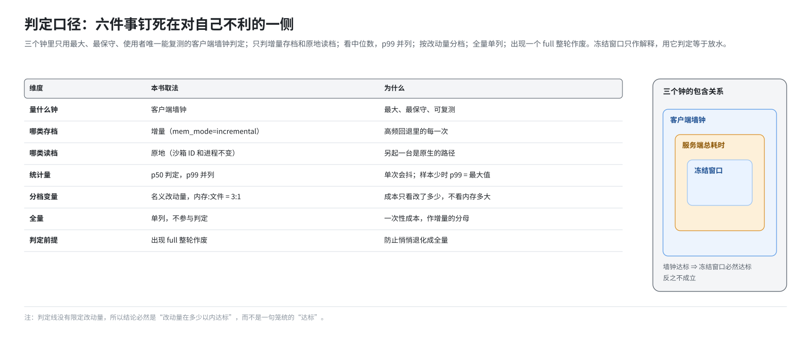
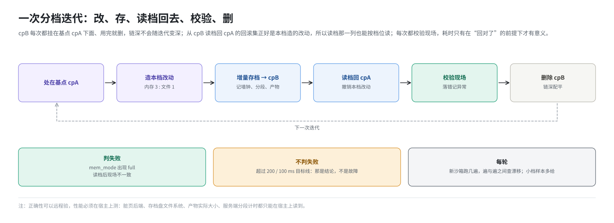

# 第 16 篇｜性能怎么量：口径、档位与三种失真

> **本篇目标**：在看数字之前，先讲数字是怎么来的。“存档 ≤ 200 ms、读档 ≤ 100 ms”这句话本身还不能用来判定，它缺了好几样东西：用谁的钟、量哪一次、看哪个统计量、在什么负载下。本篇先把这些钉死，再讲为什么按“改了多少”分档而不按“内存多大”分；什么样的数字不许被引用；负载构造不当，会怎样让测出来的数字失真；最后讲一次分档测试是怎么设计的，怎么读一份性能报告。

---

## 一、“≤ 200 ms”还不是一个口径

“存档不超过 200 毫秒”这句话里，缺了六件事：

| 缺什么 | 不同取法 |
|---|---|
| 谁的钟 | 客户端量的，还是服务端自己记的 |
| 哪一次 | 第一次（全量），还是之后的（增量） |
| 哪个统计量 | 平均、中位数，还是最坏的那次 |
| 什么负载 | 两次之间改了多少 |
| 什么恢复方式 | 原地回滚，还是另起一台 |
| 什么机器 | 哪种 CPU、哪种脏页跟踪方式 |

任何一项换个取法，同一批数据都能得出相反的结论。所以判定之前，先把六项钉死，而且**钉在对自己不利的那一侧**。口径一旦对自己有利，结论就没有说服力。

本书的口径：

| 维度 | 取法 | 为什么 |
|---|---|---|
| 量什么钟 | **客户端墙钟**：在调用方用计时器夹住 SDK 调用，含网络往返和服务端全部工作 | 三个钟里最大、最保守；也是使用者在自己机器上唯一能复测的 |
| 哪类存档 | **增量**存档：服务端回报 `mem_mode=incremental` | 目标约束的是高频回退里的每一次；全量根每台沙箱只有一次 |
| 哪类读档 | **原地**读档：沙箱 ID 和 Firecracker 进程都不变 | 另起一台是原生快照的路径 |
| 统计量 | **中位数（p50）判定，p99 并列** | p50 回答“通常多久”，p99 回答“最坏能不能接受”；单次会抖，任何单次数字都不作判定 |
| 分档变量 | **名义改动量**：两次存档之间改了多少 | 下面第三节解释 |
| 全量存档 | 单列，不参与判定 | 下面第四节解释 |
| 判定前提 | 这一轮所有增量迭代 `mem_mode` 必须是 `incremental`，出现 `full` 整轮作废 | 防止“悄悄退化成全量”时测到的根本不是增量 |



因为目标没有限定改动量，判定的结论必然是“**改动量在多少以内达标**”，而不是一句笼统的“达标”。

## 二、三个钟，只用一个判定

第 7 篇讲过三个钟：客户端墙钟、服务端总耗时、冻结窗口。它们是嵌套的：

```
客户端墙钟 ⊇ 服务端总耗时 ⊇ 冻结窗口
```

所以墙钟达标，冻结窗口必然达标；反过来不成立。判定只用墙钟，理由是**可复测**加**保守**：冻结窗口要在宿主上读计时才拿得到，使用者复现不了，而且它天然更小，用它判定就是在挑一个对自己有利的口径。

冻结窗口还是要列出来，作为解释：墙钟里有多少是虚机真停住的，决定了“要更快该往哪使劲”。如果墙钟里绝大部分都是冻结，说明要更快只能让冻结窗口本身变短；反之，时间花在了窗口之外（排队、网络、窗口外的准备），优化方向完全不同。

分阶段计时只用来看“时间花在哪”，**不做加总核对**。因为它既有窗口内的段，也有窗口外的段（比如装配视图、后台清连接跟踪表、等 envd），全部加起来会超过冻结窗口。

### 一点统计常识

- **中位数（p50）**：把所有样本排好序，取中间那个。一半样本比它快，一半比它慢。它不受个别极端值影响。
- **p99**：排好序后，99% 的样本都比它快。它反映的是“最坏的那一小撮”。
- **样本少时，p99 就是最大值。** 按常见的取法，样本不到 100 个时，p99 就落在最后一个样本上。本书 950 的分档测试每档只有 10～30 个样本，所以 p99 不能用来推断长期的尾延迟。
- **不同脚本的分位数取法不同。** 有的取最近的一项，有的在两项之间插值。同一批样本，不同取法的 p99 可以差出一截。跨表比较之前，先确认两边是同一种取法。

## 三、为什么按“改了多少”分档

“不同内存大小下的性能”是一个很自然的提法，但对本方案是**问错了变量**。

增量存档写出的是本代脏页，成本只和改了多少有关，和虚机多大无关。一台 8 GB 的沙箱只改了 4 MB，和一台 2 GB 的沙箱改 4 MB，代价是一样的。读档也一样，成本跟着回滚集走。

所以测试按“**名义改动量**”分档：0、4、8、16、32、64、128、256 MiB，加一个 512 MiB 的极限档。这也是唯一能让使用者“对号入座”的分法：使用者大概知道自己两次存档之间改多少内存、写多少文件，却很难说清“快照有多大”。

每一档的总改动按**内存 : 文件 = 3 : 1** 拆开。比如 256 MiB 档，实际是写内存 192 MiB、写文件 64 MiB。理由是沙箱里跑代码，改内存通常远多于改文件。另外还有三组附表：

| 附表 | 用途 |
|---|---|
| 纯内存 | 单独看内存这条斜率 |
| 纯文件 | 单独看文件这条斜率 |
| 只读触碰：只读、不写 | **哨兵**：读不算脏，它应当和 0 MiB 档几乎一样；明显变大，就说明“读被算成了脏” |

## 四、为什么全量单列

每台沙箱的第一次存档是全量，要写整份内存，比常见的增量档贵几倍到几十倍。但它**每台沙箱只发生一次**：存一百次档，这一次的代价摊到每次上只剩百分之一，而且它不在“回退到上一步”这个动作的路径上。

把它算进判定，会得到一个既不反映使用体验、也不反映实现质量的数字；把它藏起来，又会让“增量快多少倍”没有分母。所以它单列一行，标注“一次性成本，不参与判定”。

## 五、条件标签：不带标签的数字不许引用

任何一个耗时或大小的数字，必须带着这些标签：

| 标签 | 为什么 |
|---|---|
| 机型 | 950 和 920B 的 CPU、内核都不同 |
| 脏页后端 | `hdbss` / `kvm-wp` / `off`，同样的代码能差几倍 |
| 存档盘的文件系统和介质 | 真盘还是虚拟盘，ext4 还是别的 |
| 模板规格 | 全量的代价按客户机内存走 |
| 二进制版本 | 换过二进制的机器上，唯一对得上号的东西 |
| 脚本和参数 | 默认值改过就不是同一组数 |
| 负载形态 | 单沙箱串行、几路并发、缓存冷热 |

以脏页后端为例：软件写保护下，每个干净页在每次存档后的第一次写都要陷出一次，这笔开销含在 920B 的每个数字里，换到有 HDBSS 的机器上就没有了。一个不带“脏页后端”的数字，读者没法知道它含不含这笔钱。

几条纪律：

- **不同条件的数不相减。** 950 和 920B 的脏页后端、机型、磁盘至少三项同时不同，差值不能归因于其中任何一项，尤其不能归因于 HDBSS。要量 HDBSS 的收益，只能在同一台 950 上各跑一遍、其他条件不动。
- **空着比错的数强。** 读不到的格子写“待测”，不猜、不折算。一个错的数会被引用很多年，一个空格只会被人问一句。
- **口径说明和数字放在一起。** 分开放，数字一定会被单独引用。

还有一条和“在哪跑”有关：**正确性可以远程验，性能必须在宿主上测。** 脏页后端要问 Firecracker 的本地接口，存档盘的文件系统要读 orchestrator 进程的信息，产物实际大小要直接量文件，服务端分阶段计时要读本地文件，这些从别的机器连过来都拿不到。远程跑出的耗时缺标签，不允许引用。

## 六、负载构造：三种失真

判定表第一列写着“改动 N MiB”，它成立的前提是：**标签上的 N，等于服务端实际处理的量。** 这是整套性能测试里最容易做错的一步。


### 失真一：分配成本混进档位

第一次申请并写一块新内存，内核要清零、建页表；第一次写一个新文件，文件系统要分配块。这笔开销和“改”无关。但如果每档都重新分配，它就被算进了档位，而且档位越大混进去越多，曲线的斜率被抬高。

### 失真二：写放大

用 shell 字符串拼接之类的方式造内存负载，看起来“写了 N MB”，实际上缓冲区要复制、扩容时留下中间状态、上一代释放后又重新缺页，每一步都在弄脏额外的页。早期对照原生快照的负载脚本就是这么造的，实测的内存差分是名义量的好几倍，表完全没法看，后来重写了。

### 失真三：负载放错层

**快照只能带回它覆盖范围内的东西。** 负载放在覆盖范围之外，测出来的既是零成本，也是假通过。本方案覆盖整个客户机内存和整块根盘，所以有一个很干净的分工：

| 负载写在哪 | 弄脏了什么 |
|---|---|
| `/dev/shm`（内存文件系统） | 只有内存页，不落磁盘 |
| 根文件系统上的普通文件 | 磁盘写层，**同时**在内存里留一份文件缓存 |

两半分开放，就能分别控制、分别验证。

### 解法：预热 + 原地覆写

所有基准脚本最后都收敛到同一个两步法：

1. **预热**：先把内存文件和磁盘文件一次撑到最大档位。这一次承担全部分配成本，不计入任何档位；
2. **原地覆写**：之后每档只覆写前 N MiB，用 `dd` 的 `conv=notrunc` 参数。这个参数是要害：没有它，`dd` 会先把文件截成空再写，每档都重新分配，失真一原样回来。

数据用**随机数据**，不用全零。全零页会被稀疏文件、去重、压缩各层特殊对待，随机数据量到的才是最坏、也是最诚实的情况。

### 文件那份，故意走缓存

文件负载用普通的带缓存写，再 `sync`，因为真实用户就是这么写的。数据先进客户机的文件缓存，再刷到虚拟磁盘，所以一份文件写会**同时**出现在内存差分（缓存的那些页）和磁盘层里。这不是测量误差，是文件缓存的本性。于是读表时有一条固定预期：

> 实测内存差分 ≈ 名义内存 + 名义文件；实测磁盘层 ≈ 名义文件。

偏离这个关系，先查负载，再看时间。

## 七、一次分档迭代怎么设计

一次迭代：

```
处在基线存档 cpA 的状态
→ 在客户机里造本档规定量的改动
→ 增量存档，得到 cpB（记分阶段计时、墙钟、产物大小）
→ 读档回 cpA（撤销这份改动）
→ 校验现场
→ 删掉 cpB
```



这个设计一次解决三件事：

- **链深配平。** cpB 每次都挂在 cpA 下面，用完就删，链不会越来越深。链深是另一个可能影响耗时的变量，不配平，档与档之间就没法比；
- **读档的量就是本档的量。** 从 cpB 回 cpA 的回滚集，正好是本档造的那份改动，所以读档那一列也能按同一个档位读；
- **每次都校验。** 读档之后读回内容，落错了记异常。耗时数字只有在“回对了”的前提下才有意义。

判定规则：`mem_mode` 全是 `incremental`、每次读档后现场一致，否则判失败；**超过目标线不判失败**，那是结论，不是故障。

每一轮用新沙箱跑几遍（默认 3 遍），遍与遍之间可以看有没有漂移。小档耗时短、抖动占比大，样本多给一些。

### 另外几种专项测法

| 想回答的问题 | 怎么测 |
|---|---|
| 写完立刻存档，和过一会儿再存，差多少 | 同一套档位拍两遍：一遍写完立刻存，一遍先 `sync` 再存。两者之差是“时机”的成本，不是快照机制的成本 |
| 服务端到底写下了多少 | 直接量产物文件的实际占用，和档位标签对账，写放大一眼就能看出来 |
| 客户机里感觉到的冻结有多长 | 在客户机里跑一个每秒约 2500 次的计时采样器。虚机暂停时它也停住，时间序列里留下一个“洞”，洞的宽度就是冻结时长 |
| 没有任何并发时，读档的长尾 | 一台沙箱、一个调用方、同一个存档连续读档 100 次 |
| 变慢是因为链变深，还是写得多 | 专门设计对照，把两个绑在一起的变量拆开 |

## 八、怎么读一份性能报告

按顺序看：

1. **先看条件标签。** 哪台机器、哪种脏页后端、什么存档盘、哪个版本。缺了的，数字不能引用；
2. **再看 `mem_mode`。** 增量迭代里出现 `full`，整轮作废；
3. **看产物和档位对不对账。** 内存差分约等于名义内存加名义文件吗？只读档和 0 档差不多吗？
4. **再看墙钟的 p50、p99。** 判定是否在目标线内；
5. **最后看分阶段。** 增长主要在哪一段，是存档的写快照，还是读档的物化和写回？

---

## 本篇小结

| 概念 | 一句话解释 |
|---|---|
| 口径 | 谁的钟、哪一次、哪个统计量、什么负载、什么恢复方式、什么机器，六项钉死在不利一侧 |
| 判定用墙钟 | 最大、最保守、可复测；冻结窗口只作解释 |
| p50 判定、p99 并列 | 样本少时 p99 就是最大值，不能推断长尾 |
| 按改动量分档 | 成本只看改了多少，不看内存多大；内存:文件 = 3:1 |
| 只读哨兵 | 只读档明显变大，说明读被算成了脏 |
| 全量单列 | 一次性成本，作增量的分母 |
| 条件标签 | 不带标签的数字不许引用；不同条件的数不相减 |
| 三种失真 | 分配成本混入、写放大、负载放错层 |
| 预热 + 原地覆写 | 先撑到最大，再用 `conv=notrunc` 只覆写前 N MiB；用随机数据 |
| 迭代设计 | cpA → 改 → cpB → 读档回 cpA → 校验 → 删 cpB；链深配平 |

**下一篇预告**：[《性能实测：在鲲鹏 950 上到底多快》](17-performance-results.md)。按本篇的口径，950 上十二档的存档、读档耗时各是多少，128 MiB 以内为什么达标、256 MiB 为什么读档开始超线；时间花在了哪几段；产物有多大；同一个存档连读 100 次有多快；HDBSS 的证据；以及哪些结论还不能下。
