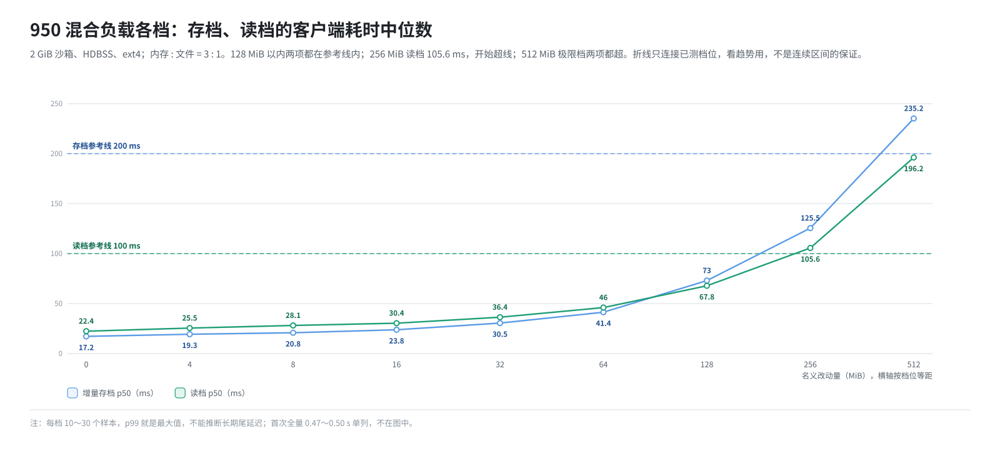
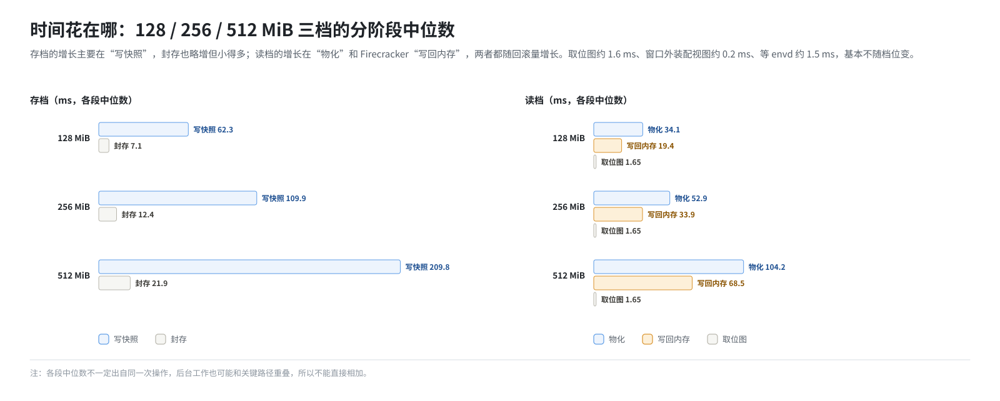
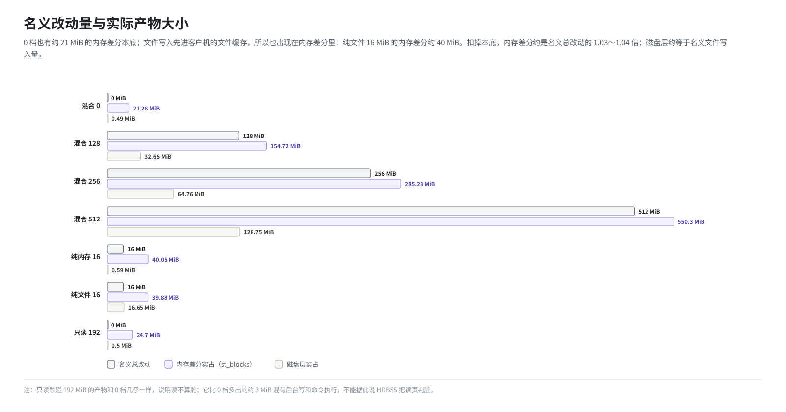

# 第 17 篇｜性能实测：在鲲鹏 950 上到底多快

> **本篇目标**：按上一篇的口径，看鲲鹏 950 上的实测数字：十二档的存档、读档耗时，哪些档达标、哪些超线；时间花在哪几段；产物有多大；同一个存档连读 100 次有多快；HDBSS 的启用证据和写密集测试；多台沙箱同时操作时延迟怎么涨。最后同样重要：哪些结论这些数据还撑不起来。

---

## 一、条件

| 项 | 本轮 |
|---|---|
| 机器 | 鲲鹏 950，ARM（aarch64） |
| 宿主内核 | openEuler 6.6 系列 |
| 沙箱 | 2 vCPU，全量内存产物 2048 MiB |
| 脏页后端 | Firecracker 自报 `hdbss` |
| 存档盘 | ext4 |
| 测试方式 | 上一篇的分档迭代：从基点改规定量 → 增量存档 → 读档回基点 → 校验 → 删除 |
| 样本 | 两遍，每遍一个新沙箱；每档 10～30 个样本，共 270 次增量迭代 |

本轮还有一些条件没有完整留档：被测二进制的版本身份、存档盘下层介质、原始逐次数据。所以下面引用的是归档文本里的统计值，没有从原始样本独立重算。读数字时要记住这一点。

270 次增量迭代**全部是 `incremental`**，没有记录到操作失败或现场不一致。

## 二、十二档主表

单位 ms。“存档”指增量存档，“读档”指原地读档。判定线是存档 ≤ 200、读档 ≤ 100，按客户端墙钟中位数判。每档样本只有 10～30 个，所以 p99 就是最大值，合成一列。

| 档（名义改动 MiB） | 样本 | 存档 p50 | 存档最大 | 读档 p50 | 读档最大 | 存档冻结 p50 | 读档冻结 p50 | 判定 |
|---|---|---|---|---|---|---|---|---|
| 混合 0 | 30 | 17.2 | 23.0 | 22.4 | 30.9 | 15.3 | 17.2 | ✓ / ✓ |
| 混合 4 | 30 | 19.3 | 26.1 | 25.5 | 31.3 | 17.2 | 19.8 | ✓ / ✓ |
| 混合 8 | 30 | 20.8 | 30.8 | 28.1 | 33.5 | 18.6 | 21.9 | ✓ / ✓ |
| 混合 16 | 30 | 23.8 | 30.2 | 30.4 | 33.9 | 21.7 | 24.5 | ✓ / ✓ |
| 混合 32 | 30 | 30.5 | 37.7 | 36.4 | 44.0 | 28.3 | 30.4 | ✓ / ✓ |
| 混合 64 | 20 | 41.4 | 49.1 | 46.0 | 56.0 | 39.3 | 39.8 | ✓ / ✓ |
| 混合 128 | 20 | 73.0 | 88.7 | 67.8 | 74.1 | 70.7 | 60.7 | ✓ / ✓ |
| 混合 256 | 20 | 125.5 | 143.3 | **105.6** | **123.9** | 122.9 | 98.1 | ✓ / **✗** |
| 混合 512（极限） | 10 | **235.2** | **259.0** | **196.2** | **218.7** | 232.6 | 187.5 | **✗ / ✗** |
| 纯内存 16 | 20 | 19.4 | 22.2 | 29.5 | 37.4 | 17.2 | 23.0 | ✓ / ✓ |
| 纯文件 16 | 20 | 38.5 | 45.2 | 31.8 | 35.7 | 36.3 | 25.2 | ✓ / ✓ |
| 只读触碰 192 | 10 | 18.6 | 23.9 | 25.4 | 30.8 | 16.4 | 19.7 | ✓ / ✓ |



怎么读这张表：

- **混合负载 128 MiB 以内，两项都达标**，而且 p50 和最大值的判定一致；
- **256 MiB 档，存档还在线内，读档 p50 105.6 ms，开始超线**；
- **512 MiB 极限档，两项都超线**；
- 纯内存和纯文件只测了 16 MiB 一档，不能外推成“所有纯负载都达标”；
- **只读触碰 192 MiB**，和 0 档几乎一样（存档 18.6 对 17.2 ms）。这一行是哨兵：读不算脏，HDBSS 没有把读过的页当成脏页；
- 冻结窗口在墙钟里占了绝大部分。比如混合 64 档，存档墙钟 41.4 ms，冻结 39.3 ms。所以要更快，主要得让冻结窗口本身变短。

**实测的边界是已测的档位，不是一个连续区间的保证。** 能说的是“128 MiB 达标、256 MiB 读档超线”，不能说“250 MiB 一定达标”。

### 拟合只是趋势

对混合 256 MiB 以内的 210 次迭代做直线拟合：

```
存档墙钟 ≈ 17.5 + 0.42 × 改动 MiB   (ms)
读档墙钟 ≈ 25.4 + 0.31 × 改动 MiB   (ms)
```

可以理解为：存档有约 17 ms 的固定开销，每多改 1 MiB 多约 0.42 ms；读档固定约 25 ms，每 MiB 约 0.31 ms。

但这只是**平均趋势**。由它反推“碰线改动量”（存档约 430 MiB、读档约 245 MiB），只是趋势线和参考线的交点，不是实测的达标上限，也没有置信区间。判定仍以已测档位为准。

## 三、首次全量

两遍各有一次全量存档（每台沙箱的第一次），单列，不参与判定：

| 遍 | 墙钟 | 冻结 | 写快照 | 封存 |
|---|---|---|---|---|
| 1 | 0.47 s | 468.0 ms | 436.3 ms | 24.4 ms |
| 2 | 0.50 s | 496.9 ms | 457.5 ms | 31.5 ms |

主要花在写 2 GiB 的快照上。这是全方案唯一保留的固定开销，每台沙箱只付一次。

## 四、时间花在哪

128 / 256 / 512 MiB 三档的分阶段中位数（ms）：

| 阶段 | 128 MiB | 256 MiB | 512 MiB |
|---|---|---|---|
| 存档：写快照 | 62.3 | 109.9 | 209.8 |
| 存档：封存 | 7.1 | 12.4 | 21.9 |
| 读档：物化 | 34.1 | 52.9 | 104.2 |
| 读档：Firecracker 写回内存 | 19.4 | 33.9 | 68.5 |
| 读档：Firecracker 取位图 | 约 1.6～1.7 | | |
| 读档：窗口外装配视图 | 约 0.2 | | |
| 读档：等 envd | 1.4 | 1.7 | 1.6 |



- 存档的增长主要在**写快照**；封存也有增长，但小得多；
- 读档的增长在**物化**（算回滚集、读内容、写临时文件）和**写回内存**，两者都随回滚量增长；
- 取位图约 1.6 ms，这就是第 7 篇说的“与虚机大小相关、但常数极小”的那一步；
- 装配视图 0.2 ms，挪到窗口外之后几乎不占时间。

注意：这些阶段的中位数不一定出自同一次操作，后台工作也可能和关键路径重叠，所以**不能直接相加**。

## 五、产物有多大

磁盘实际占用（按 `st_blocks`，不是逻辑长度）的中位数：

| 档 | 内存差分 | 磁盘层 |
|---|---|---|
| 混合 0 | 21.3 MiB | 0.5 MiB |
| 混合 128（96 内存 + 32 文件） | 154.7 MiB | 32.6 MiB |
| 混合 256（192 + 64） | 285.3 MiB | 64.8 MiB |
| 混合 512（384 + 128） | 550.3 MiB | 128.7 MiB |
| 纯内存 16 | 40.1 MiB | 0.6 MiB |
| 纯文件 16 | 39.9 MiB | 16.6 MiB |
| 只读触碰 192 | 24.7 MiB | 0.5 MiB |



- **0 档也有约 21 MiB 的内存差分。** 这是“本底”：客户机就算什么都不做，内核和后台程序也在写内存；再加上测试本身执行命令的开销；
- **文件写入也出现在内存差分里。** 看纯文件 16 那一行：只写了 16 MiB 文件，内存差分却有约 40 MiB，因为文件先进了客户机的文件缓存。这正是上一篇说的“实测内存 ≈ 名义内存 + 名义文件”；
- 扣掉 21 MiB 本底，128 / 256 / 512 档的内存差分约是名义**总**改动的 1.03～1.04 倍，和预期吻合；
- 磁盘层约等于名义文件写入量。

## 六、同一个存档连读 100 次

一台沙箱、一个调用方，对同一个全量基点连续读档 100 次（基点现场是内存 16 MiB + 文件 4 MiB，每 10 次抽验）：

| 指标 | 结果 |
|---|---|
| 客户端墙钟 p50 / p99 / 最大 / 最小 | 13.2 / 21.4 / 25.2 / 10.4 ms |
| 冻结 p50 / p99 | 8.9 / 16.1 ms |
| 结果 | 100 次全部成功，抽验全部一致 |

为什么比分档表的 0 档还快？因为这里每次读档之间**没有再造新的改动**，回滚集只有一点点本底。它说明的是“没有改动时，读档的固定开销能有多低”，不能代替分档表的回滚成本。

## 七、HDBSS 专项

### 它真的开了吗

三级证据：

| 级别 | 证据 | 说明 |
|---|---|---|
| 能力 | 向内核查询 HDBSS 能力，返回支持 | 内核支持 |
| 启用 | 两台沙箱的 Firecracker 都自报 `hdbss`；内核日志和 Firecracker 日志里缓冲区大小都是默认的 1 | 默认配置实际启用 |
| 数据面 | 冷写、热写耗时和每页 KVM 退出次数；读档后内容的 MD5 一致 | 增量和恢复确实通过硬件标脏完成 |

第三条值得解释。如果用的是软件写保护，每个干净页的第一次写都要陷出一次，“每页退出次数”应该接近 1。实测冷写时每页只有约 0.002～0.007 次退出，远小于 1。冷写仍比热写慢约 2.2 倍，但这不代表 HDBSS 没生效：冷写和热写的差别还受缓存、TLB、调度影响，不能只凭一个比值判断。

**本轮没有在同一台机器上跑软件写保护作对照**，所以不能说“HDBSS 让存档快了几倍”。也没有比较不同缓冲区大小。

### 写密集测试：页的分布比页数更重要

在一个 1024 MiB 的内存区域里，每页写 1 字节，比较两种写法：`seq` 连续写前 N 页，`rand` 在整个区域里随机挑 N 页。单写者、3 次中位数：

| 脏页量 | 写法 | 存档 | 读档 | 内存差分 |
|---|---|---|---|---|
| 0 | | 18.7 ms | 12.8 ms | 18.5 MiB |
| 64 MiB | seq | 22.5 ms | 39.1 ms | 81.9 MiB |
| 64 MiB | rand | 65.5 ms | 125.2 ms | 85.6 MiB |
| 256 MiB | seq | 49.9 ms | 89.6 ms | 273.7 MiB |
| 256 MiB | rand | 185.2 ms | 394.0 ms | |

同样是 256 MiB，随机散着写，存档和读档都慢了三到四倍。这和“散页要处理更多零碎的区间”的机制相符，但本轮没有记录内部区间数和 I/O 次数，还不能把差额归到某一个阶段。**评估一个负载时，改了多少要结合改得有多散来看。**

内存差分约等于写脏的覆盖量加本底，和预期吻合。21 个组合的 MD5 全部一致。

## 八、多台沙箱同时操作

### 跨沙箱突发

N 台沙箱同时做同样的事：每代改内存 48 MiB、文件 16 MiB，存两个增量 cp1、cp2，然后依次读档回 cp1、cp2、cp0（全量根）。每一步各沙箱对齐后同时发起。客户端墙钟 p50 / 最大（ms）：

| N | 存 cp1 | 存 cp2 | 回 cp1 | 回 cp2 | 回 cp0 |
|---|---|---|---|---|---|
| 1 | 53 / 53 | 47 / 47 | 41 / 41 | 44 / 44 | 41 / 41 |
| 4 | 54 / 58 | 55 / 63 | 56 / 61 | 49 / 53 | 50 / 52 |
| 8 | 68 / 74 | 74 / 79 | 54 / 65 | 54 / 85 | 61 / 64 |
| 16 | 103 / 116 | 100 / 111 | 75 / 87 | 71 / 92 | 60 / 76 |

16 台同时操作时，存档中位数约是单台的 2 倍，读档约 1.5～1.8 倍，仍在目标线内。93 次存档、93 次读档全部成功，93 次读档后现场全部逐项一致。冻结窗口主要花在写快照上，16 台时写快照中位数约 85～91 ms，多台同时写存档盘，互相竞争磁盘和 CPU。

这说明的是**短时突发**下的表现，不是持续吞吐，也不是长期稳定性。

### 同一台沙箱、四个调用方

一台沙箱，4 个线程各自连上，各做 5 轮“存档 → 读档 → 列表”：

| 项 | 结果 |
|---|---|
| 存档 | 20 / 20 成功，p50 / 最大 41 / 61 ms |
| 读档 | 20 / 20 成功，p50 / 最大 38 / 55 ms |
| 结束后 | 沙箱可用，21 个存档都能读档，后台进程 PID 不变 |

同一台沙箱的操作在服务端串行，所以这里看的是“排队之后能不能正确收敛”。另外，日志里记录了 18 条**命令**异常，它们来自同一台沙箱上和读档并发的流式命令，正是第 12 篇讲的“跨越读档的连接会被切断”，不是存档、读档本身失败。

## 九、哪些结论还不能下

数据能说明什么，同样要说清楚它不能说明什么：

| 不能下的结论 | 原因 |
|---|---|
| 长期尾延迟 | 每档 10～30 个样本，p99 就是最大值 |
| HDBSS 比软件写保护快多少 | 没有同机对照；不同机器的数不相减 |
| 纯文件为什么比混合慢 | 纯文件 16 MiB 存档 38.5 ms，高于同为 16 MiB 的混合档 23.8 ms；没有交错对照实验，原因未归因 |
| 缓存是热的 | 读盘次数的统计口径有缺陷，原始记录未回传，不能写成“缓存全热已证” |
| 小时级稳定性 | 只有分钟级的短稳态测试；小时级长跑、资源收敛还在待测清单上 |
| 某个确定版本的完整验收 | 被测二进制的身份没有完整留档 |

这些缺口不影响“在已测条件下，128 MiB 以内达标”这个结论，但决定了不能把它推广得更远。使用者应该用自己的负载、在自己的环境里测：改动量、写得有多散、缓存冷热、并发度、保留多少历史。

---

## 本篇小结

| 结论 | 数字 |
|---|---|
| 达标范围 | 混合 128 MiB 以内，存档和读档的 p50、最大值都在线内 |
| 开始超线 | 256 MiB 读档 p50 105.6 ms；512 MiB 两项都超 |
| 代表档 | 64 MiB：存档 41.4 ms，读档 46.0 ms |
| 趋势 | 存档 ≈ 17.5 + 0.42 ms/MiB；读档 ≈ 25.4 + 0.31 ms/MiB（只是趋势） |
| 首次全量 | 0.47～0.50 s，主要在写 2 GiB 快照 |
| 时间花在哪 | 存档在写快照；读档在物化和写回内存 |
| 产物 | 本底约 21 MiB；内存差分 ≈ 名义内存 + 名义文件 |
| 串行连读 | 同一存档连读 100 次，p50 13.2 ms |
| HDBSS | 能力、启用、数据面三级证据齐全；冷写每页退出远小于 1 |
| 散写 | 同样 256 MiB，随机散写比连续写慢 3～4 倍 |
| 并发 | 16 台突发，存档 p50 约 100 ms，读档 60～75 ms，现场全部一致 |

**下一篇预告**：[《从单沙箱到并发长跑：做过的优化》](18-optimizations.md)。第一版在单沙箱上就达标了，但多台沙箱同时做、反复做很久，暴露出一连串问题：全局锁、冻结窗口、存储读写、宿主网络、Go 的垃圾回收、历史越积越多。它们各是怎么被发现、怎么被修好的？
