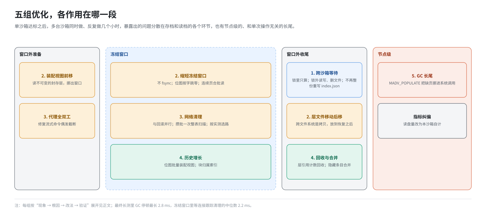
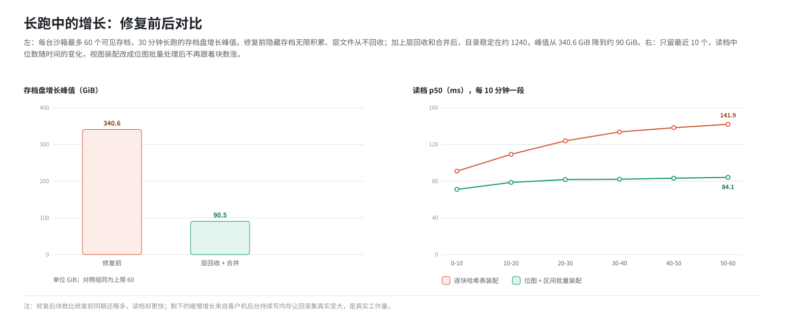
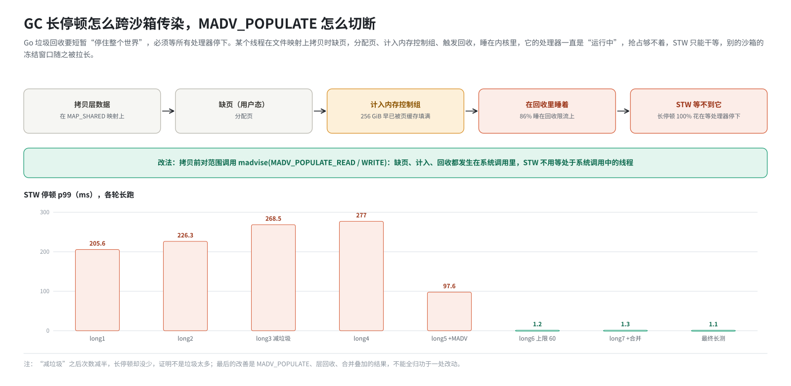

# 第 18 篇｜从单沙箱到并发长跑：做过的优化

> **本篇目标**：第一版在“一台沙箱、一次操作”的场景下就已经达标了。但很多台沙箱同时做、反复做几个小时之后，暴露出一连串问题：全局锁、冻结窗口里的多余工作、宿主网络清理、Go 的垃圾回收、历史越积越多。本篇按问题归类，讲五组优化，每组按“现象 → 根因 → 改法 → 怎么验证”的顺序；再细讲几个有代表性的案例；最后讲几个量过之后决定不做的优化。

---

## 一、起点：单沙箱达标之后，问题在哪

单沙箱测试回答的是：一次操作对不对、快不快。并发和长跑要回答的是另外几个问题：

| 场景 | 新的问题 |
|---|---|
| 不同沙箱同时存档、读档 | 它们共享 orchestrator、CPU、存档盘、宿主内核的缓存、宿主网络；一台的慢操作会不会拖慢别的？ |
| 多个调用方操作同一台沙箱 | 存档、读档、删除互相改同一份状态；读档还会打断命令 |
| 长时间反复操作、保留历史 | 存档树、磁盘层、块集合、文件数都在增长，成本会不会随之涨？空间会不会收敛？ |

测试方法是**长跑**：16 台沙箱、多个调用方，随机地存档、读档、删除，一跑就是半小时到两小时，同时在旁边采集资源、锁等待、垃圾回收、连接跟踪表等指标。每一轮暴露一些问题，修掉，再跑下一轮复测。下面讲的就是这一轮轮下来的结果。

## 二、第一组：减少跨沙箱互相等待

**现象。** 长跑里，三处等全局锁的时间（提交、登记磁盘层、读档物化）p99 达到 8～22 ms，偶尔有 250 ms。读档的物化是在冻结窗口里等这把锁的，所以别的沙箱的慢操作，直接拉长了这台沙箱的停顿。

**根因。** 全局锁里做了不该做的事：

- 每次提交都在锁里复制、排序这台沙箱的全部条目，再把一份完整的 `index.json` 重写一遍。存档链深到 2000 时，一次提交要分配约 4 MB、耗时上百毫秒。而这个文件**代码里没有任何地方读它**：启动时整个目录都会被清空，提交的原子性靠的是改名；
- 删除存档、删除整台沙箱的目录，都在锁里做；
- “有没有孩子”靠扫描全部条目来回答。

**改法。** 就是第 14 篇讲的那几条规矩：锁里只算不读写、锁里只摘账不删文件、用计数代替扫描、提交是常数时间。`index.json` 不再写在热路径上，只在调试开关打开时由后台每 5 秒最多写一次。

**验证。** 三处锁等待的 p99 降到 0.1 ms 以下。删除的客户端耗时中位数从约 54 ms 降到约 2 ms。连带效果是垃圾回收次数减半、orchestrator 总 CPU 降了四成、存活的堆内存从 832 MB 降到 298 MB。

## 三、第二组：缩短冻结窗口

**现象。** 多台沙箱同时操作时，冻结窗口里的同步落盘、层文件移动、目标视图装配都在竞争存储和 CPU；逐页、逐块的重复处理放大了这些成本。

**改法：**

| 改动 | 道理 |
|---|---|
| 存档产物不再 fsync，不等 msync | 存档只在本代有效，本来就不承诺扛过宿主崩溃；原生 pause 保留原来的落盘 |
| 目标视图装配挪到暂停之前 | 读的都是不可变的封存层，挪出窗口不影响正确性（第 7 篇） |
| 层文件移动挪到恢复运行之后 | 跨文件系统时是一次拷贝，不能让它拉长窗口（第 6 篇） |
| 位图按字跳过全 0、批量处理 | 回滚集通常只占内存的百分之几，大多数字是 0（第 3 篇） |
| 连续的页合成一批，一次读文件 | 系统调用从“每页一次”降到“每段一次”（第 11 篇） |

这些改动单看都不大，叠加起来减少的是“每一次操作都要付的固定成本”。

## 四、第三组：网络清理与在途请求

### 连接跟踪清理占了冻结窗口

**现象。** 有一轮给每台沙箱加了“最多 60 个存档”的上限，读档的频率从每秒约 16 次涨到约 39 次。读档冻结窗口里等连接跟踪清理的时间，中位数从 0 涨到 74 ms，前 15 分钟里占了冻结窗口总和的 54%。

**定位。** 先加细分计时、不改算法跑一轮基线：宿主那一半总是比沙箱命名空间那一半慢，清理时长随一批里的沙箱数线性增长（1 台 41 ms，7 台 156 ms）。再看选路：旧的代价模型把一次“让内核过滤”的遍历估成固定 5 ms，于是批量小于 7 时全走过滤，而每个地址要遍历两次、每次内核仍要走全表，负载下一次 11～20 ms。频率高 → 一批里的沙箱多 → 清理时间长 → 清理期间到的请求更多 → 下一批更大，形成正反馈。

做了一组微基准，结论是：自己扫描原始数据的整表遍历，对 8 个地址和 1 个地址耗时一样，一次就能服务整批。

**改法。** 每批一次整表原始扫描，按实测常数重新定价选路（第 12 篇的那张交叉点表），命名空间那一半和宿主那一半并行。

**验证。** 冻结窗口里等清理的时间，中位数从 89～99 ms 降到 **2.2 ms**；读档冻结窗口中位数从约 162 ms 降到 84 ms；读档吞吐从每秒 40 次升到 46 次；4 万多次读档，现场全部一致。新算法下，一批 2～14 台沙箱的清理都约 34 ms，和批量大小无关。

**后来又发现的一件事。** 两小时的长跑里，第二个小时读档中位数从 85 ms 慢慢涨到 94 ms。追下去发现，宿主连接跟踪表从约 1.9 万条涨到约 2.4 万条，而涨的**全是和沙箱无关的条目**：表里约 95% 是宿主本机访问 80 端口的短连接残留和本机 DNS 查询，沙箱自己的条目一直稳定、清得很干净。但清理要遍历整张表，所以宿主上别的流量一多，读档就跟着变慢。这是一个还没解决的已知项，第 20 篇列出了后续方向。

### 流式命令偶发被截断

**现象。** 长跑里，客户端偶尔报“对端关闭了连接，响应没收完”，大约每万次请求出现 0.5 次。

**定位。** 打开代理的逐请求追踪，一轮里代理转发了 12 万多个请求，中途断开的恰好 6 个，和客户端的 6 次截断一一对应。共同点：全是启动流式命令的请求，都已经写出了 200 和第一个事件，几毫秒后被切断；其中一次前后 3 秒内这台沙箱根本没有读档。所以和读档无关，是**代理自己**把连接关了。

顺着 Go 标准库往下查：HTTP/1 请求如果没开“全双工”模式，处理函数一写响应头，标准库就把请求体剩下的部分读掉并关闭；而反向代理此刻还在用这个请求体和上游通信，上游写完最后一个字节后再读一次确认结束，这次读失败了，就认为连接已死、把它关掉，正在流式转发的响应随之被切断。这个窗口只有几微秒，节点越忙越容易撞上，所以只在长跑里出现。

**改法。** 代理在转发前为请求开启全双工。写了一个单元测试，让上游在读完请求体之前就应答，确定性地复现：旧代码 10 次全失败，新代码 20 次全通过。

**验证。** 修复后的那一轮客户端截断为 0。按之前平均每轮 8 次估算，偶然出现 0 次的概率约万分之五。

要和第 12 篇区分：**流式调用撞上同一台沙箱的读档被截断，是既定限制**；这里说的是没有读档时的偶发截断，是缺陷，已修复。

## 五、第四组：历史增长后的成本

### 磁盘层文件从不回收

**现象。** 每次存档封存一层，修复前除了沙箱销毁，从不删除。有一轮结束时有 31355 个层文件，约 87% 属于早已删除的存档。

**定位。** 直观的想法是“存档删了，它封的层就删”。但第 10 篇讲过，层栈不是存档树，这样做在“没开脏页跟踪”或“链断过”时会删掉别的存档还在读的层。用临时单元测试证实了两个反例。

**改法。** 按“还有谁列着它”做引用计数。

**验证。** 运行中抽查三次，每台沙箱的层文件恰好等于所有视图引用的层的并集，不多不少。层文件比累计存档数少 82%，写盘少了，宿主的内存回收压力也随之大幅下降。

### 隐藏存档无限积累，磁盘线性增长

**现象。** 存档个数被上限卡在 60，但磁盘占用一直在涨，最后 15 分钟每分钟涨 6 GiB，按剩余空间推算约 11 小时写满节点。写满之后，**整个节点**的所有沙箱都会被拒绝存档，而使用者删可见的存档也释放不了这些隐藏条目。同时读档的物化也在单调变慢。

**根因。** 第 9 篇讲过：“删最旧的”模式下，每次删的都是下一个的父亲，只能隐藏，永远产生不了“可以真正删除的隐藏叶子”。

**改法。** 合并（第 9、10 篇）。

**验证。** 上限 60 的一轮：目录数稳定在约 1240，磁盘峰值从 340 GiB 降到 90 GiB，宿主内存不再被顶满。另做了一组对照：“只留最近 10 个”，同一个二进制，开合并和关合并各跑一轮。关合并的那一组 10 分钟就把链深推到上千、写掉半个多 TiB，读档慢了约 4 倍；开合并的一切平稳。**“只留最近 N 个”这个最常见的用法，没有合并是不可用的。**

### 视图块数增长，读档随时间变慢

**现象。** 合并让目录、层、磁盘都平稳了，但两小时长跑里，读档中位数仍从 91 ms 一路涨到 142 ms。同期目录数、链深、磁盘都已平稳，**变的只有视图的块数**。

**定位一：块数为什么涨。** 另起一台沙箱照负载的写法做 30 轮，在客户机里查物理块：每次截断重写的小文件，30 轮落在 30 个**不同**的物理块上。客户机的 ext4 每次截断重写都分配新块，所以视图最底层约等于“客户机写过的块的并集”，只增不减。它有上界，不会超过客户机能写到的块，约是磁盘的三分之二。

**定位二：块数为什么让读档变慢。** 读档要重新打开目标视图的每个层，对每个块在一个以偏移为键的哈希表里写一次。每项约 120 字节，装配时间和存活内存都和块数成正比。

**改法。** 改成按块号的位图，按连续区间批量处理（第 10 篇）。微基准：10 万块的装配从 34 ms 降到 0.4～1.8 ms，内存从 12.3 MB 降到 517 KB。

**验证。** 同样负载，修复后块数比修复前同期还略多，第 50～60 分钟的读档中位数却从 142 ms 降到 84 ms。读档耗时对块数的斜率从每千块 1.19 ms 降到 0.27 ms。剩下的这点增长，来自客户机后台持续写内存让回滚集真实变大，是真实的工作量，不是缺陷。

## 六、第五组：节点级长尾，Go 垃圾回收

这是最曲折的一个案例。

**现象。** Go 运行时的垃圾回收需要短暂“停住整个世界”（STW）。长跑里这种停顿 p99 达到 200 多毫秒，最长 600 多毫秒。停顿发生时，别的沙箱正在做的读档，冻结窗口被原样拉长。

**第一步：先减垃圾。** 第一组优化之后，垃圾回收次数减半，存活堆降到三分之一，但 100 ms 以上的停顿仍有 148 次，p99 反而是 268 ms。**说明长停顿不是因为垃圾太多。**

**第二步：拆开停顿。** 打开运行时指标，每 10 秒采一次“等所有处理器停下”和“总停顿”两个直方图。长停顿的窗口里，前者占后者的 **100%**：时间全花在“等大家停下”，回收本身不慢。

**第三步：看谁不肯停。** orchestrator 和所有 Firecracker 共用一个 256 GiB 的内存控制组，文件缓存很快把它填满，之后一直在控制组内部回收内存。任一时刻约有 10 个 orchestrator 线程卡在内核里，其中 86% 睡在“回收限流”上。

**结论。** 磁盘读写的代码在文件映射上拷贝数据时，缺页发生在用户态：分配页 → 计入控制组 → 触发回收 → 在回收里睡着。这期间它所在的处理器一直处于“运行中”状态，Go 的异步抢占够不着一个睡在内核缺页里的线程，STW 只能干等它醒来。

**改法。** 拷贝之前，先对要访问的范围调用 `madvise(MADV_POPULATE_READ / WRITE)`，让内核提前把页准备好。这样缺页、计入、回收都发生在**系统调用里**；处于系统调用中的线程，STW 不用等它。

**验证。** 加上这一改动后，p99 从 277 ms 降到 98 ms，累计停顿从 47 秒降到 8 秒。之后加上层回收和合并，写盘量大幅减少，控制组不再被顶满，最终长测 STW 最长只有 2.8 ms，没有一次超过 10 ms。

这个案例有两点值得记住：一是“先量再猜”，直觉上的“垃圾太多”被第一步就否定了；二是最后的改善是几个改动叠加的结果，不能全归功于某一个提交。

## 七、指标本身也会骗人

**现象。** 读档的“读盘量”指标，长跑里中位数 211 MB，最后 5 分钟 352 MB。而一次读档实际要读的只有几十 MB。

**根因。** 这个指标取的是 orchestrator **整个进程**的读盘字节差。多台沙箱同时读档，别人读的全混了进来。

**改法。** 物化过程自己边读边计，只计这台沙箱读了多少存档文件、多少模板内容。

**验证。** 新指标中位数 55 MB，同一次读档上，旧指标是新指标的 4.3 倍。

教训是：**一个在单沙箱场景下正确的指标，到了并发场景可能就失真了。** 读数字之前先确认它量的是什么。

## 八、原生快照那一侧的一个取舍

第 15 篇讲过，原生 pause 的精确增量要在缺页时“按 4 KiB 拼出 2 MiB”。第一版很直接：每次 2 MiB 缺页都新分配一块 2 MiB 缓冲，沿映射链读满再填。一个 400 MB 的工作集约 200 次缺页，就是 400 MB 的分配、清零、拷贝和随后的垃圾回收，恢复后第一次读负载慢了 100～200 ms。

两步收回：

1. **零拷贝快路径**：先查一次映射，整个 2 MiB 来自同一代时，直接把那一代的缓存交出去，不分配也不拷贝；
2. **缓冲池**：只有跨代的块才拼，缓冲从池里取、用完就还。

改完后，恢复后首读的耗时回到和修复前持平。教训是一条设计原则：**懒加载路径上每一次缺页都是热路径**，所以现在的做法是“能不拷就不拷，要拷就不分配”。

## 九、量过之后决定不做的

不是所有看起来能优化的地方都值得做：

| 候选 | 量到了什么 | 为什么不做 |
|---|---|---|
| 4 KiB 碎片化后，header 变大，限制它 | 六代 header 从 141 KiB 长到 232 KiB | 相对内存文件可以忽略；限制它会重新引入“陪绑导出” |
| 全零页不导出 | 导出的页里 0.8%～8.4% 是全零 | 要在导出前多扫一遍全部脏页，省下的不值这次扫描 |
| 关掉大页作为正式方案 | 不用测 | 缺页次数 × 512，所有沙箱失去大页，不用实测就能排除 |
| 只写 vCPU 寄存器、不复位 | 同一压力测试里 p95 是复位路线的约 3 倍 | 直觉更快，实测更慢；删掉了这条路线和它的开关（第 11 篇） |

还有一个观察：修复后对原生 pause 做性能采样，CPU 的大头是每次另起沙箱时逐条执行的 `iptables`（约 55%），内存导出相关的函数合计不到 1%。所以原生路径上剩下的抖动主要来自网络配置，不在这次改动的范围内。

最后一条值得多说一句：保留两条路线加一个开关看起来稳妥，实际上是把一个已经有答案的问题永久留在代码里，让每个后来的人都要重新论证一遍。

---

## 本篇小结

| 组 | 问题 | 改法 | 效果 |
|---|---|---|---|
| 跨沙箱等待 | 全局锁里重写整份 index、删文件、扫描 | 锁里只算、锁外读写删；计数代替扫描 | 锁等待 p99 降到 0.1 ms 以下，删除从 54 ms 到 2 ms |
| 冻结窗口 | 窗口里有落盘、移动、装配、逐页处理 | 不 fsync；装配前移、移动后移；按字跳零、合批读 | 每次操作的固定成本下降 |
| 网络清理 | 连接跟踪清理随批量线性增长，正反馈 | 每批一次整表原始扫描，按实测定价选路 | 窗口内等待中位数 89 ms → 2.2 ms |
| 流式截断 | 代理未开全双工，偶发切断 | 开启全双工 | 截断归零 |
| 历史增长 | 层不回收、隐藏无限积累、块数让装配变慢 | 引用计数回收、合并、位图批量装配 | 磁盘收敛；读档对块数斜率 1.19 → 0.27 ms/千块 |
| GC 长尾 | 缺页睡在内核回收里，STW 等不到它 | `MADV_POPULATE` 把缺页挪进系统调用 | STW p99 277 → 98 ms，最终最长 2.8 ms |
| 指标失真 | 进程级读盘量混进别的沙箱 | 本沙箱自己计 | 旧指标是真实值的 4.3 倍 |

**下一篇预告**：[《测试怎么做：怎样证明“回得对”》](19-testing.md)。前面说了很多“静默出错”的风险。测试怎么证明读档确实回对了？三层测试各证什么，59 项检查覆盖了现场的哪些部分，为什么测试要“先证明自己会失败”，四个真实的静默故障是怎么被发现的。
