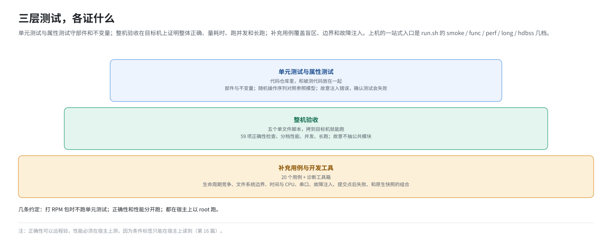
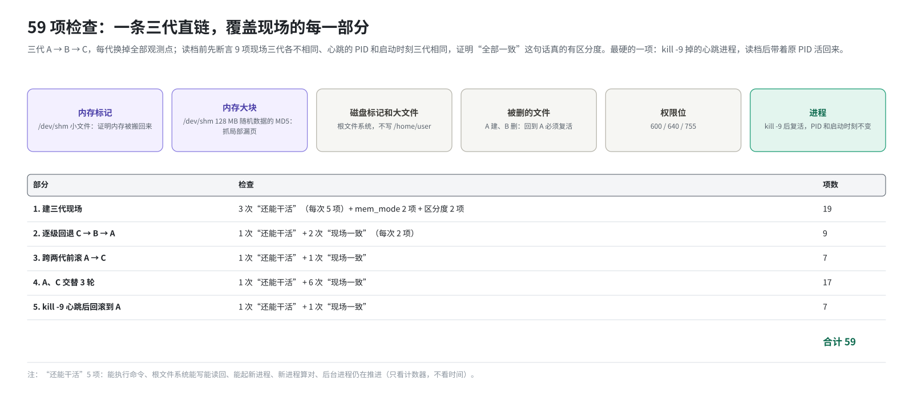

# 第 19 篇｜测试怎么做：怎样证明“回得对”

> **本篇目标**：前面反复说，这套系统最怕的是“静默回错”。那么测试怎么证明读档确实回到了那一刻？本篇先讲三层测试各证什么；然后讲正确性判据为什么是“三重证据加一条最硬的”，59 项检查是怎么设计的；再讲树形语义、和原生快照的组合、并发与长跑怎么测；接着讲四个真实的“静默故障”故事，以及从中总结出的三条纪律；最后看 950 上测过了什么、还有什么没测。

---

## 一、三层测试

| 层 | 在哪 | 证什么 |
|---|---|---|
| 单元测试与属性测试 | 代码仓库里，和被测代码放在一起 | **部件**和**不变量** |
| 整机验收 | 五个单文件脚本，拷到目标机就能跑 | 整机的正确性、耗时、并发、长跑 |
| 补充测试与开发工具 | 20 个用例，加一套开发诊断工具 | 盲区、边界、故障注入 |

上机测试有一个一站式入口 `run.sh`，按目的分成几档：`smoke`（部署预检 + 正确性验收）、`func`（功能回归）、`perf`（性能）、`long`（长跑）、`hdbss`（HDBSS 专项）。

几条约定，每条后面都有一个“为什么”：

- **打 RPM 包时不跑单元测试**，单元测试要在代码仓库里单独跑；
- **正确性和性能分开跑**：正确性测试每代要造上百 MB 的现场，不能给性能测试添噪声；性能档位也不该拖慢正确性测试；
- **都在宿主上以 root 跑**：第 16 篇讲过，正确性可以远程验，性能必须在宿主上测，因为条件标签只能在宿主上读到。

## 二、属性测试：不写例子，写性质

第 13 篇列了 19 条不变量，其中多数被破坏后是静默的。用几个手写的例子去测它们，很容易漏掉某种操作顺序。

**属性测试**换了一种思路：随机生成大量操作序列（存档、读档、删除、合并……），每一步都拿实现和一个**简单的参照模型**比对，或者从磁盘上把计数重新算一遍来核对。例如：

- 开合并、关合并两套账本，跑同一串随机操作，每一步对每个可见存档比较读档要写的位图和内容，必须逐字节相同（第 9 篇“合并不改变任何读档”的可执行版本）；
- 每一步从所有视图重新算一遍层引用计数，和实现维护的计数比对；
- 块集合的位图实现，和一个朴素的集合实现比对。

还有一个关键步骤：**故意往实现里注入错误，确认测试真的会失败。** 一个永远通过的测试，可能只是什么都没测到。这一条叫“**先自证会失败**”，下面还会反复出现。

## 三、正确性判据：三重证据加一条最硬的

读档的正确性**不能用“没报错”来判**。读档返回成功、沙箱还能执行命令，和“内容真的回到了那一刻”是两件事：一个什么都不做、只返回成功的实现，也能满足前两条。

所以要问：用什么观测量，能把“回到了那一刻”和所有“看起来像回到了那一刻”的情形区分开？把“看起来像”的情形一个个列出来，每一重证据正好排除其中一类：

| 证据 | 观测点 | 它排除的假象 |
|---|---|---|
| 内存标记 | `/dev/shm` 里的一个小文件 | “只换了磁盘、内存没动”：内存文件系统从不落盘，它变回去只可能是内存被搬回来了 |
| 内存大块 | `/dev/shm` 里 128 MB 随机数据的 MD5 | “碰巧那一页对了”：一大片逐字节对上，排除“回滚集算漏了一段”这类局部正确 |
| 磁盘标记和大文件 | 根文件系统上的标记和几十 MB 文件的 MD5 | “只回了内存、磁盘没动” |
| **进程** | 存档前启动的后台心跳进程的 PID 和启动时刻 | “虚机重启了，按记录重放了一遍”：内容可以靠重放伪造，进程身份不能 |

为什么内存要两重？内存回滚是“按回滚集写回页”，出错的典型形态是**局部**的，算漏几页、某段读错了代。一个小标记抓不住，必须有一大片随机数据兜着。

磁盘回滚是整体换视图，出错的典型形态是选错了层，内容加大文件就够抓。但“只回数据块、不回元数据”的实现也能让内容对上，所以另加两样“不好回滚”的东西：**删除**和**权限位**。新建的文件能回滚不稀奇，被删的文件复活、权限位回到那一刻的值，才说明是块级的快照，而不是在文件层面打补丁。

前三重都是“内容”，理论上都能靠重放伪造。最硬的一条是**进程**：先 `kill -9` 掉心跳进程，再读档，它必须带着原来的 PID 和启动时刻活回来。**复活一个已经被杀掉的进程，是任何重放式实现都做不到的。**

## 四、一条直链上的 59 项

整机验收的核心脚本走一条三代的直链 A → B → C：

**三代现场各不相同。** 每代都换掉全部观测点，另外各动一样不好回滚的东西：一个文件在 A 新建、B 删除、C 保持删除，所以“回到 A”必须让一个已被删除的文件复活；权限位三代分别是 600、640、755；标记写在根目录、`/etc`、自建目录下，**不写在** `/home/user`，因为那里在 E2B 里另有挂载，只测它等于只测了一层。

**先自证会失败。** 每次读档后脚本判“11 项现场全部一致”。可如果这 11 项在三代之间本来就一样，这句通过什么也没证明。所以开始读档之前，脚本先把三代现场并排，做两条方向相反的断言：9 项现场必须三代**各不相同**；心跳的 PID 和启动时刻两项必须三代**相同**（它们不是现场，是“同一个进程没被重启”的证据）。

**活性判据只用计数器，不用时间。** 第 12 篇讲过，读档会把单调时钟拨回存档时刻，时间倒流是对的行为。所以只断言“心跳计数在增长”，不要求速率。读档后头一两秒心跳偶尔只跳一两下，判成“vCPU 没恢复”是错的诊断。速率照样打印给人看，**打印但不判定**。

**`mem_mode` 两条**：A 必须是 `full`，B、C 必须是 `incremental`。

59 项由四种检查组合而成：

| 部分 | 检查 | 项数 |
|---|---|---|
| 1. 建三代现场 | 3 次“还能干活”检查（每次 5 项）+ `mem_mode` 2 项 + 区分度 2 项 | 19 |
| 2. 逐级回退 C → B → A | 1 次“还能干活” + 2 次“现场一致”（每次 2 项） | 9 |
| 3. 跨两代前滚 A → C | 1 次“还能干活” + 1 次“现场一致” | 7 |
| 4. A、C 交替 3 轮 | 1 次“还能干活” + 6 次“现场一致” | 17 |
| 5. `kill -9` 心跳后回滚到 A | 1 次“还能干活” + 1 次“现场一致” | 7 |
| 合计 | | **59** |

“还能干活”的 5 项是：能执行命令、根文件系统能写能读回、能起新进程、新进程能算出正确结果、存档前的后台进程仍在推进。

逐项比，而不是比一个总哈希，是为了失败时能直接说出“是内存没回来，还是文件没回来”。

## 五、树形语义与失败路径

直链上构造不出分叉，所以另有一个开发测试脚本专门测树：

| 部分 | 做什么 |
|---|---|
| 线性链 | 存 5 代，改动量 0 / 64 / 256 / 512 / 0 MB；什么都不改的一代也必须能正确回，那是回滚集为空的边界 |
| 回退与前滚 | 一路回退到第 1 代，再前滚回第 5 代 |
| 分叉跨公共祖先 | 站在第 1 代存第 6 代，先断言它的父亲确实是第 1 代（证明树真的分叉了），再跨分支来回读档 |
| 删除 | 删一个有后代的中间节点，按合并开关分两支断言 |
| 失败 | 故意移走某一代的位图文件，然后读档 |

最后一项要求三件事：**拒绝**（抛错，而不是返回后继续）、**拒绝没有改动沙箱**（前后标记原封不动）、**沙箱在拒绝之后照常运行**。把位图放回去，再读档立刻成功。这是“宁可报错，不可静默损坏”的可执行版本。

## 六、补充用例：盲区和边界

20 个补充用例覆盖上面碰不到的地方，挑几个：

| 用例 | 测什么 | 硬断言 |
|---|---|---|
| 生命周期竞争 | 存档、读档进行中销毁沙箱 | 服务端不崩；在途操作要么成功要么明确报错，且有时间上限；资源都回收 |
| 同沙箱多客户端 | 按沙箱串行 | 风暴之后对账：没有幽灵存档，删掉的不再出现，没删的都能读档 |
| 文件系统边界 | 写到一半存档、打开着的文件、改名、fsync 后删除 | 流式写的文件是存档那一刻的前缀；改名被回滚；fsync 过又删掉的文件回来了 |
| 时间与 CPU | 读档后定时器是否健康 | uptime 必须倒退；墙钟不倒退且和宿主差 5 秒以内；`sleep 1` 是 1.0±0.1 秒 |
| 串口 | 串口卡死的回归 | 每轮读档前后往串口写 4 KB，必须成功且 3 秒内完成 |
| 故障注入 | 在存档、读档的关键点注入失败 | 失败后账本没坏，或者能自愈 |
| 提交点后失败 | 让 Firecracker 过了提交点才失败 | 报 `torn`；之后存档、读档都被拒 |
| 存档后原生 pause | 存过档的沙箱做原生 pause / resume | 内存、磁盘标记全部完好（第 15 篇累积位图的验证） |
| 干净沙箱原生 pause | 没存过档的沙箱 | 原生生命周期没被弄坏，resume 后能重新存档 |
| 读档后立刻请求 | 读档返回后马上发命令 | 沙箱存活、账本和列表一致 |

所有用例都把“**硬判**”和“**只记录**”分开：能从语义推出唯一正确答案的（现场一致、账本相等、异常类型正确）才硬判；依赖负载和机器的量（耗时曲线、截断次数）只记录。把后者也写成断言，只会得到一批在别的机器上随机失败的用例。

还有一个容易问错的口径：并发下“存档那一刻的现场”没有定义。A 线程写完标记还没拿到锁，B 线程一次读档就把标记退回去了。所以并发用例只在风暴结束后对账；要逐次比现场的用例，每台沙箱内部必须串行。

## 七、并发与长跑

并发和长跑测试有两类判据：

- **正确性**：多台沙箱随机地存档、读档、删除，每次读档后五个字段逐项一致；收尾时列表和本地账本完全一致；
- **资源**：目录数、层文件数、磁盘占用、存活内存、连接跟踪表要“**走平**”，即后半段的斜率接近零。

为什么一定要长跑？因为第 18 篇的那些问题，几乎都不会在几分钟的测试里出现：每万次请求 0.5 次的流式截断、链深上千时才明显的 `index.json` 重写、写满 256 GiB 内存控制组之后才出现的 GC 长停顿、两小时后才看出的块数增长。

偶发问题怎么缩小范围？加计时、加旁路采样、打开逐请求追踪，把“偶尔出现”变成“能对上号的几条记录”，再从共同点往下查。第 18 篇的流式截断就是这么查出来的。

## 八、四个静默故障的故事

为什么测试要“多问一句”？下面是四个真实发生过、而且都差点溜过去的问题：

### 1. 增量悄悄退化成全量

没有 HDBSS 的开发机上，要靠部署配置里一行“打开脏页跟踪”才有增量。如果按正式部署件原样部署、忘了这一行：沙箱照常建、存档照常成功、读档照常回到那一刻，只是每次存档都变成了全量。

**为什么静默**：全量存档当然能精确恢复，内容一项都不会错。普通测试只看“回来的内容对不对”，看不见“用什么方式回来的”。性能会变慢，但没有对照时看不出这是退化。

**靠什么看得见**：一条报告“**怎么做的**”而不是“做对没有”的通道，就是 `mem_mode`。所有测试都把它当硬断言：除了第一次，出现 `full` 就是有问题，性能测试整轮作废。

### 2. 存档之后原生 pause，封存的层丢了

这是四个里唯一**真的丢了数据**的，而且丢得自洽。存档会封存写层，从第一次存档起，当前写层里只有那之后的写。早期实现里，原生 pause 导出磁盘时只取了当前写层，存过档的沙箱一 pause，最后一次存档之前的写就全丢了。

**为什么静默**，三道本该抓住它的防线全失效了：

| 本该抓住它的 | 为什么没抓住 |
|---|---|
| 导出产物自己的一致性检查 | 描述文件是从导出内容推出来的，导出多少就描述多少。块数对得上、校验对得上，只是内容少了一截 |
| 已有的正确性脚本 | 没有一个会做原生 pause。两者的**组合**没人走过 |
| 修复后补的第一版验证 | 写一个小文件，pause / resume，读回比对，**假通过**：pause / resume 不清客户机的文件缓存，刚写过的文件从缓存里读一定是对的，根本没碰到磁盘 |

最后一行才是真正的教训：**客户机的文件缓存，能把磁盘层的错误完全盖住。**

**靠什么看得见**：在存档两侧各写一份足够大的随机数据（大到不可能全留在缓存里），pause / resume 之后**绕开缓存**（`O_DIRECT`）读回、比哈希。抓缺陷的是存档**之前**写的那份，它落在被封存的层里，是唯一会丢的；之后写的那份是对照，证明脚本本身在正常工作。

### 3. 把读过的页当成脏页

这发生在原生快照那一边。在 950 上用同一张档位表跑原生快照基准，最值得看的一列不是时间，而是产物大小：名义改动量从 0 一路加到 192 MB，导出的内存差分一直停在 400 MB 上下不动。追下去，就是第 15 篇的“驻留即脏”。

**为什么静默**：导出多了只会慢，不会错，所有正确性检查都通过。

**靠什么看得见**：**只读哨兵**。只读不写的那一档，产物应该和 0 档几乎一样；明显变大，就是读被算成了脏。本方案在 950 上，只读 192 MiB 档的产物和 0 档几乎一样，证明了它没有这个问题。

### 4. 判据本身悄悄消失

`mem_mode` 判据要靠 SDK 把这个字段透出来。如果用的 SDK 不透出它，脚本读到的是“空”。这时如果脚本把“空”当成“跳过这项检查”，增量判据就悄悄消失了，测试照样通过。

**真实例子**：同一个脚本、同一套服务端，只换了客户端的 SDK。装了配套 SDK 那次是 59 项全过；换成一版没有这个字段的 SDK，三代都报 `mem_mode=?`，末行是 57 项全过。两次都打印“全部通过”，差别只有把两份日志并排、去数项数才看得出来。

**靠什么看得见**：SDK 的安装检查会专门确认这个字段存在，验收流程把它列为第一步；报告里必须记项数和 SDK 版本，59 和 57 的差不是噪声。

### 三条纪律

四个故事的共同点是：**功能看起来全对，测试全过，而问题藏在测试没问到的那一层。** 一句话：测试通过，不等于测的是那个东西。由此有三条纪律：

1. **先证明“这个检查会失败”。** 一个永远返回真的断言比没有断言更糟，它让人以为测过了。比对读档结果之前，先确认三代现场确实彼此不同；判定“弄坏了原生能力”之前，先测原生能力本来是好的；HDBSS 的数据面判据，先在没有 HDBSS 的机器上取到一个负样本。
2. **验证磁盘内容，一律绕开缓存读回。** 客户机的文件缓存会把磁盘层的错误完全盖住。
3. **报告要记项数。** 同一个脚本少了两项，照样打印“全部通过”。

还有一个相关的做法：**验收脚本故意不抽公共模块。** 每个脚本自带一份探测宿主条件的代码，看起来像没来得及重构。其实是为了防止“只拷走一半”：一个依赖公共模块的脚本被拷到目标机，如果漏拷了公共模块，它不一定会报错，更可能被补一个空壳或被异常处理兜住，然后条件标签整列变成“未知”，数字照样打印、报告照样归档。重复几十行代码，换掉一种静默降级，这笔交易划算。

## 九、950 上测过了什么

| 要证的性质 | 950 上的状态 |
|---|---|
| 存档读档后照常干活；内存、文件、删除、权限位、进程都回到那一刻 | 2026-10-15 部署验收中通过：59 项全过，10 次读档目标现场全部一致 |
| 部署前提与二进制配套 | 部署预检五项全部通过 |
| 盲区、边界 | 默认 16 个补充用例通过；重启、故障注入、配额、提交点后失败 4 个用例跳过 |
| 存档后原生 pause、干净沙箱原生 pause | 通过 |
| 短时并发 | 16 台突发，93 次读档全部一致（第 17 篇） |
| 读档后立刻请求 | 4 台 × 50 轮，200 次读档、400 条命令全部成功 |
| HDBSS | 能力、启用、数据面三级证据齐全，默认缓冲区大小 |
| 分档性能、串行长尾 | 已测（第 17 篇） |

还**没有**测的：

- 树形语义脚本在 950 上的结果；
- 小时级长跑、滚动保留下的资源收敛；
- 重启、故障注入、配额这几个专项；
- 跨树读档的端到端用例（目前只有单元测试）；
- HDBSS 启用顺序的断言（目前只靠代码位置保证）；
- 不同 HDBSS 缓冲区大小的比较。

默认功能回归通过，不代表没跑的专项也通过；几分钟的混合操作，不能替代小时级的稳定性。这些缺口都列在第 20 篇。

---

## 本篇小结

| 概念 | 一句话解释 |
|---|---|
| 三层测试 | 单元与属性测试证部件；整机验收证整体；补充用例证盲区 |
| 属性测试 | 随机操作序列 + 参照模型比对；注入错误确认测试会失败 |
| 三重证据 | 内存标记、内存大块、磁盘内容，加删除和权限位 |
| 最硬的一条 | `kill -9` 的进程带着原 PID 和启动时刻活回来 |
| 59 项 | 三代直链；先断言三代各不相同；活性只看计数器 |
| 硬判与只记录 | 有唯一正确答案的才断言，依赖机器的量只记录 |
| 四个静默故障 | 退化成全量、封存层丢失、读算脏、判据消失 |
| 三条纪律 | 先证明检查会失败；磁盘内容绕开缓存读回；报告记项数 |
| 还没测的 | 小时级长跑、重启与注入专项、跨树端到端、HDBSS 顺序断言 |

**下一篇预告**：[《全景、现状与后续方向》](20-big-picture-and-next.md)。最后一篇把全书的部件放回一张图；列出接入时要和业务约定的几件事；按症状给一张排障速查表；再列出已知问题、候选优化方向，以及三个“先量再改”的待验证项。
