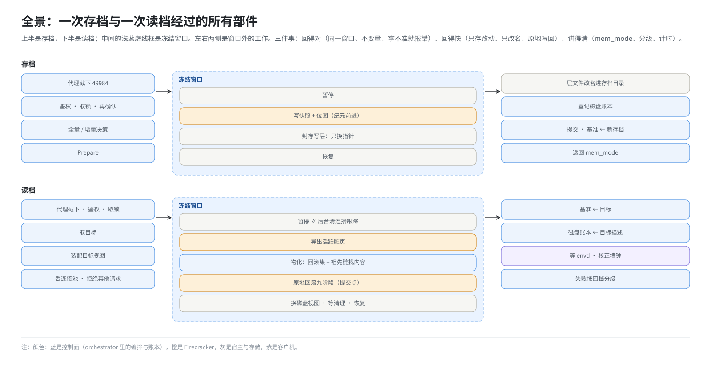
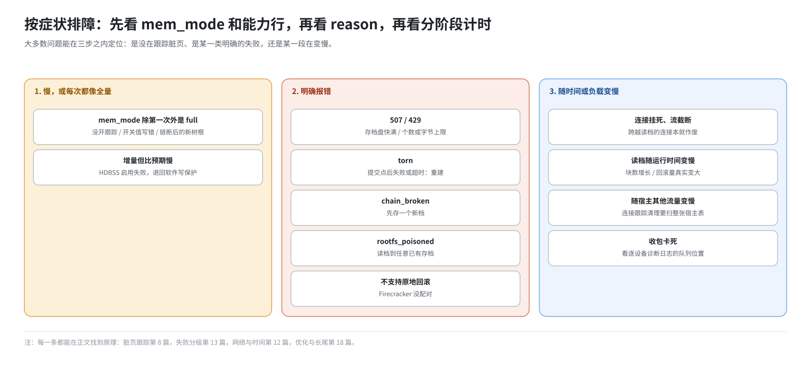

# 第 20 篇｜全景、现状与后续方向

> **本篇目标**：最后一篇。先把全书讲过的部件放回一次存档和一次读档里，看清整张图；然后把“读档管不到的东西”收成一张表，说明每一项是由实现里的哪一步决定的；再给一张按症状排查的速查表；最后列出已知问题、候选优化方向，以及三个“先量再改”的待验证项，并说明往后改动时必须守住什么。

---

## 一、全景：一次存档和一次读档经过的所有部件



**一次存档：**

```
SDK 发往沙箱 49984 端口
→ orchestrator 代理截下（第 5 篇）
→ Service：鉴权、和请求生命周期脱钩、取沙箱操作锁、再确认同一代、水位检查
→ 决定全量还是增量：没有基准→全量根；在跟踪、链没断→增量（第 6 篇）
→ Prepare：配额检查，建目录，条目对外不可见
═══ 冻结窗口 ═══
  暂停
  （仅全量）导出活跃位图，并入“开机以来写过的页”（第 15 篇）
  Firecracker 一次写出 snapfile + 稀疏内存差分 + 位图（第 11 篇），并清零脏页记录 → 纪元前进
  封存写层：刷屏障、新空写层、旧层进只读层栈、换指针（第 10 篇）
  恢复（无论成败）
═══════════════
→ 层文件改名进存档目录
→ 登记磁盘账本；失败就标记“已污染”（第 10、13 篇）
→ 提交：改名、发布、当前基准←新存档；失败走三层降级（第 13 篇）
→ 返回 checkpoint_id 和 mem_mode
```

**一次读档：**

```
SDK 发往 49984 → 代理截下 → Service：同上的进门检查
→ 取目标（只认本代、已提交、未隐藏）
→ 读目标的磁盘描述和块清单，在窗口外装配目标视图（第 7、10 篇）
→ 水位检查，打开读档窗口，丢弃代理连接池（第 12 篇）
═══ 冻结窗口 ═══
  暂停；后台开始清连接跟踪表（第 12 篇）
  导出活跃脏页（第 8 篇）
  物化：算回滚集、沿祖先链找内容、写 revert_mem / revert_bitmap（第 9 篇）
  Firecracker 原地回滚：校验、静默、取图与覆盖校验 ‖ 提交点 ‖ 内存、vCPU、中断控制器、设备、VMGenID、重置基线（第 11 篇）
  整体换磁盘视图（第 10 篇）
  等连接跟踪清理结束
  恢复
═══════════════
→ 当前基准←目标，磁盘账本←目标描述（账本跟着状态走，第 7 篇）
→ 等 envd 应答，校正墙钟（第 12 篇）
→ 返回成功；失败按四档分级（第 13 篇）
```

整套方案靠三件事做到**回得对**、**回得快**、**讲得清**：

| 要做到 | 靠什么 |
|---|---|
| 回得对 | 同一个冻结窗口里一起存、一起换；纪元不变量；回滚集“够用”；提交点前查完能查的；拿不准就报错 |
| 回得快 | 只存改过的页；封存只改名；原地写回，什么宿主资源都不重建；能挪出窗口的都挪出去 |
| 讲得清 | `mem_mode`、能力上报、分阶段计时、失败按 `reason` 分级、条件标签、三层测试 |

## 二、读档管不到的东西

| 管不到的 | 为什么 | 由哪一步决定 | 业务该怎么做 |
|---|---|---|---|
| 外部副作用（外部数据库写入、已发出的请求、发出的消息） | 它们不在沙箱里 | 快照的覆盖范围就是沙箱的内存和根盘 | 幂等、去重或补偿；控制侧记录“现在在哪个存档上” |
| 跨越读档的 TCP 连接 | 对端和宿主还记得 T1 的状态 | 读档清掉连接跟踪表、丢弃代理连接池、在途调用回 409 | 读档前停止派发，读档后重连 |
| 单调时钟 | 它来自 vCPU 寄存器，被恢复成了存档时刻的值 | vCPU 状态恢复 | 不用单调时钟量跨越读档的间隔 |
| 用户态的随机数状态 | 它就在内存里，被原样带回 | VMGenID 只通知内核 | 读档后自己重新初始化 |
| 换代之后的旧存档 | 没有活的进程可写回 | 账本按代记，启动时清空 | 需要长期保存时走原生快照 |

墙钟是一个例外：它在读档返回之前已经由 envd 校回现在了。

## 三、按症状排障速查

| 症状 | 先看哪里 | 常见原因 | 详见 |
|---|---|---|---|
| 除第一次外，`mem_mode` 还是 `full` | 启动日志的能力行和理由 | 没开脏页跟踪；开关值写成了 `yes`；个别是链断后的新树根 | 第 8、13 篇 |
| `mem_mode` 是增量，但比预期慢 | Firecracker 自报的后端 | HDBSS 启用失败，退回了软件写保护 | 第 8 篇 |
| 存档被拒，507 | 存档盘剩余空间 | 盘快满了，是整个节点的问题 | 第 14 篇 |
| 存档被拒，429 | 个数或字节上限 | 删掉不需要的；字节上限下删最旧的 | 第 14 篇 |
| 读档报 `torn` | 服务端和 Firecracker 日志 | 提交点之后失败，或回滚调用超时 | 第 11、13 篇 |
| 读档报 `guest_unresponsive` | envd 状态 | 宿主侧已完成，客户机里的服务没响应 | 第 13 篇 |
| 读档报 `chain_broken` | 之前有没有失败的存档 | 丢过纪元；先存一个新档 | 第 13 篇 |
| 存档报 `rootfs_poisoned` | 之前的封存或登记失败 | 读档到任意一个已有存档即恢复 | 第 10、13 篇 |
| 读档后连接挂死、流被截断 | 有没有同时进行的其他调用 | 跨越读档的连接本就作废，重连即可 | 第 12 篇 |
| 读档后网络收包卡死 | Firecracker 的逐设备诊断日志 | 网卡缓存问题（已修）；对比设备和客户机各自的队列位置 | 第 12 篇 |
| 读档随运行时间变慢 | 分阶段计时里哪段在涨 | 视图块数增长（已优化）；宿主连接跟踪表变大；回滚量真实变大 | 第 18 篇 |
| 读档随宿主上其他流量变慢 | 连接跟踪清理时长、宿主表条目数 | 清理要遍历整张宿主表 | 第 12、18 篇 |
| 读档报“不支持原地回滚” | Firecracker 版本 | orchestrator 和 Firecracker 没有配对 | 第 11 篇 |



## 四、已知问题与验证缺口

| 项 | 状态 | 影响 |
|---|---|---|
| 删除时同步合并 | 待改进 | 删除操作的中位数从几毫秒变成十几到二十几毫秒 |
| 连接跟踪清理的长尾 | 有方案，暂未实施 | 清理成本随整张宿主表增长，宿主上其他流量多时会进入冻结窗口 |
| 视图块数增长 | 待更长时间验证 | 已大幅优化，但长跑末尾块数还没饱和，需要更长的测试确认走势 |
| 空闲一段时间后第一次操作变慢 | 触发条件、根因待定位 | 保留现象记录，需要针对性复现 |
| 偶发的 GC 长停顿、网络槽位泄漏 | 分别处理 | 各自影响范围不同，不能归为同一个回滚缺陷 |
| 950 长期运行 | 待测 | 小时级长跑、滚动保留、资源收敛、重启 / 注入 / 配额专项都还没有 950 上的结果 |
| 跨树读档、HDBSS 启用顺序 | 待补验证 | 前者只有单元测试，缺端到端用例；后者只靠代码位置保证，缺断言 |
| 原生 pause / resume 的固定开销 | 部分未归因 | pause 里约 110 ms 的进程退出前段、resume 末尾约 35 ms 还没拆开 |

## 五、候选优化方向

| 方向 | 预期收益 | 前提与难点 | 难度 |
|---|---|---|---|
| **后台异步合并** | 删除不再同步等待合并 | 要设计它和存档、读档、删除之间的并发与回收协调 | 中 |
| **连接跟踪按标记过滤** | 清理成本不再受宿主上无关流量影响 | 给沙箱的连接打标记，按标记清；方案已设计 | 中 |
| **层块清单改成区间编码** | 减少逐块读取和解码 | 改变盘上格式，要处理兼容 | 中 |
| **可导出的存档** | 存档能带走 | 层栈压平、把模板底座也装进去、单独的导出接口；默认路径保持不变 | 中 |
| **账本跨重启加载** | 重启后账本还在 | 按事务顺序刷盘、读回、回收陈旧条目、格式迁移；而且光有账本恢复不了已消失的虚机 | 中 |
| **按沙箱按需开启脏页跟踪** | 不存档的沙箱不为跟踪付费 | 创建沙箱时就要知道它会不会存档 | 中 |
| **层文件里全零块的回收** | 省空间 | 要区分“显式写了零”和“沿用父层” | 中 |
| **视图的层列表引用父代** | 减少每个存档完整记录全部层的开销 | 要保持合并和回收的语义 | 中 |
| 跨树读档端到端测试、HDBSS 启用顺序断言 | 补齐验证缺口 | —— | 低 |
| 持续跟上游同步 | 降低分叉维护成本 | 同步后重新生成部署补丁，验证组件配对 | 持续 |


这些都是候选，不代表已经排期。实施任何一项之前，都要先验证收益、调用约定和失败语义。

## 六、三个“先量再改”的待验证项

读代码时发现了三个可能多余的同步操作。它们都**还没有量过，也没有动过**。列在这里，是为了示范一种工作方法：**先量，再改；改完把结论写回去，从待办里删掉。**

| # | 项 | 依据 | 先量什么 |
|---|---|---|---|
| V1 | 封存写层时的刷屏障，除了把写推下去，还会丢弃宿主为这块设备缓存的**已读内容**。封存前后设备内容不变，这份缓存本来仍然有效；丢掉之后，客户机再读这些块要重新经 NBD 去取 | 封存时先调用 `BLKFLSBUF` 再 `fsync` | ① 确认运行的内核上 `BLKFLSBUF` 是否真的丢读缓存；② 存档前后重复读同一批文件，对比耗时和 NBD 读请求数；③ 改成只 `fsync` 后重跑，并跑一遍正确性测试 |
| V2 | 刷盘函数对同一个文件描述符连做两次 `fsync`，第二次面对的是已经刷空的缓存 | 上游原有代码 | 这一次调用的耗时；预计是很小的固定开销，随 V1 一起处理 |
| V3 | 一次存档对 NBD 设备刷两遍：先是 Firecracker 保存磁盘状态前刷一遍，再是 orchestrator 封存时刷一遍 | 两次之间 vCPU 停着、没有在途请求，第二遍没有数据可刷 | 第二遍的耗时。**结论倾向保留**：Firecracker 那一遍失败只打一行日志、快照照常继续；orchestrator 这一遍失败会让存档报错返回，是唯一有错误检查的一遍 |

V3 是一个好例子：看起来“重复”的操作，可能恰恰是唯一可靠的那一道防线。不量、不想清楚就删，等于拆掉了一道保险。

## 七、往后改动时必须守住的东西

动任何一处之前，先对照这两张表：

**第 9 篇的纪元不变量**：每个存档的位图，恰好覆盖“父亲那一刻到这一刻”之间写过的页。它由 Firecracker（写快照和读档都清零）和账本（新存档的父亲取当前基准）两边共同维持。改任何一边，都要重新检查。

**第 7 篇的八条顺序约束**：

1. 存档时内存和磁盘在同一个暂停窗口里；
2. 读档时暂停之后才导出脏页、才物化；
3. 连接跟踪表在恢复运行之前清完；
4. 账本基准和 Firecracker 脏页记录同时重置；
5. 回滚完成后先更新账本、再等 envd；
6. Firecracker 里先写内存、再恢复设备；
7. VMGenID 在内存写回之后；
8. 设备队列页在清零后重新标脏。

八条里只有一条被违反后能立刻报错。改代码时，这张表比任何测试都更早发出警告。

再加上第 12 篇末尾的检查表：加新设备、改回滚路径时，逐条问一遍。

## 八、结语

回头看，这套沙箱级快照回滚的设计，可以压成三句话：

- **只为改动付费。** 内存只存脏页、按页沿祖先找内容；磁盘封存只改名；读档只写回需要的页。成本和改了多少、回退多远有关，和虚机多大、历史多长无关；
- **什么都不重建。** 在同一个活着的进程里原地回滚，进程、设备、网络、内存映射全部保留。这既是快的来源，也是“离不开活沙箱”的原因；
- **宁可报错，不可静默损坏。** 提交点前查完能查的，失败分四档说清楚，纪元宁可隐藏也不丢，账本对不上就拒绝服务；能力降级、退化成全量，都要说出来。

它和原生快照分工：活沙箱里的高频回退交给它，离场、长期保存、跨机器交给原生。两者叠加，先快速试错，再把满意的状态固化下来。

对使用者来说，最直接的变化发生在一次失败之后：任务可以回到准备已经完成的那一刻，带着对上次失败的认识，选择下一条路。

---

## 本篇小结

| 概念 | 一句话解释 |
|---|---|
| 全景 | 存档：拦截 → 决策 → 冻结窗口（写快照、封存）→ 提交；读档：装配 → 冻结窗口（导出、物化、原地回滚、换盘、清表）→ 账本跟随 → 校时 |
| 管不到的 | 外部副作用、跨越读档的连接、单调时钟、用户态随机数、换代后的旧存档 |
| 排障 | 先看 `mem_mode` 和能力行，再看 `reason`，再看分阶段计时 |
| 已知问题 | 删除同步合并、连接跟踪长尾、块数增长、空闲后变慢、950 长跑待测 |
| 候选方向 | 异步合并、按标记清连接跟踪、区间编码、可导出存档、账本跨重启、按需跟踪 |
| 先量再改 | V1～V3 都还没量；看起来重复的，可能是唯一可靠的那一道 |
| 必须守住 | 纪元不变量、八条顺序约束、设备检查表 |
| 三句话 | 只为改动付费；什么都不重建；宁可报错，不可静默损坏 |

全书完。回到 [导读](README.md)。
