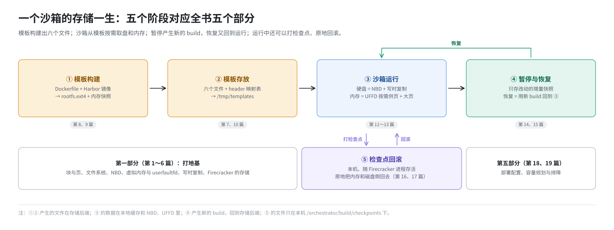
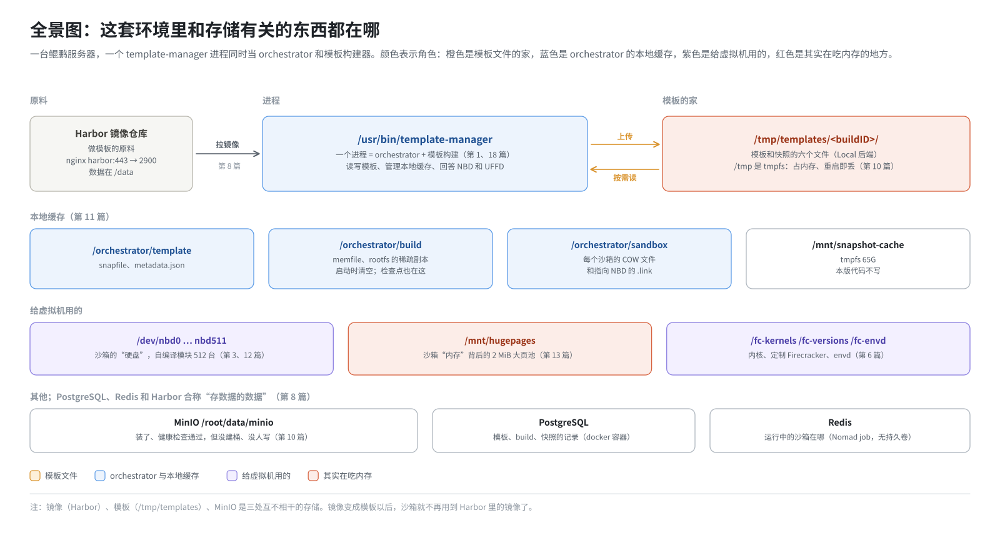

# 第 1 篇｜从“毫秒开一台虚拟机”说起：E2B 的存储要解决什么问题

> **本篇目标**：先不讲任何技术细节，只回答三个问题：E2B 的沙箱到底要存哪些东西？为什么不能像普通虚拟机那样“装一块硬盘、插一根内存条”就完事？本书讲的这套环境里，跟存储有关的进程、目录和设备都有哪些，它们之间是什么关系？读完本篇，你手里会有一张全书地图，后面每一篇都在放大地图上的某一块。

---

## 一、一个让人起疑的场景

在宿主机上用 Python SDK 写这样两行：

```python
from e2b_code_interpreter import Sandbox
sbx = Sandbox.create()          # 要一台沙箱
sbx.run_code("print(1 + 1)")    # 在里面跑代码
```

`Sandbox.create()` 返回时，你手里已经有一台**完整的 Linux 虚拟机**：

- 它有一块几 GB 的“硬盘”，上面装好了 Ubuntu、Python、Jupyter，还有一个叫 envd 的守护进程；
- 它有几百 MB 到几 GB 的“内存”，里面的系统已经启动完毕，envd 已经在监听端口，等着接收命令。

而这一切通常不到一秒钟就完成了，顺利的时候只要一两百毫秒。

如果你自己装过虚拟机，就会觉得这不对劲：

- 拷贝一块几 GB 的磁盘镜像，光读写就要好几秒；
- 开机要经过固件、内核、systemd、各种服务，少说也要好几秒；
- 一台服务器上要同时开几百台这样的虚拟机，几百份几 GB 的磁盘、几百份完整的内存，存储和内存都扛不住。

E2B 做到了，靠的是一整套存储设计。**这本书就是把这套设计从头到尾拆开讲。**

---

## 二、一台虚拟机要存哪些东西

先把“存储”的对象说清楚。一台正在运行的虚拟机，如果想把它原样保存下来、以后再原样恢复，需要存三样东西：

| 存什么 | 是什么 | 大小量级 |
|---|---|---|
| **磁盘** | 客户机的根文件系统，在宿主上是一个 ext4 镜像文件 | 几 GB |
| **内存** | 客户机的全部 RAM：内核、进程、页缓存…… | 几百 MB 到几 GB |
| **机器状态** | CPU 寄存器、中断控制器、虚拟设备的状态 | 几十 KB 到几 MB |

普通的虚拟机只关心第一样：磁盘存下来，下次开机从磁盘重新启动就行，内存里的东西丢了也无所谓。

E2B 不一样。它的沙箱**不开机**，而是从一张“快照”里**接着运行**：快照拍下的那一刻，系统已经启动好、envd 已经在跑。所以三样东西都要存，而且每一样都要能**快速**拿出来。

用一个比喻：普通虚拟机像一本书，每次都从第一页读起；E2B 的沙箱像一本夹了书签的书，打开就是上次读到的地方。书签那一页的内容（内存）和书本身（磁盘）都得保存好。

---

## 三、E2B 存储的四个设计目标

### 3.1 快：不能先拷贝再开机

如果创建沙箱时要先把几 GB 的磁盘和内存完整拷贝一份，那不可能做到毫秒级。

E2B 的办法是**按需取**：虚拟机启动时，磁盘和内存一页都不准备；客户机读到哪一块，才去取哪一块。一个刚启动的沙箱，实际用到的内存可能只有几十 MB，磁盘可能只读了几百 MB。没用到的部分，永远不用搬。

这要靠两样 Linux 机制：

- 磁盘按需取：**NBD**（网络块设备），第 3、12 篇讲；
- 内存按需取：**userfaultfd**（用户态缺页处理），第 4、13 篇讲。

### 3.2 省：同一份数据只存一次

一台服务器上同时跑几百个沙箱，它们大多来自同一个模板。如果每个沙箱都拷一份模板，存储会被迅速撑爆。

E2B 的办法是**写时复制**：所有沙箱共享模板那一份只读的数据；某个沙箱要改某一块，才把改过的那一块记到它自己的地方。沙箱各自只存“改了什么”。第 5 篇讲这个思想，第 12 篇讲它在磁盘上的实现。

### 3.3 能暂停、能恢复：只存改动

沙箱可以**暂停**：不再占 CPU 和内存，过几个小时再按同一个 ID 恢复，里面的状态原封不动。

如果暂停时把整台机器的内存和磁盘都存一份，又慢又费空间。E2B 的办法是**增量快照**：只存这一轮运行中改过的页和块，再用一张“映射表”记下每一块数据存在哪一代快照里。第 7 篇讲这张表，第 14、15 篇讲暂停和恢复。

### 3.4 能回滚：退回到之前的某一步

AI 在沙箱里干活，可能一步把环境搞坏。这套环境的 ARM 适配补丁新增了一个能力：在沙箱运行过程中打多个**检查点**，随时把内存和磁盘退回到某个检查点，而且不换进程、不换沙箱 ID。第 16、17 篇讲。

---

## 四、一个沙箱的存储一生

把上面这些串起来，一个沙箱从无到有、从生到死，存储上经历五个阶段，正好对应本书的五个部分：



- **第一部分（第 1～6 篇）**：打地基。块、页、文件系统、块设备、虚拟内存、写时复制、Firecracker 的存储设备。不涉及 E2B 的代码。
- **第二部分（第 7～10 篇）**：模板。一个模板由哪六个文件组成；做模板的原料（Docker 镜像）存在 Harbor 里；镜像怎么变成磁盘镜像和内存快照；做好的模板存到哪里。
- **第三部分（第 11～13 篇）**：一个沙箱运行时的存储栈。节点本地缓存、沙箱的硬盘、沙箱的内存。
- **第四部分（第 14～17 篇）**：快照。暂停与恢复、ARM 上增量快照的特点、检查点回滚。
- **第五部分（第 18～19 篇）**：部署脚本为存储做了什么，以及容量和排障。

---

## 五、本书讲的这套环境

本书不讲 E2B 官方最新版，只讲作者实际部署的这一套。它有几个特点，后面会反复用到。

### 5.1 代码和部署方式

- **代码**：上游 [e2b-dev/infra](https://github.com/e2b-dev/infra) 的 tag `2026.09`，加上一个 ARM 适配补丁 `0001-adapted-for-arm-architecture.patch`。
- **机器**：一台鲲鹏 ARM 服务器，操作系统是 openEuler，单机部署。
- **部署三步**：
  1. 下载 [AustinJiangg/e2b-infra](https://github.com/AustinJiangg/e2b-infra) 仓库；
  2. 按 `e2b-infra.spec` 把源码、补丁、内核、定制版 Firecracker 等打成 RPM 包，安装到 `/opt/e2b-infra`；
  3. 执行 `build.sh -d`（停止并清理）、`build.sh -i`（安装依赖组件）、`build.sh -s`（启动部署）。

### 5.2 一个进程身兼两职

E2B 的服务端有好几个组件：api、client-proxy、orchestrator、template-manager……其中跟存储关系最密切的是两个：

- **orchestrator**：在每台机器上管理沙箱的生命周期，创建、暂停、恢复、删除，以及给沙箱供应磁盘和内存数据；
- **template-manager**：负责构建模板。

在这套环境里，这两个角色是**同一个进程**。部署文件 `dep/template-manager.hcl` 里有一行：

```hcl
ORCHESTRATOR_SERVICES = "orchestrator,template-manager"
```

这个进程的可执行文件叫 `/usr/bin/template-manager`，和 `/usr/bin/orchestrator` 是同一个二进制的两份拷贝。所以本书说“orchestrator”或“template-manager”时，指的都是这一个进程。它下面挂着一个个 Firecracker 进程，每个 Firecracker 就是一台虚拟机。

### 5.3 全景图：存储相关的东西都在哪



逐行解释一下，后面各篇会展开：

- **Harbor**：一个 Docker 镜像仓库。模板的第一行 `FROM harbor:443/e2b-orchestration/ubuntu:22.04-custom` 就是从这里拿原料（第 8 篇）。
- **`/tmp/templates`**：做好的模板、暂停产生的快照，最终都存在这里。注意它在 `/tmp` 下，而 openEuler 的 `/tmp` 是放在内存里的 tmpfs，宿主机一重启就没了（第 10 篇）。
- **`/orchestrator/...`**：运行时的本地缓存，不是模板的家（第 11 篇）。**`/mnt/snapshot-cache`** 是部署脚本挂的一块 tmpfs，这个版本的代码只在启动时建一下目录，从不往里写（第 11 篇）。
- **`/dev/nbdN`**：每个运行中的沙箱占一个，作为它的根盘（第 12 篇）。
- **`/mnt/hugepages`**：沙箱的内存用 2 MiB 大页，开机时由部署脚本预留（第 13 篇）。
- **MinIO**：一个对象存储服务。部署脚本把它装好了，配置里也写了它，但实际上没有任何组件往里写模板（第 10 篇解释为什么）。
- **PostgreSQL、Redis**：它们存的不是磁盘和内存数据，而是“哪个模板有哪些 build”“哪个沙箱在哪台机器上”这类记录。本书不展开，只在用到时提一句。

### 5.4 六个贯穿全书的事实

这套环境有几处和“标准 E2B”不同的地方，后面会反复回到这里：

| 事实 | 在哪篇展开 |
|---|---|
| orchestrator 和 template-manager 是同一个进程 | 本篇、第 18 篇 |
| 模板实际存在本地目录 `/tmp/templates`，`.env` 里写的 MinIO 没有生效 | 第 10 篇 |
| `/tmp` 是 tmpfs，模板占的是内存，重启就丢 | 第 10、19 篇 |
| 每个运行中的沙箱占一个 NBD 设备，自编译的 nbd 模块最多 512 个 | 第 3、12 篇 |
| 沙箱内存走 2 MiB 大页，开机预留 20% 的静态池，其余按需超分配 | 第 13 篇 |
| ARM 补丁改了 UFFD 换页方式，导致内存增量比真实脏页大 | 第 15 篇 |

---

## 六、本书的读法

- 第 2～6 篇是通用基础，讲后面要用到的操作系统知识，不涉及 E2B。有基础的读者可以只看每篇末尾的小结表。
- 第 7 篇的“映射表”是理解全书的钥匙：模板、暂停、恢复都绕不开它。
- 只想弄清楚“模板存在哪、为什么重启会丢”，读第 1、7、10、11 篇即可。
- 第 18、19 篇最贴近运维，可以当手册查。
- 本书只读不练，文中的代码和命令都是帮助理解的示例片段，不追求完整可运行。

---

## 本篇小结

| 概念 | 一句话解释 |
|---|---|
| 沙箱 | 一台 Firecracker 微虚拟机，从模板快照恢复，而不是开机 |
| 三样要存的东西 | 磁盘、内存、机器状态 |
| 按需取 | 客户机用到哪块才取哪块，没用到的永远不搬 |
| 写时复制 | 共享只读的模板，各沙箱只存自己改过的部分 |
| 增量快照 | 暂停时只存这一轮改过的页和块 |
| 检查点回滚 | 在本机上把运行中的沙箱原地退回到之前某一步 |
| template-manager 进程 | 这套环境里一个进程同时担任 orchestrator 和模板构建 |
| `/tmp/templates` | 模板和快照的实际存放处，在 tmpfs 上 |
| Harbor | 存做模板用的 Docker 镜像 |
| MinIO | 装了、配了，但没有用来存模板 |

**下一篇预告**：[《存储基础（一）：字节、块、页与文件系统》](02-bytes-blocks-pages-filesystems.md)。地图有了，从最底层讲起：硬盘为什么总是一块一块地读写，内存为什么总是一页一页地管理，文件系统是怎么把一堆块组织成文件的，以及一个“看起来 10 GB、实际只占 1 MB”的文件是怎么回事。
