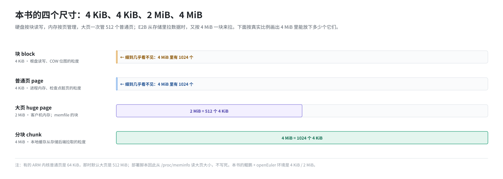
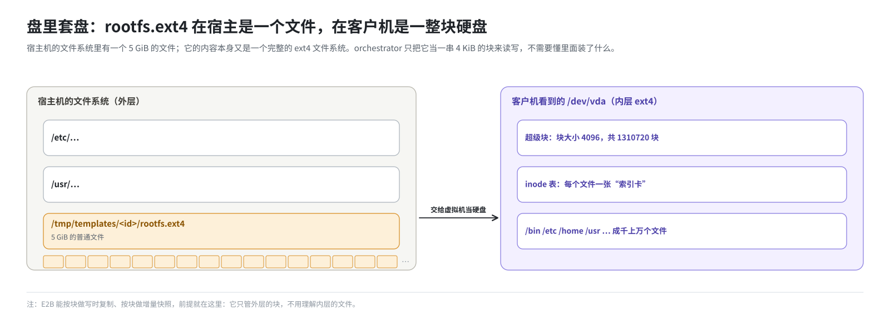

# 第 2 篇｜存储基础（一）：字节、块、页与文件系统

> **本篇目标**：讲清楚后面每一篇都要用到的几个最基础的概念：硬盘为什么按“块”读写，内存为什么按“页”管理，文件系统怎么把一堆块变成有名字的文件，一个文件为什么可以当成一块硬盘来用，“稀疏文件”和“tmpfs”又是什么。读完本篇，你会知道本书里两个最重要的数字从哪来：4 KiB 和 2 MiB。

---

## 一、硬盘眼里只有“第几块”

### 1.1 扇区与块

我们写程序时习惯说“往文件第 100 个字节写一个字母”。但硬盘不认识“文件”，也不按字节干活。在硬盘眼里，整块盘就是一长排**格子**，每个格子固定大小，从 0 开始编号：

```
硬盘： [0号][1号][2号][3号][4号] ...... [第 N 号]
        每格 512 字节或 4096 字节
```

最小的格子叫**扇区**，传统上是 512 字节，现代硬盘多是 4096 字节。操作系统在扇区之上再定义一个自己的单位，叫**块**（block），Linux 上最常见的是 **4096 字节，也就是 4 KiB**。

硬盘每次读写都是整块整块地来。哪怕你只想改一个字节，操作系统也要：

1. 把这个字节所在的整块 4 KiB 读进内存；
2. 在内存里改掉那一个字节；
3. 再把整块 4 KiB 写回去。

用一个比喻：硬盘像一个只按整箱发货的仓库。你想要一瓶水，它也只能发一整箱给你。

### 1.2 为什么这对 E2B 很重要

E2B 要记录“沙箱改过磁盘的哪些地方”。既然硬盘本来就是按块读写的，那就**按块记**：用一张表，每一块占一个比特，写过的块标 1，没写过的标 0。

这套环境的代码里有一个常量：

```go
RootfsBlockSize = 2 << 11   // 4096 字节，即 4 KiB
```

意思是：沙箱的根磁盘按 4 KiB 一块来管理。一块 10 GB 的盘就是约 260 万块，记录“哪些块被写过”只需要约 320 KB 的位图。后面第 12 篇的写时复制、第 14 篇的增量快照，都是在这个粒度上工作的。

---

## 二、内存眼里只有“第几页”

### 2.1 页

内存也一样，操作系统不按字节管理它，而是切成固定大小的**页**（page），最常见的同样是 **4 KiB**。

为什么也是 4 KiB？因为内存和硬盘之间要频繁搬运数据（比如把文件读进内存），两边用同样的单位最省事：一块正好装进一页。

### 2.2 大页

一页 4 KiB 有个问题：内存大了以后页数太多。256 GB 的内存就是 6700 多万页，CPU 要维护的“页表”（每一页对应到哪块物理内存的记录，第 4 篇讲）会非常庞大，查表也慢。

于是有了**大页**（huge page）：一次管理一大片连续内存。x86 和常见配置下的 ARM 上，大页是 **2 MiB**，等于 512 个普通页。

这套环境的代码里同样有常量：

```go
PageSize     = 2 << 11   // 4 KiB，普通页
HugepageSize = 2 << 20   // 2 MiB，大页
```

沙箱的内存默认用 2 MiB 大页。好处是页表小、缺页次数少；代价是每次要准备内存时，一准备就是 2 MiB。第 13 篇会详细讲。

> **补充**：有些 ARM 服务器的内核把普通页设成 64 KiB，这时默认大页是 512 MiB。这套环境的部署脚本因此没有写死大页大小，而是从 `/proc/meminfo` 的 `Hugepagesize` 读出来再换算页数。本书讲的鲲鹏 + openEuler 环境是 4 KiB 普通页、2 MiB 大页。

### 2.3 一张对照表

| 单位 | 大小 | 谁在用 | 在本书里管什么 |
|---|---|---|---|
| 块 | 4 KiB | 硬盘、文件系统 | 沙箱根磁盘的读写和记录粒度 |
| 普通页 | 4 KiB | 内存管理 | 一般进程的内存 |
| 大页 | 2 MiB | 内存管理 | 沙箱的客户机内存 |
| 分块（chunk） | 4 MiB | E2B 自己定义 | 从存储里拉数据的粒度（第 11 篇） |

---



## 三、文件系统：把块变成“文件”

### 3.1 文件系统做了什么

一块硬盘只是一长排编号的格子。我们平时用的“文件”“目录”“文件名”“修改时间”，都是**文件系统**在格子上搭出来的。

用图书馆来比喻：

- 硬盘的块是书架上的一个个**格子**；
- 文件是**一本书**，内容可能分散放在很多格子里；
- 文件系统是**图书管理员**加一套**索引卡**：每本书一张卡，上面写着书名、作者、借阅时间，以及“这本书第 1 页在 37 号格，第 2 页在 38 号格，第 3 页在 905 号格……”；
- 目录也是一种特殊的卡片，上面列着“这个目录下有哪些书，各自的卡片在哪”。

### 3.2 ext4 的几个基本概念

Linux 上最常用的文件系统是 **ext4**。E2B 沙箱的根盘就是 ext4。只需要知道几个名词：

| 名词 | 是什么 | 类比 |
|---|---|---|
| 超级块（superblock） | 记录整个文件系统的总体信息：块大小、总块数、还剩多少空闲 | 图书馆的总账本 |
| inode | 每个文件一个，记录权限、大小、时间，以及数据存在哪些块 | 一本书的索引卡 |
| 块组（block group） | 把整块盘分成若干组，每组有自己的 inode 表和空闲块位图 | 图书馆分成几个阅览室 |
| 日志（journal） | 改动先记日志再落盘，断电后可以恢复一致 | 管理员的工作记录本 |

后面讲模板构建（第 9 篇）时会看到两条命令：

- `tune2fs -l rootfs.ext4`：打印超级块信息，比如块大小、空闲块数；
- `e2fsck rootfs.ext4`：检查并修复文件系统的一致性，相当于把所有索引卡和书架核对一遍。

示例输出（节选）：

```
$ tune2fs -l rootfs.ext4
Filesystem volume name:   <none>
Block count:              1310720
Free blocks:              712345
Block size:               4096
...
```

意思是：块大小 4096 字节，一共 131 万块（5 GiB），还有 71 万块空闲。

---

## 四、一个文件也可以是一块“硬盘”

### 4.1 镜像文件

既然硬盘就是一长排编号的块，那么一个普通文件，只要把它的字节按 4 KiB 一段切开，第 0～4095 字节当第 0 块，第 4096～8191 字节当第 1 块……它就**可以假装是一块硬盘**。

把一个 ext4 文件系统“格式化”到这样一个文件里，就得到一个**磁盘镜像文件**。E2B 模板里的 `rootfs.ext4` 就是这样的东西：在宿主机看来它只是一个文件，在虚拟机看来它是一整块装着 Ubuntu 的硬盘。



### 4.2 “盘里套盘”

注意这里有**两层文件系统**：

- 外层：宿主机自己的文件系统，`rootfs.ext4` 是它里面的一个文件；
- 内层：`rootfs.ext4` 这个文件的内容本身又是一个完整的 ext4 文件系统，里面有成千上万个文件。

宿主机上的程序（比如 orchestrator）只关心外层：它把 `rootfs.ext4` 当成一串块来读写，**不需要懂**里面装了什么文件。这正是 E2B 能按块做写时复制、按块做增量快照的前提：它不用理解客户机的文件，只管块。

---

## 五、稀疏文件：看起来很大，实际很小

### 5.1 现象

在 Linux 上做一个小实验（只看输出就行）：

```
$ truncate -s 10G big.img      # 把文件“拉长”到 10 GB，但什么都不写
$ ls -lh big.img
-rw-r--r-- 1 root root 10G  big.img
$ du -h big.img
0       big.img
```

`ls` 说它有 10 GB，`du` 说它占用 0 字节。两个都没说错：

- `ls -l` 显示的是文件的**逻辑大小**，也就是“从开头到结尾一共多少字节”；
- `du` 显示的是文件**实际占用的磁盘块**。

### 5.2 原理：洞

文件系统允许文件里有“洞”（hole）：某一段从来没写过，就不给它分配磁盘块，索引卡上只记一句“这一段是空的”。读这一段时，文件系统直接返回全零，不用去读硬盘。

这样的文件叫**稀疏文件**（sparse file）。往第 5 GB 处写 4 KiB，文件就只占 4 KiB：

```
文件逻辑上：  [洞……………………][4KiB 数据][洞……………………]
             0               5GB         5GB+4KiB             10GB
实际占用：    4 KiB
```


### 5.3 在 E2B 里随处可见

E2B 大量使用稀疏文件，后面会一再遇到：

- 每个沙箱的写时复制文件（第 12 篇）：逻辑大小等于整块根盘，实际只占沙箱写过的那些块；
- 本地缓存文件（第 11 篇）：逻辑大小等于整个 memfile，实际只占拉下来的那些分块；
- 检查点的内存 diff 文件（第 16 篇）：逻辑大小等于整个客户机内存，实际只占这一轮写过的页。

所以排查磁盘占用时，**一定要用 `du` 而不是 `ls -l`**。在 `/orchestrator/build` 里看到一个“8 GB”的文件，先别慌，`du` 一下，可能只占几十 MB。

---

## 六、页缓存：读过的文件会留在内存里

Linux 读文件时，会把读到的块放进内存里的**页缓存**（page cache）。下次再读同一块，就直接从内存拿，不用碰硬盘。写文件时也先写进页缓存，过一会儿再统一刷到硬盘。

页缓存的特点：

- 它用的是“空闲”内存，内存紧张时内核会自动回收；
- 但它**算在**读写这个文件的进程所在的内存控制组（cgroup）的账上。

第二点在这套环境里有实际影响。template-manager 进程在 Nomad 里有一个 32 GiB 的内存上限（第 18 篇）。它构建模板、打快照时读写大量文件，这些文件的页缓存都记在它头上。上限设小了，进程会被内核当成“内存超标”杀掉。而沙箱的客户机内存走大页，反而**不**记在这个账上（第 13 篇）。

---

## 七、tmpfs：放在内存里的文件系统

最后一个概念：**tmpfs**。它是一种特殊的文件系统，所有文件都放在内存里，不落硬盘。

- 优点：快。读写就是读写内存。
- 缺点：占内存；**重启就清空**。

这套环境里有两处 tmpfs，和存储关系重大：

| 挂载点 | 由谁挂载 | 大小 | 里面放什么 |
|---|---|---|---|
| `/tmp` | openEuler 系统自带的 `tmp.mount` | 默认按内存比例 | **模板和快照**（`/tmp/templates`）、构建层缓存（`/tmp/build-cache`） |
| `/mnt/snapshot-cache` | 部署脚本 `init-client.sh`、`start-client.sh` | 65G | 名字叫快照缓存，但这个版本的代码不往里写（第 11 篇） |

第一行是个要牢记的事实：**这套环境的模板实际存在内存里**。宿主机一重启，所有模板都会消失，需要重新构建。不重启的话，系统自带的 `systemd-tmpfiles` 每天也会清理一次 `/tmp`，删掉 10 天内既没被读也没被改过的文件。第 10 篇会讲为什么会这样，以及怎么改。

可以用这条命令确认一个目录是不是 tmpfs：

```
$ findmnt /tmp
TARGET SOURCE FSTYPE OPTIONS
/tmp   tmpfs  tmpfs  rw,nosuid,nodev,...
```

`FSTYPE` 那一列是 `tmpfs`，就是放在内存里的。

---

## 本篇小结

| 概念 | 一句话解释 |
|---|---|
| 块 | 硬盘和文件系统读写的最小单位，本书里是 4 KiB |
| 页 | 内存管理的单位，普通页 4 KiB |
| 大页 | 2 MiB 一页，页表小、缺页少，沙箱内存用它 |
| 文件系统 | 把一排编号的块组织成有名字的文件和目录 |
| ext4 | Linux 常用文件系统，沙箱根盘用它；超级块、inode、块组、日志 |
| 磁盘镜像文件 | 一个普通文件，内容是一整个文件系统，可以交给虚拟机当硬盘 |
| 稀疏文件 | 没写过的部分不占空间，`ls -l` 和 `du` 会对不上 |
| 页缓存 | 读写过的文件留在内存里，记在进程所在 cgroup 的账上 |
| tmpfs | 内存里的文件系统，重启即空；本环境的 `/tmp` 就是它 |

**下一篇预告**：[《存储基础（二）：块设备与 NBD》](03-block-devices-and-nbd.md)。既然一个文件可以当硬盘，那能不能更进一步：一块“硬盘”的内容，干脆由一个程序**实时回答**？这就是 NBD。下一篇讲块设备是什么、NBD 怎么工作，以及为什么这套环境要自己编译 nbd 内核模块。
