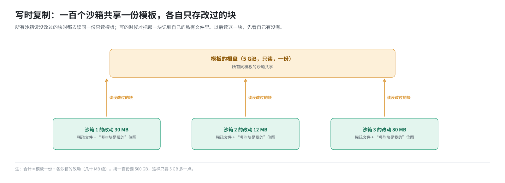
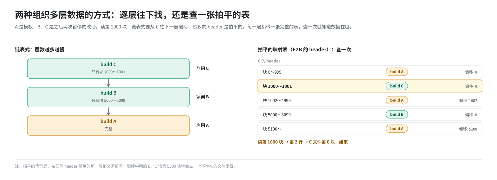

# 第 5 篇｜写时复制与分层：只存改动的思想

> **本篇目标**：前几篇解决了“怎么按需取”。本篇解决“怎么省着存”：几百个沙箱基于同一个模板，各自又改了一些东西，暂停了又恢复，恢复了又暂停，数据怎么组织才不浪费？本篇讲写时复制、分层，以及把多层数据“拍平”成一张映射表的思路。这是一篇纯讲思想的文章，后面几乎所有的设计都是它的具体实现。

---

## 一、问题：一百个沙箱，难道拷一百份？

假设一个模板的根盘是 5 GB，内存快照是 2 GB。现在要同时开一百个基于它的沙箱。

最笨的办法是每个沙箱拷一份：

```
沙箱 1：5 GB 磁盘 + 2 GB 内存
沙箱 2：5 GB 磁盘 + 2 GB 内存
……
沙箱 100：5 GB 磁盘 + 2 GB 内存
合计：700 GB
```

可实际上，每个沙箱启动后可能只往磁盘写了几十 MB（装了几个包、生成了几个文件），绝大部分数据和模板一模一样。拷一百份，99% 都是重复的。

---

## 二、写时复制：读时共享，写时才复制

### 2.1 思想

**写时复制**（Copy-On-Write，COW）的思想很朴素：

- 大家**共享**同一份原始数据，只读；
- 谁要**改**某一部分，就把那一部分**复制**一份到自己那里再改；
- 以后读这一部分时，先看自己有没有改过的版本，有就用自己的，没有就用共享的。

用一个比喻：全班共用一本**课本**，谁都不能在课本上写字。每个人手里有一叠**便签**，想改课本第 37 页，就在便签上抄一份第 37 页再改，贴在自己的本子里。以后读第 37 页，先翻自己的便签，有就看便签，没有就看课本。

### 2.2 用在沙箱磁盘上



每个沙箱的私有部分只记它写过的块，按第 2 篇的说法，就是一个**稀疏文件**加一张“哪些块是我的”的位图。一百个沙箱的总占用变成：

```
模板 5 GB（一份） + 一百份各自的改动（几十 MB 级）
```

### 2.3 用在内存上

内存也一样。一百个沙箱从同一个内存快照恢复，按需取页时都从同一份快照文件里读。某个沙箱的客户机写了某一页，那一页就变成它自己的（在它自己的 Firecracker 进程的内存里），不影响别人。

第 4 篇说的 `MAP_PRIVATE` 就是内核提供的内存写时复制：多个进程映射同一个文件，写的时候各自复制。

### 2.4 写时复制的代价

写时复制不是免费的：

- **第一次写**某一块时要多做一步：先判断“我有没有这块”，没有就要在自己的文件里分配位置；
- **读**的时候要多查一步：先看自己，再看共享的；
- 要维护一张“哪些块是我的”的表。

不过这些开销和“拷贝 5 GB”相比，微不足道。

---

## 三、分层：一层叠一层

### 3.1 Docker 镜像的层

写时复制再往前推一步，就是**分层**。最常见的例子是 Docker 镜像：

```
┌──────────────────────────┐
│ 容器的可写层（运行时的改动）  │  ← 可写
├──────────────────────────┤
│ 第 3 层：COPY app.py       │  ← 只读
├──────────────────────────┤
│ 第 2 层：RUN pip install   │  ← 只读
├──────────────────────────┤
│ 第 1 层：ubuntu:22.04      │  ← 只读
└──────────────────────────┘
```

每一层只记录相对于下面那层的**改动**。读一个文件时，从最上层往下找，找到的第一个就是它。这样，一百个基于 ubuntu 的镜像，ubuntu 那一层只存一份。第 8 篇讲 Harbor 时还会回到镜像层。

### 3.2 E2B 的 build 链

E2B 的模板也是分层的，但层的含义不同。在 E2B 里，每一次**快照**都产生一层：

```
 build A：模板构建完成时的快照（完整的磁盘和内存）
    │
    ▼ 基于 A 创建沙箱，运行一阵，暂停
 build B：只含这一轮改过的磁盘块和内存页
    │
    ▼ 基于 B 恢复，再运行一阵，再暂停
 build C：只含这一轮改过的磁盘块和内存页
```

每一层叫一个 **build**，有一个 UUID 作为 buildID。B 只存 A 之后改过的部分，C 只存 B 之后改过的部分。恢复到 C 时，磁盘和内存的内容由 A、B、C 三层拼起来。

---

## 四、两种组织多层数据的方式

现在问题来了：恢复到 C 以后，客户机要读第 1000 块，这一块在哪一层？

### 4.1 链表式：逐层往下找

最直接的办法是像 Docker 那样从上往下找：



每一层要有一张“我有哪些块”的位图。问题是：**层越多越慢**。一个沙箱暂停恢复了一百次，读一块可能要查一百张表。而且每一层的位图都得常驻内存。

### 4.2 拍平的映射表：查一次就知道

E2B 用的是另一种办法：每一层都带一张**完整的映射表**，直接写明“第 X 块的数据在哪一层的哪个位置”。

以 C 的磁盘映射表为例：

```
 偏移范围（块）       数据在哪个 build    在那个文件里的偏移
 0     ～ 999         A                   0
 1000  ～ 1001        C                   0
 1002  ～ 4999        A                   1002 × 4KiB
 5000  ～ 5099        B                   0
 5100  ～ ...         A                   5100 × 4KiB
```

读第 1000 块：查一次表，直接得到“在 C 的第 0 个位置”，去读就行，不管有多少层。

这张表叫 **header**。每一层的 header 是怎么来的？在**上一层的 header** 基础上，用本层改过的块覆盖对应的条目：

```
 B 的 header = A 的 header，再把 5000～5099 改成“在 B”
 C 的 header = B 的 header，再把 1000～1001 改成“在 C”
```

这就叫把链“拍平”。第 7 篇会看这张表在代码里的真实样子。

### 4.3 两种方式的对比

| | 链表式 | 拍平的映射表 |
|---|---|---|
| 读一块要查几次 | 层数次 | 一次 |
| 每层存什么 | 本层数据 + 本层的位图 | 本层数据 + 一张完整映射表 |
| 层数增加时 | 读越来越慢 | 读的速度不变 |
| 新建一层时 | 只写本层位图 | 要合并出一张新表（通常很快，表是按区间存的） |

---

## 五、拍平的代价：每一层都得留着

拍平的映射表读起来快，但有一个必然的代价：

> **只要还有一张映射表指向某一层，那一层的数据文件就必须留着。**

看上面 C 的 header：它直接指向 A 和 B。如果有人把 B 的数据文件删了，C 读第 5000 块时就会去一个不存在的文件里读，沙箱直接出错。

所以：

- 删除一个快照时，不能简单地把它的目录删掉，要确认没有后代还在引用它；
- 手工去存储目录里删文件是危险的，删一个“中间层”会打断所有后代。

第 14 篇讲暂停和删除时会再强调这一点。

---

## 六、压实：别让层越叠越多

层只增不减也有问题：

- 存储里会堆满大量很小的 diff 文件；
- 早期某一层里的数据，可能已经被后面的层全部覆盖了，但因为某个 header 还在引用它的一小部分，整个文件都删不掉。

解决办法叫**压实**（compaction）：把几层合并成一层，改写引用它们的 header，然后删掉旧的层。

```
 压实前：A ← B ← C        C 的 header 指向 A、B、C
 压实后：A ← (B+C)        新的一层包含 B 和 C 里仍被引用的数据
                          header 改写为指向 A 和新层
```

这套环境的检查点回滚功能就实现了压实（第 17 篇）：被删除但还有后代的检查点先隐藏起来，等它只剩一个孩子时，就把它并进孩子里。

---

## 七、一句话总结本书的设计思想

回头看，后面各篇讲的东西，几乎都是同一个思想的不同实现：

> **共享不变的部分，只存改过的部分，再用一张表把它们拼起来。**

| 后面的设计 | 共享的是什么 | 只存的是什么 | 用什么拼 |
|---|---|---|---|
| 沙箱的硬盘（第 12 篇） | 模板的根盘 | 沙箱写过的块 | 一张位图 |
| 暂停快照（第 14 篇） | 上一代 build | 这一轮改过的块和页 | header 映射表 |
| 模板构建的层缓存（第 9 篇） | 之前构建过的相同步骤 | 新步骤的结果 | 按内容算的哈希 |
| Docker 镜像（第 8 篇） | 相同的镜像层 | 新增的层 | 镜像清单 |
| 检查点回滚（第 16、17 篇） | 父检查点 | 这一段时间写过的页和块 | 检查点树 + 层索引 |

---

## 本篇小结

| 概念 | 一句话解释 |
|---|---|
| 写时复制 | 读时共享，写时才复制到自己那份 |
| 私有改动 | 稀疏文件加“哪些块是我的”的位图 |
| 分层 | 每一层只记录相对下层的改动 |
| build | E2B 里的一层，每次快照产生一个，有自己的 buildID |
| 链表式查找 | 逐层往下找，层越多越慢 |
| 拍平的映射表 | 每层带一张完整的表，查一次就知道数据在哪层哪个位置 |
| header | E2B 里这张映射表的名字 |
| 拍平的代价 | 被任何 header 引用的层都必须保留，删中间层会打断后代 |
| 压实 | 把多层合并成一层，改写 header，删掉旧层 |

**下一篇预告**：[《虚拟机的“盘”和“内存条”：Firecracker 眼中的存储》](06-firecracker-disk-and-memory.md)。基础知识讲完了，最后一篇基础篇看看虚拟机本身：Firecracker 给客户机提供了什么样的磁盘和内存，它原生的快照功能是什么样的，以及 E2B 用的定制版 Firecracker 为了配合上面这些设计，多做了哪几件事。
