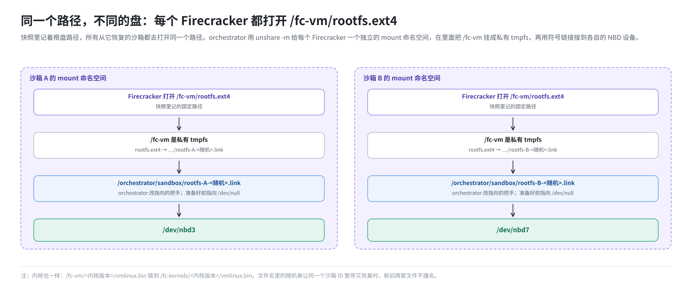
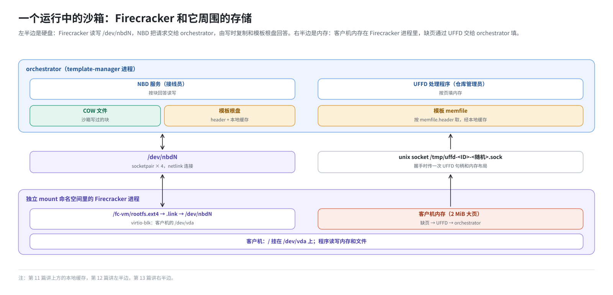

# 第 6 篇｜虚拟机的“盘”和“内存条”：Firecracker 眼中的存储

> **本篇目标**：基础篇的最后一篇，把视角转到虚拟机本身。Firecracker 给客户机提供了什么样的磁盘和内存？它怎么找到内核和根盘？它原生的快照功能存了什么、有什么局限？E2B 用的定制版 Firecracker 为了配合“按需取”“只存改动”，又多做了哪几件事？读完本篇，你会看到第 3、4 篇的 NBD 和 userfaultfd 是在哪里接上虚拟机的。

---

## 一、Firecracker 是什么

**Firecracker** 是亚马逊开源的一个虚拟机监控程序（VMM），专门用来跑“微虚拟机”（microVM）：只模拟最少的设备，启动快、占内存少。

在宿主机上，一台 Firecracker 虚拟机就是**一个普通进程**：

- 客户机的全部内存，就是这个进程地址空间里的一大块内存；
- 客户机的硬盘，是这个进程打开的一个宿主上的文件或设备；
- 外部通过一个 unix socket 上的 HTTP 接口控制它：设置内核、设置磁盘、启动、暂停、打快照……

本书只关心它的存储部分。

---

## 二、Firecracker 给客户机提供的存储设备

### 2.1 根盘：virtio-blk

Firecracker 给客户机提供一块 **virtio-blk** 磁盘。virtio 是一套“半虚拟化”设备标准：客户机知道自己在虚拟机里，用一套简单高效的协议和宿主通信，而不是假装自己在操作真实的硬盘控制器。

在客户机里，这块盘显示为 `/dev/vda`，挂载为根目录 `/`。

在宿主那头，Firecracker 需要一个**路径**。orchestrator 通过接口这样告诉它：

```go
// 简化
PUT /drives/rootfs
{
    "drive_id":       "rootfs",
    "path_on_host":   "/fc-vm/rootfs.ext4",   // 宿主上的路径
    "is_root_device": true,                    // 是根盘
    "is_read_only":   false                    // 可写
}
```

客户机读写 `/dev/vda` 的第 N 块，Firecracker 就去读写 `path_on_host` 的第 N×4096 字节处。至于这个路径背后是一个普通文件，还是一台 NBD 设备，Firecracker 不在乎。

### 2.2 内存

客户机的内存大小通过“机器配置”指定：

```go
// 简化
PUT /machine-config
{
    "vcpu_count":   2,
    "mem_size_mib": 2048,
    "smt":          false,     // ARM 上 Firecracker 不支持 SMT，补丁改成 false
    "huge_pages":   "2M",      // 用 2 MiB 大页支撑客户机内存
    "track_dirty_pages": ...   // 是否打开写跟踪，第 16 篇讲
}
```

`huge_pages: "2M"` 让 Firecracker 从大页池里申请客户机内存。这套环境的沙箱默认用大页。

### 2.3 内核

客户机内核也是一个宿主上的文件。orchestrator 按版本号去固定目录找：

```
/fc-kernels/<内核版本>/vmlinux.bin
```

部署脚本 `init-client.sh` 把 RPM 自带的内核放成了三份：

| 目录 | 放的是 |
|---|---|
| `/fc-kernels/vmlinux-6.1.158/` | RPM 里的 `bin/vmlinux.bin` |
| `/fc-kernels/vmlinux-6.1.102/` | 同一个文件，另一个名字 |
| `/fc-kernels/vmlinux-6.6.0-132.0.0/` | RPM 里的 `bin/vmlinux.bin.openeuler` |

目录名只是一个寻址用的标签。建模板时如果不指定内核版本，api 用编译进去的默认值 `vmlinux-6.1.158`。少了这个目录，建模板会在一开始就失败。

### 2.4 Firecracker 本身

Firecracker 的可执行文件也按版本放：

```
/fc-versions/<版本>/firecracker
```

这套环境用的是 RPM 自带的**定制版** Firecracker（`bin/firecracker`，只在 aarch64 包里有），部署时放到 `/fc-versions/v1.13.1/firecracker`。目录名 `v1.13.1` 只是 orchestrator 查找用的键，二进制自报的版本是 1.12.1。它和官方版的区别见本篇第五节。

---

## 三、同一个路径，不同的盘：mount 命名空间

这里有一个很巧妙的设计，和《E2B 沙箱网络从零讲透》里“每个沙箱都是 169.254.0.21”是同一个道理。

### 3.1 问题

快照会**记录**根盘的路径。一个模板的快照里写着“根盘在 `/fc-vm/rootfs.ext4`”。所有从这个快照恢复的沙箱，Firecracker 都会去打开**同一个路径**。

可每个沙箱的根盘应该是不同的东西：沙箱 1 用 `/dev/nbd3`，沙箱 2 用 `/dev/nbd7`。同一个路径怎么指向不同的盘？

### 3.2 解法

orchestrator 不是直接启动 Firecracker，而是用 `unshare -m` 先给它开一个**独立的 mount 命名空间**，再在里面执行一小段脚本（简化）：

```bash
unshare -m -- bash -c '
  mount --make-rprivate /
  mount -t tmpfs tmpfs /fc-vm                       # 在自己的命名空间里，/fc-vm 是一块私有的 tmpfs
  ln -s /orchestrator/sandbox/rootfs-<沙箱ID>-<随机串>.link /fc-vm/rootfs.ext4
  mkdir -p /fc-vm/vmlinux-6.1.158
  ln -s /fc-kernels/vmlinux-6.1.158/vmlinux.bin /fc-vm/vmlinux-6.1.158/vmlinux.bin
  exec <进入网络命名空间> /fc-versions/v1.13.1/firecracker --api-sock /tmp/fc-<沙箱ID>-<随机串>.sock
'
```

mount 命名空间和网络命名空间类似：每个命名空间有自己的一套挂载点，互相看不见。所以：

- 每个 Firecracker 都看到一个 `/fc-vm/rootfs.ext4`；
- 但在各自的命名空间里，它指向不同的东西。

### 3.3 一条三跳的链接

顺着链接走下去：



中间那个 `.link` 文件是 orchestrator 用来“改指向”的把手。根盘准备好之前它指向 `/dev/null`，准备好之后改成指向分到的 `/dev/nbdN`。

文件名里的随机串，是为了让同一个沙箱 ID 暂停又恢复时，新旧两份文件不会撞名。这个随机串后面在 COW 文件、socket 文件的名字里都会看到。

---

## 四、原生快照：存了什么，局限在哪

### 4.1 创建快照

Firecracker 原生支持快照。先暂停虚拟机，再调用：

```go
PUT /snapshot/create
{
    "snapshot_type": "Full",            // 或 "Diff"
    "snapshot_path": "/path/snapfile",  // 机器状态
    "mem_file_path": "/path/memfile"    // 内存
}
```

产物两个文件：

| 文件 | 内容 | 大小 |
|---|---|---|
| snapfile（也叫 vmstate） | CPU 寄存器、中断控制器、各虚拟设备的状态，以及磁盘路径、内存配置等 | 很小，KB 到 MB 级 |
| memfile | 客户机内存 | 和客户机内存一样大 |

注意：**快照不包括磁盘**。磁盘内容由外部自己保证和快照一致。

两种类型：

- **Full**：整份内存写出去。2 GB 的客户机就是 2 GB 的文件，每次快照都写一遍。
- **Diff**：只写自上次快照以来被写过的页。需要先打开写跟踪（`track_dirty_pages`），产物是一个稀疏文件，**不能单独加载**，要自己把基础快照和各代 Diff 合并成一份完整的 memfile 才能用。

### 4.2 加载快照

启动一个新的 Firecracker 进程，调用：

```go
PUT /snapshot/load
{
    "snapshot_path": "/path/snapfile",
    "mem_backend": {
        "backend_type": "File" 或 "Uffd",
        "backend_path": "/path/memfile" 或 "/path/uffd.sock"
    }
}
```

内存后端有两种：

- **File**：Firecracker 把 memfile 整个 mmap 进来，靠内核的缺页从文件里读。
- **Uffd**：Firecracker 建一个 userfaultfd，登记客户机内存区域，然后通过 `backend_path` 指定的 unix socket 把这个 UFFD 的文件描述符**交给外部程序**。之后客户机缺页，由外部程序负责填页（第 4 篇第五节）。

E2B 用的是 **Uffd** 后端。外部程序就是 orchestrator。

### 4.3 原生方案对 E2B 的三个不合适

1. **全量快照的开销和内存大小挂钩**，和“改了多少”无关。一个空闲的沙箱暂停一次也要写 2 GB。
2. **Diff 链要自己合并**，而且合并是线性的，链一长，恢复就慢。
3. **产物是本地文件**。要放到存储后端、多台机器共享、按需取页，都得另外做一层。

---

## 五、定制版 Firecracker 多做的几件事

E2B 用的不是官方 Firecracker，而是 E2B 自己维护的一个分支（`firecracker-v1.12-direct-mem`，版本号 1.12.1）。这套环境 RPM 里带的那个二进制，又在 E2B 分支的基础上加了回滚功能。所以改动分两层：

| 层 | 和存储有关的改动 | 本篇 |
|---|---|---|
| E2B 分支 | 打快照可以不导出内存；三个查询内存的接口 | 5.1、5.2 |
| 本环境加的 | 打快照顺带写脏页位图；导出位图的接口；原地回滚；HDBSS 硬件记脏 | 5.3 |

下面引用的源码路径以 Firecracker 源码目录为根。

### 5.1 打快照时可以不导出内存

`mem_file_path` 变成**可选的**（`src/vmm/src/vmm_config/snapshot.rs` 里它的类型是 `Option<PathBuf>`）。不传它，Firecracker 只写 snapfile，并把磁盘缓冲刷下去，**不导出内存**：

```rust
// src/vmm/src/persist.rs，create_snapshot（节选）
// 只有指定了 mem_file_path 才把内存写进文件
if let Some(ref mem_file_path) = params.mem_file_path {
    vmm.vm.snapshot_memory_to_file(mem_file_path, params.snapshot_type, /* …… */)?;
}
```

为什么？因为 E2B 想自己导出内存，而且只导出脏页（第 14 篇）。

### 5.2 新增三个查询接口

| 接口 | 返回什么 | 用途 |
|---|---|---|
| `GET /memory/mappings` | 客户机内存的每一段，对应 Firecracker 进程里的哪个虚拟地址、多大、页多大 | orchestrator 据此用 `process_vm_readv` 去拷内存 |
| `GET /memory/dirty` | 一张位图：哪些页“在内存里、且没有 UFFD 写保护” | 暂停时只导出脏页 |
| `GET /memory` | 两张位图：哪些页在内存里（常驻），哪些页全是零 | 第一次快照时剔除全零页 |

前两个配合起来，orchestrator 就能做到：“问 Firecracker 哪些页脏了，再问这些页在你进程的哪个地址，然后我自己把它们拷出来。”Firecracker 只负责“停下来、报告情况”，数据搬运由 orchestrator 完成。

`GET /memory/dirty` 的判据值得记住，第 15 篇会反复用到。它在 `src/vmm/src/lib.rs` 的 `get_dirty_memory` 里：先用 `mincore` 找出常驻的页，再对每个常驻页读一次 `/proc/self/pagemap` 的那一项，看两位：

```rust
// src/vmm/src/utils/pagemap.rs（节选）
pub fn is_write_protected(&self) -> bool { (self.raw & (1u64 << 57)) != 0 } // 第 57 位：UFFD 写保护
pub fn is_present(&self) -> bool         { (self.raw & (1u64 << 63)) != 0 } // 第 63 位：在内存里

// is_page_dirty：在内存里，且没有写保护，就算脏
Ok(entry.is_present() && !entry.is_write_protected())
```

也就是说，它并不直接知道“哪些页被写过”，而是靠 UFFD 写保护这个标记间接推断。标记靠不住时，判据就会出偏差。

### 5.3 本环境加的：位图、回滚与硬件记脏

这套环境的 Firecracker 还多了几样东西，都是为检查点回滚（第 16 篇）加的：

| 改动 | 做什么 | 源码 |
|---|---|---|
| 打快照时写脏页位图 | `PUT /snapshot/create` 多一个可选字段 `dirty_bitmap_path`，写差分内存的同时把“这次写了哪些页”写成一个 FCDB 格式的位图文件 | `src/vmm/src/vstate/vm.rs` 的 `snapshot_memory_to_file` |
| 导出位图 | `PUT /snapshot/save-dirty-bitmap`：虚机暂停时，把写跟踪位图写到文件，不清零 | `src/vmm/src/rollback.rs` 的 `save_dirty_bitmap` |
| 原地回滚 | `PUT /snapshot/rollback`：不新开进程，直接把客户机内存、vCPU、中断控制器和设备倒回某个检查点 | `src/vmm/src/rollback.rs` |
| HDBSS | 鲲鹏 950 上让 CPU 硬件记录写过的页，没有就退回 KVM 写保护 | `src/vmm/src/vstate/vm.rs` 的 `setup_dirty_tracking` |

这里的写跟踪位图来自 KVM 的脏页日志，只记**写**，不看 UFFD 的标记，和上面 `GET /memory/dirty` 是两套判据。第 15 篇讲 ARM 上暂停为什么要从前者换到后者。

### 5.4 这些改动在哪看得到

e2b-infra 仓库里只有编译好的 `firecracker.arm`，Firecracker 的源码没有随它发布。本书对 Firecracker 的描述以编出这个二进制的源码为准，正文只给源码目录内的路径和函数名。orchestrator 一侧调用它的代码和接口定义文件 `firecracker.yml` 在 orchestrator 源码里，可以对照着看。回滚相关改动的完整清单，见《E2B 沙箱快照回滚从零讲透》附录 A。

---

## 六、一张图：Firecracker 和它周围的存储

把这篇和前几篇串起来，一个运行中的沙箱，Firecracker 周围是这样的：



后面三篇各负责一块：

- 第 11 篇：图上方“模板根盘”“模板 memfile”的本地缓存从哪来；
- 第 12 篇：左半边，NBD 服务和写时复制；
- 第 13 篇：右半边，UFFD 处理程序和大页。

---

## 本篇小结

| 概念 | 一句话解释 |
|---|---|
| Firecracker | 跑微虚拟机的 VMM，一台虚拟机就是一个宿主进程 |
| virtio-blk | 客户机里的 `/dev/vda`，宿主那头是一个路径 |
| 机器配置 | 内存大小、是否用 2 MiB 大页、是否打开写跟踪 |
| `/fc-kernels`、`/fc-versions` | 按版本号存放内核和 Firecracker 的目录 |
| mount 命名空间 | 让每个 Firecracker 看到同一个 `/fc-vm/rootfs.ext4`，背后却是各自的盘 |
| `.link` 符号链接 | orchestrator 改指向的把手，最终指向 `/dev/nbdN` |
| snapfile | 机器状态，很小；快照不含磁盘 |
| Full / Diff 快照 | 原生快照的两种类型，Diff 要自己合并 |
| Uffd 内存后端 | 加载快照时把缺页处理交给外部程序 |
| 定制版的改动 | 不导出内存、`/memory/dirty`、`/memory/mappings`、`/memory`、原地回滚 |

**下一篇预告**：[《模板长什么样：一个 buildID 目录里的六个文件》](07-template-six-files.md)。基础篇到此结束。第二部分从模板开始：一个模板在存储里到底是哪几个文件？那张“拍平的映射表”header 在代码里长什么样？读完下一篇，你就能拿着一份 header，手工算出沙箱读第 N 块时该去哪个文件的哪个位置。
