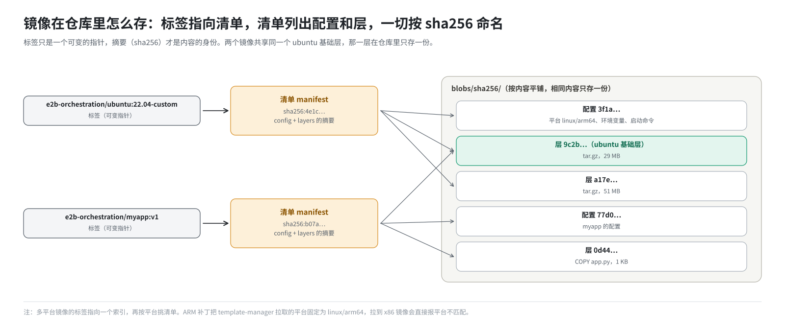
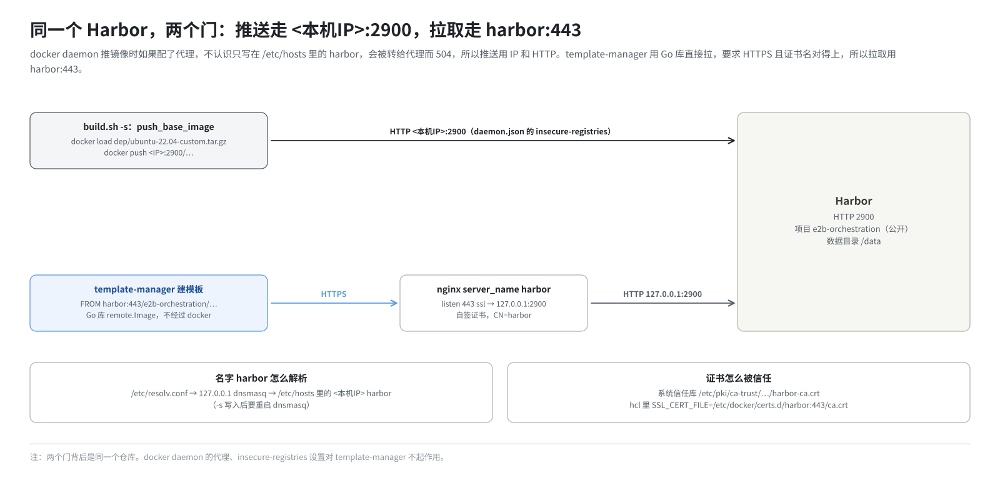

# 第 8 篇｜模板的原料仓库：Harbor 与镜像的存放

> **本篇目标**：模板的第一行写着 `FROM harbor:443/e2b-orchestration/ubuntu:22.04-custom`。这个镜像存在哪？它在仓库里是什么样子？template-manager 又是怎么拿到它的？本篇讲镜像仓库和 OCI 镜像的存储格式，然后一步步看这套环境的 Harbor 是怎么装起来、怎么被用的，以及部署和建模板时最常遇到的几个 Harbor 问题。

---

## 一、问题：模板的原料从哪来

第 9 篇会讲模板构建的完整流水线。流水线的第一步是：**拿到一个 Docker 镜像**，把它变成虚拟机的根盘。

这套环境做测试用的模板（`benchmark/build_template.py`）是这样写的：

```python
Template().from_dockerfile('FROM harbor:443/e2b-orchestration/ubuntu:22.04-custom')
```

意思是：以 `harbor:443` 这台仓库上、`e2b-orchestration` 项目里、名叫 `ubuntu`、标签为 `22.04-custom` 的镜像为起点。

要理解这一行背后发生了什么，先要知道镜像仓库是什么、镜像在仓库里是怎么存的。

---

## 二、镜像仓库：按“名字:标签”收发镜像

### 2.1 是什么

**镜像仓库**（registry）是一个 HTTP 服务，专门存放容器镜像。它对外提供一套标准接口（OCI Distribution 规范）：

- 推送：`docker push 仓库地址/名字:标签`；
- 拉取：`docker pull 仓库地址/名字:标签`；
- 查询有哪些标签：`GET /v2/<名字>/tags/list`。

用一个比喻：镜像仓库是一个按**货号**收发货的仓库。货号就是“名字:标签”，比如 `e2b-orchestration/ubuntu:22.04-custom`。你报货号，它发货；你送货来，它按货号入库。

最有名的公共仓库是 Docker Hub。这套环境是离线部署，不依赖外网，所以在本机自建了一个仓库：Harbor。

### 2.2 一个镜像的完整名字

```
harbor:443 / e2b-orchestration / ubuntu : 22.04-custom
└──┬────┘    └──────┬───────┘   └─┬──┘   └────┬─────┘
 仓库地址          项目          仓库名        标签
```

如果名字里没写仓库地址，比如 `ubuntu:22.04`，默认就是 Docker Hub。

---

## 三、OCI 镜像在仓库里怎么存

### 3.1 三样东西

一个镜像在仓库里不是“一个大文件”，而是由三类东西组成的：

| 组成部分 | 是什么 | 例子 |
|---|---|---|
| **清单**（manifest） | 一个小 JSON：这个镜像由哪个配置、哪几层组成，每样东西的 sha256 是什么 | 几 KB |
| **配置**（config） | 一个小 JSON：平台（`linux/arm64`）、环境变量、工作目录、默认启动命令、层的历史 | 几 KB |
| **层**（layer） | 一个个 `tar.gz` 压缩包，每层记录相对下层的文件改动（第 5 篇） | 几 MB 到几百 MB |

清单大致是这样（简化）：

```json
{
  "mediaType": "application/vnd.oci.image.manifest.v1+json",
  "config": { "digest": "sha256:3f1a...", "size": 2310 },
  "layers": [
    { "digest": "sha256:9c2b...", "size": 29531234 },
    { "digest": "sha256:a17e...", "size": 51203311 },
    { "digest": "sha256:0d44...", "size": 1024 }
  ]
}
```

### 3.2 按内容命名

注意每样东西都用它内容的 **sha256** 来标识，叫**摘要**（digest）。这有两个好处：

- **去重**：两个镜像共享同一个 ubuntu 基础层，那一层的 sha256 一样，仓库只存一份。这就是第 5 篇说的“共享不变的部分”。
- **防篡改**：拉下来的内容重新算一遍 sha256，对不上就说明坏了。

标签（`22.04-custom`）只是一个指向某份清单的**可变指针**；摘要才是镜像内容的真正身份。

### 3.3 多平台镜像

同一个名字可以对应多个平台的镜像，比如 `linux/amd64` 一份、`linux/arm64` 一份。这时标签指向的不是清单，而是一个**索引**（index），里面列出各平台各自的清单。拉取方按自己的平台挑一份。

这套环境的 ARM 补丁把 template-manager 拉镜像时的平台**固定成了 `linux/arm64`**：

```go
var DefaultPlatform = containerregistry.Platform{
    OS:           "linux",
    Architecture: "arm64",
}
```

拉下来之后还会检查一遍平台。所以，**如果有人往 Harbor 里推了一个 x86 镜像，用它建模板会直接报平台不匹配**，而不是装出一个跑不起来的根盘。



### 3.4 在仓库的磁盘上长什么样

标准的仓库服务（Docker 官方的 distribution，Harbor 内部用的也是它）把数据存在一个目录里，大致是：

```
<数据目录>/docker/registry/v2/
├── blobs/sha256/
│   ├── 3f/3f1a.../data      ← 配置
│   ├── 9c/9c2b.../data      ← 层
│   └── a1/a17e.../data      ← 层
└── repositories/
    └── e2b-orchestration/ubuntu/
        ├── _manifests/tags/22.04-custom/current/link   ← 标签指向哪份清单
        └── _layers/...                                  ← 这个仓库引用了哪些层
```

所有内容按 sha256 平铺在 `blobs` 下，`repositories` 下只放“引用”。

---

## 四、Harbor 是什么

**Harbor** 是一个开源的企业级镜像仓库。它的核心存储就是上面那个标准仓库服务，外面又加了一圈：

- **项目**：镜像按项目分组，项目可以设为公开或私有；
- **用户和权限**：谁能推、谁能拉；
- **网页界面**：浏览镜像、标签、层；
- 还有漏洞扫描、复制同步等功能，这套环境没用到。

Harbor 本身由一组容器组成：核心服务、仓库服务、自带的数据库和 Redis、一个 nginx 入口等，用 `docker compose` 拉起。它自带的数据库和 Redis 与 E2B 用的 PostgreSQL、Redis **毫无关系**，各管各的。

---

## 五、这套环境的 Harbor 是怎么装起来的

Harbor 的安装分散在 `build.sh -i` 和 `build.sh -s` 两步里。

### 5.1 `-i`：解压、改配置、配 nginx

**解压离线安装包**。Harbor 官方没有 aarch64 的离线安装包，这套环境用的是社区构建的 `harbor-offline-installer-aarch64-v2.13.0.tgz`，解压到 `build.sh` 所在目录下的 `harbor/`。

**改 `harbor.yml`**，三处：

```bash
sed -i '/^https:/ s/^/#/' harbor.yml                         # 关掉 Harbor 自己的 https
sed -i "s/^hostname: .*/hostname: $HOST_IP/" harbor.yml      # 主机名改成本机 IP
sed -i "/^  port: [0-9]\+/ s/[0-9]\+$/2900/" harbor.yml      # HTTP 端口改成 2900
```

数据目录没改，用安装包的默认值（`data_volume: /data`）。所以镜像的层实际存在宿主机的 `/data` 下。

**装 nginx，在 Harbor 前面加一层 https**：

```nginx
server {
    listen 443 ssl;
    server_name harbor;
    ssl_certificate     /etc/nginx/ssl/harbor.crt;   # 自签证书
    ssl_certificate_key /etc/nginx/ssl/harbor.key;
    location / {
        proxy_pass http://127.0.0.1:2900;            # 转给 Harbor
    }
}
```

为什么 Harbor 自己关掉 https，再让 nginx 来做？因为两种用法对 https 的要求不一样（见第六节）。

**生成自签证书，并让两边都信任它**：

```bash
openssl req -x509 ... -out /etc/nginx/ssl/harbor.crt   # 证书的名字是 harbor
# 装进系统信任库：Go 程序（template-manager）读这里
cp harbor.crt /etc/pki/ca-trust/source/anchors/harbor-ca.crt && update-ca-trust extract
# 装进 docker 的信任目录：docker daemon 读这里
cp harbor.crt /etc/docker/certs.d/harbor:443/ca.crt
```

### 5.2 `-s`：拉起、建项目、推基础镜像

`build.sh -s` 一开始就执行 Harbor 的 `install.sh`，用 `docker compose` 拉起 Harbor 的那组容器。接着修正两个配置目录的属主（Harbor 容器里的进程以 UID 10000 运行，读不了 root 的文件），重启仓库和入口容器。

然后在 Nomad 起来之后，做四件事：

1. **登录**：`docker login -u admin -p Harbor12345 <本机IP>:2900`。
2. **建项目**：用 Harbor 的 REST API 建一个**公开**项目 `e2b-orchestration`。公开意味着拉取不需要登录，template-manager 拉镜像时就不用带凭证。
3. **让 `harbor` 这个名字能解析**（`ensure_harbor_hostname`）：往 `/etc/hosts` 追加一行 `<本机IP> harbor`，再重启 dnsmasq。dnsmasq 只在启动时读 `/etc/hosts`，所以必须重启。已有这一行就跳过；指向别的地址就只告警。
4. **推基础镜像**（`push_base_image`）：先查 Harbor 里有没有 `e2b-orchestration/ubuntu:22.04-custom`，没有才推：

```bash
docker load -i dep/ubuntu-22.04-custom.tar.gz              # 得到本地镜像 ubuntu:22.04-custom
docker tag  ubuntu:22.04-custom <本机IP>:2900/e2b-orchestration/ubuntu:22.04-custom
docker push <本机IP>:2900/e2b-orchestration/ubuntu:22.04-custom
```

`ubuntu-22.04-custom.tar.gz` 是 RPM 里带的一个预先准备好的 arm64 镜像（`docker save` 的产物），在 RPM 构建时被拷进部署包。推失败只告警、不中断部署。

---

## 六、为什么有两个地址

细心的读者会发现：推镜像用的是 `<本机IP>:2900`，模板里拉镜像写的却是 `harbor:443`。这是同一个仓库的两个门。



**推送走 2900（HTTP）**：

- docker daemon 默认只肯用 https 和仓库通信。要用 http，得把地址加进 `/etc/docker/daemon.json` 的 `insecure-registries`。部署文档要求加上 `"<本机IP>:2900"`。
- 为什么不用 `harbor:443` 推？如果 docker daemon 配了代理（`HTTP(S)_PROXY`），它的 `NO_PROXY` 通常只列了本机 IP，不认识 `harbor` 这个只写在本机 `/etc/hosts` 里的名字，请求会被转给代理，代理回一个 `504 Gateway Timeout`。用 IP 推就没这个问题。

**拉取走 harbor:443（HTTPS）**：

- template-manager 用的 Go 库默认要求 https，并且校验证书的名字。证书是签给 `harbor` 的，所以地址必须写 `harbor`。
- 部署文件 `dep/template-manager.hcl` 里还专门给它设了一个环境变量，指向这张证书：

```hcl
SSL_CERT_FILE = "/etc/docker/certs.d/harbor:443/ca.crt"
```

---

## 七、template-manager 怎么拉镜像

### 7.1 不经过 docker

一个容易误解的地方：template-manager 拉镜像**不经过本机的 docker daemon**。它用 Go 的 go-containerregistry 库，自己按 registry 协议直接跟仓库对话：

```go
// 简化自 GetPublicImage
ref := name.ParseReference("harbor:443/e2b-orchestration/ubuntu:22.04-custom")
img := remote.Image(ref, remote.WithPlatform(linux/arm64))  // 直接 HTTPS 请求 harbor:443
verifyImagePlatform(img, linux/arm64)                        // 平台对不上就报错
```

所以：

- docker daemon 的代理、`insecure-registries` 设置，对 template-manager **不起作用**；
- template-manager 能不能拉到镜像，取决于三件事：`harbor` 能否解析、443 能否连通、证书是否被信任。

### 7.2 解析 `harbor`

template-manager 查 DNS 的路径是：`/etc/resolv.conf` 第一行指向 `127.0.0.1`，也就是本机的 dnsmasq；dnsmasq 读 `/etc/hosts`，答出本机 IP。（DNS 的细节见《E2B 沙箱网络从零讲透》第 17 篇。）

### 7.3 按需拉层

`remote.Image` 返回的只是一个“镜像句柄”，此时只拉了清单和配置。真正的层，要到下一步解包时才一层层拉下来（第 9 篇）。

---

## 八、另一条路：`ARTIFACTS_REGISTRY_PROVIDER=Local`

`.env` 里有一行：

```bash
export ARTIFACTS_REGISTRY_PROVIDER=Local
```

这是 E2B 的另一种取镜像方式。在官方的云上部署里，用户提交 Dockerfile 后，平台先在别处把镜像构建好，推到云厂商的镜像仓库，名字是“模板 ID:buildID”；template-manager 再按这个名字去取。`Local` 实现的意思是“去本机 docker daemon 里找 `模板ID:buildID` 这个镜像”。

这套环境建模板走的是 `FROM` 指定镜像的那条路（上一节），不走这里。知道有这么个配置就行。

---

## 九、三处存储，互不相干

到这里，这套环境里已经出现了三个“存东西的地方”，名字容易混：

| 存储 | 存什么 | 在磁盘上的位置 | 谁用 |
|---|---|---|---|
| Harbor | 做模板用的 Docker 镜像（原料） | `/data`（Harbor 数据目录） | 建模板时 template-manager 拉 |
| 模板存储 | 做好的模板和快照（六个文件） | `/tmp/templates`（第 10 篇） | template-manager 读写 |
| MinIO | 本来设计用来存模板，实际没用 | `/root/data/minio` | 没人 |

镜像变成模板之后，Harbor 里的镜像就**不再被沙箱用到**了。删掉 Harbor 里的镜像，不影响已经建好的模板；但以后重建这个模板会失败。

---

## 十、常见问题

| 现象 | 原因 | 看哪里 |
|---|---|---|
| 建模板报 `lookup harbor on 127.0.0.1:53: server misbehaving` | `/etc/hosts` 里没有 `harbor`，或加了之后没重启 dnsmasq | `getent hosts harbor` |
| `docker push` 报 504 | 推的地址用了 `harbor:443`，被 docker 的代理设置转走了 | 改用 `<本机IP>:2900` |
| `build.sh -s` 装 Harbor 时报 `Unsupported config option for services` | 系统里的 `docker-compose` 是 2018 年的 1.x 版本，看不懂 Harbor 2.13 的 compose 文件 | 装 Docker Compose v2 插件 |
| 建模板报平台不匹配 | Harbor 里那个标签是 x86 镜像 | 推 arm64 的镜像 |
| 建模板报证书错误 | 证书没装进系统信任库，或证书已重新生成但 template-manager 没重启 | `/etc/pki/ca-trust/source/anchors/harbor-ca.crt` |
| Harbor 里查不到 `ubuntu:22.04-custom` | `-s` 时推送失败（只告警不中断） | `curl -u admin:Harbor12345 http://127.0.0.1:2900/v2/e2b-orchestration/ubuntu/tags/list` |

最后一条的正常输出是：

```json
{"name":"e2b-orchestration/ubuntu","tags":["22.04-custom"]}
```

---

## 本篇小结

| 概念 | 一句话解释 |
|---|---|
| 镜像仓库 | 按“名字:标签”收发镜像的 HTTP 服务 |
| 清单、配置、层 | 一个镜像的三部分，都按 sha256 命名 |
| 摘要 | 内容的 sha256，相同的层只存一份 |
| 多平台索引 | 一个标签对应多个平台；补丁把拉取平台固定为 `linux/arm64` |
| Harbor | 在标准仓库外加了项目、权限、界面；数据在 `/data` |
| nginx 反代 | `harbor:443`（HTTPS，自签证书）转给 Harbor 的 2900 |
| 两个地址 | 推送走 `<本机IP>:2900`，拉取走 `harbor:443` |
| `e2b-orchestration` | `-s` 用 API 建的公开项目，拉取不用登录 |
| `push_base_image` | `-s` 把 RPM 带的 `ubuntu:22.04-custom` 推进 Harbor |
| template-manager 拉镜像 | 用 Go 库直接按 registry 协议拉，不经过 docker daemon |
| `ARTIFACTS_REGISTRY_PROVIDER=Local` | 另一条按 buildID 取镜像的路，本环境建模板不走它 |

**下一篇预告**：[《从 Dockerfile 到 rootfs.ext4：模板构建流水线》](09-template-build-pipeline.md)。镜像拿到了，下一篇看它怎么一步步变成虚拟机的根盘，又怎么变成一份能毫秒恢复的内存快照：解包、转 ext4、扩容、两次开机、逐步执行模板步骤、层缓存，最后打快照、上传。
