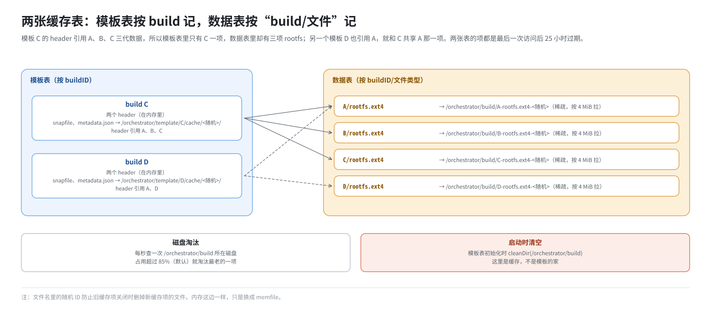
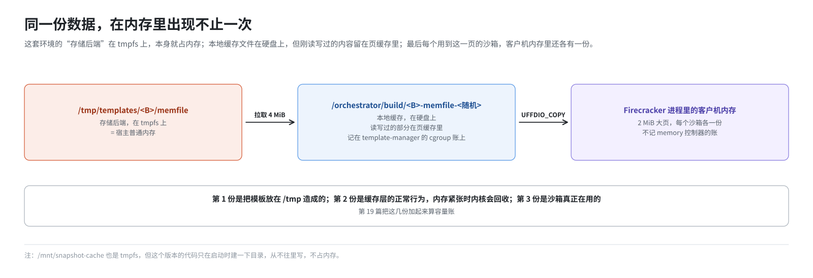

# 第 11 篇｜节点本地缓存：`/orchestrator` 目录里都是什么

> **本篇目标**：模板在存储后端里，但虚拟机不能直接拿存储后端里的对象当盘、当内存用。中间还隔着一层**节点本地缓存**。本篇讲这一层：`/orchestrator` 下面三个目录各放了什么、活多久；大文件怎么按 4 MiB 一块被拉到本地；沙箱读一块数据的完整路径是什么；以及为什么在这里看到几 GB 的文件不必惊慌。最后顺带澄清 `/mnt/snapshot-cache` 这块“挂着却没人用”的 tmpfs。

---

## 一、为什么还要一层本地缓存

上一篇说，模板存在存储后端里。在官方云部署中，存储后端是远方的对象存储，读一次要走网络，几十毫秒起步。

而沙箱对数据的需求是：

- **随机、小块、频繁**：客户机读一个 4 KiB 的块、缺一个 2 MiB 的页，都要立刻拿到；
- **同一块会被反复读**：同一台机器上一百个沙箱来自同一个模板，读的大多是同一批块；
- **要能 mmap**：orchestrator 的 NBD 服务和 UFFD 处理程序都希望把数据当成内存里的一个大数组来用。

所以需要在本机放一份“已经拉下来的部分”：第一次读某块时从存储后端拉，之后就从本机读。这就是节点本地缓存。

在这套环境里，“存储后端”其实就是本机的 `/tmp/templates`，读起来很快。但缓存这一层的代码是一样的，**照样存在**。这导致了一个有意思的后果，第七节讲。

---

## 二、三个目录

orchestrator 的本地缓存都在 `ORCHESTRATOR_BASE_PATH`（默认 `/orchestrator`）下面。部署脚本 `start-client.sh` 和 `init-client.sh` 提前建好了这三个目录：

```bash
mkdir -p /orchestrator/sandbox
mkdir -p /orchestrator/template
mkdir -p /orchestrator/build
```

| 目录 | 环境变量 | 放什么 | 活多久 |
|---|---|---|---|
| `/orchestrator/template/` | `TEMPLATE_CACHE_DIR` | 每个 build 的小文件：`snapfile`、`metadata.json` | 缓存项过期或被关闭时删除 |
| `/orchestrator/build/` | `DEFAULT_CACHE_DIR` | 每个 build 的大文件：`memfile`、`rootfs.ext4` 的本地副本 | TTL 25 小时 + 磁盘占用超 85% 时淘汰最老的；**进程启动时整个目录清空** |
| `/orchestrator/sandbox/` | `SANDBOX_CACHE_DIR` | 每个运行中沙箱的写时复制文件（第 12 篇）和 `.link` 符号链接 | 沙箱销毁即删 |

另外还有一个构建时的工作目录 `/orchestrator/build-templates/`（第 9 篇），构建完就删，这里不再提。

### 2.1 `/orchestrator/template/`：小文件整个下载

`snapfile` 和 `metadata.json` 很小，每次都是整个用，所以第一次需要时**整个下载**下来：

```
/orchestrator/template/<buildID>/cache/<随机 ID>/snapfile
/orchestrator/template/<buildID>/cache/<随机 ID>/metadata.json
```

两个 `.header` 也很小，但它们读进来以后就以内存中的数据结构存在，不落本地文件。

### 2.2 `/orchestrator/build/`：大文件按块拉取

`memfile` 和 `rootfs.ext4` 动辄几 GB，**不会整个下载**，而是在本地建一个同样大小的**稀疏文件**，用到哪块拉哪块：

```
/orchestrator/build/<buildID>-memfile-<随机 ID>
/orchestrator/build/<buildID>-rootfs.ext4-<随机 ID>
```

### 2.3 文件名里的随机 ID

两个目录的文件名里都有一段随机 ID。它解决的是这样一个问题：

> 某个 build 的旧缓存项过期了，正在被关闭、删文件；与此同时，又有人要用这个 build，新建了一个缓存项。如果两者用同一个文件名，旧的那个删文件时会把新的也删掉。

加上随机 ID，新旧两份各用各的文件，互不干扰。

---

## 三、两张缓存表

在 orchestrator 进程内存里，有两张带过期时间的表（TTL cache），管着上面这些文件：

**模板表**：以 buildID 为键，一项代表“一个可以用来创建沙箱的 build”，里面有它的两个 header、snapfile、metadata，以及指向内存和磁盘数据的句柄。

- 过期时间：**最后一次访问后 25 小时**。代码注释说，要比沙箱可能的最长寿命还长。
- 过期时，关闭这一项，删掉 `/orchestrator/template/` 下对应的文件。

**数据表**：以“buildID/memfile”或“buildID/rootfs.ext4”为键，一项代表“某个 build 的某个数据文件的本地副本”。

- 过期时间同样是 25 小时。
- 另外有一个后台循环，**每秒**检查一次 `/orchestrator/build` 所在磁盘的占用率。超过阈值（默认 85%）就淘汰最老的一项，然后立刻再检查，直到降下来。

为什么分两张表？因为一个 build 的 header 可能引用好几个其他 build 的数据（第 7 篇）。比如 build C 的磁盘数据来自 A、B、C 三层，那么模板表里只有 C 一项，数据表里却有 A、B、C 三项 rootfs。如果另一个模板 D 也引用 A，它们共享 A 的那一项。



### 3.1 启动时清空

模板表的初始化代码里有这么一段：

```go
// 删除旧的 build 缓存目录内容，因为它可能包含没人管理的陈旧数据
err := cleanDir(config.DefaultCacheDir)     // 即 /orchestrator/build
```

orchestrator 一重启，`/orchestrator/build` 下的所有文件都被清空。这再次说明：**这里是缓存，不是模板的家**。

---

## 四、分块拉取：chunker

### 4.1 4 MiB 一块

数据表里的每一项，背后都是一个 **chunker**（分块拉取器）。它把一个大文件切成 **4 MiB** 一块（代码常量 `MemoryChunkSize`）来管理：

```
存储后端里的 memfile（2 GiB）
 ├─ 第 0 块  [0, 4MiB)
 ├─ 第 1 块  [4MiB, 8MiB)
 ├─ ……
 └─ 第 511 块

本地 /orchestrator/build/<buildID>-memfile-xxx（逻辑 2 GiB 的稀疏文件，mmap 进内存）
 └─ 只有拉过的块才有内容
```

为什么是 4 MiB？它比一个块（4 KiB）或一个大页（2 MiB）都大：一次拉 4 MiB，附近的数据也一起来了，下次很可能用得上；而且对远端对象存储来说，请求次数少比每次请求小更重要。代码注释也要求它“必须大于等于块大小”。

### 4.2 一个缓存文件、一张位图

每个 chunker 有两样东西：

- 一个本地文件：用 `Truncate` 设成和源文件一样大（稀疏），再用 `MAP_SHARED` mmap 进 orchestrator 的地址空间；
- 一张位图：记录哪些范围已经拉到本地了。

### 4.3 读一段数据

```go
// 简化自 FullFetchChunker.Slice
func Slice(off, length) []byte {
    b, err := 本地缓存.Slice(off, length)       // 先看本地有没有
    if err == nil { return b }                   // 有，直接返回 mmap 里的那一段

    // 没有：算出这一段落在哪几个 4 MiB 块里，并发去拉
    for 每个涉及的块 {
        fetchers.Wait(块偏移, func() {           // 同一块只拉一次，别人在拉就等着
            buf := 本地缓存.地址(块偏移, 4MiB)    // 直接拿 mmap 里那 4 MiB 的位置
            存储后端.ReadAt(buf, 块偏移)          // 从存储后端读到这个位置
            本地缓存.标记已拉取(块偏移, 4MiB)
        })
    }
    return 本地缓存.Slice(off, length)           // 再读一次，这次一定有
}
```

几个要点：

- 数据**直接读进 mmap 的位置**，不经过中间缓冲区；
- `fetchers.Wait` 保证**同一块同时只拉一次**：两个沙箱同时读同一块，一个去拉，另一个等它拉完；
- 读到的结果是 mmap 里的一段**切片**，调用者直接用，不复制。

### 4.4 两种拉取器

代码里有两种 chunker，由特性开关 `chunker-config` 选择：

| 拉取器 | 行为 |
|---|---|
| FullFetch（整块拉取） | 缺哪块就把整个 4 MiB 拉完，再返回 |
| Streaming（流式拉取） | 一边拉一边看，等到调用者要的那几个字节到了就先返回，剩下的继续在后台拉 |

这套环境没有配置特性开关服务（`.env` 里 `LAUNCH_DARKLY_API_KEY` 为空），所有特性开关都用代码里的默认值。`chunker-config` 的默认值是 `useStreaming: false`，所以用的是**整块拉取**。本书提到的其他开关也一样，都按默认值来：比如磁盘淘汰阈值 85%、每台 NBD 设备 4 条连接。

---

## 五、读一块数据的完整路径

把第 7 篇的 header 和本篇的缓存串起来。沙箱的客户机要读根盘第 N 块：


内存的路径完全一样，只是起点换成了 UFFD 缺页（第 13 篇），查的是 `memfile.header`。

有两种特殊情况：

- header 里这一段是 `uuid.Nil`：直接返回全零，不碰任何文件；
- 这个 build 是本机**刚刚**打的快照（比如第 9 篇构建过程中的上一层）：它的数据文件本来就在本地，数据表里存的是一个“本地 diff”，直接读，不用去存储后端拉。

---

## 六、谁会触发拉取

本地缓存里的块，什么时候被拉下来？

| 触发者 | 拉什么 |
|---|---|
| 客户机读根盘 | 涉及的 rootfs 块 |
| 客户机缺页 | 涉及的 memfile 块 |
| 预取（第 13 篇） | metadata.json 里预取清单列出的 memfile 块，在客户机访问之前 |
| 打快照时导出 | 不触发拉取，导出的是沙箱自己的改动 |

同一台机器上，第一个从某模板创建的沙箱要“冷启动”，把用到的块拉下来；之后的沙箱就“热启动”，块已经在本地了。25 小时内没人用，这些块随着缓存项过期被删掉，下次又要冷启动。

---

## 七、同一份数据，内存里有两份

这套环境有一个独特的现象。按数据流走一遍：



同一个模板的同一页内存数据，可能同时在三处占用宿主内存：

1. `/tmp/templates` 的 tmpfs 里；
2. `/orchestrator/build` 文件的页缓存里（第 2 篇：读写过的文件会留在页缓存）；
3. 每个用到它的沙箱的客户机内存里（这一份是每个沙箱各一份）。

第 1 份是这套环境把模板放在 `/tmp` 造成的；第 2 份是缓存层的正常行为，内存紧张时内核会回收它，但它记在 template-manager 进程的内存控制组账上（第 18 篇的 32 GiB 上限）。第 19 篇算容量账时会把这些加起来。

---

## 八、`/mnt/snapshot-cache`：挂着，但没人用

部署脚本里有这样两行：

```bash
mkdir -p /mnt/snapshot-cache
mountpoint -q /mnt/snapshot-cache || mount -t tmpfs -o size=65G tmpfs /mnt/snapshot-cache
```

名字叫“快照缓存”，挂了一块最大 65G 的 tmpfs。代码里也有对应的配置项 `SNAPSHOT_CACHE_DIR`，默认就是这个路径。

但在这个版本的代码里，orchestrator 对它做的唯一一件事，是启动时确保这个目录存在（`ensureDirs`）。没有任何代码往里写文件。这两行是从上游的部署脚本继承来的。

这块 tmpfs 不会造成实际的内存占用：tmpfs 的 `size=65G` 只是上限，没写东西就不占内存。知道它是空的就行，排查问题时不用管它。

---

## 九、常见误判

| 看到的现象 | 实际情况 |
|---|---|
| `ls -l /orchestrator/build` 里有好几个几 GB 的文件 | 稀疏文件，用 `du` 看实际占用，通常只有拉过的那部分 |
| 删了模板，`/orchestrator/build` 里的文件还在 | 正常，缓存靠 25 小时 TTL 或重启回收 |
| `/orchestrator/build` 里有 memfile，所以模板存在这里 | 错。任何存储后端下都有这一层缓存，判断后端要看进程环境变量（第 10 篇） |
| 重启 orchestrator 后第一个沙箱变慢 | 正常，`/orchestrator/build` 被清空，要冷启动重新拉 |
| `/mnt/snapshot-cache` 里什么都没有 | 正常，这个版本不用它 |

---

## 本篇小结

| 概念 | 一句话解释 |
|---|---|
| 节点本地缓存 | 存储后端和虚拟机之间的一层，随机读、反复读、可 mmap |
| `/orchestrator/template` | 小文件 snapfile、metadata.json 整个下载 |
| `/orchestrator/build` | memfile、rootfs 的稀疏本地副本，按需拉取；启动时清空 |
| `/orchestrator/sandbox` | 运行中沙箱的写时复制文件和 `.link` |
| 随机 ID 后缀 | 防止新旧缓存项互删文件 |
| 两张缓存表 | 模板表（按 buildID）和数据表（按 buildID/文件类型），TTL 25 小时 |
| 磁盘淘汰 | 每秒检查，占用超 85% 淘汰最老的 |
| chunker | 按 4 MiB 分块拉取，位图记已拉取，同一块只拉一次 |
| 整块拉取 | 本环境特性开关全用默认值，用 FullFetch |
| 读路径 | 沙箱自己的 → header 查表 → 数据表 → chunker → 存储后端 |
| 内存里两份 | tmpfs 上的模板和缓存文件的页缓存，加上客户机内存 |
| `/mnt/snapshot-cache` | 部署脚本挂的 tmpfs，本版代码只建目录不写 |

**下一篇预告**：[《沙箱的硬盘：NBD 加写时复制》](12-sandbox-disk-nbd-cow.md)。上面“读一块数据的完整路径”的第一步是“沙箱自己写过吗”。下一篇就讲这一步之前和之后的部分：沙箱的根盘怎么由模板加 COW 文件拼成，NBD 设备池怎么管理 512 台设备，客户机的一次写是怎么落到 COW 文件里的，以及 ARM 补丁在这一层做的几处改动。
