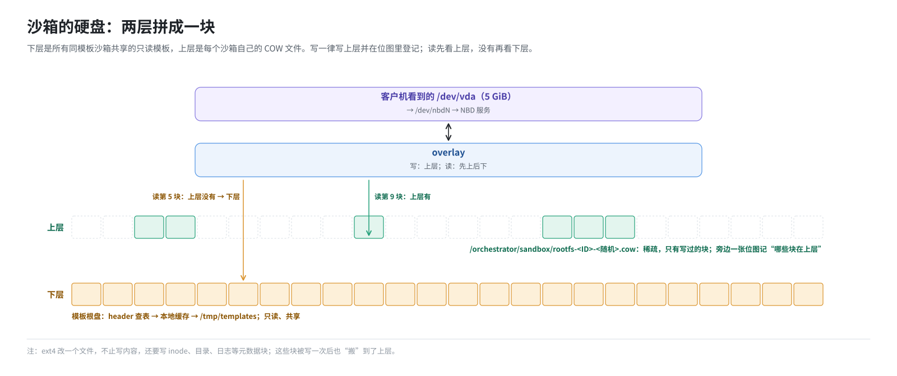
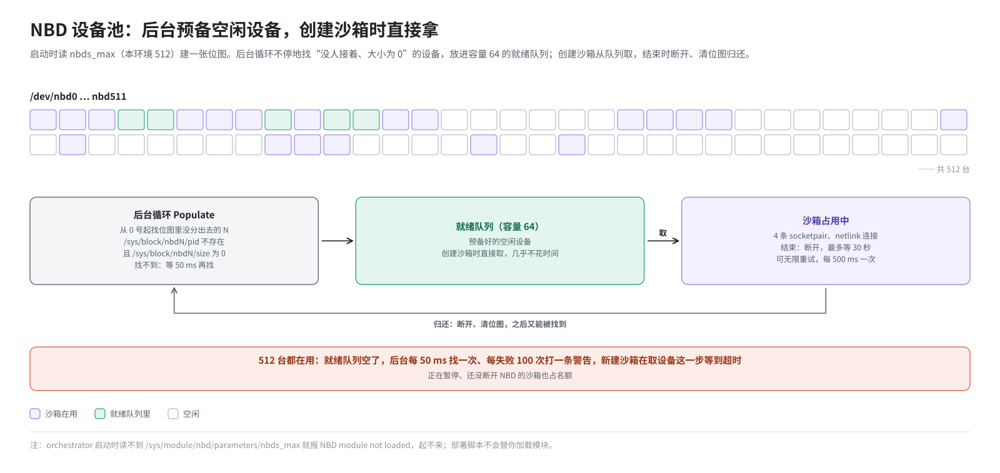
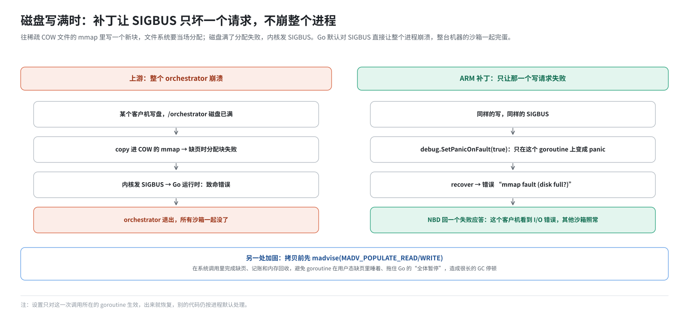

# 第 12 篇｜沙箱的硬盘：NBD 加写时复制

> **本篇目标**：本篇把第 3 篇的 NBD、第 5 篇的写时复制、第 11 篇的本地缓存拼起来，讲一个运行中沙箱的根盘到底是怎么构成的。读完本篇，你会知道：沙箱的根盘由哪两层拼成，读和写各走哪条路；orchestrator 怎么从 512 台 NBD 设备里挑一台、用完怎么还；模板构建时为什么不用 NBD；以及 ARM 补丁在这一层做的几处加固，其中一处能防止“磁盘写满导致整个 orchestrator 崩掉”。

---

## 一、两层拼成一块盘

一个从模板恢复出来的沙箱，它的根盘是这样两层：



- **下层**是只读的。它其实不是一个文件，而是“一张 header 加若干个 build 的数据”，读的时候按第 7 篇的方法查表、按第 11 篇的方法从缓存取。在代码里它是一个只读设备（`ReadonlyDevice`）。
- **上层**是每个沙箱自己的 **COW 文件**。创建沙箱时新建，大小设成和根盘一样（稀疏，不占空间），用 `MAP_SHARED` mmap 进 orchestrator。旁边还有一张位图（`BlockSet`），记录“哪些块在上层”。
- **overlay**（覆盖层）把两层拼起来，对外表现成一块完整的、可读可写的盘。

---

## 二、读和写

### 2.1 写：一律写上层

客户机写第 N 块：

1. 把数据拷进 COW 文件 mmap 的第 N 块位置；
2. 在位图里把第 N 块标记为“在上层”。

**永远不碰下层**。所以一百个沙箱随便怎么写，模板都不会被改动。

根盘按 4 KiB 一块管理（第 2 篇），客户机的写正好也是按块对齐的，不需要“先读出整块、改一部分、再写回”。

### 2.2 读：先上后下

overlay 的读逻辑（原代码简化）：

```go
func (o *Overlay) ReadAt(p []byte, off int64) {
    for 每一个 4 KiB 块 {
        err := 上层.ReadAt(这一块)          // 上层有吗？
        if err == nil { continue }           // 有，就用上层的
        if 不是“这里没有”的错误 { 报错 }
        下层.ReadAt(这一块)                   // 上层没有，读下层
    }
}
```

“上层没有”在代码里是一种**正常的回答**，不是故障：位图里没标记的块，上层就说“我这儿没有”，overlay 转去问下层。

### 2.3 一个例子

一个刚恢复的沙箱，客户机执行 `pip install requests`：

| 动作 | 涉及的块 | 走哪条路 |
|---|---|---|
| 读 `/usr/bin/python3` | 几百个块 | 上层都没有 → 下层 → 本地缓存（可能要从 `/tmp/templates` 拉） |
| 写 `site-packages/requests/*.py` | 几十个新块 | 写进 COW 文件，标记位图 |
| 改目录项、inode 表、日志 | 若干元数据块 | 第一次写这些块时也写进 COW 文件 |
| 再读刚装的 `requests/__init__.py` | 那几十个块 | 上层有 → 直接从 COW 文件读 |

注意第三行：ext4 改一个文件，不止写文件内容本身，还要改 inode、目录、空闲块位图、日志。这些元数据块原本在模板里，被写一次后就“搬”到了上层。所以沙箱的 COW 文件里，通常有一部分是文件系统的元数据。

---

## 三、把 overlay 交给内核：NBD

overlay 是 orchestrator 进程里的一个 Go 对象。要让 Firecracker（以及客户机）用上它，需要第 3 篇讲的 NBD。

### 3.1 接上一台 NBD 设备

创建沙箱时，orchestrator 做这些事（简化）：

```
1. 从 NBD 设备池取一个空闲编号，比如 7
2. 建 4 对 unix socket（socketpair）
     每对的一头交给内核，另一头留给自己
3. 通过 netlink 告诉内核：
     “把这 4 条连接接到 nbd7 上，块大小 4096，大小 5 GiB，
       超时 30 秒，支持多连接”
4. 为每条连接起一个处理循环（dispatch），读请求、调 overlay、回应答
5. 等内核报告 nbd7 已连接
6. 把 /orchestrator/sandbox/rootfs-<ID>-<随机>.link 指向 /dev/nbd7
```

最后一步接上了第 6 篇说的三跳链接：Firecracker 打开 `/fc-vm/rootfs.ext4` → `.link` → `/dev/nbd7`。

为什么是 4 条连接？这是特性开关 `nbd-connections-per-device` 的默认值。多条连接让内核可以把请求分散开，多个处理循环并行回答。

### 3.2 处理循环

每条连接上的处理循环很简单：

```
循环：
  从 socket 读一个请求头（28 字节）
  按类型处理：
    读：    起一个 goroutine，调 overlay.ReadAt，把应答头 + 数据写回 socket
    写：    先把后面跟着的数据读完，起一个 goroutine，调 overlay.WriteAt，写回应答头
    刷盘：  确认之前的写都已落到 COW 文件
    断开：  退出循环
```

每个请求一个 goroutine，所以同一台设备上的多个请求是并发处理的；应答靠请求编号对应（第 3 篇）。写回 socket 时加锁，保证一个应答的头和数据不会被别的应答插进来。

---

## 四、NBD 设备池

### 4.1 512 台设备怎么分

一台机器上有 512 台 NBD 设备（`nbds_max=512`）。orchestrator 启动时：

1. 读 `/sys/module/nbd/parameters/nbds_max`。读不到就报 `NBD module not loaded`，启动失败；读到 0 也失败。
2. 建一张 512 位的位图，记录哪些编号已经分出去了。
3. 起一个后台循环（`Populate`），不停地找空闲设备，放进一个容量为 64 的“就绪队列”。

找空闲设备的办法：

```
从 0 号开始，找一个位图里还没分出去的编号 N
检查 /sys/block/nbdN/pid 不存在，且 /sys/block/nbdN/size 为 0   （第 3 篇）
   满足：放进就绪队列，位图标记为已分出
   不满足：说明这台设备被别人占着（比如上一个 orchestrator 没清干净），跳过，看下一个
都找不到：等 50 毫秒再找
```

创建沙箱时，直接从就绪队列里取一个，不用现找。这样“分配 NBD 设备”这一步几乎不花时间。



### 4.2 设备用尽

如果 512 台都在用，就绪队列空了，后台循环每 50 毫秒找一次，每失败 100 次打一条警告日志。新建沙箱会在取设备这一步等着，最终超时失败。

所以 **`nbds_max` 就是这台机器同时运行沙箱数的硬上限**。还有一个容易忽视的情况：正在打快照、正在暂停的沙箱，在 NBD 断开之前也占着设备。

### 4.3 归还

沙箱结束时归还设备：

1. 通过 netlink 告诉内核断开 nbdN；
2. 等内核报告“已断开”，最多等 30 秒；
3. 关闭 socket；
4. 在位图里清掉 N，让它可以被再次分配。

断开可能失败，比如还有人打开着这台设备。归还时可以设成**无限重试**：每 500 毫秒重试一次，每 100 次打一条错误日志。一台设备卡住不还，就永久少了一个名额。

---

## 五、另一种方式：Direct

模板构建（第 9 篇）时，根盘**不走 NBD**，而是用 **Direct** 方式：

```go
if rootfsCachePath == "" {
    rootfsProvider = NewNBDProvider(...)      // 运行沙箱：NBD + overlay
} else {
    rootfsProvider = NewDirectProvider(...)   // 构建模板：直接用文件
}
```

Direct 方式把一个本地文件（比如构建工作目录里的 `rootfs.ext4`）直接 mmap，并把文件路径直接交给 Firecracker。没有 overlay，没有 NBD。

为什么构建时这样做？

- 构建刚开始，根盘就是一个本地文件，不需要从存储后端按需拉；
- 构建的第一层要导出**完整的**根盘（第 9 篇：所有块都算“写过”），Direct 方式本来就是整个文件；
- 少一层 NBD，就少一份 512 名额的占用，也少了内核往返的开销。

| | NBD 方式 | Direct 方式 |
|---|---|---|
| 用在哪 | 运行沙箱、构建时的后续层 | 构建的 base 层（provision 和第一次快照） |
| Firecracker 拿到的路径 | `/dev/nbdN` | 一个本地文件 |
| 下层 | 模板 header + 本地缓存 | 无 |
| 写到哪 | COW 文件 | 直接写文件本身 |
| 导出 diff | 只导出 COW 里的块 | 整个文件 |

---

## 六、打快照时，这块盘怎么办

第 14 篇会完整讲暂停。和根盘相关的部分是：

1. 先让 Firecracker 把磁盘缓冲刷下去；
2. 把 overlay 的上层（COW 文件）**弹出来**（`EjectCache`），不再接受新的写；
3. 停掉这个沙箱：Firecracker 退出，NBD 断开，设备归还；
4. 等 NBD 上的所有请求都处理完；
5. 按位图从小到大遍历 COW 文件里的块，依次写进一个新的 diff 文件，同时记下哪些块写了，生成这一层的映射（第 7 篇）。全零的块单独记，不写数据。

于是，COW 文件里的内容变成了新 build 的 `rootfs.ext4`，位图变成了新 header 里的映射。**磁盘的增量快照就是这么来的，而且是精确的**：只有真正被写过的块才在里面。

如果沙箱打过检查点（第 16、17 篇），上层不止一个 COW 文件，而是好几层“封存层”加一个当前写层。导出时把它们**压平**成一个 diff：每一块取最上面那一层的版本。

---

## 七、ARM 补丁在这一层的改动

这一层的补丁改动分两类：为回滚做准备的结构调整，和两处稳定性加固。

### 7.1 为多层磁盘做准备

上游的 overlay 只有“一个上层 + 一个下层”。回滚功能需要“一摞上层”：每打一个检查点，就把当前写层封存，再开一个新的写层（第 17 篇）。补丁为此加了：

- **`LayerStack`**：多层只读层的读取路径。不是一层层往下找，而是给每个块一个 `uint16` 的索引，记“这一块的主人是第几层”，读的时候查一次数组就到。代价是每 GiB 根盘 512 KiB 的索引。
- **`BlockSet`**：替换原来用 `sync.Map` 记录“哪些块在这一层”的做法，改成一张用原子操作的位图。位只会被置 1、不会被清 0，所以不需要锁。

这两样平时（没有打检查点时）也在用，只是摞起来的只有一层。

### 7.2 加固一：先在系统调用里把页面调进来

orchestrator 读写 COW 文件、缓存文件，都是通过 mmap 直接拷内存。第一次碰到某一页时会发生缺页（第 4 篇），内核要分配页面、记到内存控制组的账上。如果这个控制组的内存已经满了（页缓存很容易把它填满），内核会在缺页处理中**回收内存、甚至睡一会儿**。

问题出在 Go 运行时：一个在用户态缺页里睡着的线程，Go 的垃圾回收无法让它停下来，于是整个进程的“全体暂停”要一直等它醒来。补丁作者在长时间运行的测试里测到了很长的 GC 停顿，原因正是这个。

补丁的做法是，在拷贝之前，先用 `madvise(MADV_POPULATE_READ/WRITE)` 这个系统调用把要碰的页面提前调进来：

```go
populateMapped(缓存的那一段, populateWrite)   // 在系统调用里完成缺页、记账、回收
copy(缓存的那一段, 数据)                      // 这时页面已经在了，不再缺页
```

在系统调用里睡着，Go 运行时是可以绕过它继续 GC 的。这是一个优化，不是保证：调进来的页面在拷贝之前仍可能被回收。所以下面的保护依然保留。

### 7.3 加固二：磁盘写满时只坏一个请求，不崩整个进程

COW 文件是稀疏文件。往 mmap 里写一个从未写过的块时，文件系统要**当场分配**磁盘块。如果磁盘已经满了，分配失败，内核给进程发 **SIGBUS** 信号。

Go 对 SIGBUS 的默认处理是：**整个进程崩溃**。也就是说，某一个沙箱往盘里写满了 `/orchestrator` 所在的磁盘，整个 orchestrator 挂掉，这台机器上所有沙箱一起完蛋。补丁注释里说，这是在实际的“磁盘写满”事故中发现的。

补丁用 Go 的 `debug.SetPanicOnFault(true)` 把这次写操作所在 goroutine 上的 SIGBUS 变成一个普通的 panic，再 `recover` 成一个错误：

```go
// 简化
func (c *Cache) WriteAt(b []byte, off int64) (n int, err error) {
    defer guardMmapFault(&n, &err, "cache write", off, len(b))()
    ...
    copy(mmap[off:], b)    // 如果这里 SIGBUS，变成 err = "mmap fault (disk full?)"
}
```

这个错误一路传回 NBD 处理循环，变成这一个写请求的失败应答。结果是：**只有写满盘的那个客户机看到一个 I/O 错误**，其他沙箱照常运行。

---



## 八、排查时看什么

```bash
# 这个沙箱用的是哪台 NBD 设备
ls -l /orchestrator/sandbox/rootfs-<沙箱ID>-*.link
#   … -> /dev/nbd7

# COW 文件实际占了多少（稀疏文件要用 du）
du -h /orchestrator/sandbox/rootfs-<沙箱ID>-*.cow

# 在用的 NBD 设备有多少台（size 不为 0 的）
for f in /sys/block/nbd*/size; do [ "$(cat $f)" != 0 ] && echo $f; done | wc -l

# /orchestrator 所在磁盘还剩多少
df -h /orchestrator
```

---

## 本篇小结

| 概念 | 一句话解释 |
|---|---|
| 两层根盘 | 下层是只读的模板（header + 本地缓存），上层是沙箱自己的 COW 文件 |
| COW 文件 | `/orchestrator/sandbox/rootfs-<ID>-<随机>.cow`，稀疏，配一张位图 |
| overlay | 写一律写上层；读先看上层，没有再读下层 |
| NBD 接入 | 4 对 socketpair，netlink 连接，每个请求一个 goroutine 处理 |
| `.link` | 指向分到的 `/dev/nbdN`，Firecracker 经它找到根盘 |
| 设备池 | 后台预备最多 64 个空闲设备；判断空闲看 pid 和 size |
| 设备用尽 | 512 就是并发上限，暂停中的沙箱也占名额 |
| 归还 | netlink 断开，最多等 30 秒，可无限重试 |
| Direct 方式 | 模板 base 层直接用文件，不走 NBD |
| 磁盘增量 | 暂停时弹出 COW，按位图导出，精确 |
| LayerStack、BlockSet | 补丁为多层磁盘加的索引数组和原子位图 |
| MADV_POPULATE | 先在系统调用里把页面调进来，避免 GC 长停顿 |
| SIGBUS 保护 | 磁盘写满时只让那一个写请求失败，不崩整个进程 |

**下一篇预告**：[《沙箱的内存：UFFD 按需供页与大页》](13-sandbox-memory-uffd-hugepages.md)。硬盘讲完了，下一篇讲内存：Firecracker 恢复快照时怎么把缺页交给 orchestrator，orchestrator 怎么按 memfile header 填页，预取清单怎么让恢复更快，以及部署脚本是怎么为几百个沙箱预留大页的。
