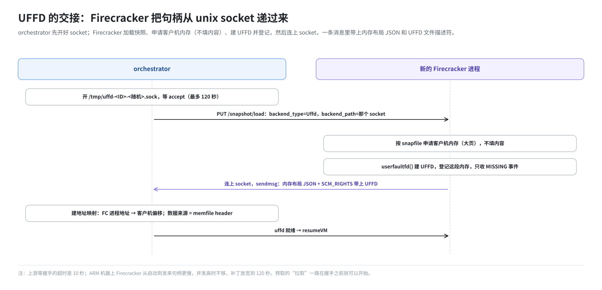
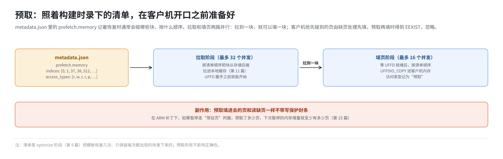

# 第 13 篇｜沙箱的内存：UFFD 按需供页与大页

> **本篇目标**：上一篇讲了沙箱的硬盘，本篇讲内存。Firecracker 恢复快照时，客户机内存一页都没准备；客户机每碰到一页，就由 orchestrator 现场填进去。本篇讲清楚这件事的每一步：UFFD 句柄怎么从 Firecracker 交到 orchestrator 手里，一次缺页怎么被处理，预取清单怎么让恢复更快；然后讲客户机内存背后的大页池：部署脚本怎么算出预留多少、为什么客户机内存不算在 Nomad 的内存上限里、停服后大页为什么不会自己回来。

---

## 一、问题：几百 MB 的内存，不能先读完再开机

模板的 memfile 可能有 2 GB。如果恢复沙箱时先把 2 GB 全部读进客户机内存再开始运行：

- 读 2 GB，即便在内存里拷贝也要几百毫秒；
- 一台机器上同时恢复几十个沙箱，就是几十个 2 GB；
- 而客户机刚恢复时，真正要用的可能只有几十 MB。

所以 E2B 用第 4 篇讲的 userfaultfd：**客户机碰到哪一页，才准备哪一页**。

---

## 二、UFFD 句柄的交接

### 2.1 握手

创建沙箱时，orchestrator 先在 `/tmp` 下开一个 unix socket：

```
/tmp/uffd-<沙箱ID>-<随机>.sock
```

然后让新启动的 Firecracker 加载快照，内存后端设为 Uffd，路径指向这个 socket（第 6 篇）：

```
PUT /snapshot/load
{ "snapshot_path": ".../snapfile",
  "mem_backend": { "backend_type": "Uffd", "backend_path": "/tmp/uffd-….sock" } }
```

Firecracker 收到后：

1. 按 snapfile 里记录的大小，在自己的地址空间里申请客户机内存（用大页时从大页池申请），但**不填内容**；
2. 创建一个 userfaultfd，把这段内存登记上去，只接收“缺页”（MISSING）事件；
3. 连上那个 unix socket，发一条消息。消息里有两样东西：
   - 一段 JSON：客户机内存分成哪几段，每段在 Firecracker 进程里的起始地址、大小、页大小；
   - 一个附带的**文件描述符**：就是刚建的 userfaultfd。

unix socket 可以在进程之间传递文件描述符（`SCM_RIGHTS`），这是把 UFFD 交给另一个进程的标准做法。

orchestrator 这边等着 `accept`，最多等 **120 秒**。上游是 10 秒，ARM 补丁放宽到了 120 秒，因为 ARM 机器上 Firecracker 从启动到发来句柄要慢一些，并发高的时候 10 秒不够。



### 2.2 两张表

握手之后，orchestrator 手里有了两样东西：

- **地址映射**：Firecracker 进程的虚拟地址 A，对应客户机内存的第几个字节；
- **数据来源**：这个 build 的 memfile。它和根盘的下层一样，是“一张 `memfile.header` 加若干 build 的数据”，经第 11 篇的本地缓存按需读取。

然后 orchestrator 告诉 Firecracker 可以继续了，Firecracker 让客户机从快照那一刻接着运行。

---

## 三、一次缺页

### 3.1 事件循环

orchestrator 为每个沙箱起一个循环，用 `poll` 等两个文件描述符：

- UFFD：有缺页事件就可读；
- 一个“退出”管道：沙箱要停时写它，让循环退出。

### 3.2 处理一个缺页

```
 客户机读了一个从没碰过的内存地址
      │
      ▼
 Firecracker 进程缺页 → 内核发现这段地址登记在 UFFD 上 → 那个 vCPU 线程挂起
      │  UFFD 里出现一条消息：{缺页地址 A，是不是写}
      ▼
 orchestrator 读出消息
      │  地址映射：A → 客户机内存第 X 字节，页大小 2 MiB
      │  起一个 goroutine 处理这一页（不阻塞循环继续读下一条）
      ▼
 goroutine：
      │  按 memfile.header 查 X 在哪个 build、哪个偏移          （第 7 篇）
      │  从那个 build 的本地缓存取 2 MiB                       （第 11 篇，必要时从存储后端拉）
      │  UFFDIO_COPY：把这 2 MiB 原子地放到地址 A
      ▼
 内核把页挂上，唤醒那个 vCPU 线程，客户机继续运行
```

代码里，读缺页和写缺页处理方法一样，只是记录的访问类型不同：

```go
if flags & UFFD_PAGEFAULT_FLAG_WRITE != 0 {
    go faultPage(..., block.Write)   // 写一个还没有的页：也得先把原内容放进去，写才能继续
} else if flags == 0 {
    go faultPage(..., block.Read)
} else {
    报错：不应该收到 MINOR 或 WP 事件，因为没有登记它们
}
```

### 3.3 两个细节

- **已经有了**：两个 vCPU 几乎同时碰同一页，会来两条缺页消息。第二次 `UFFDIO_COPY` 会返回 `EEXIST`，代码把它当作正常情况，直接忽略。
- **取数据失败**：比如存储后端读不到。这时整个沙箱已经没法正确运行，代码会触发“退出”，让沙箱停下来，而不是让客户机读到错误的内存。

### 3.4 记账

每处理一页，orchestrator 记两笔：

- 这一页“已经填过”：打快照时要用；
- 这一页的访问顺序和类型（读、写、预取）：用来录制预取清单（第 9 篇 optimize 阶段）。

---

## 四、写保护那一行被注释掉了

`faultPage` 里本来有这么三行，ARM 补丁把它们注释掉了：

```go
// 对 UFFD 做 copy 会清掉写保护位，除非显式要求保留。
// 读引起的缺页，我们要求保留；写引起的缺页反正会清掉写保护位。
//if accessType != block.Write {
//    copyMode |= UFFDIO_COPY_MODE_WP
//}
copyErr := u.fd.copy(addr, pagesize, b, copyMode)
```

按第 4 篇的说法：原本读缺页填进去的页会“贴上封条”，以后被写才撕掉，这样暂停时就能精确知道哪些页被写过。注释掉之后，所有填进去的页都不带封条。

这对**正确性没有影响**：客户机读写内存一切照常。影响的是**暂停时的增量快照**：读过的页也会被当成写过的页存下来。第 15 篇专门讲这件事的来龙去脉和实测结果。

---

## 五、预取：在客户机开口之前准备好

### 5.1 为什么要预取

纯按需供页有个代价：客户机每碰到一页新内存，vCPU 就要停下来等 orchestrator 填页。恢复后的前几百毫秒，客户机里的内核和 envd 会连续碰到几百页，每页都要等一次。

模板构建时的 optimize 阶段（第 9 篇）已经录下了“恢复后通常会碰哪些页、按什么顺序”，存在 `metadata.json` 的 `prefetch.memory` 里。恢复时照着这份清单提前准备，客户机碰到时页已经在了，不用等。

### 5.2 两个并行的阶段

预取器分两路同时干活：



- 拉取阶段在 UFFD 握手之前就可以开始，因为它只是填本地缓存；
- 填页阶段用的是和缺页处理同一个函数 `faultPage`，访问类型记为“预取”；
- 如果客户机抢先碰到了某一页，缺页处理先填了，预取再填时会得到 `EEXIST`，忽略即可。

并发数是特性开关的默认值（本环境不改，第 11 篇）。

### 5.3 预取的副作用

预取填进去的页，和读缺页一样不带写保护封条。所以在 ARM 补丁下，**预取了多少页，下次暂停时增量就至少有多少页**。第 15 篇会回到这一点。

---

## 六、NoopMemory：不从快照恢复时

不是所有虚拟机都从快照恢复。模板构建的第一次正式开机（第 9 篇 base 阶段），是一台新开机的虚拟机，内存从零开始，没有 memfile 可以按需读。

这时内存后端是 **NoopMemory**：客户机内存就是 Firecracker 自己申请的普通内存（或大页），缺页由内核自己处理（填零），orchestrator 不参与。

到打快照时，NoopMemory 的处理也不同：它问 Firecracker 要的是“哪些页在内存里、哪些页全是零”（`GET /memory`），只导出在内存里且不全零的页（第 9 篇、第 14 篇）。

---

## 七、大页：客户机内存的“地基”

### 7.1 为什么用大页

沙箱的客户机内存默认用 2 MiB 大页（第 6 篇的 `huge_pages: "2M"`）。好处有三：

- **缺页次数少**：同样 1 GB 内存，4 KiB 页要缺 26 万次，2 MiB 页只要 512 次。每次缺页都是一次 orchestrator 往返，次数少是实打实的提速；
- **页表小**：宿主为每台虚拟机维护的页表项少了 512 倍；
- **header 小**：memfile 的映射按 2 MiB 一块，条目也少。

代价是：每次缺页要拷 2 MiB，即使客户机只碰了其中 4 KiB。

### 7.2 部署脚本怎么预留

第 4 篇说过，大页要预先留出来。`init-client.sh` 在每次 `build.sh -s` 时做这件事：

```bash
mkdir -p /mnt/hugepages
mountpoint -q /mnt/hugepages || mount -t hugetlbfs none /mnt/hugepages
```

然后计算：

```
总内存 = /proc/meminfo 的 MemTotal

给宿主留的普通内存 = max(4 GiB, 总内存 × 16%)，但不超过 42 GiB
可做大页的内存     = 总内存 − 给宿主留的普通内存

大页总页数 = 可做大页的内存 ÷ 大页大小（从 /proc/meminfo 的 Hugepagesize 读）

静态池   = min(大页总页数 × 20%, HUGEPAGES_BASE_MAX_MIB 对应的页数)
          写进 /proc/sys/vm/nr_hugepages
超分配额 = 大页总页数 × 80%
          写进 /proc/sys/vm/nr_overcommit_hugepages
```

以一台 512 GiB 内存的机器为例：

| 项 | 计算 | 结果 |
|---|---|---|
| 给宿主留 | max(4, 512×16%=82) = 82，上限 42 | 42 GiB |
| 可做大页 | 512 − 42 | 470 GiB |
| 静态池 | min(470×20%=94, 64) | 64 GiB（32768 页） |
| 超分配额 | 470 × 80% | 376 GiB |

`HUGEPAGES_BASE_MAX_MIB` 在 `.env` 里是 `65536`，即 64 GiB。这是这套环境加的上限：上游是固定 20%，在大内存机器上开机就锁死近百 GiB 内存，哪怕一个沙箱都没跑。


### 7.3 静态池和超分配的区别

| | 静态池 | 超分配 |
|---|---|---|
| 什么时候分配 | 写入 `nr_hugepages` 的那一刻，立即划出来 | 有人要、静态池又不够时，临时向系统要 |
| 能不能拿到 | 一定能（已经划好了） | 不一定，要看那时有没有足够的连续物理内存 |
| 用完后 | 留在池里，不还给系统 | 还给系统 |

“在内存还没碎的时候先划出来”是静态池的意义。机器跑久了，想临时凑一个连续的 2 MiB 可能凑不到，超分配就会失败，沙箱创建就会失败。

### 7.4 大页不算在 Nomad 的内存上限里

template-manager 这个 Nomad 任务有 32 GiB 的内存上限（第 18 篇），而 Firecracker 进程就在这个任务的 cgroup 里。几百个沙箱、每个 2 GiB，为什么没把它撑爆？

因为 **hugetlb 内存不记在 memory 控制器的账上**。大页有自己独立的记账（hugetlb 控制器），而 Nomad 设的是 memory 控制器的 `memory.max`。所以：

- 客户机内存（大页）：不占这 32 GiB；
- orchestrator 自己的堆、读写缓存文件产生的页缓存（第 2、11 篇）：占这 32 GiB。

部署文件里的注释特意提醒：这个上限不是“沙箱数 × 内存”的预算。

### 7.5 停服后大页不会回来

大页池是写在 `/proc/sys/vm/` 下的内核参数，不随服务停止而变化。`build.sh -d` 停掉所有服务后，静态池那 64 GiB 依然被划着，`free` 命令里看着就是“少了 64 GiB”。`build.sh -d` 会提醒这件事。

要还回去，用：

```bash
build.sh --purge-hugepages
```

它做的事：

1. 检查还有没有 Firecracker 进程在跑。在跑的沙箱占着的大页回收不了，只告警，不中止；
2. 检查 `/mnt/hugepages` 下有没有文件，有文件会“钉住”大页；
3. 先把超分配额度写成 0，再把静态池写成 0。顺序反了，归零过程中可能又冒出临时页；
4. 卸载 `/mnt/hugepages`；
5. 打印 `/proc/meminfo` 里的大页数字，确认归零。

这些设置不是持久的：机器重启后大页池就是 0，下次 `build.sh -s` 再按公式重新预留。

---

## 八、看一眼

```bash
# 大页池现状
grep -E 'HugePages_|Hugepagesize|^Hugetlb' /proc/meminfo
#   HugePages_Total:   40000    静态 + 已临时要来的
#   HugePages_Free:    12000    空闲
#   HugePages_Surp:     7232    超出静态池、临时要来的
#   Hugepagesize:      2048 kB

# 预留参数
cat /proc/sys/vm/nr_hugepages /proc/sys/vm/nr_overcommit_hugepages

# 正在等待握手的 UFFD socket
ls /tmp/uffd-*.sock
```

---

## 本篇小结

| 概念 | 一句话解释 |
|---|---|
| UFFD 握手 | Firecracker 经 unix socket 把内存布局 JSON 和 UFFD 描述符交给 orchestrator |
| 120 秒 | ARM 补丁把等待握手的超时从 10 秒放宽到 120 秒 |
| 缺页处理 | 地址 → 客户机偏移 → 查 memfile.header → 本地缓存取页 → `UFFDIO_COPY` |
| `EEXIST` | 同一页被填两次，正常，忽略 |
| 写保护被注释 | 填进去的页都不带封条，影响增量快照精度，不影响正确性 |
| 预取 | 按 metadata.json 的清单，拉取和填页两路并行，提前准备 |
| NoopMemory | 新开机的虚拟机，内存由 Firecracker 自管，不走 UFFD |
| 大页 | 2 MiB 一页，缺页少 512 倍 |
| 预留公式 | 宿主留 max(4G,16%)≤42G；其余 20% 静态（上限 64 GiB）、80% 超分配 |
| hugetlb 不记 memory | 客户机内存不占 template-manager 的 32 GiB 上限 |
| `--purge-hugepages` | 停服后手工释放静态大页池 |

**下一篇预告**：[《暂停与恢复：一次增量快照是怎么做出来的》](14-pause-and-resume.md)。第三部分到此结束：一个沙箱运行时的硬盘和内存都讲完了。第四部分讲快照。下一篇从“暂停”开始：orchestrator 怎么让 Firecracker 停下来，怎么问出哪些页脏了，怎么用 `process_vm_readv` 把它们拷出来，磁盘的 COW 文件怎么变成新的 diff，新的 header 怎么合成，最后六个文件怎么写进 `/tmp/templates`。
