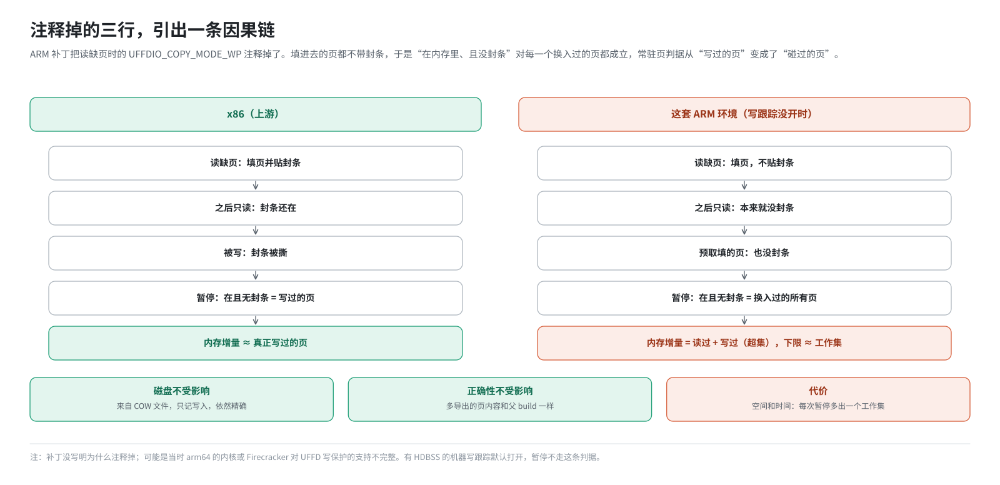
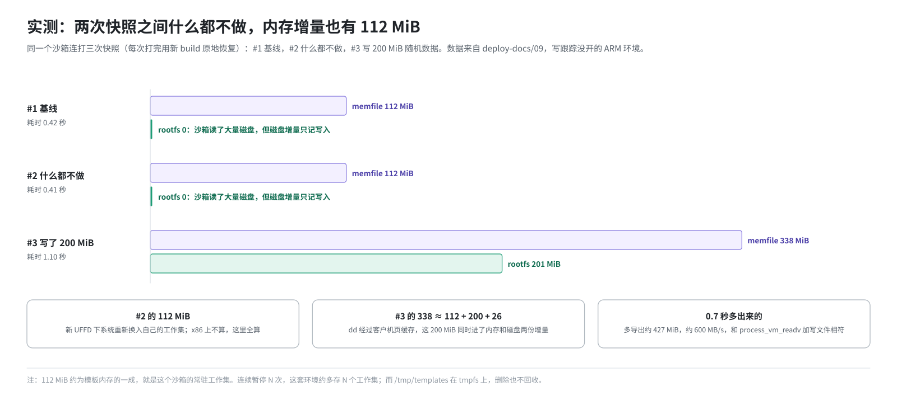

# 第 15 篇｜ARM 上的增量为什么“偏大”：脏页判据与实测

> **本篇目标**：上一篇说，暂停时要回答“哪些内存页要导出”，而这套 ARM 环境的回答往往比 x86 大。本篇把这件事讲透：x86 上的精确增量靠的是什么；ARM 补丁注释掉的那三行带来了怎样一条因果链；部署文档里的实测数字说明了什么；这对存储和速度有什么影响；以及补丁后来加的“写跟踪位图”这条路，在什么样的机器上能把增量重新变精确。

---

## 一、问题的提法

暂停时，内存要导出“和父 build 不一样的页”。最理想的答案是：**恢复之后被客户机写过的页**。

- 没被碰过的页：还是父 build 里的内容，不用导出；
- 只被读过的页：内容也没变，不用导出；
- 被写过的页：内容可能变了，必须导出。

难点在于：读和写，在“页被换入”这个层面上看不出区别。恢复后客户机第一次碰某一页，不管是读还是写，都要通过 UFFD 把页填进来（第 13 篇）。要区分读和写，需要额外的机制。

---

## 二、x86 上的做法：封条

### 2.1 五步链条

第 4 篇讲过 UFFD 的写保护“封条”。上游在 x86 上是这样用的：

1. UFFD 只登记“缺页”事件，不登记“写保护”事件；
2. **读**引起的缺页：`UFFDIO_COPY` 填页时带上 `UFFDIO_COPY_MODE_WP`，页填进去了，但贴着封条；
3. **写**引起的缺页：填页时不带这个选项，页直接可写，本来就是脏的；
4. 之前只读过的页，后来被写了：硬件发现封条，内核撕掉封条，让写继续（因为没登记写保护事件，不通知 orchestrator），这一页就变成了“没封条”；
5. 暂停时问定制版 Firecracker 的 `GET /memory/dirty`。它读 `/proc/<pid>/pagemap`，把“**在内存里、且没有封条**”的页报为脏页。

结果：只读过的页带着封条，不算脏；写过的页没封条，算脏。**精确。**

### 2.2 证据

定制版 Firecracker 的源码不在本书依据的仓库里，但 RPM 里带的 `firecracker.arm` 没去掉调试符号，能看到这些函数名：

```
vmm::Vmm::get_dirty_memory                          # GET /memory/dirty 的实现
vmm::utils::pagemap::PagemapReader                  # 读 /proc/<pid>/pagemap
vmm::utils::pagemap::PagemapEntry::is_present       # 存在位
vmm::utils::pagemap::PagemapEntry::is_write_protected   # uffd-wp 封条位
```

接口定义文件里对 `/memory/dirty` 的描述是：“返回脏页位图（自开启写保护以来被写过的页）”。

---

## 三、ARM 补丁注释掉的三行

```go
// Performing copy() on UFFD clears the WP bit unless we explicitly tell
// it not to. We do that for faults caused by a read access. Write accesses
// would anyways cause clear the write-protection bit.
//if accessType != block.Write {
//    copyMode |= UFFDIO_COPY_MODE_WP
//}
copyErr := u.fd.copy(addr, pagesize, b, copyMode)
```

补丁没有写明为什么注释掉。可能的原因是当时的 arm64 内核或 Firecracker 对 UFFD 写保护的支持不完整，带上这个选项会出错。不管原因，后果是一条清楚的链：



几个推论：

- **只读也会产生增量**。客户机什么都没改，只要恢复后跑起来，内核、systemd、envd 碰过的页都会被导出。
- **预取会直接变成增量**。预取用的是同一个填页函数（第 13 篇），预取了多少页，增量就至少多少页。
- **磁盘不受影响**。磁盘增量来自 COW 文件，只记写入，和 UFFD 无关（第 12 篇）。
- **正确性不受影响**。多导出的页，内容和父 build 里的一模一样，恢复时覆盖成相同的值。代价只是空间和时间。

---

## 四、实测：什么都不做，也有 112 MiB

部署文档 `deploy-docs/09-增量快照实现与ARM实测分析.md` 记录了一次实测。方法是对同一个沙箱连续打三次快照：

- **#1 基线**：沙箱刚创建；
- **#2 什么都不做**：两次快照之间一条命令都没跑；
- **#3 写 200 MiB**：在沙箱里 `dd if=/dev/urandom of=blob.bin bs=1M count=200`。

这里的“打快照”是 SDK 的 `create_snapshot`：打完快照后，沙箱会用刚生成的 build **原地恢复**一次（新的 Firecracker、新的 UFFD），继续运行。

结果：

| 快照 | 场景 | memfile diff | rootfs diff | 耗时 |
|---|---|---|---|---|
| #1 | 基线 | 112 MiB | 0 | 0.42 秒 |
| #2 | 什么都没做 | **112 MiB** | **0** | 0.41 秒 |
| #3 | 写了 200 MiB | 338 MiB | 201 MiB | 1.10 秒 |



逐条读：

**#2 的 112 MiB 是最直接的证据。** 两次快照之间什么都没做，精确增量应该接近 0。可这里有 112 MiB。为什么“什么都不做”还有换入？因为 #1 之后沙箱是从新 build **重新恢复**的：新的 UFFD，所有页回到“未填”状态，系统一跑起来就要把自己的工作集（内核、systemd、envd、后台进程）重新换进来。在 x86 上这些是带封条的干净页，不算；在 ARM 补丁下全算。

**112 MiB 就是这个沙箱的常驻工作集**，大约是模板内存的一成。也就是说：**在这套环境里，每次快照的内存增量有一个下限，约等于工作集，和你改没改东西无关。**

**#3 的 memfile 338 MiB ≈ 112 + 200 + 26。** `dd` 写文件要经过客户机的页缓存，页缓存本身就在客户机内存里，所以这 200 MiB 既出现在磁盘增量里，也出现在内存增量里。剩下约 26 MiB 是缓冲、元数据和新换入的页。

**rootfs：#1、#2 是 0，#3 是 201 MiB。** 沙箱启动肯定读了大量磁盘，但磁盘增量是 0，说明磁盘侧只记写入，是精确的。

**耗时**：#3 比 #2 多 0.7 秒，多导出了约 427 MiB，约 600 MB/s，和 `process_vm_readv` 加写本地文件的速度相符。#1、#2 的 0.4 秒里，大部分是暂停、快照、导出、重新恢复的固定开销。

---

## 五、影响

### 5.1 存储

每暂停一次，至少多出一个工作集大小的内存 diff。链越长越明显：

```
 连续暂停、恢复 N 次的内存 diff 总量：
   x86（精确）：      ≈ 工作集一次 + 每次的真实改动
   本环境（超集）：    ≈ N × 工作集 + 每次的真实改动
```

这些 diff 都进了 `/tmp/templates`。再结合两件已知的事：

- `/tmp` 是 tmpfs，占的是内存（第 10 篇）；
- 通过 API 删快照不删文件（第 14 篇）；

如果开了“超时自动暂停”这类用法（SDK 里 `lifecycle={"on_timeout": "pause"}`），每个沙箱每次超时都会往内存里多写一个工作集，而且不会自己回收。

### 5.2 速度

导出的页越多，暂停越慢，恢复时要读的数据也越多。不过因为 header 是拍平的，链再长，恢复时读一页也只查一次表（第 5 篇），恢复速度不会因为链长而线性变慢。

---

## 六、另一条路：写跟踪位图

### 6.1 补丁后来加了什么

本书依据的这一版 ARM 补丁里，还为暂停加了一个更好的脏页来源：**Firecracker 的写跟踪位图**。它是随检查点回滚功能（第 16 篇）一起加进来的。

写跟踪（track dirty pages）是 Firecracker 原生就有的功能，背后是 KVM 的脏页日志（第 4 篇第七节）：KVM 记录客户机写过的每一页。它只记**写**，不记读，也不记 orchestrator 通过 UFFD 填进去的页（那些是宿主写的，不是客户机写的）。所以用它做判据，天然就是精确的。

暂停时，orchestrator 按这个顺序选判据（第 14 篇第 3.3 节）：

```go
if 写跟踪没开 {
    用常驻页判据（GET /memory/dirty）       // 本节之前讲的“超集”
} else if 之前检查点攒下的位图不可信 {
    用常驻页判据
} else {
    让 Firecracker 把写跟踪位图写成一个文件（FCDB 格式），读进来
    再并上之前每次检查点清零前攒下的部分（第 16 篇）
    用这个                                 // 精确
}
```

orchestrator 的日志会写明这一次用的是哪一种：`source=resident`（常驻页）、`source=tracked`（写跟踪）或 `source=tracked+accumulated`（写跟踪加累积）。

### 6.2 写跟踪什么时候开

写跟踪不是免费的。纯软件的 KVM 脏页日志要把客户机内存设成只读，每一页第一次被写都要陷入一次虚拟化层。对从不暂停、从不打检查点的沙箱，这是纯开销。

所以补丁的默认策略是**看硬件**（`fc/dirtytracking.go`）：

| 情况 | 默认 |
|---|---|
| CPU 支持硬件脏状态跟踪（arm64 的 HDBSS，KVM 能力号 502） | **开**：开销接近于零 |
| 不支持 | **关**：避免白白的性能损失 |
| 设了环境变量 `FC_TRACK_DIRTY_PAGES=true` 或 `false` | 按设置来 |

环境变量的值按 Go 的布尔规则解析：`1/t/true/TRUE/True` 是开，`0/f/false/FALSE/False` 是关。写成 `yes`、`on`、空值这类**不认识的值**，会被记下来、在启动日志里告警，然后**忽略**，按硬件默认处理。代码注释解释了为什么不把不认识的值当“关”：那样一整批机器可能悄悄丢掉增量能力，只表现为变慢，没人知道为什么。

部署文件 `dep/template-manager.hcl` 里没有设这个变量，所以在这套环境里，**是否精确取决于这台机器的 CPU**：

- 没有 HDBSS 的机器：写跟踪默认关，暂停走常驻页判据，就是第三、四节的“超集”行为；
- 有 HDBSS 的机器：写跟踪默认开，暂停走写跟踪位图，内存增量精确。

一台机器属于哪一种，看 orchestrator 启动日志里的检查点能力报告（第 17 篇第七节），或者暂停日志里的 `source=` 字段。

---

## 七、可以怎么改善

按性价比从高到低：

1. **在有 HDBSS 的机器上运行**：什么都不用改，写跟踪自动打开。
2. **在没有 HDBSS 的机器上手动打开写跟踪**：设 `FC_TRACK_DIRTY_PAGES=true`（加在 `dep/template-manager.hcl` 的 `env` 里）。代价是每个沙箱第一次写每一页时有一次陷入，需要实测权衡。
3. **恢复 UFFD 写保护**：确认这台机器的内核和 Firecracker 支持 arm64 上的 `UFFDIO_REGISTER_MODE_WP` 和 `UFFDIO_COPY_MODE_WP`，再把那三行放开、重新出包。用上面 #2 的方法回归：#2 的 memfile 应该降到 MiB 级。
4. **收敛预取**：在超集模式下，预取的页直接进增量，预取带来的启动收益要和存储放大一起算账。
5. **减小模板内存和工作集**：工作集越小，每次的下限越小。
6. **定期重建模板**：链太长时，基于当前状态重新构建一个完整的模板，避免文件数和映射条数无限增长。

---

## 八、自己判断

```bash
# 这台机器的写跟踪开了没有（看启动日志里的能力报告）
#   "hardware dirty state tracking present (KVM capability 502)"  → 开
#   "no hardware dirty state tracking; ..."                        → 关

# 某次暂停用的判据
#   "memfile diff page set for the native pause" source=resident | tracked | tracked+accumulated

# 对比两次相邻快照的 memfile diff 大小（本地缓存里最直观）
ls -lth /orchestrator/build | head
```

判据：两次快照之间什么都不做，第二次的 memfile 是“约等于工作集”还是“接近 0”。

---

## 本篇小结

| 概念 | 一句话解释 |
|---|---|
| 精确增量 | 只导出写过的页，只读的页不导出 |
| x86 的封条 | 读缺页填页时贴写保护封条，写了才撕；`/memory/dirty` 报“在且无封条”的页 |
| 被注释的三行 | ARM 补丁填页时不再贴封条 |
| 超集 | 换入过的页都算脏，读也算；内存增量下限约等于工作集 |
| 实测 | 什么都不做也有 112 MiB；磁盘增量是 0，仍然精确 |
| 预取放大 | 超集模式下，预取多少页，增量就多多少页 |
| 存储影响 | N 次暂停约 N 个工作集，进 `/tmp/templates`（内存），且删除不回收 |
| 写跟踪位图 | KVM 脏页日志，只记客户机写，精确；补丁优先用它 |
| 默认看硬件 | 有 HDBSS 默认开，没有默认关；`FC_TRACK_DIRTY_PAGES` 可强制 |
| 日志判断 | `source=resident` 是超集，`tracked` 是精确 |

**下一篇预告**：[《快照回滚（一）：检查点树与内存》](16-rollback-checkpoint-tree.md)。暂停和恢复讲完了，它们都要换一个新的 Firecracker 进程。这套环境的 ARM 补丁还加了一项新能力：在沙箱运行中打多个检查点，随时**原地**退回到其中某一个，不换进程、不丢沙箱 ID。下一篇讲这项能力的内存部分：检查点树长什么样，一个检查点存了什么，脏页从哪来，回滚又是怎么做的。
