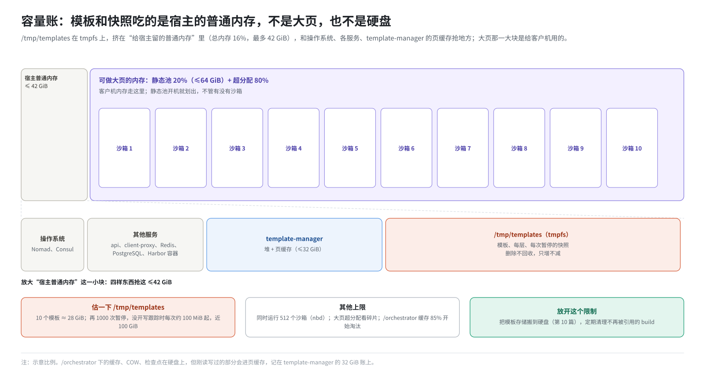
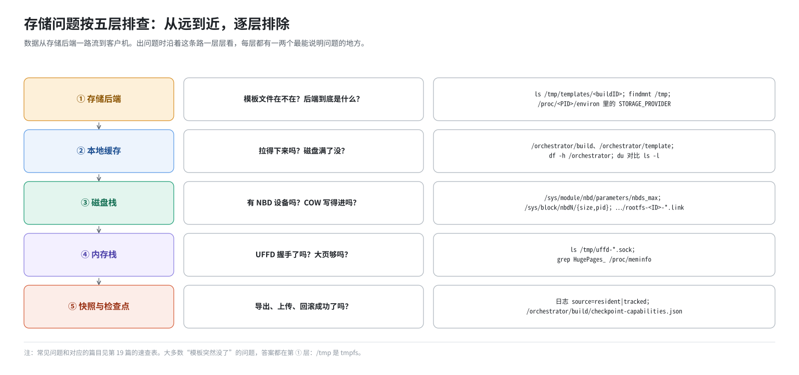

# 第 19 篇｜全景、容量规划与排障

> **本篇目标**：全书最后一篇。第一部分把一个沙箱从模板构建到删除的完整一生复盘一遍，每一步写出数据在哪、谁在读写，把前 18 篇串起来。第二部分算一笔这套环境的容量账，重点是“哪些存储其实在吃内存”。第三部分给出按层排查的思路、常用工具和常见问题速查表。最后是风险清单和术语表。

---

## 一、一个沙箱的一生

用一个具体的例子：建一个模板，从它创建沙箱，装个包，打两个检查点、回滚一次，暂停，恢复，最后删除。

### 1.1 构建模板（第 8、9 篇）

```
 SDK: Template.build(FROM harbor:443/e2b-orchestration/ubuntu:22.04-custom, RUN pip install numpy)
   │
   ▼ api 分配 buildID，交给 template-manager
 template-manager
   │ 经 dnsmasq 解析 harbor，HTTPS 到 nginx:443 → Harbor:2900，按 linux/arm64 拉清单和层
   │ 在镜像上追加 envd、busybox、provision.sh 等层
   │ /orchestrator/build-templates/<id>/rootfs.ext4：mkfs → loop 挂载解包 → e2fsck → 缩小
   │ busybox init 开机，provision 装 systemd → 扩容到 disk_size_mb
   │ systemd 开机，Direct 方式，等 envd → 暂停 → 第 1 层快照
   │ 从第 1 层恢复（NBD + UFFD）→ RUN pip install numpy → 暂停 → 第 2 层
   │ finalize：configure.sh、启动命令、就绪 → 暂停 → 最终层
   │ optimize：恢复几次，录预取清单，更新 metadata.json
   ▼
 /tmp/templates/<各层 buildID>/  六个文件 × 每层
 /tmp/build-cache/<范围>/index/<哈希>  每层一条
```

### 1.2 创建沙箱（第 6、11、12、13 篇）

```
 SDK: Sandbox.create(template)
   ▼
 orchestrator
   │ 模板表里有最终层吗？没有就从 /tmp/templates 下载 snapfile、metadata.json 到
   │   /orchestrator/template/<buildID>/cache/<随机>/，读两个 header
   │ 网络槽位（网络书）
   │ NBD 池取一台 /dev/nbdN；新建 /orchestrator/sandbox/rootfs-<ID>-<随机>.cow
   │ overlay = COW 文件 + 模板根盘（header 查表 → /orchestrator/build 缓存 → /tmp/templates）
   │ .link → /dev/nbdN
   │ unshare -m：/fc-vm 私有 tmpfs，rootfs.ext4 → .link；内核 → /fc-kernels/…
   │ 启动 Firecracker，加载 snapfile，内存走 UFFD
   │ 握手拿到 UFFD；预取器按 metadata.json 清单提前拉取、填页
   ▼
 客户机从快照那一刻接着运行
   内存：缺页 → orchestrator 查 memfile.header → 本地缓存 → UFFDIO_COPY（2 MiB 大页）
   磁盘：读 → NBD → overlay → COW 文件或模板；写 → COW 文件
```

### 1.3 装包（第 12 篇）

`pip install requests` 写入的块全部进 COW 文件，位图标记；读 Python 解释器从模板读。

### 1.4 打两个检查点、回滚一次（第 16、17 篇）

```
 SDK 调 49984 端口 CreateCheckpoint
   │ 暂停 → 封存写层 W1 → 新写层 W2
   │ Firecracker 写 snapfile + mem_diff + mem_bitmap（第一个是完整内存）
   │ 恢复运行 → 封存层移到 checkpoints/<ID>/layers/
   ▼
 /orchestrator/build/checkpoints/<沙箱ID>/<c1>/  …/<c2>/  …/layers/

 RestoreCheckpoint(c1)
   │ 组装 c1 的磁盘视图（模板 + L1）
   │ 暂停 → 算还原集 → 沿 c1 祖先链生成 revert_mem → Firecracker 原地写回内存、恢复 vCPU
   │ NBD 下面换视图 + 新写层 → 恢复运行 → 等 envd
   ▼
 进程、网络、NBD 都没变，内存和磁盘回到 c1
```

### 1.5 暂停（第 14、15 篇）

```
 SDK: sbx.pause()   （api 分配新 buildID）
   │ 暂停 → snapfile（不导出内存）
   │ 脏页位图：写跟踪开着 → 写跟踪位图 ∪ DirtySinceBoot；否则 → 常驻页（ARM 下是超集）
   │ process_vm_readv → /orchestrator/build/<新ID>-memfile-<随机>；合成 memfile.header
   │ 弹出 COW（及各封存层压平）→ 停沙箱、还 NBD → /orchestrator/build/<新ID>-rootfs.ext4-<随机>
   │ 放进模板缓存表；后台拷贝到 /tmp/templates/<新ID>/
   ▼
 检查点全部作废（随进程）
```

### 1.6 恢复（第 14 篇）

用新 buildID 创建沙箱，走 1.2 的路。沙箱 ID 不变，其余全新。

### 1.7 删除

`Sandbox.kill()`：结束沙箱，归还 NBD，删 COW 文件。如果沙箱是暂停状态，删除它的快照只删数据库记录，**`/tmp/templates` 里的文件留着**（第 14 篇第七节）。本地缓存 25 小时后过期。

---

## 二、容量账

### 2.1 这套环境的特点：很多“存储”其实在吃内存

| 存储 | 介质 | 占什么 | 什么时候释放 |
|---|---|---|---|
| `/tmp/templates` | **tmpfs** | 内存 | 宿主重启；tmpfiles 清 10 天未访问的文件；人工清理 |
| `/tmp/build-cache` | **tmpfs** | 内存（很小，只有索引和 COPY 文件） | 同上 |
| 大页静态池 | hugetlb | 内存，开机划出，不管用没用 | `--purge-hugepages` 或重启 |
| 大页超分配部分 | hugetlb | 内存，沙箱用多少占多少 | 沙箱结束 |
| `/orchestrator/build` | 硬盘 | 硬盘；刚读写过的部分还在页缓存里（内存） | TTL 25 小时；占用超 85% 淘汰；orchestrator 重启 |
| `/orchestrator/build/checkpoints` | 硬盘 | 硬盘 + 页缓存 | 删除检查点、压实；沙箱结束；重启 |
| `/orchestrator/sandbox` | 硬盘 | 硬盘，每个运行中沙箱写过的块 | 沙箱结束（被强杀的除外） |
| `/orchestrator/template` | 硬盘 | 很小 | 缓存项过期 |
| `/mnt/snapshot-cache` | tmpfs | 不占（没人写） | — |
| Harbor（`/data`） | 硬盘 | 镜像层 | 在 Harbor 里删镜像 |
| MinIO（`/root/data/minio`） | 硬盘 | 几乎为零 | — |

### 2.2 内存怎么分

把一台机器的内存按用途分开看：



注意最关键的一点：**`/tmp/templates` 不在大页里，它占的是“给宿主留的普通内存”**。而这一块只有总内存的 16%，最多 42 GiB。模板和快照多了，会和宿主上的其他服务、template-manager 的页缓存抢这块内存。

### 2.3 估算 `/tmp/templates` 会长多大

```
 每个模板：
   第 1 层：完整根盘（实际占用的块）+ 去全零的内存
   之后每层：这一步写的块 + 这一步的内存 diff
 每次暂停：
   写跟踪开着：写过的页 + 写过的块
   写跟踪没开（ARM 超集）：至少一个工作集（实测约 100 MiB 级）+ 写过的块
 删除：不回收
```

举例：10 个模板，每个首层根盘实占 2 GiB、内存 300 MiB，后续层合计 500 MiB，约 28 GiB。再加上 1000 次暂停，没开写跟踪时每次至少约 100 MiB，就是近 100 GiB，远超 42 GiB 的上限。

结论：**在这套环境里，暂停次数和模板数量受限于宿主普通内存，而不是硬盘。**要放开这个限制，就把模板存储搬到硬盘上（第 10 篇第六节），并定期清理不再需要的 build。

### 2.4 其他上限

| 资源 | 上限 | 由什么决定 |
|---|---|---|
| 同时运行的沙箱 | 512 | `nbds_max`；正在暂停的也占 |
| 客户机内存总量 | 静态池 + 超分配 | 第 13 篇公式；超分配能否兑现取决于内存碎片 |
| `/orchestrator` 硬盘 | 本地缓存 85% 时开始淘汰 | 检查点、COW 文件不受这个淘汰管 |
| 检查点 | 剩余空间 ≥ max(4 GiB, 2×客户机内存) | 其他配额默认不限 |
| template-manager 页缓存 | 32 GiB | 构建大镜像、频繁暂停时注意 |

---

## 三、排障

### 3.1 按层定位

存储问题按数据流从远到近分五层，逐层排除：



### 3.2 常用工具

| 想知道 | 看什么 |
|---|---|
| 存储后端到底是什么 | `tr '\0' '\n' < /proc/$(pgrep -f '^/usr/bin/template-manager' \| head -1)/environ \| grep STORAGE` |
| `/tmp` 是不是 tmpfs | `findmnt /tmp` |
| 模板和快照占了多少 | `du -sh /tmp/templates`；`ls /tmp/templates \| wc -l` |
| 稀疏文件实际占用 | `du -h` 和 `ls -l` 对比 |
| nbd 模块和设备 | `cat /sys/module/nbd/parameters/nbds_max`；`ls /dev/nbd* \| wc -l` |
| 在用的 NBD 设备 | `/sys/block/nbdN/size` 不为 0、`/sys/block/nbdN/pid` 存在 |
| 某沙箱用的哪台 NBD | `ls -l /orchestrator/sandbox/rootfs-<ID>-*.link` |
| 大页 | `grep -E 'HugePages_\|Hugepagesize\|^Hugetlb' /proc/meminfo` |
| 写跟踪、检查点配置 | `cat /orchestrator/build/checkpoint-capabilities.json` |
| 某次暂停用的判据 | orchestrator 日志 `memfile diff page set for the native pause` 的 `source=` |
| Harbor 里的基础镜像 | `curl -u admin:Harbor12345 http://127.0.0.1:2900/v2/e2b-orchestration/ubuntu/tags/list` |
| `/orchestrator` 磁盘 | `df -h /orchestrator` |

### 3.3 常见问题速查

| 现象 | 原因 | 看哪里、怎么办 | 篇 |
|---|---|---|---|
| 宿主重启后所有模板都没了 | `/tmp` 是 tmpfs | 重建模板；长期办法是把模板存储搬到硬盘 | 10 |
| 一个十几天没用的模板突然恢复失败 | `systemd-tmpfiles` 清掉了 10 天未访问的文件 | 同上 | 10 |
| 恢复报“对象不存在” | build 目录被清掉或手工删了，或换了存储后端没搬数据 | `ls /tmp/templates/<buildID>` | 7、10、14 |
| orchestrator 起不来，`NBD module not loaded` | nbd 模块没加载 | 按部署前提固化模块 | 3、18 |
| 并发到几百个后建不出沙箱 | NBD 用尽（512），或大页超分配凑不出 | 数在用的 nbd；看 `HugePages_Free` | 12、13 |
| template-manager 退出码 137，api 一直 503 | 页缓存撑满 32 GiB 的 cgroup | 看 OOM 日志；按实测调 `memory` | 18 |
| Nomad 报 `Dimension "memory" exhausted`，api 503 | `memory` 设得比节点可分配内存还大 | 调小 | 18 |
| 部署时卡好几分钟没动静 | `udevadm trigger` 没限定 nbd，全机设备事件风暴 | 用脚本里限定 `nbd*` 的写法 | 3 |
| `/orchestrator/build` 很大 | 稀疏缓存文件，正常 | `du` 看实际；25 小时或重启回收 | 11 |
| 删了模板，`/tmp/templates` 没变小 | api 删除只删数据库记录 | 设计如此；需要时人工清理不再引用的 build | 14 |
| ARM 上快照比预期大很多 | 没开写跟踪，常驻页判据是超集 | 看日志 `source=`；考虑写跟踪 | 15 |
| 停服后内存没回来 | 大页静态池还占着 | `build.sh --purge-hugepages` | 13 |
| 改了 MinIO 配置没效果 | `dep/template-manager.hcl` 写死 `Local`，或改的不是源头 | 看进程环境变量 | 10、18 |
| 建模板报 `lookup harbor ... server misbehaving` | `/etc/hosts` 没有 harbor 或 dnsmasq 没重启 | `getent hosts harbor` | 8 |
| 建模板报平台不匹配 | Harbor 里那个镜像不是 arm64 | 推 arm64 镜像 | 8 |
| 带 COPY 的模板上传失败 | Local 后端不支持签名上传链接 | 只用 FROM、RUN，或换 MinIO | 9、10 |
| 某个沙箱写盘报 I/O 错误，其他沙箱正常 | `/orchestrator` 所在磁盘满了，补丁把 SIGBUS 变成了单个请求失败 | `df -h /orchestrator` | 12 |
| 打检查点报 429 `checkpoint_bytes_limit` | 超了字节配额 | 删更老的检查点让它压实 | 17 |
| 打检查点报 rootfs 中毒 | 磁盘账本无法证明一致 | 回滚到一个已有检查点修复 | 17 |
| 回滚失败且沙箱无法继续 | 提交点之后失败，客户机被撕裂 | 只能重建沙箱 | 16 |
| 暂停恢复后检查点都不见了 | 检查点随 Firecracker 进程，新进程接管时丢弃 | 设计如此 | 16 |
| `/orchestrator/sandbox` 里有很多老 COW 文件 | 停服时强杀的沙箱留下的孤儿 | 确认无沙箱运行时人工清理 | 18 |
| `/mnt/snapshot-cache` 是空的 | 本版代码不用它 | 不用管 | 11 |

---

## 四、风险与改进方向

| 风险 | 影响 | 改进方向 |
|---|---|---|
| 模板存在 tmpfs 上 | 重启全丢；占宿主普通内存；10 天未访问会被清 | `LOCAL_TEMPLATE_STORAGE_BASE_PATH` 指到硬盘，或切到 MinIO |
| 删除不回收文件 | `/tmp/templates` 只增不减 | 定期按数据库里仍存在的 build 及其 header 引用关系清理 |
| MinIO 装了不用 | 占一个服务和端口，配置让人误解 | 要么启用，要么在文档里写明 |
| ARM 上内存增量偏大 | 暂停又慢又占空间 | 有 HDBSS 的机器自动解决；否则评估 `FC_TRACK_DIRTY_PAGES=true` 或恢复 UFFD 写保护 |
| 检查点不跨进程 | 暂停或重启后丢失 | 需要持久的回滚点时用暂停快照 |
| 孤儿 COW 文件 | 硬盘慢慢被占 | 停服前先停掉沙箱，或定期清理 |
| 升级内核后 nbd 模块悄悄换回原版 | 优化失效且难以察觉 | 升级流程里加一步校验模块哈希 |
| Local 后端不支持签名上传 | 带 COPY 的模板构建失败 | 切到 MinIO |

---

## 五、全书回顾

| 部分 | 讲了什么 | 一句话 |
|---|---|---|
| 一、打地基（1～6） | 块、页、文件系统、NBD、虚拟内存、UFFD、写时复制、Firecracker 的存储 | 磁盘靠 NBD 按需取，内存靠 UFFD 按需取，改动靠写时复制只存一份 |
| 二、模板（7～10） | 六个文件、header、Harbor、构建流水线、存储后端 | 一个模板是一串 build，header 把它们拍平成一张表 |
| 三、沙箱存储栈（11～13） | 本地缓存、NBD + COW、UFFD + 大页 | 远端 → 本地缓存 → overlay/UFFD → 客户机 |
| 四、快照（14～17） | 暂停恢复、ARM 增量、检查点树、封存层与压实 | 暂停产生 build，检查点只活在进程里 |
| 五、部署与运维（18～19） | 部署流程、配置总表、容量、排障 | 很多存储其实在吃内存 |

---

## 六、术语表

| 中文 | 英文 / 代码名 | 解释 | 篇 |
|---|---|---|---|
| 块 | block | 磁盘读写单位，本书 4 KiB | 2 |
| 页 / 大页 | page / huge page | 内存管理单位，4 KiB / 2 MiB | 2、4 |
| 稀疏文件 | sparse file | 没写过的部分不占空间 | 2 |
| 页缓存 | page cache | 读写过的文件留在内存里 | 2 |
| 块设备 | block device | 内核提供的“按编号读写的块” | 3 |
| 网络块设备 | NBD | 块读写变成发给用户态程序的请求 | 3、12 |
| 缺页 | page fault | 访问未准备好的页时 CPU 停下 | 4 |
| 用户态缺页处理 | userfaultfd / UFFD | 把缺页交给另一个程序处理 | 4、13 |
| 写保护封条 | UFFD write protect | 填页时贴上，写了就撕掉 | 4、15 |
| 写时复制 | copy-on-write / COW | 读时共享，写时复制 | 5、12 |
| 构建 | build / buildID | 模板或快照的一次产物 | 7 |
| 映射表 | header | 每段数据在哪个 build 的哪个偏移 | 7 |
| 代数 | generation | header 的第几代 | 7 |
| 镜像仓库 | registry / Harbor | 按名字:标签存取镜像 | 8 |
| 镜像清单 / 层 | manifest / layer | 镜像的组成部分，按 sha256 命名 | 8 |
| 层缓存 | build cache / HashIndex | 按哈希复用模板构建的层 | 9 |
| 存储后端 | StorageProvider | Local、MinIO、GCP、AWS | 10 |
| 分块拉取器 | chunker | 按 4 MiB 把数据拉到本地缓存 | 11 |
| 覆盖层 | overlay | 写上层、读先上后下 | 12 |
| 设备池 | DevicePool | 管理 512 台 NBD 设备 | 12 |
| 预取 | prefetch | 按清单提前准备内存页 | 13 |
| 写跟踪 | track dirty pages | Firecracker / KVM 记录客户机写过的页 | 15、16 |
| 硬件脏状态跟踪 | HDBSS | ARM 硬件辅助的脏页记录 | 4、15 |
| 检查点 | checkpoint | 本机、随进程存活的快照 | 16 |
| 时期 | epoch | 两个检查点之间的一段时间 | 16 |
| 还原集 | revert set | 回滚时需要写回的页 | 16 |
| 封存 | seal | 把当前写层冻结成只读层 | 17 |
| 磁盘视图 | view | 模板加若干封存层 | 17 |
| 压实 | compaction / fold | 把隐藏检查点并进唯一的孩子 | 17 |
| 中毒 | poisoned | 磁盘账本无法证明一致时拒绝新检查点 | 17 |

---

## 本篇小结

| 概念 | 一句话解释 |
|---|---|
| 一生复盘 | 构建 → 创建 → 写入 → 检查点 → 回滚 → 暂停 → 恢复 → 删除 |
| 吃内存的存储 | `/tmp/templates`、大页池，以及缓存文件的页缓存 |
| 关键瓶颈 | 模板和快照受限于宿主普通内存（最多 42 GiB），而不是硬盘 |
| 其他上限 | 512 个 NBD、大页、32 GiB cgroup、检查点剩余空间 |
| 排障五层 | 存储后端 → 本地缓存 → 磁盘栈 → 内存栈 → 快照与检查点 |
| 最大风险 | 模板在 tmpfs 上，且删除不回收 |

全书完。
