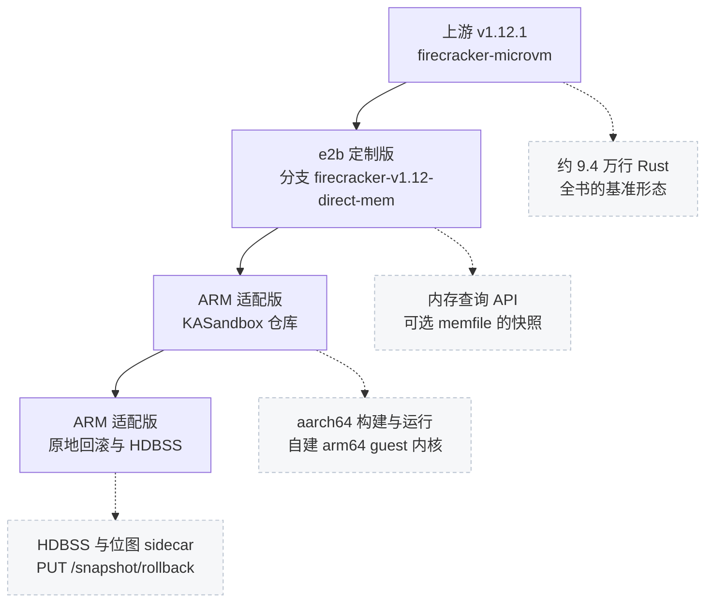
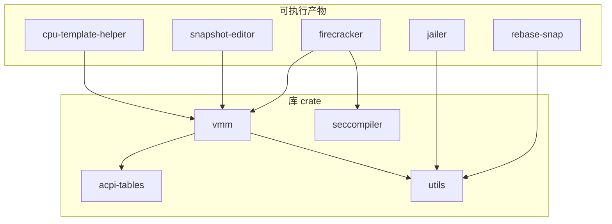

# 01 · 四层版本谱系与仓库地图

> 本书讲的不是一份代码，而是四份：上游 Firecracker，以及叠在它上面的三层改动。
> 读任何一篇之前，先要知道自己站在哪一层，以及那一层相对下一层动了什么。
> 本篇给出四层的提交谱系与改动规模，再给出一张仓库地图：每个 crate 多大、做什么、谁依赖谁。
>
> **读者**：所有读者，尤其是第一次打开这份代码的人。
> **预备**：无。
> **代码**：`Cargo.toml`、`src/*/Cargo.toml`、`scripts/build.sh`、`resources/`、`tools/`、`docs/`

---

## 0. 本篇要回答的问题

1. 四层版本各自是什么、由哪个提交确定、彼此之间隔着多少个提交？
2. 每一层相对下一层改了多少文件、多少行，改在哪些模块？
3. Firecracker 仓库里有哪些 crate，各自多大、做什么、依赖关系是什么样的？
4. `vmm` 这个占了九成代码量的 crate，内部怎么划分，哪些子模块值得先读？
5. 源码之外的 `resources/`、`tests/`、`tools/`、`docs/` 分别放什么？
6. e2b infra 作为调用方，是怎么拿到并使用 Firecracker 二进制的？

---

## 1. 四层是一条线，不是一棵树

四层版本的关系是线性的：每一层都以前一层的完整代码为起点，在其上追加提交，没有互相合并的分叉。
这一点决定了本书的组织方式 —— 第一到第八部分讲上游 v1.12.1，后面三部分各讲一层的增量，
读者可以只读上游部分而不受后三层影响，但反过来不行。

最底下是上游 v1.12.1，即 firecracker-microvm/firecracker 仓库 tag `v1.12.1` 所指的提交 `d990331f7`
（tag 本身是个带注释的 tag 对象，哈希是 `e538c8d1f`，不要把两者搞混）。
它是 2025 年发布线上的一个补丁版本，本书对「Firecracker 的行为」的一切陈述，未特别说明处都以它为准。

往上第一层是 e2b 定制版：e2b-dev/firecracker 仓库分支 `firecracker-v1.12-direct-mem` 的提交 `54a1c1a`。
从 `v1.12.1` 到它一共 26 个提交（含两个合并提交）。这 26 个提交做了三类事：
加了一组供宿主进程直接查询 guest 内存的只读 API；把快照接口里的内存文件路径改成可选；
补了一套构建与发布脚本。另有四个提交是从上游 `firecracker-v1.12` 维护分支合入的修复，
内容与 CPU 特性检查和 MSR 例外表有关，不属于 e2b 自己的功能（第 55 篇展开）。

再往上是 ARM 适配版：把 e2b 定制版的整棵源码树搬进 KASandbox 仓库的 `firecracker/` 目录，
并让它在 aarch64 的鲲鹏 / openEuler 宿主上构建与运行。这一层对 Firecracker 源码的改动极小，
只有两个文件；真正的内容在别处 —— aarch64 的代码路径本来就在上游代码里，
只是在 x86_64 上开发的人从来不走；另外还有一套自建的 arm64 guest 内核。

最上面是 ARM 适配版：KASandbox_0904 仓库的提交 `56c8ce3`，两个提交，
分别使能鲲鹏的硬件脏页跟踪 HDBSS（hardware dirty bit state structure），
以及加入原地回滚与脏页位图 sidecar。它是本项目自己写的代码中体量最大的一块。

e2b-dev/firecracker 里还有 `firecracker-v1.10-direct-mem`、`firecracker-v1.14-direct-mem` 等几条平行分支，
它们把同一组内存 API 移植到别的上游小版本上。本项目取的是 v1.12 那条，本书不讲其余几条。

线性谱系有一个实际好处：任意两层之间的差异都能用一条 `git diff` 命令完整取出，不需要理解合并历史。
本书每一篇上游篇目末尾的「后续各层的差异」小节，就是这样得出的 —— 把该篇涉及的文件名喂给三条 diff 命令，
有输出就写，没输出就不写。读者自己排查问题时可以用同样的方法确认「我手上这个二进制里这段代码是不是原样的上游」。

需要提醒的是，后两层住在更大的仓库里：KASandbox 与 KASandbox_0904 是完整的沙箱平台仓库，
Firecracker 只是其中的 `firecracker/` 子目录，同一批提交里往往还夹着 orchestrator、部署脚本、测试用例的改动。
所以统计这两层的规模时必须限定路径，否则数出来的是整个平台的活动量，不是 Firecracker 的改动量。

## 2. 每层改了多少

下面三张数字来自各层的 `git diff --stat`，统计口径是「相对上一层的净增删行数」。

| 层 | 提交数 | 触及文件 | 新增行 | 删除行 |
|---|---|---|---|---|
| e2b 定制版（相对上游 v1.12.1） | 26 | 31 | 985 | 39 |
| ARM 适配版（相对 e2b 定制版，仅 `firecracker/`） | 1 | 2 | 18 | 14 |
| ARM 适配版（相对 ARM 适配版，仅 `firecracker/`） | 2 | 27 | 1661 | 22 |

### 2.1 e2b 定制版：改动集中在三个位置

把 e2b 定制版的 31 个文件按目录拆开，形状就清楚了：`src/` 下 17 个文件、+665 / −16 行；
`tests/` 下 6 个文件、+259 / −19 行；其余 8 个文件（seccomp 过滤器、构建脚本、`Makefile`、工具脚本）
+61 / −4 行。也就是说功能代码不到七百行，其中一半集中在三个文件上：

- `src/vmm/src/vstate/vm.rs`（+193）：内存查询的实现主体，加在 `Vm` 上。
- `src/vmm/src/utils/pagemap.rs`（+115，新文件）：读宿主 `/proc/<pid>/pagemap` 判断页的常驻与脏状态。
- `src/firecracker/src/api_server/parsed_request.rs`（+70）与 `request/memory.rs`（+52，新文件）：
  新端点的路由与请求解析。

其余是把这条链路接起来所需的胶水：`rpc_interface.rs`（+72）加新的 `VmmAction` 变体与分发，
`lib.rs`（+40）加 `Vmm` 上的查询方法，`vmm_config/instance_info.rs`（+30）扩展实例信息，
`persist.rs`（+7）与 `vmm_config/snapshot.rs`（+4）把快照请求里的内存文件路径改成可选，
`swagger/firecracker.yaml`（+83）把新端点写进 API 契约。
seccomp 过滤器（x86_64 +14 / −3，aarch64 +4）要为新增的系统调用开口子，否则新 API 一调就被杀。

这个分布本身就说明了这一层的性质：它没有改动 Firecracker 的任何既有行为路径，
只是在控制面上新开了几个只读端点，再把快照接口的一个必填字段放松成可选。

### 2.2 ARM 适配版：两个文件，一个取舍

对 Firecracker 源码的改动只有两处，都在提交 `b8e85c3` 里：

- `scripts/build.sh`：产物路径里写死的 `x86_64-unknown-linux-musl` 改成按 `uname -m` 拼出来。
- `src/firecracker/src/main.rs`：把 `main_exec()` 里调用 `resize_fdtable()` 的那一段整体注释掉。

第二处不是移植性问题，是一个有代价的取舍。`resize_fdtable()` 在进程启动时预先把文件描述符表扩到上限，
目的是让后续快照恢复时大量建 fd 的过程不必反复扩表。注释掉它意味着放弃这部分恢复性能，
换取绕开该环境上出现的一类进程异常。上游代码里对这个函数的错误分级注释仍然保留在注释块内，
从代码上看不出被禁用的原因；第 58 篇根据构建与运行环境说明后果。

这一层的实质内容不在 diff 里。aarch64 的 vCPU 初始化、FDT 生成、GIC 保存恢复都是上游早就写好的代码路径，
只是在 x86_64 宿主上从不执行；把它们跑通、跑对，是第十部分的主题。
guest 内核那一半（`fc-kernels` 的 arm64 配置与补丁）则完全在 Firecracker 仓库之外。

### 2.3 ARM 适配版：新增一个模块，改动分散到设备层

两个提交、27 个文件、+1661 行。最大的一块是新文件 `src/vmm/src/rollback.rs`（656 行），
原地回滚的全部逻辑在这里。其次是 `src/vmm/src/vstate/memory.rs`（+280）与 `vstate/vm.rs`（+141），
前者加内存写回与位图 sidecar 的读写，后者加脏页跟踪后端的切换与 HDBSS 使能。
`aarch64/vm.rs`（+41）是 HDBSS 在 GIC 初始化之外的挂接点。

剩下的改动很分散：`devices/virtio/` 下六个 `persist.rs` 与 `net/device.rs` 各加十几行，
因为回滚要把设备状态原地写回一台**正在运行的** microVM，而上游的 `Persist` 实现只服务于
「构造一台全新的设备」这一种场景。`vcpu.rs`（+31）加了 `RestoreState` 事件，
`rpc_interface.rs`（+77）与 `request/snapshot.rs`（+17）加两个新端点。
aarch64 的 seccomp 过滤器 +66 −几行，是为回滚路径上新用到的系统调用开口。

这层改动的形状与 e2b 定制版正相反：e2b 那层是「加一条旁路」，这层是「在既有路径上加一个反方向」。
后者要碰的地方多得多，第十一部分逐个讲。

## 3. 仓库地图：十二个 crate

Firecracker 是一个 cargo workspace，`Cargo.toml` 的 `members` 就是 `src/*`，
每个子目录一个 crate。下表是各 crate 的规模与职责，行数口径是该 crate `src/` 下所有 `.rs` 文件的总行数
（含文件内的 `#[cfg(test)]` 单元测试，不含 `benches/` 与 crate 级的 `tests/`）。

| crate | 行数 | 产物 | 职责 |
|---|---|---|---|
| `vmm` | 77 285 | 库 | VMM 全部逻辑：vCPU、内存、设备、快照、控制面 |
| `firecracker` | 4 920 | 二进制 | 主程序：参数解析、API server、事件循环驱动 |
| `jailer` | 3 133 | 二进制 | 生产环境的隔离启动器：chroot、cgroup、namespace |
| `acpi-tables` | 2 704 | 库 | x86_64 的 ACPI 表构造 |
| `cpu-template-helper` | 2 674 | 二进制 | CPU 模板的导出、裁剪与校验 |
| `utils` | 1 411 | 库 | 参数解析、时间、校验函数 |
| `snapshot-editor` | 650 | 二进制 | 离线编辑快照的内存文件与 vmstate |
| `seccompiler` | 599 | 库 + 二进制 | 把 JSON 描述的 seccomp 过滤器编译成 BPF |
| `clippy-tracing` | 445 | 二进制 | 批量增删 `tracing::instrument` 属性的源码工具 |
| `rebase-snap` | 329 | 二进制 | 把差分内存文件合并回基准内存文件 |
| `log-instrument` | 56 | 库 | 函数进出打 trace 日志的属性宏 |
| `log-instrument-macros` | 38 | 库 | 上一项的过程宏实现 |

合计约 9.4 万行。`vmm` 一个 crate 占 82%，这是本书篇幅分配的直接依据。

依赖关系很浅。`vmm` 只依赖 `acpi-tables`、`utils` 和可选的 `log-instrument`；
`firecracker` 依赖 `vmm`、`utils` 和 `seccompiler`（把内嵌的 JSON 过滤器编译进二进制）；
三个离线工具各自依赖 `vmm` 或 `utils`；`jailer` 刻意不依赖 `vmm`，因为它要静态链接成独立二进制，
在 Firecracker 进程之前运行。

注意 `Cargo.toml` 里 `default-members` 不含 `jailer`：默认的 `cargo build` 编 gnu target，
而 jailer 必须静态编译才能在 chroot 之后正常工作，所以它被排除在默认构建之外，由构建脚本单独处理。

## 4. `vmm` 内部：按职责划分的十七个位置

`src/vmm/src/` 下的划分和本书第二到第七部分的划分是对应的。

| 模块 | 行数 | 本书位置 |
|---|---|---|
| `devices/` | 29 137 | 第五部分（其中 `virtio/` 27 238） |
| `arch/` | 10 614 | 第三部分（`x86_64/` 5 441、`aarch64/` 5 057） |
| `dumbo/` | 6 724 | 第 31 篇 |
| `cpu_config/` | 6 318 | 第四部分 |
| 顶层 `.rs` 文件 | 6 411 | 第二、六部分 |
| `mmds/` | 2 720 | 第 32 篇 |
| `vstate/` | 2 499 | 第三部分 |
| `vmm_config/` | 2 495 | 第 10 篇 |
| `device_manager/` | 2 274 | 第 23 篇 |
| `io_uring/` | 2 067 | 第 28 篇 |
| `logger/` | 1 516 | 第 44 篇 |
| `rate_limiter/` | 1 407 | 第 35 篇 |
| `gdb/` | 1 346 | 第 45 篇 |
| `snapshot/` | 576 | 第 36 篇 |
| `utils/` | 568 | 散见 |
| `acpi/` | 344 | 第 17 篇 |
| `test_utils/` | 269 | 第 47 篇 |

几个值得先说明的地方。

`devices/virtio/` 里最大的三块是 `vsock/`（6 159）、`block/`（5 813）、`net/`（5 005），
剩下的 `balloon/`（2 150）、`rng/`（946）与 bindgen 生成的 `generated/`（307）都不大；
还有约 6 858 行是设备无关的公共部分 —— `queue.rs`、`iovec.rs`、`iov_deque.rs`、`device.rs`、`mmio.rs`、`persist.rs`，
也就是 virtio 的传输层与队列实现。这部分是第 25、26 篇的内容，读任何一个具体设备之前都要先读它。

`vstate/` 只有两千多行却是全书核心之一：`kvm.rs`、`vm.rs`、`vcpu.rs`、`memory.rs` 四个文件，
分别对应 `/dev/kvm`、VM fd、vCPU fd 与 guest 内存四件东西。后两层的改动几乎都落在这里。

顶层的六千多行里，`builder.rs`、`rpc_interface.rs`、`persist.rs`、`resources.rs`、`lib.rs` 五个文件
构成控制面主干：从 HTTP 请求到 `VmmAction`，再到构建、快照与运行时更新。

`src/firecracker/src/` 的划分更简单：`main.rs` 是进程入口，`api_server/` 是 HTTP 服务与请求解析，
`api_server_adapter.rs` 把 API 线程和 VMM 线程接起来，`seccomp.rs` 与 `metrics.rs` 各管一件事，
`generated/` 是从 swagger 生成的类型。

## 5. 源码之外

四个目录，都会在后面的篇目里用到。

`resources/` 放构建与运行时要用的数据。`resources/seccomp/` 下按 target 三元组各一份 JSON 过滤器
（`x86_64-unknown-linux-musl.json`、`aarch64-unknown-linux-musl.json`，外加 `unimplemented.json`），
构建时由 `seccompiler` 编译成 BPF 内嵌进二进制。`resources/guest_configs/` 放 CI 用的 guest 内核配置，
`rebuild.sh` 按这些配置构建内核与 rootfs。

`tests/` 是一整套 pytest 工程，不是 Rust 测试：`framework/` 是测试框架（起 microVM、发 API、断言），
`integration_tests/` 按 `functional/`、`performance/`、`security/`、`build/`、`style/` 分组。
Rust 单元测试写在各个 `.rs` 文件里的 `#[cfg(test)] mod tests` 中，不在这个目录。

`tools/` 放开发脚本，核心是 `devtool` —— 把构建与测试都放进一个容器镜像里执行，
使得本机不必装 musl 工具链。`bindgen.sh` 与 `bindgen-patches/` 生成 `generated/` 目录，
`release*.sh` 与 `bump-version.sh` 管发布流程。

`docs/` 是上游文档，按主题分：`design.md`、`snapshotting/`、`cpu_templates/`、`mmds/`、
`jailer.md`、`seccomp.md`、`hugepages.md` 等。这些文档写得不差，但版本漂移比代码快，
本书把它们当参考而不是依据 —— 凡文档与 v1.12.1 的代码冲突处，以代码为准。

## 6. e2b infra 怎么消费这个二进制

Firecracker 对上层是一个可执行文件加一个 Unix socket，没有库接口。
e2b infra 的 orchestrator 按版本名把二进制放在一个目录下，启动沙箱时按模板指定的版本挑一个。

构建侧：e2b 定制版的 `scripts/build.sh` 从 `src/firecracker/swagger/firecracker.yaml` 里
读 `info.version` 字段（v1.12.1 上是 `1.12.1`），再取 HEAD 的 7 位短哈希，
拼成 `v<版本>_<短哈希>` 作为版本名，构建后把二进制放进 `build/fc/<版本名>/firecracker`。
提交 `54a1c1a` 对应的版本名就是 `v1.12.1_54a1c1a`。`scripts/upload.sh` 把整个目录上传到对象存储。

消费侧：orchestrator 的 `internal/cfg/model.go` 里有配置项 `FirecrackerVersionsDir`，
环境变量 `FIRECRACKER_VERSIONS_DIR`，默认值 `/fc-versions`；
`internal/sandbox/fc/config.go` 把它与模板里的 `FirecrackerVersion`、常量 `FirecrackerBinaryName`
拼成完整路径，即 `/fc-versions/<版本名>/firecracker`。版本名是纯字符串，
所以宿主上可以同时放多份 Firecracker，不同模板用不同版本。

ARM 单机版走的是同一套机制，只是版本名不再遵循上面的拼法：
`packages/shared/pkg/feature-flags/flags.go` 里的默认版本常量直接写成 `v1.13.1`，
而实际二进制是 ARM 适配版（源码基线仍是 v1.12.1）构建出来的。
版本名与源码版本在这里对不上，是需要知道的一个事实；第 63 篇讲对接细节。

反过来看，这套消费方式也解释了为什么三层改动都尽量做成「加端点」而不是「改行为」。
orchestrator 与 Firecracker 之间的契约只有 swagger 文件描述的那组 HTTP 接口；
只要既有端点的语义不变，换一个版本目录就能灰度，出问题回退也只是改一个字符串。
e2b 定制版把 `mem_file_path` 从必填改成可选，是这条原则的一次边界情况：
字段本身仍在，旧的调用方式仍然有效，只是多了一种不传它的用法。

## 7. 小结

- 四层是线性叠加：上游 v1.12.1（`d990331f7`）→ e2b 定制版（`54a1c1a`，26 个提交）→
  ARM 适配版（`b8e85c3`）→ ARM 适配版（`56c8ce3`，2 个提交）。没有互相合并的分叉。
- e2b 定制版功能代码约 665 行，集中在 `vstate/vm.rs`、新文件 `utils/pagemap.rs` 与 API 解析层；
  它只新增旁路，不改既有行为路径。
- ARM 适配版对 Firecracker 源码只改两个文件：构建脚本的架构自适应，以及注释掉 `resize_fdtable()`；
  后者用恢复性能换环境稳定性。这一层的实质内容在 aarch64 代码路径与 guest 内核，不在 diff 里。
- ARM 适配版约 1661 行，新文件 `rollback.rs` 占 656 行，其余分散在内存、vCPU 与各设备的持久化实现上；
  它要在既有路径上加一个反方向，所以触及面比 e2b 定制版宽得多。
- 仓库共十二个 crate 约 9.4 万行，`vmm` 一个占 82%；依赖关系很浅，`jailer` 刻意不依赖 `vmm`。
- `vmm` 内部最大的三块是 `devices/`（2.9 万行）、`arch/`（1.1 万行）、`dumbo/` 与 `cpu_config/`（各 0.6～0.7 万行）；
  `vstate/` 只有 2 499 行，却是后两层改动的主要落点。
- Firecracker 对上层只是一个二进制加一个 Unix socket；e2b infra 按 `/fc-versions/<版本名>/firecracker` 取用，
  版本名由构建脚本从 swagger 版本号与提交短哈希拼出。

## 延伸阅读 / 下一篇

- [第 0 篇 · 全书导读与 Firecracker 总览](00-overview.md)：一篇读完全貌。
- [第 2 篇 · microVM 与 Firecracker 的设计取舍](02-microvm-design-tradeoffs.md)：下一篇，讲这份代码为什么长成这样。
- [第 46 篇 · 代码组织、依赖与构建](46-code-organization-and-build.md)：crate 划分与构建流程的完整版。
- [第 75 篇 · 代码地图：crate、模块与篇目](75-code-map.md)：从文件反查篇目。
- [第 78 篇 · 四层差异总表](78-layer-diff-tables.md)：本篇第 2 节的文件级展开。
- e2b 侧怎么起 Firecracker 进程、怎么管版本目录，见 [e2b 手册第 28 篇](../e2b-infra/28-firecracker-process-management.md)。
